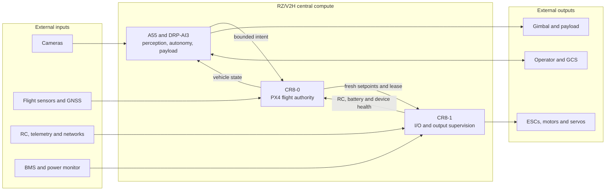

# RZ/V2H Single-SoC Autonomous Drone Solution

> **Solution positioning:** one RZ/V2H central compute SoC for perception,
> autonomy, flight control, and deterministic I/O. External sensors, cameras,
> BMS/power electronics, radios, ESCs, motors, and payload controllers remain
> part of the aircraft. Present this as a target reference architecture, not a
> production-ready or certified product.

## Contents

- [Executive summary](#executive-summary)
- [1. What single-SoC means](#1-what-single-soc-means)
- [2. Reference solution](#2-reference-solution)
- [3. External-device story](#3-external-device-story)
- [4. Customer value](#4-customer-value)
- [5. Target use cases](#5-target-use-cases)
- [6. Message and claim guide](#6-message-and-claim-guide)
- [7. Evidence and productization](#7-evidence-and-productization)
- [Sources](#sources)

## Executive summary

**One platform for onboard intelligence and real-time flight control.** RZ/V2H
combines Linux application cores, DRP-AI3 inference and two Cortex-R8 cores.
That lets a customer design one central flight computer with perception,
mission logic, PX4 flight control and supervised aircraft I/O.

The commercial opportunity is integration: fewer central compute components,
short on-chip communication paths, and a coordinated release for flight,
vision and payload software. Engineers can start with Renesas Linux/AI tools,
ROS 2 examples, PX4 interfaces and available module/carrier resources while
the customer board is being designed. The
[ecosystem guide](./rzv2h-development-ecosystem.md) identifies exactly which
assets can be reused and which integrations remain customer work.

The [Renesas datasheet](https://www.renesas.com/en/document/dst/rzv2h-group-datasheet)
provides a strong hardware basis: quad A55, dual R8, four CSI-2 inputs, and
DRP-AI capability up to 8 dense/80 sparse TOPS. Application throughput, system
power, latency and flight endurance depend on the released workload and
aircraft. They are measured outcomes, not deductions from the TOPS rating.

This is a product-development architecture. The current NuttX/PX4 port and RDK
examples supply useful starting evidence, but do not yet demonstrate a complete
flight-qualified three-domain aircraft.

| Reader | Start here | What the document enables |
|---|---|---|
| Customer/product lead | This solution brief and §4 | Select a use case and agree a measurable evaluation |
| Software/AI lead | [Development ecosystem](./rzv2h-development-ecosystem.md) | Choose a coherent profile, retrieve sources and reproduce a demo |
| Hardware/system engineer | [System specification](./rzv2h-system-specification.md#55-board-design-start-package) | Start power, memory, interfaces, resource allocation and board review |
| Flight/BSP engineer | [Software specification](./rzv2h-software-specification.md#34-developer-start-path) | Locate build inputs, implement gateways and plan bench verification |

## 1. What single-SoC means

### 1.1 Included on the central compute

| Capability | RZ/V2H domain | Target software |
|---|---|---|
| Camera perception and AI inference | Cortex-A55 + DRP-AI3 + DRP | Linux media, supported OpenCV acceleration, compiled neural models, customer-integrated VIO/SLAM and obstacle perception |
| Mission autonomy and networking | Cortex-A55 | ROS 2, aerial mission/planning applications, uXRCE-DDS agent, MAVLink/network/payload services |
| Flight management and control | CR8-0 | NuttX + PX4 estimator, commander, navigation, rate/attitude control and failsafes |
| Deterministic aircraft I/O | CR8-1 | NuttX target I/O image for RC, battery, CAN, safety inputs and leased ESC/servo outputs |

The target architecture does not use the Cortex-M33 core.

The architecture applies to customer-designed RZ/V2H platforms. The customer
selects the memory, storage, power, sensors, transceivers, connectors, Linux
distribution, and board support needed by the aircraft.

### 1.2 Still external to the SoC

- LPDDR, eMMC/SD/xSPI storage, PMICs, oscillators, reset, and transceivers.
- IMUs, barometer, magnetometer, GNSS/RTK, range and optical-flow sensors.
- Navigation and payload cameras, lenses, triggers, and optional thermal sensor.
- Battery cells, BMS, power monitor, regulators, PDB, wiring, and protection.
- RC receiver, telemetry radio, cellular/Wi-Fi modem, antennas, and Remote ID.
- ESCs, motors, servos, gimbal controller, lighting, buzzer, and other payloads.

Use **“single central compute SoC”** when the audience might interpret
“single-chip drone” literally.

### 1.3 Hardware delivery options

| Route | Customer advantage | Design responsibility |
|---|---|---|
| SOM + custom carrier | Reuse a supplier's compute, memory and local power implementation; concentrate on aircraft interfaces | Verify module pinout, thermal limits, BSP, lifecycle, debug and CR8 access; design and qualify the carrier |
| Discrete RZ/V2H board | Own the mechanical layout, component selection and production BOM | Own high-speed memory, power sequencing, signal/power integrity, boot and full board bring-up |

[OneKiwi's RZ/V2H SOM](https://onekiwi.com.vn/products/som-renesas-ai-rz-v2h/)
is a concrete supplier option with carrier and Linux BSP resources. Request the
released module design package before laying out a board; see the ecosystem
guide for its published specification and version differences. A SOM can reduce
high-speed design work, but savings in schedule, cost and weight require a
customer-specific comparison. Connector appearance alone does not establish
CM4, Jetson, SO-DIMM or SMARC electrical compatibility.

## 2. Reference solution

<!-- sys-view: context -->
**Figure 2-1: Target solution — perception to propeller coordination on one central SoC**

The architecture protects flight authority with a simple rule: Linux proposes;
PX4 decides; the I/O core applies only fresh, valid, armed output commands.
Linux or camera failure can remove autonomy features, but cannot legitimately
write motor outputs. The two R8 cores still share the SoC, so this is software
and execution-domain separation—not independent hardware redundancy.

The [system specification](./rzv2h-system-specification.md) defines device
connections and the [software specification](./rzv2h-software-specification.md)
defines the intent gateway, time synchronization and actuator lease. These are
target contracts: on-chip messaging still needs measured deadlines, cache
handling, fault containment and restart tests.

### 2.1 RDK pre-development sample

The RZ/V2H RDK can shorten evaluation before customer hardware is available. The
current reference ecosystem provides Ubuntu 24.04, ROS 2 Jazzy, Linux 6.10,
DRP-AI/ROS 2 packages, and an RDK PX4 v1.16 FreeRTOS/ROS 2 Humble drone sample.
Those are separate, versioned reference profiles; they are not one production
software release and shall not be mixed without a compatibility test.

The RDK and this repository's NuttX/PX4 board targets remain pre-development
samples. They do not define customer pins or interfaces, and the stock RDK has
no usable analog battery input. See the
[RZ/V2H ecosystem guide](./rzv2h-development-ecosystem.md) for repositories,
Yocto/Ubuntu/ROS 2 versions, AI tooling, and YOLO guidance.

## 3. External-device story

### 3.1 Battery and BMS

The preferred smart BMS connection is differential CAN when the battery is
remote or the harness is electrically noisy. Use DroneCAN in its supported
Classic CAN mode when the selected devices support it, or freeze a documented
vendor protocol that explicitly selects Classic CAN or CAN FD. For a short board-local
smart-battery link, SMBus Smart Battery Data is appropriate. SMBus resembles
I2C electrically but has a defined battery command and timing contract; it is
not “read any I2C registers.”

CR8-1 collects pack voltage/current, remaining charge, cell and temperature
information, warnings, and source health. A customer board may add a protected
ADC front end or an external digital power monitor when its safety assessment
calls for an independent measurement. PX4 on CR8-0 owns warning, return, and
landing policy; the BMS continues to own cell and pack protection.

### 3.2 Cameras, VIO, and DRP-AI3 perception

A customer board can allocate the SoC's four CSI-2 receivers to forward stereo,
a downward navigation camera, and an inspection payload. Alternative surround
layouts are possible; actual field of view, occlusions and range coverage must
be designed. Four inputs alone do not provide full-sphere obstacle avoidance.

The development path is tangible: start with a supported camera and Renesas
detector sample, add calibrated time-correlated VIO, then integrate an aerial
planner. Renesas publishes EVK model measurements, including 19.3 ms inference
for YOLOv5s; the [ecosystem benchmark section](./rzv2h-development-ecosystem.md#41-a-useful-benchmark-with-its-boundary)
records the test tuple and separates inference from camera-to-control latency.

Direct CSI-2 is useful for short local links. GMSL/FPD-Link or other SerDes
can serve remote camera heads when the selected driver, CSI format, link
budget, synchronization and harness are qualified. USB and Ethernet cameras
offer additional integration options. The system specification provides
candidate parts and the design checks; none is universally immune to motor EMI.

### 3.3 Precision landing and docking

Drone-in-a-Box is a target application built from a downward camera, calibrated
target detection, range/vehicle state, PX4 precision landing, and a separately
designed charging/docking interface.

Use an A55 CPU AprilTag detector or a separately trained and compiled neural
detector. AprilTag is not inherently a DRP-AI model. The existing PX4
[precision-landing interface](https://docs.px4.io/v1.16/en/advanced_features/precland)
accepts MAVLink `LANDING_TARGET`; a DDS landing-target path needs explicit
integration. Sub-10 cm touchdown repeatability remains a candidate customer
goal to validate across wind, lighting, target loss and approach conditions.

### 3.4 Gimbal and payload

A smart gimbal with its own stabilizing controller is preferred. MAVLink Gimbal
Protocol v2 over UART or IP carries pointing commands and status. A55 payload
software arbitrates operator, mission, and AI-tracking requests; CR8-0 supplies
trusted vehicle attitude/time and may inhibit actions by flight state. Gimbal
power uses a separately protected payload rail so a stall or reboot cannot
brown out flight compute.

### 3.5 Flight sensors and actuators

- SPI is the normal choice for high-rate board-local IMUs.
- I2C/I3C fits short, lower-rate local sensors; UART or CAN fits GNSS, LiDAR,
  air-data, and remote avionics.
- CR8-1 drives selected DShot/PWM or CAN ESC protocols under a renewable CR8-0
  output lease.
- Each ESC needs a defined local command-timeout safe state; feedback may return
  RPM, voltage, current, temperature, and faults.

The full interface and failure contract is in the
[system specification](./rzv2h-system-specification.md); software ownership and
state machines are in the
[software specification](./rzv2h-software-specification.md).

### 3.6 Predictable degraded operation

The target progresses through boot/output inhibition, readiness, guarded
arming, operation and disarming. In flight, PX4 responds to the available
estimates and configured policy. Loss of vision does not guarantee position
hold or return-to-launch if no usable position source remains.

A CR8-0 fault expires the CR8-1 output lease; loss of CR8-1 requires actuator
timeout and any independent hardware protection. Stopping thrust can prevent
runaway actuation but can also cause a crash. Any parachute/termination system
must be separately selected and qualified, and remain effective during total
SoC power loss.

## 4. Customer value

### 4.1 Why choose this architecture?

| Customer need | RZ/V2H opportunity | Evidence for the buying decision |
|---|---|---|
| Compact integrated avionics | Application, AI and real-time compute reside on one SoC | Compare complete populated compute assemblies, including memory, regulators and cooling |
| Local perception without continuous cloud processing | Run compiled models alongside Linux camera services | Demonstrate accuracy and frame age on customer imagery |
| Reuse familiar development tools | Linux/Yocto, ROS 2, PX4 interfaces and NuttX source | Rebuild a pinned example and inspect the resulting source/license inventory |
| Product-specific payloads | Camera, gimbal, BMS and radio interfaces are explicit | Exercise the actual selected devices and fault behavior |
| Control over the product lifecycle | Own board support, manifests, calibration and updates | Demonstrate reproducible builds and a recoverable multi-image update |

Compared with a companion computer plus a separate flight controller, the
single-SoC route offers consolidation and on-chip communication. A separate
flight controller offers a distinct compute/power failure boundary. Choose
using the aircraft requirements and measured total-system results, not a
comparison of sparse TOPS against unrelated dense or GPU ratings.

### 4.2 Customer evaluation: three demonstrations

| Demonstration | Reuse now | Customer-facing evidence |
|---|---|---|
| **See:** camera to AI result | RDK Linux/ROS 2 and a locked DRP-AI detector example | Customer-scene accuracy, annotated recording, frame drops, latency and temperature |
| **Control:** sensor to supervised output | PX4/NuttX CR8 bench profiles; implement the CR8-1 lease | Timestamped physical sensors, battery/RC health and scoped safe-output behavior without propellers |
| **Integrate:** autonomy with fault handling | Customer VIO/planner and validated A55↔CR8 gateway | Joint-load timing, rejected stale intent, Linux restart and continued eligible PX4 operation |

Agree the pass criteria before evaluation. Report model inference, complete
perception latency, transport latency and actuator response separately. Measure
compute energy and complete aircraft energy before claiming endurance gains;
payload and propulsion often dominate the aircraft budget.

### 4.3 Honest trade-offs

- One SoC is a common power, clock, thermal, and silicon failure domain.
- Integration increases board-design and bring-up complexity.
- Linux, PX4, CR8 I/O, AI models, and devices still need coordinated lifecycle
  and compatibility management.
- A flight-ready product requires persistent storage, secure boot/update,
  target-proven IPC, electrical qualification, and extensive fault testing.

## 5. Target use cases

| Use case | Reference configuration | Value delivered | Validation gate |
|---|---|---|---|
| Autonomous Drone-in-a-Box | Downward camera, target detector, range aid, BMS and docking controller | Repeatable approach and docking with energy-aware missions | Touchdown error distribution, target-loss response and protected charge interlocks |
| Surround obstacle perception | Customer-defined multi-camera layout and depth/planning pipeline | Wider situational awareness with onboard processing | FOV/occlusion coverage, depth error and end-to-end reaction distance |
| GPS-denied inspection | Calibrated camera/IMU VIO with range/flow aids as appropriate | Local navigation where GNSS is unavailable | Drift, time sync, estimator transitions and environmental limits |
| Industrial asset inspection | EO/IR camera, stabilized gimbal and defect model | Local image analysis and selective data upload | Image/model accuracy, payload interoperability and power disturbance tests |
| Aerial mapping and survey | Global shutter, GNSS/RTK and capture-event timing | Time-correlated imagery and position records | Camera-center/geotag error, calibration and storage throughput |
| Public-safety observation | EO/IR gimbal and region-appropriate secure links | Onboard observation and adaptable backhaul | Security, privacy, RF and operational approval |

Airframe, payload, endurance, range, link availability, and regulatory status
remain customer- and configuration-specific.

## 6. Message and claim guide

### 6.1 Recommended messages

1. **“One RZ/V2H central compute SoC from perception to flight control.”**
2. **“Linux and DRP-AI3 for vision; dual Cortex-R8 for flight and I/O.”**
3. **“PX4 retains flight authority while Linux autonomy supplies bounded intent.”**
4. **“Connect smart batteries, cameras, gimbals, radios, sensors, and ESCs using
   standards-based interfaces.”**
5. **“A reference architecture for consolidating companion compute and flight
   compute—not a claim that external avionics disappear.”**

### 6.2 Claims requiring qualifiers

| Topic | Recommended form | Avoid |
|---|---|---|
| AI performance | “DRP-AI3, up to 80 TOPS with Renesas pruning conditions; workload results require measurement.” | A naked TOPS number implying application throughput |
| Cooling/efficiency | “Designed for power-efficient embedded AI; thermal solution depends on workload and enclosure.” | “No cooling required” without a thermal test |
| Safety | “Separated Linux, flight, and I/O execution domains with fail-silent target behavior.” | “Physically isolated,” “cannot fail,” or a certification claim |
| Single chip | “Single central compute SoC.” | “The entire drone is one chip” |
| Power/weight/cost | “Potential reduction by removing a separate companion compute board.” | Universal percentages or savings without a measured comparison |
| Autonomy | “Target reference architecture for onboard perception and autonomy.” | “Fully autonomous/production ready” before system validation |
| Radio/regulation | “Supports integration of region-appropriate modules.” | Fixed range, universal cellular support, or compliance before approval |

### 6.3 Optional-feature caution

RZ/V2H ordering codes vary in optional GPU, ISP, and security features. Sales
and engineering material shall identify the exact selected part before claiming
those blocks. “RZ/V2H family supports” is not proof that a specific BOM does.

### 6.4 Safety and market qualification

Define the jurisdiction, aircraft and operation before selecting an assurance
route. [FAA waiver guidance](https://www.faa.gov/uas/commercial_operators/part_107_waivers)
and [EASA specific-category guidance](https://www.easa.europa.eu/en/domains/drones-air-mobility/operating-drone/specific-category-civil-drones)
are starting references, not approvals for this design. Dual cores, watchdogs,
PX4/NuttX or a parachute do not establish a DAL, SAIL or failure probability.

The system specification retains a preliminary hazard/containment analysis and
the evidence needed to develop the aircraft safety case.

## 7. Evidence and productization

### 7.1 What exists today

- An RDK-based PX4/NuttX RZ/V2H CR8-0 pre-development port with build-clean
  integration paths.
- Bounded on-target SIH evidence for a simulation-only profile.
- Source/build scaffolding for CR8-1, MHU/shared-memory IPC, CRC/sequence checks,
  and multiple peripheral drivers.
- Build-clean PWM and opt-in TX-only DShot paths that still need physical proof.
- Reference RDK NuttX/PX4 board configurations whose peripheral assignments
  must be adapted to the customer's flight-controller hardware.

### 7.2 What does not exist yet

- A flight-validated physical-sensor and motor aircraft image.
- Enabled, fully implemented, safety-validated CR8-0↔CR8-1 PX4 I/O operation.
- Integrated A55 Linux/DRP-AI3 camera/autonomy product image.
- Selected BMS, cameras, gimbal, radio, ESCs, memory, storage, and production PCB.
- A released customer flight-controller board and validated battery interface;
  the RDK has no analog battery path, so that option requires customer hardware.
- Production boot/update/security, fleet identity, persistent parameters, and
  aircraft qualification evidence.

### 7.3 Productization sequence

1. Freeze aircraft requirements, safety target, exact SoC ordering code, and
   external-device ICD.
2. Prove CR8-0 physical sensors, timing, storage, reset, and motor output.
3. Implement CR8-1 I/O, output lease, BMS/RC/CAN, and safe timeout behavior.
4. Validate inter-core reset, cache, corruption, overload, and latency behavior.
5. Integrate A55 Linux, cameras, DRP-AI3, DDS, VIO, mission, gimbal, and network.
6. Run power, thermal, EMI/EMC, security, HIL, tethered flight, envelope
   expansion, and endurance campaigns.
7. Publish performance and customer claims only from the released configuration
   and named test evidence.

## Sources

- [Renesas RZ/V2H product page](https://www.renesas.com/en/products/rz-v2h)
- [Renesas RZ/V2H Group Datasheet Rev.1.40](https://www.renesas.com/en/document/dst/rzv2h-group-datasheet)
- [PX4 ROS 2 User Guide](https://docs.px4.io/main/en/ros2/user_guide)
- [PX4 Power Systems](https://docs.px4.io/main/en/power_systems/)
- [PX4 Smart Batteries](https://docs.px4.io/v1.14/en/smart_batteries/)
- [Smart Battery Data Specification](https://www.sbs-forum.org/specs/sbdat110.pdf)
- [PX4 DroneCAN](https://docs.px4.io/main/en/dronecan/)
- [PX4 DShot](https://docs.px4.io/main/en/peripherals/dshot)
- [PX4 MAVLink Camera v2](https://docs.px4.io/main/en/camera/mavlink_v2_camera)
- [PX4 Gimbal Configuration](https://docs.px4.io/main/en/advanced/gimbal_control)
- [RZ/V2H NuttX port status](../port-status-nuttx.md)
- [RZ/V2H PX4 HAL status](../port-status-px4-hal.md)
- [RZ/V2H IPC architecture](../ipc-architecture.md)
- [RZ/V2H development ecosystem and RDK pre-development guide](./rzv2h-development-ecosystem.md)
- [RZ/V2H system specification](./rzv2h-system-specification.md)
- [RZ/V2H software specification](./rzv2h-software-specification.md)
