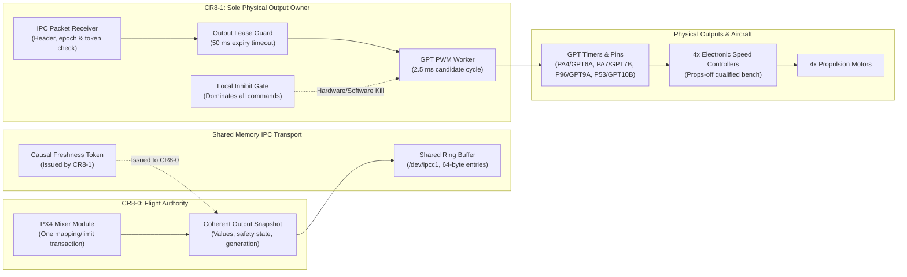
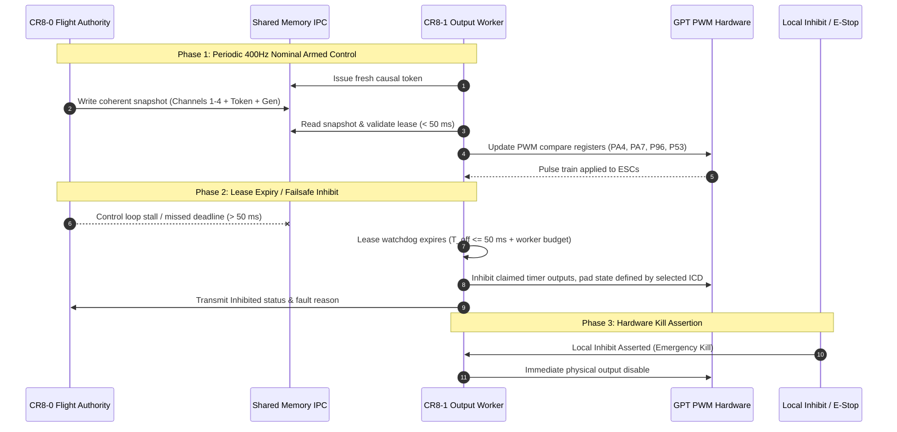

# Actuator safety and physical outputs

## Purpose and authority

This module owns **CR8-1 sole physical output owner** for the exact-BOM two-CR8 demo. The user approved this boundary and the [umbrella registry](./rzv2h-demo-requirements.md) on 2026-10-21. Existing parent requirements remain unchanged: SYS-ARC-004; SYS-SAF-001/004/005; SW-DEV-005. The registry owns allocation; the requirement rows below are synchronized module views, not an independent allocation authority.

Revision 1.0 records the approved target design. “Verified” in requirement evidence means the target contract is documented in the approved design, not that firmware implements it. Every implementation/physical test gap below remains open. Current staging behavior is a migration reference. A55/cameras/CM33 are outside demo runtime. Props-off qualification retains full product-service requirements.

## Module ownership

| Path | Classification | Owner | Notes |
|---|---|---|---|
| [actuator-lease.hpp](../../../src/apps/actuator-lease.hpp) / [actuator-lease.cpp](../../../src/apps/actuator-lease.cpp) | product-owned | CR8-1 sole physical output owner | Canonical lease state machine (`ActuatorLease`), causal freshness token validation, reason codes |
| [output-worker.hpp](../../../src/apps/output-worker.hpp) | product-owned | CR8-1 sole physical output owner | Independent output worker thread (`OutputWorker`), execution cycle, HAL submission, clamp on lease expiry |
| [output-status.hpp](../../../src/apps/output-status.hpp) | product-owned | CR8-1 sole physical output owner | Supervised status reporting (`OutputStatusStore`, `supervised_status`) merging control lease and worker state |
| [output-configuration.hpp](../../../src/apps/output-configuration.hpp) | product-owned | CR8-1 sole physical output owner | Channel rates, pulse constraints, and output profile definitions |
| [io-supervisor.cpp](../../../boards/renesas/rdk-rzv2h-io-cr8_1/rzv2h_io/io-supervisor.cpp) | product-owned | CR8-1 sole physical output owner | CR8-1 output supervisor integrating worker and lease manager |
| [output-lease.cpp](../../../boards/renesas/rdk-rzv2h-io-cr8_1/rzv2h_io/output-lease.cpp) | legacy/reference | CR8-1 sole physical output owner | Legacy bridge lease state and expiry authority |
| `px4io_cr8.cpp` (removed 2026-11-18; git history) | retired reference | CR8-1 sole physical output owner | Legacy backend worker/relay reference |
| [timer_config.cpp](../../../boards/renesas/rdk-rzv2h/src/timer_config.cpp) | legacy/reference | CR8-1 sole physical output owner | Four-channel mapping migration evidence |
| [pwm_servo.c](../../../platforms/nuttx/src/px4/renesas/rzv/io_pins/pwm_servo.c) | product-owned | CR8-1 sole physical output owner | Selected backend physical submission/disable HAL |

Behavioral slices in a shared bridge file do not grant simultaneous write ownership. IPC owns codec/epoch handling, flight control owns producer/readiness consumption, battery owns sample semantics, and actuator safety owns lease/worker inhibition. Integrate those edits sequentially; mirrors have no independent schema authority.

## Interfaces and behavior

The following is the approved target contract with explicit hardware gaps. Exact layouts and block/data-flow/state/sequence diagrams remain in the [engineering design](./rzv2h-dualcr8-demo-design.md); the [architecture](./rzv2h-dualcr8-demo-architecture.md) explains system boundaries without duplicating normative authority.

**Figure 1: Actuator safety architecture and physical output pipeline**

| Interface | Direction | Contract / limit |
|---|---|---|
| Commands | Validated CR8-0 snapshot → lease | Four final channel values; no CR8-1 remapping |
| Physical output | Worker → four ESCs | DShot selected as primary protocol on PA4/GPT6A, PA7/GPT7B, P96/GPT9A, P53/GPT10B; PWM 400Hz retained as backup requiring qualification |
| Local inhibit | Selected kill interface → worker/hardware | Dominates received commands; physical independence still requires qualification |
| Status | Worker/latch → reporter → CR8-0 | initialized-safe, recovery-eligible and arm-ready distinct |

### State and fault transitions

These are target integration states, not claims that enums or handlers already exist.

**Figure 2: Actuator safety and output lease state machine**

```mermaid
stateDiagram-v2
    [*] --> Unclaimed : System Boot / Reset

    Unclaimed --> InitializedSafe : Compatible current-epoch role hello
    note right of InitializedSafe : Claim & init selected resources; outputs electrically inactive

    InitializedSafe --> Ready : Fresh token-bound disarmed handshake
    note right of Ready : Disarmed safe state; ready for arming authority

    Ready --> Armed : Fresh armed authority & all safety gates pass
    note right of Armed : Apply bounded PWM setpoints to ESCs

    Armed --> Inhibited : Stop / expired authority / backend fault / selected local kill
    note right of Inhibited : Disable physical outputs; latch safe shutdown

    Inhibited --> Ready : Safe backend, fresh disarmed handshake and worker acknowledgement
```

| From | Event / guard | To | Action / recovery constraint |
|---|---|---|---|
| Unclaimed | Compatible current-epoch role/resource hello | InitializedSafe | Claim and initialize only selected resources |
| InitializedSafe | Fresh token-bound disarmed stop handshake | Ready | Remain electrically inactive |
| Ready | Fresh armed authority and all gates satisfied | Armed | Apply bounded selected-channel values |
| Armed | Stop/kill/expiry/backend fault | Inhibited | Disable physical output |
| Inhibited | Safe backend and fresh disarmed handshake acknowledged by worker | Ready | Hardware faults first require module reinitialization; stop alone is not a backend fault |

**Figure 3: Real-time actuator command dispatch, lease expiry, and kill interlock sequence**

### Configuration and persistence

| Parameter / contract | Selected value / gap | Owner / persistence boundary |
|---|---|---|
| Output protocol & bounds | DShot primary, PWM 400Hz backup | CR8-1 validates protocol, rate, and timer compare representation |
| DIS values | Preserved CR8-0 configuration | Final inhibit masks standby pulses |
| Worker period | 2.5 ms candidate | Physical bound = 50 ms + worker period + measured scheduler/HAL budget |
| Inactive pad/gate state | Selected electrical ICD | High impedance alone is not a universal safe level |

## Requirements registry

| ID | Requirement | Evidence | Confidence |
|---|---|---|---|
| SDS-ACT-001 | CR8-1 shall remain the sole physical output owner in the new pair. | [Approved target design](./rzv2h-dualcr8-demo-design.md#6-link-lease-and-output-state-models) | verified |
| SDS-ACT-002 | An unclaimed backend shall avoid output-resource writes. | [Approved target design](./rzv2h-dualcr8-demo-design.md#6-link-lease-and-output-state-models) | verified |
| SDS-ACT-003 | Product boot/reset/negotiation/standby shall remain electrically inactive. | [Approved target design](./rzv2h-dualcr8-demo-design.md#6-link-lease-and-output-state-models) | verified |
| SDS-ACT-004 | The worker shall enforce the qualified physical shutdown bound. | [Approved target design](./rzv2h-dualcr8-demo-design.md#6-link-lease-and-output-state-models) | verified |
| SDS-ACT-005 | A backend failure shall latch output inhibition. | [Approved target design](./rzv2h-dualcr8-demo-design.md#6-link-lease-and-output-state-models) | verified |
| SDS-ACT-006 | Recovery shall require a fresh current-epoch disarmed handshake. | [Approved target design](./rzv2h-dualcr8-demo-design.md#6-link-lease-and-output-state-models) | verified |
| SDS-ACT-007 | A local kill request shall dominate received actuator commands. | [Approved target design](./rzv2h-dualcr8-demo-design.md#6-link-lease-and-output-state-models) | verified |
| SDS-ACT-008 | Full acceptance shall require qualified reset/core-halt containment. | [Approved target design](./rzv2h-dualcr8-demo-design.md#6-link-lease-and-output-state-models) | verified |
| SDS-ACT-009 | A valid stop-motors command shall inhibit every motor channel. | [Approved target design](./rzv2h-dualcr8-demo-design.md#6-link-lease-and-output-state-models) | verified |

## Verification matrix

The methods below define required future proof. Existing source/reference coverage in the evidence ledger is partial and does not close a new-pair test.

| ID | Method | Level | Pass criterion | Existing test/gap | Code-review criterion |
|---|---|---|---|---|---|
| SDS-ACT-001 | analysis + test | integration/system | Selected CR8-0 init/reset/runtime never touches output GPT/pads. | gap: full integration and physical acceptance evidence pending | Single mutable hardware owner |
| SDS-ACT-002 | analysis + test | integration/system | Wrong/absent role hello produces zero pin/GPT/reset/cleanup writes. | gap: full integration and physical acceptance evidence pending | Post-hello claim and claimed-only unwind |
| SDS-ACT-003 | analysis + test | integration/system | Connector has no active pulse train with nonzero DIS stored across each listed condition. | gap: full integration and physical acceptance evidence pending | Final inhibit and reset containment |
| SDS-ACT-004 | analysis + test | integration/system | External capture T_off is at most 50 ms + worker period + declared measured scheduler/HAL budget. | gap: full integration and physical acceptance evidence pending | Independent worker timing |
| SDS-ACT-005 | analysis + test | integration/system | Init/apply failure stays inhibited despite a live reporting/control loop. | gap: full integration and physical acceptance evidence pending | Worker-owned latch |
| SDS-ACT-006 | analysis + test | integration/system | No queued old armed frame or reinitialization alone restores output. | gap: full integration and physical acceptance evidence pending | Separate recovery eligibility from arm-ready |
| SDS-ACT-007 | analysis + test | integration/system | Concurrent valid armed messages cannot override asserted local inhibit. | gap: full integration and physical acceptance evidence pending | Independent command versus final gate |
| SDS-ACT-008 | analysis + test | integration/system | Warm active reset and whole-core halt have distinct measured outcomes satisfying the selected hardware safety contract. | gap: full integration and physical acceptance evidence pending | No retained GPT pulse hidden by software-only proof |
| SDS-ACT-009 | analysis + test | integration/system | All four channels inactive with stop asserted irrespective of stored DIS. | gap: full integration and physical acceptance evidence pending | Stop precedence and per-channel zero separation |

## Traceability

| ID | Design or behavior trace | Test trace | Review trace |
|---|---|---|---|
| SDS-ACT-001 | [Interfaces and behavior](#interfaces-and-behavior) | [Verification matrix](#verification-matrix) | [Review criteria](#review-criteria) |
| SDS-ACT-002 | [Interfaces and behavior](#interfaces-and-behavior) | [Verification matrix](#verification-matrix) | [Review criteria](#review-criteria) |
| SDS-ACT-003 | [Interfaces and behavior](#interfaces-and-behavior) | [Verification matrix](#verification-matrix) | [Review criteria](#review-criteria) |
| SDS-ACT-004 | [Interfaces and behavior](#interfaces-and-behavior) | [Verification matrix](#verification-matrix) | [Review criteria](#review-criteria) |
| SDS-ACT-005 | [Interfaces and behavior](#interfaces-and-behavior) | [Verification matrix](#verification-matrix) | [Review criteria](#review-criteria) |
| SDS-ACT-006 | [Interfaces and behavior](#interfaces-and-behavior) | [Verification matrix](#verification-matrix) | [Review criteria](#review-criteria) |
| SDS-ACT-007 | [Interfaces and behavior](#interfaces-and-behavior) | [Verification matrix](#verification-matrix) | [Review criteria](#review-criteria) |
| SDS-ACT-008 | [Interfaces and behavior](#interfaces-and-behavior) | [Verification matrix](#verification-matrix) | [Review criteria](#review-criteria) |
| SDS-ACT-009 | [Interfaces and behavior](#interfaces-and-behavior) | [Verification matrix](#verification-matrix) | [Review criteria](#review-criteria) |

## Review criteria

Review each verification-row boundary against the actual selected profile and source change. Reject double ownership, stale data promoted to fresh authority, implicit hardware selection, cross-clock subtraction and promotion of a build/ACK into physical proof. Resolve each test gap with a named artifact before claiming its requirement passed. A hardware-dependent record stays blocked until its ICD is frozen; independent source work remains possible.

## Evidence ledger

| Claim / requirement | Evidence location | Confidence | Status / gap |
|---|---|---|---|
| Approved module requirements | [Engineering design](./rzv2h-dualcr8-demo-design.md) | verified | Target design authority only |
| Current software boundary | [io-supervisor.cpp](../../../boards/renesas/rdk-rzv2h-io-cr8_1/rzv2h_io/io-supervisor.cpp) | verified | PWM candidate with unconfigured hardware; see [software receipt](../evidence/dualcr8-software-validation-261021.md), no admitted pair |
| Related source/test evidence | [Subsystem evidence](../../../plans/reports/research-261021-0230-product-subsystems.md) | verified | Historical source review; rerun affected tests during implementation |
| Full module acceptance | [Verification matrix](#verification-matrix) | unknown | Required test/physical results pending |

Partial existing coverage: [rzv2h_gpt_pwm_contract_test.py](../../../test/rzv2h_gpt_pwm_contract_test.py). Source/HAL contracts only; not connector waveform or core-halt containment. This test was not executed during specification authoring.

## Open inputs and acceptance gaps

ESC protocol is locked as DShot primary with PWM 400Hz backup; exact ESC device revision, pad bias, command timeout, independent kill/containment hardware and warm-reset GPT retention remain qualification work. No physical containment claim covers a halted core solely because a software lease exists.

The [shared hardware-input ledger](./rzv2h-demo-requirements.md#hardware-input-gates) names closure evidence. Unknown hardware remains an input gate rather than a substituted part number or a waived requirement.
