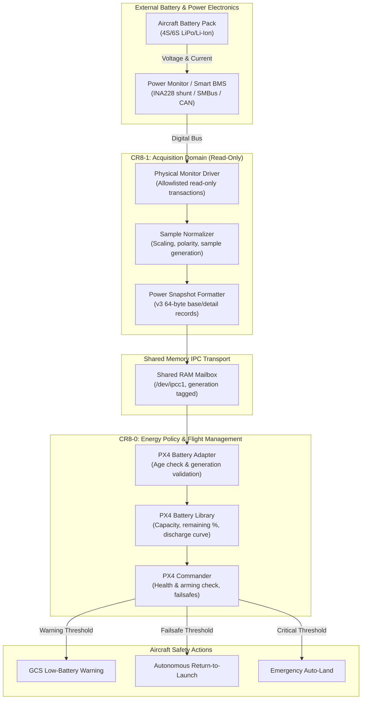
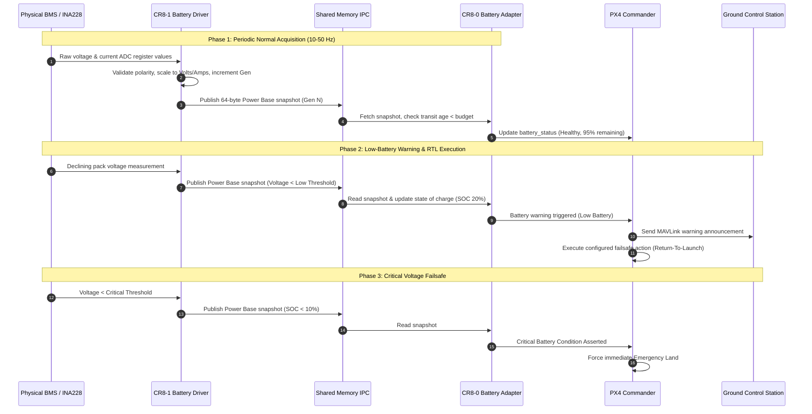

# Battery and power

## Purpose and authority

This module owns **CR8-1 acquisition with CR8-0 energy policy** for the exact-BOM two-CR8 demo. The user approved this boundary and the [umbrella registry](./rzv2h-demo-requirements.md) on 2026-10-21. Existing parent requirements remain unchanged: SYS-IF-003/004/008; SYS-SAF-004; SW-DEV-002. The registry owns allocation; the requirement rows below are synchronized module views, not an independent allocation authority.

Revision 1.0 records the approved target design. “Verified” in requirement evidence means the target contract is documented in the approved design, not that firmware implements it. Every implementation/physical test gap below remains open. Current staging behavior is a migration reference. A55/cameras/CM33 are outside demo runtime. Props-off qualification retains full product-service requirements.

## Module ownership

| Path | Classification | Owner | Notes |
|---|---|---|---|
| [battery.hpp](../../../src/apps/battery.hpp) / [battery.cpp](../../../src/apps/battery.cpp) | product-owned | CR8-1 acquisition with CR8-0 energy policy | Canonical power snapshot parser/formatter (`BatteryFrameParser`, `BatterySnapshot`), generation tracking, validity masks, transit budget, and SOC calculation |
| [protocol.hpp](../../../src/apps/protocol.hpp) | product-owned | CR8-1 acquisition with CR8-0 energy policy | Wire definition and codecs for `DEMO_BATTERY_BASE` (0x12) and `DEMO_BATTERY_DETAIL` (0x14) |
| [ina228](../../../src/drivers/power_monitor/ina228/) | legacy/reference | CR8-1 acquisition with CR8-0 energy policy | Candidate conversion/shunt implementation; does not select hardware |
| [batt_smbus](../../../src/drivers/batt_smbus/) | legacy/reference | CR8-1 acquisition with CR8-0 energy policy | Candidate read logic; no implicit manufacturer/protection-write permission |
| [battery](../../../src/lib/battery/) | product-owned | CR8-1 acquisition with CR8-0 energy policy | CR8-0 normalization/energy policy boundary |
| [batteryCheck.cpp](../../../src/modules/commander/HealthAndArmingChecks/checks/batteryCheck.cpp) | product-owned | CR8-1 acquisition with CR8-0 energy policy | Battery health readiness and source loss |

Behavioral slices in a shared bridge file do not grant simultaneous write ownership. IPC owns codec/epoch handling, flight control owns producer/readiness consumption, battery owns sample semantics, and actuator safety owns lease/worker inhibition. Integrate those edits sequentially; mirrors have no independent schema authority.

## Interfaces and behavior

The following is the approved target contract with explicit hardware gaps. Exact layouts and block/data-flow/state/sequence diagrams remain in the [engineering design](./rzv2h-dualcr8-demo-design.md); the [architecture](./rzv2h-dualcr8-demo-architecture.md) explains system boundaries without duplicating normative authority.

**Figure 1: Battery acquisition and flight energy policy architecture**



| Interface | Direction | Contract / limit |
|---|---|---|
| Selected BMS/monitor | External → CR8-1 | Device/bus/pins, scales, current sign, pack ID and validity fixed by ICD |
| Power base/detail | CR8-1 → CR8-0 | Proposed v3 64-byte records; same epoch/source/acquisition generation |
| Battery status | CR8-0 adapter → PX4 policy | V, A, temperature/capacity if available; unknown stays unavailable |
| Protection | External BMS | Monitoring does not implement cell protection |

### State and fault transitions

These are target integration states, not claims that enums or handlers already exist.

**Figure 2: Battery acquisition lifecycle and freshness state machine**

```mermaid
stateDiagram-v2
    [*] --> Unidentified : Power-On / Reset

    Unidentified --> Acquiring : Approved device ICD & identity match
    note right of Acquiring : Read-only acquisition started; validating conversion parameters

    Acquiring --> Valid : Valid physical conversion completed
    note right of Valid : Advance sample generation counter; forward to CR8-0

    Valid --> Stale : Acquisition fails OR age exceeds budget
    note right of Stale : Sample flagged invalid; health checker triggers warning

    Stale --> Acquiring : Fresh identified acquisition restored
    note right of Acquiring : Revalidate source integrity before declaring healthy
```

| From | Event / guard | To | Action / recovery constraint |
|---|---|---|---|
| Unidentified | Approved device ICD and identity match | Acquiring | Bounded read-only acquisition |
| Acquiring | Valid physical conversion completed | Valid | Advance sample generation |
| Valid | Acquisition fails or age exceeds budget | Stale | Report invalidity despite live reporter |
| Stale | Fresh identified acquisition | Acquiring | Revalidate source and policy before healthy |

**Figure 3: Periodic power measurement, transport, and low-battery failsafe sequence**



### Configuration and persistence

| Parameter / contract | Selected value / gap | Owner / persistence boundary |
|---|---|---|
| BAT1_SOURCE | Actual selected route; not -1 for acceptance | CR8-0 |
| Pack/cell/capacity and warning parameters | Unknown until pack/aircraft ICD | CR8-0 policy |
| INA228_SHUNT/CURRENT/CONFIG | Candidate symbols only; no selected default | Acquisition calibration if INA228 selected |
| Sample/stale budgets | Unknown until device and transport load qualification | Source generation plus conservative source age/transit/local elapsed |

## Requirements registry

| ID | Requirement | Evidence | Confidence |
|---|---|---|---|
| SDS-POWER-001 | CR8-1 shall acquire battery data from the selected physical source. | [Approved target design](./rzv2h-dualcr8-demo-design.md#42-battery-acquisition-progress-and-bounded-age) | verified |
| SDS-POWER-002 | Battery acquisition shall remain read-only at the pack interface. | [Approved target design](./rzv2h-dualcr8-demo-design.md#42-battery-acquisition-progress-and-bounded-age) | verified |
| SDS-POWER-003 | A battery sample generation shall advance only after a successful new acquisition. | [Approved target design](./rzv2h-dualcr8-demo-design.md#42-battery-acquisition-progress-and-bounded-age) | verified |
| SDS-POWER-004 | The battery adapter shall invalidate samples exceeding the qualified age budget. | [Approved target design](./rzv2h-dualcr8-demo-design.md#42-battery-acquisition-progress-and-bounded-age) | verified |
| SDS-POWER-005 | The battery adapter shall preserve unsupported fields as unavailable. | [Approved target design](./rzv2h-dualcr8-demo-design.md#42-battery-acquisition-progress-and-bounded-age) | verified |
| SDS-POWER-006 | The battery adapter shall enforce the selected units/sign contract. | [Approved target design](./rzv2h-dualcr8-demo-design.md#42-battery-acquisition-progress-and-bounded-age) | verified |
| SDS-POWER-007 | The battery adapter shall reject mismatched base/detail generations. | [Approved target design](./rzv2h-dualcr8-demo-design.md#42-battery-acquisition-progress-and-bounded-age) | verified |
| SDS-POWER-008 | CR8-0 shall apply ordinary battery warning/source-loss policy. | [Approved target design](./rzv2h-dualcr8-demo-design.md#42-battery-acquisition-progress-and-bounded-age) | verified |

## Verification matrix

The methods below define required future proof. Existing source/reference coverage in the evidence ledger is partial and does not close a new-pair test.

| ID | Method | Level | Pass criterion | Existing test/gap | Code-review criterion |
|---|---|---|---|---|---|
| SDS-POWER-001 | analysis + test | integration/system | Calibrated physical stimulus matches measured values; synthetic or disabled-battery inputs cannot close acceptance. | gap: new-pair tests and physical evidence pending | Device ICD and sole acquisition owner |
| SDS-POWER-002 | analysis + test | integration/system | No manufacturer/protection/configuration write is reachable in normal acquisition. | gap: new-pair tests and physical evidence pending | Allowlisted device transactions |
| SDS-POWER-003 | analysis + test | integration/system | Frozen acquisition with live reporter never advances source generation. | gap: new-pair tests and physical evidence pending | Measurement versus publication sequence |
| SDS-POWER-004 | analysis + test | integration/system | Source age plus bounded transit plus receiver elapsed exceeds limit and reports stale. | gap: new-pair tests and physical evidence pending | No subtraction of unrelated clocks |
| SDS-POWER-005 | analysis + test | integration/system | Missing cell/temperature/capacity fields never become healthy zero-valued measurements. | gap: new-pair tests and physical evidence pending | Validity mask and field normalization |
| SDS-POWER-006 | analysis + test | integration/system | Positive discharge, valid zero current and invalid reading are distinguishable with calibrated input. | gap: new-pair tests and physical evidence pending | Conversion, scaling and polarity |
| SDS-POWER-007 | analysis + test | integration/system | Mixed epoch/source/sample-generation fragments cannot form a valid pack snapshot. | gap: new-pair tests and physical evidence pending | Cross-frame assembly identity |
| SDS-POWER-008 | analysis + test | integration/system | Selected threshold and disconnect tests produce the required readiness/action reasons without bypass. | gap: new-pair tests and physical evidence pending | Feasible aircraft action and energy state |

## Traceability

| ID | Design or behavior trace | Test trace | Review trace |
|---|---|---|---|
| SDS-POWER-001 | [Interfaces and behavior](#interfaces-and-behavior) | [Verification matrix](#verification-matrix) | [Review criteria](#review-criteria) |
| SDS-POWER-002 | [Interfaces and behavior](#interfaces-and-behavior) | [Verification matrix](#verification-matrix) | [Review criteria](#review-criteria) |
| SDS-POWER-003 | [Interfaces and behavior](#interfaces-and-behavior) | [Verification matrix](#verification-matrix) | [Review criteria](#review-criteria) |
| SDS-POWER-004 | [Interfaces and behavior](#interfaces-and-behavior) | [Verification matrix](#verification-matrix) | [Review criteria](#review-criteria) |
| SDS-POWER-005 | [Interfaces and behavior](#interfaces-and-behavior) | [Verification matrix](#verification-matrix) | [Review criteria](#review-criteria) |
| SDS-POWER-006 | [Interfaces and behavior](#interfaces-and-behavior) | [Verification matrix](#verification-matrix) | [Review criteria](#review-criteria) |
| SDS-POWER-007 | [Interfaces and behavior](#interfaces-and-behavior) | [Verification matrix](#verification-matrix) | [Review criteria](#review-criteria) |
| SDS-POWER-008 | [Interfaces and behavior](#interfaces-and-behavior) | [Verification matrix](#verification-matrix) | [Review criteria](#review-criteria) |

## Review criteria

Review each verification-row boundary against the actual selected profile and source change. Reject double ownership, stale data promoted to fresh authority, implicit hardware selection, cross-clock subtraction and promotion of a build/ACK into physical proof. Resolve each test gap with a named artifact before claiming its requirement passed. A hardware-dependent record stays blocked until its ICD is frozen; independent source work remains possible.

## Evidence ledger

| Claim / requirement | Evidence location | Confidence | Status / gap |
|---|---|---|---|
| Approved module requirements | [Engineering design](./rzv2h-dualcr8-demo-design.md) | verified | Target design authority only |
| Current migration and implementation boundaries | [ina228](../../../src/drivers/power_monitor/ina228/) | verified | Source location exists; no integrated new-pair result |
| Related source/test evidence | [Subsystem evidence](../../../plans/reports/research-261021-0230-product-subsystems.md) | verified | Historical source review; rerun affected tests during implementation |
| Full module acceptance | [Verification matrix](#verification-matrix) | unknown | Required test/physical results pending |

Partial existing coverage: [rzv2h-drone-artifact-contract-test.py](../../../test/rzv2h-drone-artifact-contract-test.py). Legacy INA228 selection only; not battery normalization/freshness evidence. This test was not executed during specification authoring.

## Open inputs and acceptance gaps

No BMS/monitor, pack chemistry/capacity, bus/pins, shunt, stale budget or low-energy action is selected. Required read-only acquisition service and PX4 adapter remain new work.

The [shared hardware-input ledger](./rzv2h-demo-requirements.md#hardware-input-gates) names closure evidence. Unknown hardware remains an input gate rather than a substituted part number or a waived requirement.
