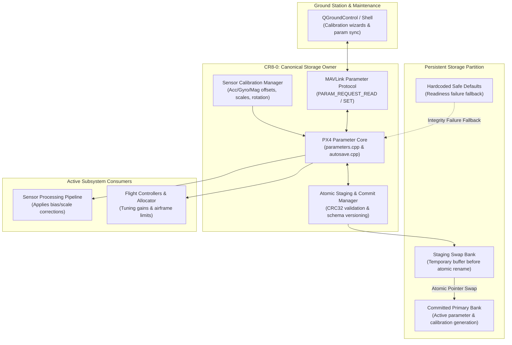
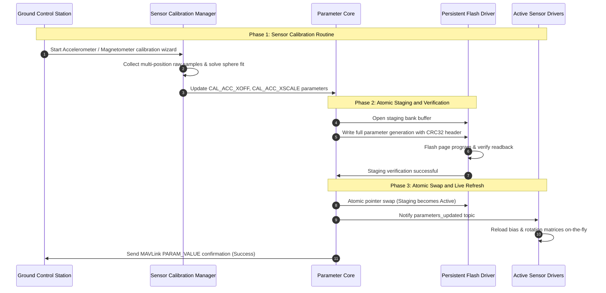

# Calibration and persistent storage

## Purpose and authority

This module owns **CR8-0 canonical records with one selected medium owner** for the exact-BOM two-CR8 demo. The user approved this boundary and the [umbrella registry](./rzv2h-demo-requirements.md) on 2026-10-21. Existing parent requirements remain unchanged: SW-CFG-001/002; SYS-SAF-005. The registry owns allocation; the requirement rows below are synchronized module views, not an independent allocation authority.

Revision 1.0 records the approved target design. “Verified” in requirement evidence means the target contract is documented in the approved design, not that firmware implements it. Every implementation/physical test gap below remains open. Current staging behavior is a migration reference. A55/cameras/CM33 are outside demo runtime. Props-off qualification retains full product-service requirements.

## Module ownership

| Path | Classification | Owner | Notes |
|---|---|---|---|
| [parameters.cpp](../../../src/lib/parameters/parameters.cpp) | product-owned | CR8-0 canonical records with one selected medium owner | Atomic save/recovery integration |
| [autosave.cpp](../../../src/lib/parameters/autosave.cpp) | product-owned | CR8-0 canonical records with one selected medium owner | Mode-safe deferred save |
| [sensor_calibration](../../../src/lib/sensor_calibration/) | product-owned | CR8-0 canonical records with one selected medium owner | Identity-bound calibration record management |
| [defconfig](../../../boards/renesas/rdk-rzv2h/nuttx-config/dualcr8/defconfig) | legacy/reference | CR8-0 canonical records with one selected medium owner | Current volatile PARAMFS baseline; no durability proof |

Behavioral slices in a shared bridge file do not grant simultaneous write ownership. IPC owns codec/epoch handling, flight control owns producer/readiness consumption, battery owns sample semantics, and actuator safety owns lease/worker inhibition. Integrate those edits sequentially; mirrors have no independent schema authority.

## Interfaces and behavior

The following is the approved target contract with explicit hardware gaps. Exact layouts and block/data-flow/state/sequence diagrams remain in the [engineering design](./rzv2h-dualcr8-demo-design.md); the [architecture](./rzv2h-dualcr8-demo-architecture.md) explains system boundaries without duplicating normative authority.

**Figure 1: Persistent calibration and configuration storage architecture**

| Interface | Direction | Contract / limit |
|---|---|---|
| Parameter/calibration set | CR8-0 → storage owner | Complete generation with integrity, schema and hardware/calibration identity |
| Persistent medium | Selected driver/partition | Geometry, endurance, flush/rename and power-loss semantics unselected |
| Restore | Store → sensors/flight | Eligible complete record or explicit calibration/readiness failure |
| Replacement | Maintenance → record identity | Qualified physical serial or controlled replacement epoch |

### State and fault transitions

These are target integration states, not claims that enums or handlers already exist.

**Figure 2: Calibration lifecycle and atomic commit state machine**

```mermaid
stateDiagram-v2
    [*] --> Unvalidated : Power-On / Cold Boot

    Unvalidated --> Checking : Read complete candidate record from flash
    note right of Checking : Verify CRC32 checksum, schema version & physical hardware binding

    Checking --> Active : All eligibility checks pass
    note right of Active : Publish complete valid generation to sensors & controllers

    Active --> Staging : Mode-safe parameter save requested
    note right of Staging : Write candidate to staging bank; prior generation remains safe & recoverable

    Staging --> Active : Commit durable, verified & atomic pointer swapped
    note right of Active : Expose newly committed generation to system

    Checking --> Uncalibrated : Corrupt, incompatible, or missing record
    note right of Uncalibrated : Safe default values loaded; flight readiness blocked
```

| From | Event / guard | To | Action / recovery constraint |
|---|---|---|---|
| Unvalidated | Read complete candidate | Checking | Validate integrity/schema/hardware binding |
| Checking | All eligibility checks pass | Active | Publish one complete valid generation |
| Active | Mode-safe save requested | Staging | Prior committed generation remains recoverable |
| Staging | Commit durable and verified | Active | Expose new generation atomically |
| Checking | Corrupt/incompatible/missing record | Uncalibrated | Safe defaults with readiness failure |

**Figure 3: Sensor calibration routine and atomic persistence sequence**

### Configuration and persistence

| Parameter / contract | Selected value / gap | Owner / persistence boundary |
|---|---|---|
| CAL_ACC/GYRO/MAG device IDs, offsets/scales/rotations | Existing PX4 parameter types/names preserved | Storage owns record lifecycle; sensor module applies |
| Airframe/output/failsafe parameters | Selected values from their owning modules | Stored in one compatible configuration set |
| Storage geometry/partition | Unknown | No presumed xSPI/SD capacity or offset |
| Schema and maintenance replacement epoch | To be versioned in implementation | Route/type DeviceId alone is not physical identity |

## Requirements registry

| ID | Requirement | Evidence | Confidence |
|---|---|---|---|
| SDS-STORE-001 | The store shall retain committed calibration through a cold power cycle. | [Approved target design](./rzv2h-dualcr8-demo-design.md#21-seven-required-subsysteminterface-areas) | verified |
| SDS-STORE-002 | The store shall expose only complete committed generations. | [Approved target design](./rzv2h-dualcr8-demo-design.md#21-seven-required-subsysteminterface-areas) | verified |
| SDS-STORE-003 | Startup shall reject records failing integrity validation. | [Approved target design](./rzv2h-dualcr8-demo-design.md#21-seven-required-subsysteminterface-areas) | verified |
| SDS-STORE-004 | Startup shall reject records incompatible with the selected schema. | [Approved target design](./rzv2h-dualcr8-demo-design.md#21-seven-required-subsysteminterface-areas) | verified |
| SDS-STORE-005 | Calibration eligibility shall require qualified physical identity binding. | [Approved target design](./rzv2h-dualcr8-demo-design.md#21-seven-required-subsysteminterface-areas) | verified |
| SDS-STORE-006 | Interrupted saves shall recover to a declared valid recovery state. | [Approved target design](./rzv2h-dualcr8-demo-design.md#21-seven-required-subsysteminterface-areas) | verified |
| SDS-STORE-007 | Storage work shall execute outside control/lease-critical contexts. | [Approved target design](./rzv2h-dualcr8-demo-design.md#21-seven-required-subsysteminterface-areas) | verified |
| SDS-STORE-008 | Incompatible rollback shall reject calibration reuse. | [Approved target design](./rzv2h-dualcr8-demo-design.md#21-seven-required-subsysteminterface-areas) | verified |

## Verification matrix

The methods below define required future proof. Existing source/reference coverage in the evidence ledger is partial and does not close a new-pair test.

| ID | Method | Level | Pass criterion | Existing test/gap | Code-review criterion |
|---|---|---|---|---|---|
| SDS-STORE-001 | analysis + test | integration/system | Exact eligible calibration values restore after power removal on the selected medium. | gap: full integration and physical acceptance evidence pending | Durability through complete stack |
| SDS-STORE-002 | analysis + test | integration/system | Injected interruption never exposes a mix of old and new record fields. | gap: full integration and physical acceptance evidence pending | Atomic replace and publication boundary |
| SDS-STORE-003 | analysis + test | integration/system | Truncation and corruption produce explicit invalid calibration/readiness. | gap: full integration and physical acceptance evidence pending | Integrity coverage before activation |
| SDS-STORE-004 | analysis + test | integration/system | Unsupported version cannot silently load as current calibration. | gap: full integration and physical acceptance evidence pending | Version validation and explicit migration |
| SDS-STORE-005 | analysis + test | integration/system | Same-model same-route replacement cannot silently inherit old calibration without qualified identity/replacement maintenance. | gap: full integration and physical acceptance evidence pending | DeviceId limitations |
| SDS-STORE-006 | analysis + test | integration/system | Each write/erase/rename interruption recovers last complete set or safe defaults marked uncalibrated. | gap: full integration and physical acceptance evidence pending | Recovery state selection |
| SDS-STORE-007 | analysis + test | integration/system | Maximum selected save/load/logger workload leaves measured control and output deadlines intact. | gap: full integration and physical acceptance evidence pending | Context and bounded access |
| SDS-STORE-008 | analysis + test | integration/system | Image/schema/hardware mismatch on rollback cannot activate incompatible saved records. | gap: full integration and physical acceptance evidence pending | Compatible release-set restore |

## Traceability

| ID | Design or behavior trace | Test trace | Review trace |
|---|---|---|---|
| SDS-STORE-001 | [Interfaces and behavior](#interfaces-and-behavior) | [Verification matrix](#verification-matrix) | [Review criteria](#review-criteria) |
| SDS-STORE-002 | [Interfaces and behavior](#interfaces-and-behavior) | [Verification matrix](#verification-matrix) | [Review criteria](#review-criteria) |
| SDS-STORE-003 | [Interfaces and behavior](#interfaces-and-behavior) | [Verification matrix](#verification-matrix) | [Review criteria](#review-criteria) |
| SDS-STORE-004 | [Interfaces and behavior](#interfaces-and-behavior) | [Verification matrix](#verification-matrix) | [Review criteria](#review-criteria) |
| SDS-STORE-005 | [Interfaces and behavior](#interfaces-and-behavior) | [Verification matrix](#verification-matrix) | [Review criteria](#review-criteria) |
| SDS-STORE-006 | [Interfaces and behavior](#interfaces-and-behavior) | [Verification matrix](#verification-matrix) | [Review criteria](#review-criteria) |
| SDS-STORE-007 | [Interfaces and behavior](#interfaces-and-behavior) | [Verification matrix](#verification-matrix) | [Review criteria](#review-criteria) |
| SDS-STORE-008 | [Interfaces and behavior](#interfaces-and-behavior) | [Verification matrix](#verification-matrix) | [Review criteria](#review-criteria) |

## Review criteria

Review each verification-row boundary against the actual selected profile and source change. Reject double ownership, stale data promoted to fresh authority, implicit hardware selection, cross-clock subtraction and promotion of a build/ACK into physical proof. Resolve each test gap with a named artifact before claiming its requirement passed. A hardware-dependent record stays blocked until its ICD is frozen; independent source work remains possible.

## Evidence ledger

| Claim / requirement | Evidence location | Confidence | Status / gap |
|---|---|---|---|
| Approved module requirements | [Engineering design](./rzv2h-dualcr8-demo-design.md) | verified | Target design authority only |
| Current migration and implementation boundaries | [parameters.cpp](../../../src/lib/parameters/parameters.cpp) | verified | Source location exists; no integrated new-pair result |
| Related source/test evidence | [Subsystem evidence](../../../plans/reports/research-261021-0230-product-subsystems.md) | verified | Historical source review; rerun affected tests during implementation |
| Full module acceptance | [Verification matrix](#verification-matrix) | unknown | Required test/physical results pending |

Partial existing coverage: [rzv2h-parameter-save-contract-test.py](../../../test/rzv2h-parameter-save-contract-test.py). Host atomic-file behavior only; selected-medium power-cut proof remains pending. This test was not executed during specification authoring.

## Open inputs and acceptance gaps

Medium/controller/partition, integrity format, migration rules, endurance, actual power-cut behavior and physical identity source remain qualification work. Existing atomic file code on TMPFS is not persistent calibration.

The [shared hardware-input ledger](./rzv2h-demo-requirements.md#hardware-input-gates) names closure evidence. Unknown hardware remains an input gate rather than a substituted part number or a waived requirement.
