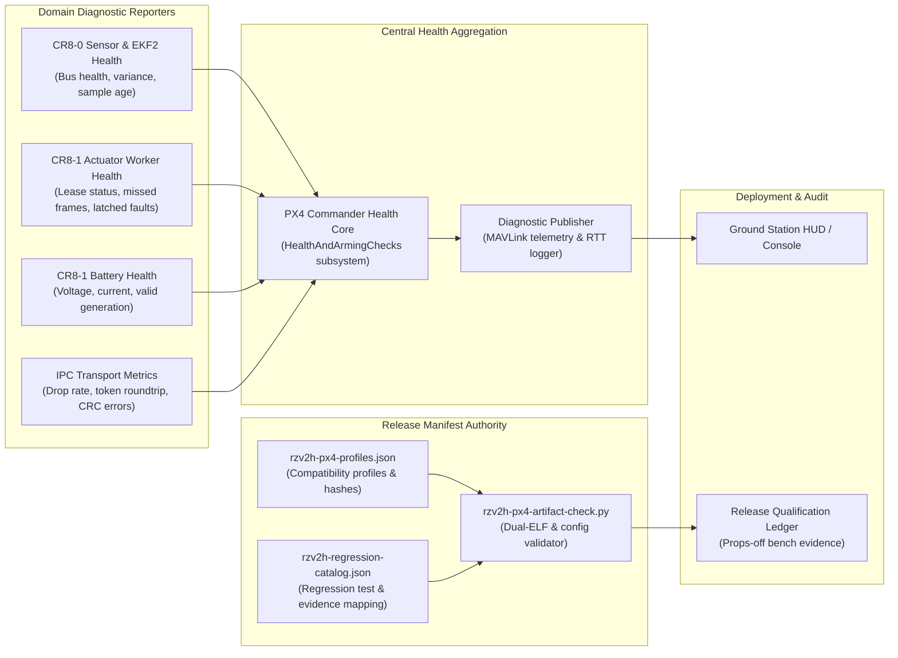
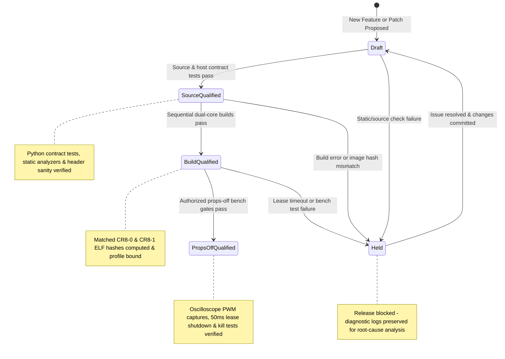
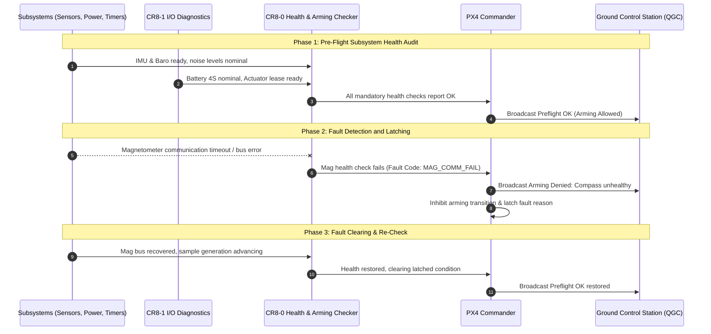

# Diagnostics and release qualification

## Purpose and authority

This module owns **Per-domain reporters with one release manifest authority** for the exact-BOM two-CR8 demo. The user approved this boundary and the [umbrella registry](./rzv2h-demo-requirements.md) on 2026-10-21. Existing parent requirements remain unchanged: SW-OBS-001; SW-CFG-001/002; product update/security requirements. The registry owns allocation; the requirement rows below are synchronized module views, not an independent allocation authority.

Revision 1.0 records the approved target design. “Verified” in requirement evidence means the target contract is documented in the approved design, not that firmware implements it. Every implementation/physical test gap below remains open. Current staging behavior is a migration reference. A55/cameras/CM33 are outside demo runtime. Props-off qualification retains full product-service requirements.

## Module ownership

| Path | Classification | Owner | Notes |
|---|---|---|---|
| [bench-fault.hpp](../../../src/apps/bench-fault.hpp) | product-owned | Per-domain reporters with one release manifest authority | Bounded one-shot props-off bench fault injection scheduler (`BenchFaultSchedule`) |
| [hardware-contract.hpp](../../../src/apps/hardware-contract.hpp) | product-owned | Per-domain reporters with one release manifest authority | Hardware, board, profile, and resource contract ID bindings |
| [Kconfig](../../../src/apps/Kconfig) | product-owned | Per-domain reporters with one release manifest authority | Props-off fault hook configuration (`CONFIG_RZV2H_DUALCR8_FAULT_INJECTION`) |
| [rzv2h-px4-profiles.json](../../../Tools/rzv2h-px4-profiles.json) | product-owned | Per-domain reporters with one release manifest authority | Compatibility profile identity authority |
| [rzv2h-px4-artifact-check.py](../../../Tools/rzv2h-px4-artifact-check.py) | product-owned | Per-domain reporters with one release manifest authority | Linked-artifact validation |
| [rzv2h-regression-catalog.json](../../../Tools/rzv2h-regression-catalog.json) | product-owned | Per-domain reporters with one release manifest authority | Regression/evidence mapping |
| [rzv2h-ipc](../../../platforms/nuttx/Debug/rzv2h-ipc/) | peer/host | Per-domain reporters with one release manifest authority | Authorized load/inspection tooling; no firmware safety authority |

Behavioral slices in a shared bridge file do not grant simultaneous write ownership. IPC owns codec/epoch handling, flight control owns producer/readiness consumption, battery owns sample semantics, and actuator safety owns lease/worker inhibition. Integrate those edits sequentially; mirrors have no independent schema authority.

## Interfaces and behavior

The following is the approved target contract with explicit hardware gaps. Exact layouts and block/data-flow/state/sequence diagrams remain in the [engineering design](./rzv2h-dualcr8-demo-design.md); the [architecture](./rzv2h-dualcr8-demo-architecture.md) explains system boundaries without duplicating normative authority.

**Figure 1: Multi-domain diagnostics and release qualification architecture**

| Interface | Direction | Contract / limit |
|---|---|---|
| Diagnostics | Each owner → bounded reporter | Image/config/calibration identity, epoch, reason, source age and submission generations |
| Release set | Build/policy → loader/recovery | Paired image hashes plus configuration/calibration/hardware contract identity |
| Qualification | Host/build/target → named evidence | Separate evidence tiers; props-off is selected campaign |
| Update trust | Selected boot/update path | Authentication policy inherited from product authority; mechanism unselected |

### State and fault transitions

These are target integration states, not claims that enums or handlers already exist.

**Figure 2: Progressive release qualification state machine**

| From | Event / guard | To | Action / recovery constraint |
|---|---|---|---|
| Draft | Source/host checks pass | SourceQualified | Record exact revisions and failures |
| SourceQualified | Sequential builds/artifact checks pass | BuildQualified | Record both ELF/config hashes |
| BuildQualified | Authorized required props-off gates pass | PropsOffQualified | Record captures and full services evidence |
| Any tier | Mismatch or failed required gate | Held | Inhibit release promotion and preserve evidence |

**Figure 3: System health check, fault diagnostic reporting, and flight gate sequence**

### Configuration and persistence

| Parameter / contract | Selected value / gap | Owner / persistence boundary |
|---|---|---|
| Fault injection selector | CONFIG_RZV2H_DUALCR8_FAULT_INJECTION=n normally | Finite bench-only hooks separately enabled |
| Log bounds/retention | Workload and medium qualification required | Never block control/lease paths |
| Release identities | Machine-owned catalog and measured hashes | No arbitrary hardware-accepted IDs |
| Campaign | Props-off first | Hover/GPS mission is later, separately scoped |

## Requirements registry

| ID | Requirement | Evidence | Confidence |
|---|---|---|---|
| SDS-REL-001 | The release manifest shall bind the complete compatible demo set. | [Approved target design](./rzv2h-dualcr8-demo-design.md#8-implementationtest-inventory-and-evidence-contract) | verified |
| SDS-REL-002 | Pair validation shall reject either new/legacy image mismatch. | [Approved target design](./rzv2h-dualcr8-demo-design.md#8-implementationtest-inventory-and-evidence-contract) | verified |
| SDS-REL-003 | Diagnostics shall retain the originating fault reason. | [Approved target design](./rzv2h-dualcr8-demo-design.md#8-implementationtest-inventory-and-evidence-contract) | verified |
| SDS-REL-004 | Normal release artifacts shall exclude fault-injection capability. | [Approved target design](./rzv2h-dualcr8-demo-design.md#8-implementationtest-inventory-and-evidence-contract) | verified |
| SDS-REL-005 | Qualification reports shall distinguish measured physical output from submission. | [Approved target design](./rzv2h-dualcr8-demo-design.md#8-implementationtest-inventory-and-evidence-contract) | verified |
| SDS-REL-006 | Interrupted update recovery shall retain propulsion inhibition. | [Approved target design](./rzv2h-dualcr8-demo-design.md#8-implementationtest-inventory-and-evidence-contract) | verified |
| SDS-REL-007 | The initial physical campaign shall stop at props-off qualification. | [Approved target design](./rzv2h-dualcr8-demo-design.md#8-implementationtest-inventory-and-evidence-contract) | verified |
| SDS-REL-008 | Release verification shall test the selected authentication policy. | [Approved target design](./rzv2h-dualcr8-demo-design.md#8-implementationtest-inventory-and-evidence-contract) | verified |

## Verification matrix

The methods below define required future proof. Existing source/reference coverage in the evidence ledger is partial and does not close a new-pair test.

| ID | Method | Level | Pass criterion | Existing test/gap | Code-review criterion |
|---|---|---|---|---|---|
| SDS-REL-001 | analysis + test | integration/system | Both image hashes, configuration, calibration and hardware contract identities are resolved together. | gap: full integration and physical acceptance evidence pending | Single manifest authority |
| SDS-REL-002 | analysis + test | integration/system | Current policy qualifies no actuator pair; historical staging images cannot pass as the merged dualcr8 contract. Future pair admission requires explicit selected identities. | gap: full integration and physical acceptance evidence pending | Reciprocal pair policy |
| SDS-REL-003 | analysis + test | integration/system | Backend/lease/battery/storage/command failures remain distinguishable in correlated records. | gap: full integration and physical acceptance evidence pending | Bounded source-tagged reporting |
| SDS-REL-004 | analysis + test | integration/system | Both linked artifacts prove the selector disabled outside explicitly labeled bench builds. | gap: full integration and physical acceptance evidence pending | No default-on hooks |
| SDS-REL-005 | analysis + test | integration/system | ACK/HAL/log success is never reported as connector waveform or motor-stop evidence. | gap: full integration and physical acceptance evidence pending | Observation layer and capture provenance |
| SDS-REL-006 | analysis + test | integration/system | Failure at each selected update boundary cannot activate an incompatible release or outputs. | gap: full integration and physical acceptance evidence pending | Recoverable compatible set and physical inhibit |
| SDS-REL-007 | analysis + test | integration/system | Acceptance report makes no hover/GPS-flight claim and retains all required battery/storage/kill gates. | gap: full integration and physical acceptance evidence pending | Campaign scope without product scope reduction |
| SDS-REL-008 | analysis + test | integration/system | Invalid signatures/identities fail where product authority requires authenticated update or commands. | gap: full integration and physical acceptance evidence pending | Threat boundary and selected trust implementation |

## Traceability

| ID | Design or behavior trace | Test trace | Review trace |
|---|---|---|---|
| SDS-REL-001 | [Interfaces and behavior](#interfaces-and-behavior) | [Verification matrix](#verification-matrix) | [Review criteria](#review-criteria) |
| SDS-REL-002 | [Interfaces and behavior](#interfaces-and-behavior) | [Verification matrix](#verification-matrix) | [Review criteria](#review-criteria) |
| SDS-REL-003 | [Interfaces and behavior](#interfaces-and-behavior) | [Verification matrix](#verification-matrix) | [Review criteria](#review-criteria) |
| SDS-REL-004 | [Interfaces and behavior](#interfaces-and-behavior) | [Verification matrix](#verification-matrix) | [Review criteria](#review-criteria) |
| SDS-REL-005 | [Interfaces and behavior](#interfaces-and-behavior) | [Verification matrix](#verification-matrix) | [Review criteria](#review-criteria) |
| SDS-REL-006 | [Interfaces and behavior](#interfaces-and-behavior) | [Verification matrix](#verification-matrix) | [Review criteria](#review-criteria) |
| SDS-REL-007 | [Interfaces and behavior](#interfaces-and-behavior) | [Verification matrix](#verification-matrix) | [Review criteria](#review-criteria) |
| SDS-REL-008 | [Interfaces and behavior](#interfaces-and-behavior) | [Verification matrix](#verification-matrix) | [Review criteria](#review-criteria) |

## Review criteria

Review each verification-row boundary against the actual selected profile and source change. Reject double ownership, stale data promoted to fresh authority, implicit hardware selection, cross-clock subtraction and promotion of a build/ACK into physical proof. Resolve each test gap with a named artifact before claiming its requirement passed. A hardware-dependent record stays blocked until its ICD is frozen; independent source work remains possible.

## Evidence ledger

| Claim / requirement | Evidence location | Confidence | Status / gap |
|---|---|---|---|
| Approved module requirements | [Engineering design](./rzv2h-dualcr8-demo-design.md) | verified | Target design authority only |
| Current migration and implementation boundaries | [rzv2h-px4-profiles.json](../../../Tools/rzv2h-px4-profiles.json) | verified | Source location exists; no integrated new-pair result |
| Related source/test evidence | [Subsystem evidence](../../../plans/reports/research-261021-0230-product-subsystems.md) | verified | Historical source review; rerun affected tests during implementation |
| Full module acceptance | [Verification matrix](#verification-matrix) | unknown | Required test/physical results pending |

Partial existing coverage: [rzv2h-px4-artifact-test.py](../../../test/rzv2h-px4-artifact-test.py). Individual candidate artifacts and no-pair policy are checked in the [software receipt](../evidence/dualcr8-software-validation-261021.md); pair admission and the full release set remain pending. This test was not executed during specification authoring.

## Open inputs and acceptance gaps

Selected boot/authentication/update route, log storage budget, complete release manifests and physical evidence do not yet exist for the new pair. No firmware readiness tier is promoted by documentation validation.

The [shared hardware-input ledger](./rzv2h-demo-requirements.md#hardware-input-gates) names closure evidence. Unknown hardware remains an input gate rather than a substituted part number or a waived requirement.
