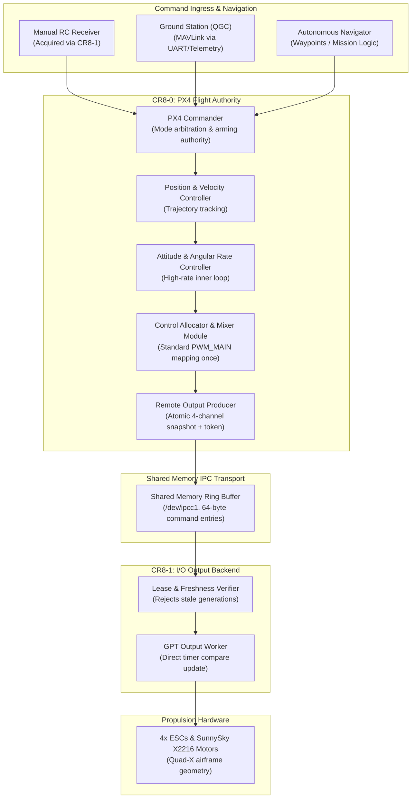
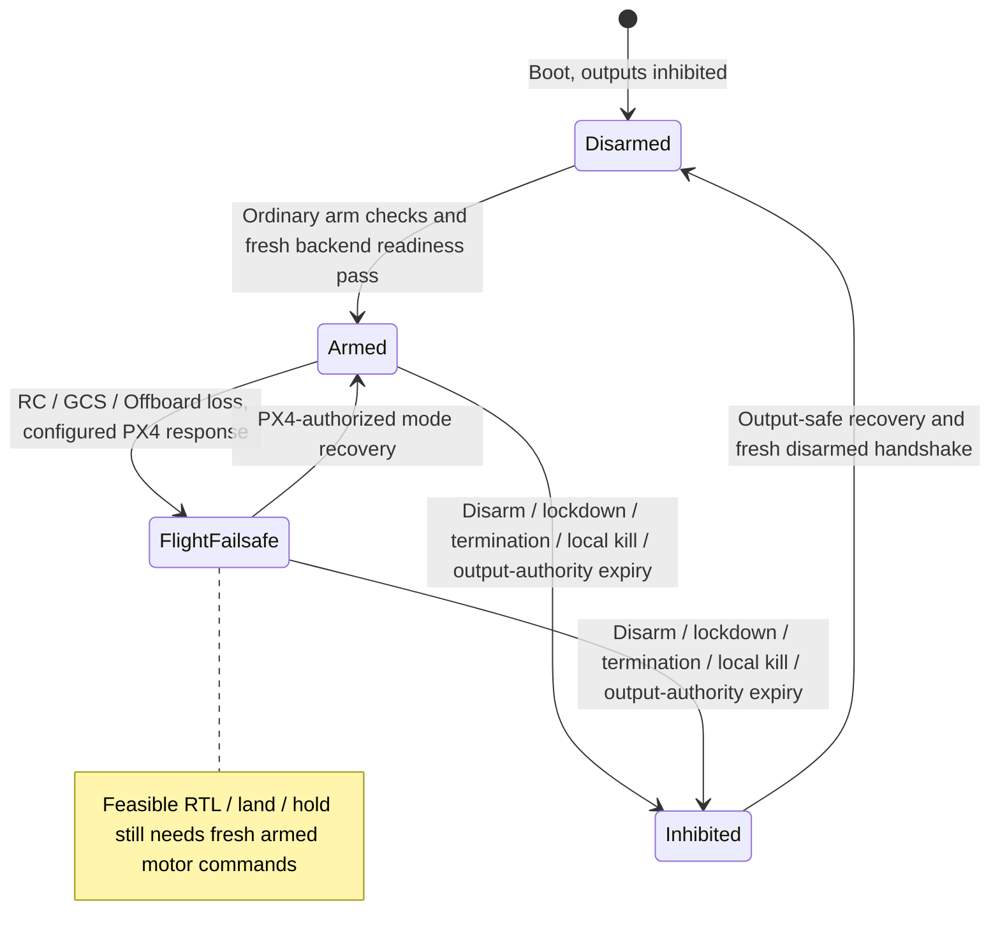
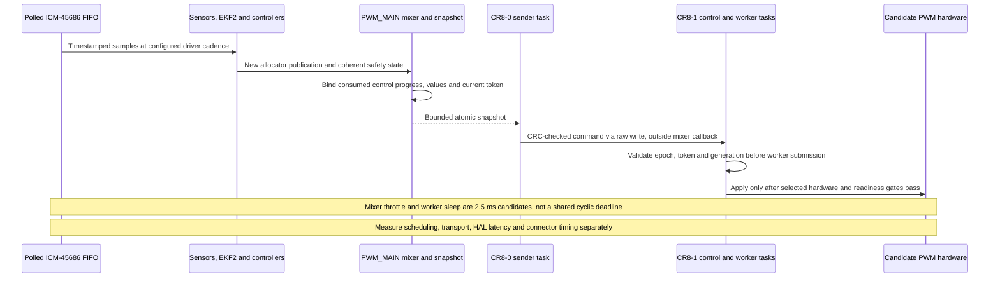

# Flight control and command authority

## Purpose and authority

This module owns **CR8-0 flight authority** for the exact-BOM two-CR8 demo. The user approved this boundary and the [umbrella registry](./rzv2h-demo-requirements.md) on 2026-10-21. Existing parent requirements remain unchanged: SYS-ARC-003; SYS-IF-008; SW-ARC-005. The registry owns allocation; the requirement rows below are synchronized module views, not an independent allocation authority.

Revision 1.0 records the approved target design. “Verified” in requirement evidence means the target contract is documented in the approved design, not that firmware implements it. Every implementation/physical test gap below remains open. Current staging behavior is a migration reference. A55/cameras/CM33 are outside demo runtime. Props-off qualification retains full product-service requirements.

## Module ownership

| Path | Classification | Owner | Notes |
|---|---|---|---|
| [output-producer.hpp](../../../src/apps/output-producer.hpp) | product-owned | CR8-0 flight authority | Remote output producer (`OutputProducer`) advancing generations, state generation and binding causal tokens |
| [output-snapshot.hpp](../../../src/apps/output-snapshot.hpp) | product-owned | CR8-0 flight authority | Lockless atomic seqlock snapshot (`AtomicRecord`, `OutputSnapshot`) between mixer callback and IPC sender |
| [remote-outputs.cpp](../../../boards/renesas/rdk-rzv2h/rzv2h_outputs/remote-outputs.cpp) | product-owned | CR8-0 flight authority | CR8-0 remote outputs flight authority integration and backend status subscriber |
| [mixer_module.cpp](../../../src/lib/mixer_module/mixer_module.cpp) | product-owned | CR8-0 flight authority | Single standard mapping/limit transaction |
| [control_allocator](../../../src/modules/control_allocator/) | product-owned | CR8-0 flight authority | Valid advancing actuator generation |
| [commander](../../../src/modules/commander/) | product-owned | CR8-0 flight authority | Arm/mode and command-loss policy |
| [px4io.cpp](../../../src/drivers/px4io/px4io.cpp) | legacy/reference | CR8-0 flight authority | Remote OutputModuleInterface and PWM_MAIN construction pattern |
| `uorb_bridge.cpp` (removed 2026-11-18; git history) | retired reference | CR8-0 flight authority | Legacy bridge producer integration reference |

Behavioral slices in a shared bridge file do not grant simultaneous write ownership. IPC owns codec/epoch handling, flight control owns producer/readiness consumption, battery owns sample semantics, and actuator safety owns lease/worker inhibition. Integrate those edits sequentially; mirrors have no independent schema authority.

## Interfaces and behavior

The following is the approved target contract with explicit hardware gaps. Exact layouts and block/data-flow/state/sequence diagrams remain in the [engineering design](./rzv2h-dualcr8-demo-design.md); the [architecture](./rzv2h-dualcr8-demo-architecture.md) explains system boundaries without duplicating normative authority.

**Figure 1: Flight control hierarchy and command authority architecture**

| Interface | Direction | Contract / limit |
|---|---|---|
| Estimator/control | CR8-0 internal | Validity → controllers → allocator → PWM_MAIN |
| Manual/GCS command | Selected ingress → commander | RC acquisition target CR8-1; ingress hardware/protocol remains open |
| Output snapshot | Mixer callback → sender | Four values, stop/effective safety state, generation and local time committed together |
| Backend health | CR8-1 → commander | First status, ready/rate/fault plus independent status age |

### State and fault transitions

These are target integration states, not claims that enums or handlers already exist.

**Figure 2: Flight authority arming and command state machine**

| From | Event / guard | To | Action / recovery constraint |
|---|---|---|---|
| Boot | Health not yet complete | Disarmed | Outputs inhibited; no arm eligibility |
| Disarmed | Ordinary checks and valid command authority | Armed | Produce fresh coherent controlled outputs |
| Armed | RC/GCS/Offboard loss | Flight failsafe | Configured feasible PX4 response retains fresh armed output authority |
| Armed / flight failsafe | Disarm/lockdown/termination/kill/authority expiry | Inhibited | Fresh state cannot overlay old values |
| Inhibited | Valid recovery and new disarmed generation | Disarmed | No cached armed replay |

**Figure 3: Independently scheduled flight processing and candidate PWM dispatch; timing remains unqualified**

### Configuration and persistence

| Parameter / contract | Selected value / gap | Owner / persistence boundary |
|---|---|---|
| PWM_MAIN_FUNC1..4 | Selected quad-X assignment pending wiring proof | CR8-0 sole mapping owner |
| PWM_MAIN_MIN/MAX/DIS/FAIL | Selected ESC bounds pending | CR8-0 preserves values; CR8-1 validates/inhibits |
| PWM_MAIN_TIMx | Equal selected CR8-1 rate | Mismatch blocks readiness |
| RC/GCS loss thresholds | Selected interface/policy required | Flight authority; stored through calibration-storage |

## Requirements registry

| ID | Requirement | Evidence | Confidence |
|---|---|---|---|
| SDS-FLIGHT-001 | CR8-0 shall apply actuator function mapping exactly once. | [Approved target design](./rzv2h-dualcr8-demo-design.md#5-px4-to-output-dataflow-and-concurrency) | verified |
| SDS-FLIGHT-002 | CR8-0 shall retain sole arm/mode authority. | [Approved target design](./rzv2h-dualcr8-demo-design.md#5-px4-to-output-dataflow-and-concurrency) | verified |
| SDS-FLIGHT-003 | The remote producer shall commit one coherent output snapshot per generation. | [Approved target design](./rzv2h-dualcr8-demo-design.md#5-px4-to-output-dataflow-and-concurrency) | verified |
| SDS-FLIGHT-004 | The mixer callback shall complete without blocking transport work. | [Approved target design](./rzv2h-dualcr8-demo-design.md#5-px4-to-output-dataflow-and-concurrency) | verified |
| SDS-FLIGHT-005 | An armed snapshot shall require a newly advancing valid control generation. | [Approved target design](./rzv2h-dualcr8-demo-design.md#5-px4-to-output-dataflow-and-concurrency) | verified |
| SDS-FLIGHT-006 | Commander shall block arming without fresh backend readiness. | [Approved target design](./rzv2h-dualcr8-demo-design.md#5-px4-to-output-dataflow-and-concurrency) | verified |
| SDS-FLIGHT-007 | The flight authority shall distinguish command-loss causes. | [Approved target design](./rzv2h-dualcr8-demo-design.md#5-px4-to-output-dataflow-and-concurrency) | verified |
| SDS-FLIGHT-008 | The producer shall preserve configured disarmed values. | [Approved target design](./rzv2h-dualcr8-demo-design.md#5-px4-to-output-dataflow-and-concurrency) | verified |

## Verification matrix

The methods below define required future proof. Existing source/reference coverage in the evidence ledger is partial and does not close a new-pair test.

| ID | Method | Level | Pass criterion | Existing test/gap | Code-review criterion |
|---|---|---|---|---|---|
| SDS-FLIGHT-001 | analysis + test | integration/system | One PWM_MAIN producer exists; no second mapping or reversal occurs on CR8-1. | gap: full integration and physical acceptance evidence pending | Single mixer ownership |
| SDS-FLIGHT-002 | analysis + test | integration/system | I/O or telemetry messages cannot arm the aircraft independently of commander. | gap: full integration and physical acceptance evidence pending | Command authorization and mode arbitration |
| SDS-FLIGHT-003 | analysis + test | integration/system | Every interleaving contains values and effective safety state from the same transaction. | gap: full integration and physical acceptance evidence pending | Bounded atomic/seqlock snapshot |
| SDS-FLIGHT-004 | analysis + test | integration/system | Callback call graph has no raw IPC write/recovery, filesystem or blocking logging. | gap: full integration and physical acceptance evidence pending | Real-time context boundary |
| SDS-FLIGHT-005 | analysis + test | integration/system | Token-only callbacks over cached controls cannot extend output authority. | gap: full integration and physical acceptance evidence pending | Allocator generation and token binding |
| SDS-FLIGHT-006 | analysis + test | integration/system | Missing first status, stale status, backend fault or rate mismatch blocks ordinary arming. | gap: full integration and physical acceptance evidence pending | Selected-profile health integration |
| SDS-FLIGHT-007 | analysis + test | integration/system | RC loss, GCS loss and local inhibit retain separate reason codes and selected policy results. | gap: full integration and physical acceptance evidence pending | No link-health conflation |
| SDS-FLIGHT-008 | analysis + test | integration/system | Nonzero DIS survives snapshot/transport unchanged while standby pins remain inhibited. | gap: full integration and physical acceptance evidence pending | Configuration versus final physical inhibit |

## Traceability

| ID | Design or behavior trace | Test trace | Review trace |
|---|---|---|---|
| SDS-FLIGHT-001 | [Interfaces and behavior](#interfaces-and-behavior) | [Verification matrix](#verification-matrix) | [Review criteria](#review-criteria) |
| SDS-FLIGHT-002 | [Interfaces and behavior](#interfaces-and-behavior) | [Verification matrix](#verification-matrix) | [Review criteria](#review-criteria) |
| SDS-FLIGHT-003 | [Interfaces and behavior](#interfaces-and-behavior) | [Verification matrix](#verification-matrix) | [Review criteria](#review-criteria) |
| SDS-FLIGHT-004 | [Interfaces and behavior](#interfaces-and-behavior) | [Verification matrix](#verification-matrix) | [Review criteria](#review-criteria) |
| SDS-FLIGHT-005 | [Interfaces and behavior](#interfaces-and-behavior) | [Verification matrix](#verification-matrix) | [Review criteria](#review-criteria) |
| SDS-FLIGHT-006 | [Interfaces and behavior](#interfaces-and-behavior) | [Verification matrix](#verification-matrix) | [Review criteria](#review-criteria) |
| SDS-FLIGHT-007 | [Interfaces and behavior](#interfaces-and-behavior) | [Verification matrix](#verification-matrix) | [Review criteria](#review-criteria) |
| SDS-FLIGHT-008 | [Interfaces and behavior](#interfaces-and-behavior) | [Verification matrix](#verification-matrix) | [Review criteria](#review-criteria) |

## Review criteria

Review each verification-row boundary against the actual selected profile and source change. Reject double ownership, stale data promoted to fresh authority, implicit hardware selection, cross-clock subtraction and promotion of a build/ACK into physical proof. Resolve each test gap with a named artifact before claiming its requirement passed. A hardware-dependent record stays blocked until its ICD is frozen; independent source work remains possible.

## Evidence ledger

| Claim / requirement | Evidence location | Confidence | Status / gap |
|---|---|---|---|
| Approved module requirements | [Engineering design](./rzv2h-dualcr8-demo-design.md) | verified | Target design authority only |
| Current migration and implementation boundaries | [mixer_module.cpp](../../../src/lib/mixer_module/mixer_module.cpp) | verified | Source location exists; no integrated new-pair result |
| Related source/test evidence | [Subsystem evidence](../../../plans/reports/research-261021-0230-product-subsystems.md) | verified | Historical source review; rerun affected tests during implementation |
| Full module acceptance | [Verification matrix](#verification-matrix) | unknown | Required test/physical results pending |

Partial existing coverage: [mixer_module_tests.cpp](../../../src/lib/mixer_module/mixer_module_tests.cpp). Native mixer behavior plus candidate coherent-producer/runtime coverage is recorded in the [software receipt](../evidence/dualcr8-software-validation-261021.md); physical control and full acceptance remain pending. This test was not executed during specification authoring.

## Open inputs and acceptance gaps

Receiver/GCS interfaces, loss budgets, motor order/rotation, selected ESC limits and controller/load measurements remain open. Approval of ownership is not a flight-stability result.

The [shared hardware-input ledger](./rzv2h-demo-requirements.md#hardware-input-gates) names closure evidence. Unknown hardware remains an input gate rather than a substituted part number or a waived requirement.
