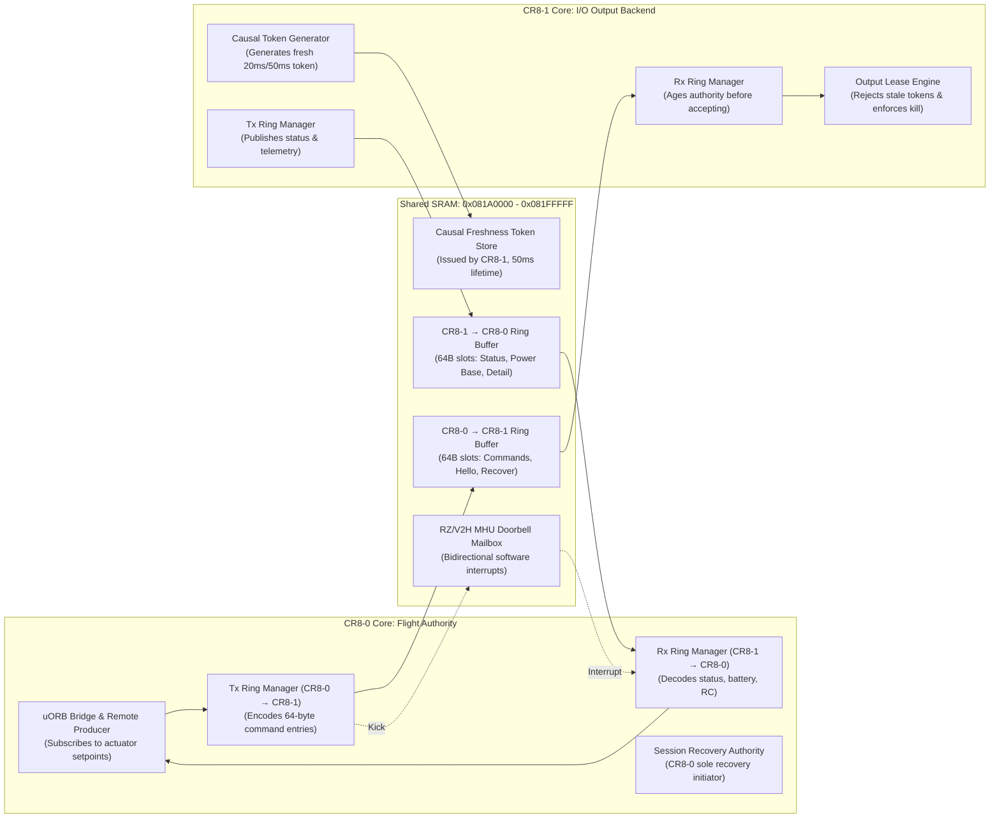

# Inter-core communication

## Purpose and authority

This module owns **Single writer per direction; CR8-0 recovery initiator** for the exact-BOM two-CR8 demo. The user approved this boundary and the [umbrella registry](./rzv2h-demo-requirements.md) on 2026-10-21. Existing parent requirements remain unchanged: SW-IPC-001/002/003; SYS-ARC-003/004. The registry owns allocation; the requirement rows below are synchronized module views, not an independent allocation authority.

Revision 1.0 records the approved target design. “Verified” in requirement evidence means the target contract is documented in the approved design, not that firmware implements it. Every implementation/physical test gap below remains open. Current staging behavior is a migration reference. A55/cameras/CM33 are outside demo runtime. Props-off qualification retains full product-service requirements.

## Module ownership

| Path | Classification | Owner | Notes |
|---|---|---|---|
| [protocol.hpp](../../../src/apps/protocol.hpp) / [protocol.cpp](../../../src/apps/protocol.cpp) | product-owned | Single writer per direction; CR8-0 recovery initiator | Canonical application codec implementation (`DemoHeader`, wire codec, CRC32, little-endian framing, static assertions) |
| [raw-link.hpp](../../../src/apps/raw-link.hpp) | product-owned | Single writer per direction; CR8-0 recovery initiator | POSIX `/dev/ipcc1` raw link wrapper (`RawLink`), ioctl helpers, nonblocking I/O |
| [protocol.h](../../../boards/renesas/rdk-rzv2h/px4io_cr8_0/protocol.h) | product-owned | Single writer per direction; CR8-0 recovery initiator | CR8-0 board protocol header including `src/apps/protocol.hpp` |
| [protocol.h](../../../boards/renesas/rdk-rzv2h-io-cr8_1/px4io_cr8_1/protocol.h) | peer/host | Single writer per direction; CR8-0 recovery initiator | CR8-1 board protocol header including `src/apps/protocol.hpp` |
| [protocol.h](../../../boards/renesas/rdk-rzv2h-io-cm33/px4io_m33/protocol.h) | legacy/reference | Single writer per direction; CR8-0 recovery initiator | Legacy mirror only; no demo runtime |
| [rzv_ipc_channels.h](../../../platforms/nuttx/NuttX/nuttx/arch/arm/src/rzv/rzv_ipc_channels.h) | product-owned | Single writer per direction; CR8-0 recovery initiator | Raw transport shared-memory/channel authority |

Behavioral slices in a shared bridge file do not grant simultaneous write ownership. IPC owns codec/epoch handling, flight control owns producer/readiness consumption, battery owns sample semantics, and actuator safety owns lease/worker inhibition. Integrate those edits sequentially; mirrors have no independent schema authority.

## Interfaces and behavior

The following is the approved target contract with explicit hardware gaps. Exact layouts and block/data-flow/state/sequence diagrams remain in the [engineering design](./rzv2h-dualcr8-demo-design.md); the [architecture](./rzv2h-dualcr8-demo-architecture.md) explains system boundaries without duplicating normative authority.

**Figure 1: Dual-CR8 inter-core communication architecture and shared memory layout**



| Interface | Direction | Contract / limit |
|---|---|---|
| Raw transport | CR8-0 ↔ CR8-1 | /dev/ipcc1; raw ABI v2, 64-byte public entry; stop-and-wait writes may block 100 ms |
| Application codec | Legacy v2 / demo v3 | Separate layouts; proposed header32, command/status64, heartbeat44, hello48, power base/detail64 bytes |
| Commands and recovery | CR8-0 → CR8-1 | Compatible role/current epoch, coherent snapshot and receiver token |
| Status/power/RC | CR8-1 → CR8-0 | Bounded independent streams; health traffic cannot renew actuator authority |

### State and fault transitions

These are target integration states, not claims that enums or handlers already exist.

**Figure 2: IPC link session and epoch recovery state machine**

```mermaid
stateDiagram-v2
    [*] --> No_Session : Power-On / Core Reset

    No_Session --> Negotiating : Raw shared memory epoch established
    note right of Negotiating : Shared memory rings zeroed; no actuator output claimed

    Negotiating --> Compatible : Compatible current-epoch role & resource hello exchanged
    note right of Compatible : Valid session active; enable safe bootstrap and command exchange

    Compatible --> Recovering : Transport fault / Epoch mismatch / CR8-1 rotation request
    note right of Recovering : Output authority revoked; CR8-0 sole recovery initiator

    Recovering --> Negotiating : New epoch observed & buffers flushed
    note right of Negotiating : Fresh handshake required before re-enabling outputs
```

| From | Event / guard | To | Action / recovery constraint |
|---|---|---|---|
| No session | Raw epoch established | Negotiating | No output claim |
| Negotiating | Compatible current-epoch role/resource hello | Compatible | Enable safe bootstrap exchange |
| Compatible | Transport fault/epoch change | Recovering | Invalidate prior command authority |
| Compatible | Pre-wrap sticky rotation request | Recovering | CR8-0 alone initiates RECOVER |
| Recovering | New epoch observed | Negotiating | Fresh role and disarmed handshake |

**Figure 3: Bidirectional IPC message exchange and causal freshness token sequence**

```mermaid
sequenceDiagram
    autonumber
    participant CR8_0 as CR8-0 Producer
    participant SRAM as Shared SRAM Rings
    participant MHU as MHU Doorbell
    participant CR8_1 as CR8-1 Consumer

    Note over CR8_0,CR8_1: Phase 1: Handshake & Causal Token Issuance
    CR8_1->>SRAM: Publish Status Frame containing fresh Token (T_fresh = 0x4A12)
    CR8_1->>MHU: Assert software interrupt to CR8-0
    MHU-->>CR8_0: Handle Rx interrupt, extract Token T_fresh

    Note over CR8_0,CR8_1: Phase 2: Signed Actuator Command Dispatch
    CR8_0->>CR8_0: Commit output snapshot bound to Token T_fresh
    CR8_0->>SRAM: Write 64-byte Command Frame (Seq 101, Token 0x4A12)
    CR8_0->>MHU: Assert software interrupt to CR8-1
    MHU-->>CR8_1: Handle Rx interrupt, dequeue Command Frame
    CR8_1->>CR8_1: Verify Token matches current issued token (< 50 ms age)
    CR8_1->>CR8_1: Apply motor pulses to ESCs

    Note over CR8_0,CR8_1: Phase 3: Stale / Replayed Token Rejection
    CR8_0->>SRAM: Delayed Command Frame arrives with old Token (0x3901)
    CR8_1->>CR8_1: Token expired or mismatched!
    CR8_1->>CR8_1: Invalidate command; retain safe disarmed output
```

### Configuration and persistence

| Parameter / contract | Selected value / gap | Owner / persistence boundary |
|---|---|---|
| Entry limit | 64 bytes | Raw transport contract |
| Command lease / heartbeat | 50 ms / 500 ms | Existing thresholds retained |
| Token issuance / lifetime / history | 20 ms candidate / 50 ms / at most 3 | Load qualification pending; events reuse existing token |
| Status expiry | 50 ms proposed receive-local | Advancing valid status required; heartbeat cannot renew |
| Compatibility identities | Phase 1 machine-owned profile catalog | Different authority from requirements registry |

## Requirements registry

| ID | Requirement | Evidence | Confidence |
|---|---|---|---|
| SDS-IPC-001 | The demo codec shall keep each raw entry within 64 bytes. | [Approved target design](./rzv2h-dualcr8-demo-design.md#4-proposed-demo-wire-contract-and-freshness-proof) | verified |
| SDS-IPC-002 | The receiver shall reject frames failing the selected codec contract. | [Approved target design](./rzv2h-dualcr8-demo-design.md#4-proposed-demo-wire-contract-and-freshness-proof) | verified |
| SDS-IPC-003 | The sender shall bind authority to a snapshot created after token receipt. | [Approved target design](./rzv2h-dualcr8-demo-design.md#4-proposed-demo-wire-contract-and-freshness-proof) | verified |
| SDS-IPC-004 | The receiver shall age existing authority before accepting queued commands. | [Approved target design](./rzv2h-dualcr8-demo-design.md#4-proposed-demo-wire-contract-and-freshness-proof) | verified |
| SDS-IPC-005 | CR8-0 shall remain the sole raw recovery initiator. | [Approved target design](./rzv2h-dualcr8-demo-design.md#4-proposed-demo-wire-contract-and-freshness-proof) | verified |
| SDS-IPC-006 | Event status shall reuse the current freshness-token issue time. | [Approved target design](./rzv2h-dualcr8-demo-design.md#4-proposed-demo-wire-contract-and-freshness-proof) | verified |
| SDS-IPC-007 | An epoch change shall invalidate prior command generations. | [Approved target design](./rzv2h-dualcr8-demo-design.md#4-proposed-demo-wire-contract-and-freshness-proof) | verified |
| SDS-IPC-008 | Non-actuator traffic shall leave actuator authority unchanged. | [Approved target design](./rzv2h-dualcr8-demo-design.md#4-proposed-demo-wire-contract-and-freshness-proof) | verified |

## Verification matrix

The methods below define required future proof. Existing source/reference coverage in the evidence ledger is partial and does not close a new-pair test.

| ID | Method | Level | Pass criterion | Existing test/gap | Code-review criterion |
|---|---|---|---|---|---|
| SDS-IPC-001 | analysis + test | integration/system | Static sizes/offsets and every serialized record fit the public entry. | gap: new-pair tests and physical evidence pending | Separate v2/v3 headers and all consumer layouts |
| SDS-IPC-002 | analysis + test | integration/system | Malformed magic/version/type/length/CRC/reserved/state fields do not dispatch or renew authority. | gap: new-pair tests and physical evidence pending | Boundary validation before state mutation |
| SDS-IPC-003 | analysis + test | integration/system | Delayed-token replay and cached-control replay cannot extend an armed lease. | gap: new-pair tests and physical evidence pending | Causal token and control-generation provenance |
| SDS-IPC-004 | analysis + test | integration/system | Queued armed command after expiry cannot bypass fresh disarmed recovery. | gap: new-pair tests and physical evidence pending | Pre-receipt expiry ordering |
| SDS-IPC-005 | analysis + test | integration/system | CR8-1 requests rotation without issuing initiator-only recovery operations. | gap: new-pair tests and physical evidence pending | Epoch ownership and sticky request acknowledgement |
| SDS-IPC-006 | analysis + test | integration/system | Bursty status cannot evict a live token early or refresh its lifetime. | gap: new-pair tests and physical evidence pending | Bounded token issuance/history |
| SDS-IPC-007 | analysis + test | integration/system | Old snapshot/token/sequence cannot reactivate outputs in a new session. | gap: new-pair tests and physical evidence pending | Session reset and tracker initialization |
| SDS-IPC-008 | analysis + test | integration/system | Battery, RC and diagnostic traffic cannot extend command lease or mask stale backend status. | gap: new-pair tests and physical evidence pending | Per-stream sequencing, expiry and bounded queues |

## Traceability

| ID | Design or behavior trace | Test trace | Review trace |
|---|---|---|---|
| SDS-IPC-001 | [Interfaces and behavior](#interfaces-and-behavior) | [Verification matrix](#verification-matrix) | [Review criteria](#review-criteria) |
| SDS-IPC-002 | [Interfaces and behavior](#interfaces-and-behavior) | [Verification matrix](#verification-matrix) | [Review criteria](#review-criteria) |
| SDS-IPC-003 | [Interfaces and behavior](#interfaces-and-behavior) | [Verification matrix](#verification-matrix) | [Review criteria](#review-criteria) |
| SDS-IPC-004 | [Interfaces and behavior](#interfaces-and-behavior) | [Verification matrix](#verification-matrix) | [Review criteria](#review-criteria) |
| SDS-IPC-005 | [Interfaces and behavior](#interfaces-and-behavior) | [Verification matrix](#verification-matrix) | [Review criteria](#review-criteria) |
| SDS-IPC-006 | [Interfaces and behavior](#interfaces-and-behavior) | [Verification matrix](#verification-matrix) | [Review criteria](#review-criteria) |
| SDS-IPC-007 | [Interfaces and behavior](#interfaces-and-behavior) | [Verification matrix](#verification-matrix) | [Review criteria](#review-criteria) |
| SDS-IPC-008 | [Interfaces and behavior](#interfaces-and-behavior) | [Verification matrix](#verification-matrix) | [Review criteria](#review-criteria) |

## Review criteria

Review each verification-row boundary against the actual selected profile and source change. Reject double ownership, stale data promoted to fresh authority, implicit hardware selection, cross-clock subtraction and promotion of a build/ACK into physical proof. Resolve each test gap with a named artifact before claiming its requirement passed. A hardware-dependent record stays blocked until its ICD is frozen; independent source work remains possible.

## Evidence ledger

| Claim / requirement | Evidence location | Confidence | Status / gap |
|---|---|---|---|
| Approved module requirements | [Engineering design](./rzv2h-dualcr8-demo-design.md) | verified | Target design authority only |
| Current migration and implementation boundaries | [protocol.h](../../../boards/renesas/rdk-rzv2h/px4io_cr8_0/protocol.h) | verified | Source location exists; no integrated new-pair result |
| Related source/test evidence | [Subsystem evidence](../../../plans/reports/research-261021-0230-product-subsystems.md) | verified | Historical source review; rerun affected tests during implementation |
| Full module acceptance | [Verification matrix](#verification-matrix) | unknown | Required test/physical results pending |

Partial existing coverage: [rzv2h-dual-cr8-output-lease-runtime-test.py](../../../test/rzv2h-dual-cr8-output-lease-runtime-test.py). Existing lease cases only; proposed v3 causal-token cases remain pending. This test was not executed during specification authoring.

## Open inputs and acceptance gaps

Proposed v3 codec, paired identities, causal token implementation and full-load timing are not implemented. Receiver-issued tokens establish causality, not cryptographic authentication. Authentication requirements remain in the product release owner.

The [shared hardware-input ledger](./rzv2h-demo-requirements.md#hardware-input-gates) names closure evidence. Unknown hardware remains an input gate rather than a substituted part number or a waived requirement.
