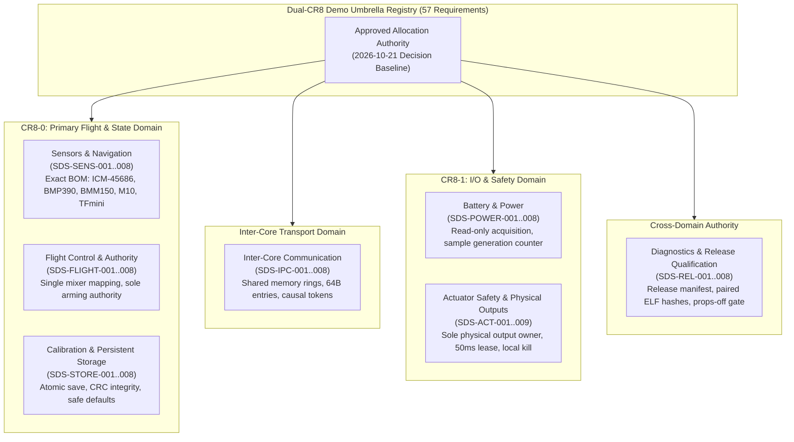
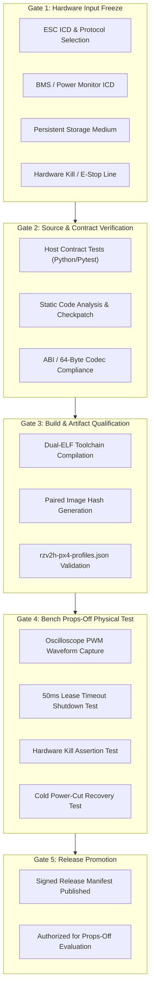

# Dual-CR8 demo requirements registry

## Authority and decisions

The user approved the recommended decisions on 2026-10-21: “go ahead with your recommendations regarding pending decisions”. This document is the explicit shared registry for seven module owners. New SDS IDs are append-only within the domains below. Existing SYS/SW IDs are preserved with no migration. Module requirements tables are synchronized views of these records; this registry is the allocation authority.

| Decision | Approved allocation | Consequence |
|---|---|---|
| Mixer | CR8-0 standard PWM_MAIN mapping/range/reversal/DIS/FAIL once | CR8-1 validates bounds/protocol/rate and owns final physical inhibition; software §5.6 is reconciled |
| Specifications | Seven module owners and this shared registry | Module boundaries include all product services, not just IPC |
| Hardware | Keep unselected hardware as explicit input gates | Continue independent source preparation; no purchase recommendation, electrical identity or pin assignment inferred |
| Campaign | Props-off qualification first | Hover/GPS mission is a later campaign; full battery, durable calibration, command/kill and diagnostics remain required |
| ESC Protocol | DShot selected as primary; PWM 400Hz retained as backup requiring qualification | Primary backend targets DShot framing on CR8-1 GPT outputs; preserves 400Hz PWM fallback on PA4/GPT6A, PA7/GPT7B, P96/GPT9A, P53/GPT10B |
| Production Board | Fully custom discrete RZ/V2H board based on RDK-RZ/V2H drone demo | Production layout derives from the RDK reference architecture; customer-board pinmux, clocks, power/reset and physical interfaces require qualification |

The [system](./rzv2h-system-specification.md) and [software](./rzv2h-software-specification.md) specifications remain parent product authorities. The [engineering design](./rzv2h-dualcr8-demo-design.md) records proposed wire layouts, states, sequences and physical proof. These contracts do not claim implementation, flight qualification or certification.

## Module ownership

**Figure 1: Seven-module requirements hierarchy and domain ownership architecture**

| Path | Classification | Owner | Notes |
|---|---|---|---|
| [Sensors and navigation](./rzv2h-demo-sensors-navigation-spec.md) | product-owned | CR8-0 sensor/navigation integration | SDS-SENS-001 through SDS-SENS-008; target requirements |
| [Flight control and command authority](./rzv2h-demo-flight-control-spec.md) | product-owned | CR8-0 flight authority | SDS-FLIGHT-001 through SDS-FLIGHT-008; target requirements |
| [Battery and power](./rzv2h-demo-battery-power-spec.md) | product-owned | CR8-1 acquisition with CR8-0 energy policy | SDS-POWER-001 through SDS-POWER-008; target requirements |
| [Calibration and persistent storage](./rzv2h-demo-calibration-storage-spec.md) | product-owned | CR8-0 canonical records with one selected medium owner | SDS-STORE-001 through SDS-STORE-008; target requirements |
| [Inter-core communication](./rzv2h-demo-ipc-spec.md) | product-owned | Single writer per direction; CR8-0 recovery initiator | SDS-IPC-001 through SDS-IPC-008; target requirements |
| [Actuator safety and physical outputs](./rzv2h-demo-actuator-safety-spec.md) | product-owned | CR8-1 sole physical output owner | SDS-ACT-001 through SDS-ACT-009; target requirements |
| [Diagnostics and release qualification](./rzv2h-demo-diagnostics-release-spec.md) | product-owned | Per-domain reporters with one release manifest authority | SDS-REL-001 through SDS-REL-008; target requirements |

No module owns another module's mutable state. Firmware sources shared physically by modules use the behavioral slices described in each ownership ledger and sequential integration. The system resource ledger owns shared pin/clock/reset conflicts. Requirements IDs are distinct from machine-owned wire/profile compatibility identities.

## Hardware input gates

| Input | Current state | Closure evidence | Work held |
|---|---|---|---|
| Four ESCs | Protocol selected: DShot primary, PWM 400Hz backup; SunnySky X2216 motor pair | Exact label/revision, primary device specification, voltage/current compatibility, accepted DShot rate/timing, timeout, harness/order/direction and connector captures | Final DShot timer DMA verification, backup PWM qualification and hardware-accepted compatibility identity |
| Battery source/pack | BMS/monitor and pack unselected | Read-only ICD, chemistry/cells/capacity, calibrated units/sign, validity/age, bus/controller/core/pins and protection responsibilities | Acquisition/normalization constants, energy policy and full acceptance |
| Durable storage | Current staging uses volatile TMPFS; medium unselected | Controller/partition owner, geometry/endurance, integrity/schema, atomic commit and real power-cut recovery | Selected persistence backend and durability acceptance |
| Command/kill | Receiver, GCS link and local inhibit hardware unselected | CR8-1 acquisition/local inhibit versus CR8-0 policy, loss budgets, electrical containment and recovery | Selected input implementation and physical kill proof |
| Sensor fitting | Devices selected, installation unqualified | Rotation, mounting, wiring/supply/pull-up and measured sample/quality evidence | Calibration and integrated navigation qualification |
| Reset/core-halt containment | Software lease alone insufficient when worker halts | Warm-reset GPT/pad retention and wrong-pair isolation tested separately; selected hardware containment assessed and proven | Powered qualification/full acceptance |

The ESC protocol is frozen: DShot is the primary protocol with PWM 400Hz retained as a backup mode requiring qualification. The production board strategy is frozen as a fully custom discrete RZ/V2H board based on the RDK reference architecture and reviewed port sources, with customer-board qualification required. No flash partition, power-gate GPIO or universal safe high-impedance level is assigned here. A later device choice must update its ICD, resources, compatibility identities and affected tests together.

## Requirements registry

“Verified” below means verified against the approved target design. Software-subset evidence is recorded in the [validation receipt](../evidence/dualcr8-software-validation-261021.md); full integration, physical verification and pair admission remain pending.

| ID | Requirement | Evidence | Confidence |
|---|---|---|---|
| SDS-SENS-001 | The demo profile shall instantiate exactly the declared sensor BOM. | [Approved target design](./rzv2h-dualcr8-demo-design.md#2-source-authority-bom-and-shared-resource-ownership) | verified |
| SDS-SENS-002 | The new SPI selector shall leave P94/P95 unassigned to sensor roles. | [Approved target design](./rzv2h-dualcr8-demo-design.md#2-source-authority-bom-and-shared-resource-ownership) | verified |
| SDS-SENS-003 | The sensor pipeline shall retain acquisition freshness through estimator ingestion. | [Approved target design](./rzv2h-dualcr8-demo-design.md#2-source-authority-bom-and-shared-resource-ownership) | verified |
| SDS-SENS-004 | The sensor pipeline shall apply the validated fitted orientation. | [Approved target design](./rzv2h-dualcr8-demo-design.md#2-source-authority-bom-and-shared-resource-ownership) | verified |
| SDS-SENS-005 | The profile shall declare every expected sensor in ordinary PX4 health checks. | [Approved target design](./rzv2h-dualcr8-demo-design.md#2-source-authority-bom-and-shared-resource-ownership) | verified |
| SDS-SENS-006 | The TFmini driver shall apply final serial framing before acquisition. | [Approved target design](./rzv2h-dualcr8-demo-design.md#2-source-authority-bom-and-shared-resource-ownership) | verified |
| SDS-SENS-007 | The estimator integration shall reject navigation data failing its selected validity policy. | [Approved target design](./rzv2h-dualcr8-demo-design.md#2-source-authority-bom-and-shared-resource-ownership) | verified |
| SDS-SENS-008 | Sensor bus recovery shall preserve unrelated output deadlines. | [Approved target design](./rzv2h-dualcr8-demo-design.md#2-source-authority-bom-and-shared-resource-ownership) | verified |
| SDS-FLIGHT-001 | CR8-0 shall apply actuator function mapping exactly once. | [Approved target design](./rzv2h-dualcr8-demo-design.md#5-px4-to-output-dataflow-and-concurrency) | verified |
| SDS-FLIGHT-002 | CR8-0 shall retain sole arm/mode authority. | [Approved target design](./rzv2h-dualcr8-demo-design.md#5-px4-to-output-dataflow-and-concurrency) | verified |
| SDS-FLIGHT-003 | The remote producer shall commit one coherent output snapshot per generation. | [Approved target design](./rzv2h-dualcr8-demo-design.md#5-px4-to-output-dataflow-and-concurrency) | verified |
| SDS-FLIGHT-004 | The mixer callback shall complete without blocking transport work. | [Approved target design](./rzv2h-dualcr8-demo-design.md#5-px4-to-output-dataflow-and-concurrency) | verified |
| SDS-FLIGHT-005 | An armed snapshot shall require a newly advancing valid control generation. | [Approved target design](./rzv2h-dualcr8-demo-design.md#5-px4-to-output-dataflow-and-concurrency) | verified |
| SDS-FLIGHT-006 | Commander shall block arming without fresh backend readiness. | [Approved target design](./rzv2h-dualcr8-demo-design.md#5-px4-to-output-dataflow-and-concurrency) | verified |
| SDS-FLIGHT-007 | The flight authority shall distinguish command-loss causes. | [Approved target design](./rzv2h-dualcr8-demo-design.md#5-px4-to-output-dataflow-and-concurrency) | verified |
| SDS-FLIGHT-008 | The producer shall preserve configured disarmed values. | [Approved target design](./rzv2h-dualcr8-demo-design.md#5-px4-to-output-dataflow-and-concurrency) | verified |
| SDS-POWER-001 | CR8-1 shall acquire battery data from the selected physical source. | [Approved target design](./rzv2h-dualcr8-demo-design.md#42-battery-acquisition-progress-and-bounded-age) | verified |
| SDS-POWER-002 | Battery acquisition shall remain read-only at the pack interface. | [Approved target design](./rzv2h-dualcr8-demo-design.md#42-battery-acquisition-progress-and-bounded-age) | verified |
| SDS-POWER-003 | A battery sample generation shall advance only after a successful new acquisition. | [Approved target design](./rzv2h-dualcr8-demo-design.md#42-battery-acquisition-progress-and-bounded-age) | verified |
| SDS-POWER-004 | The battery adapter shall invalidate samples exceeding the qualified age budget. | [Approved target design](./rzv2h-dualcr8-demo-design.md#42-battery-acquisition-progress-and-bounded-age) | verified |
| SDS-POWER-005 | The battery adapter shall preserve unsupported fields as unavailable. | [Approved target design](./rzv2h-dualcr8-demo-design.md#42-battery-acquisition-progress-and-bounded-age) | verified |
| SDS-POWER-006 | The battery adapter shall enforce the selected units/sign contract. | [Approved target design](./rzv2h-dualcr8-demo-design.md#42-battery-acquisition-progress-and-bounded-age) | verified |
| SDS-POWER-007 | The battery adapter shall reject mismatched base/detail generations. | [Approved target design](./rzv2h-dualcr8-demo-design.md#42-battery-acquisition-progress-and-bounded-age) | verified |
| SDS-POWER-008 | CR8-0 shall apply ordinary battery warning/source-loss policy. | [Approved target design](./rzv2h-dualcr8-demo-design.md#42-battery-acquisition-progress-and-bounded-age) | verified |
| SDS-STORE-001 | The store shall retain committed calibration through a cold power cycle. | [Approved target design](./rzv2h-dualcr8-demo-design.md#21-seven-required-subsysteminterface-areas) | verified |
| SDS-STORE-002 | The store shall expose only complete committed generations. | [Approved target design](./rzv2h-dualcr8-demo-design.md#21-seven-required-subsysteminterface-areas) | verified |
| SDS-STORE-003 | Startup shall reject records failing integrity validation. | [Approved target design](./rzv2h-dualcr8-demo-design.md#21-seven-required-subsysteminterface-areas) | verified |
| SDS-STORE-004 | Startup shall reject records incompatible with the selected schema. | [Approved target design](./rzv2h-dualcr8-demo-design.md#21-seven-required-subsysteminterface-areas) | verified |
| SDS-STORE-005 | Calibration eligibility shall require qualified physical identity binding. | [Approved target design](./rzv2h-dualcr8-demo-design.md#21-seven-required-subsysteminterface-areas) | verified |
| SDS-STORE-006 | Interrupted saves shall recover to a declared valid recovery state. | [Approved target design](./rzv2h-dualcr8-demo-design.md#21-seven-required-subsysteminterface-areas) | verified |
| SDS-STORE-007 | Storage work shall execute outside control/lease-critical contexts. | [Approved target design](./rzv2h-dualcr8-demo-design.md#21-seven-required-subsysteminterface-areas) | verified |
| SDS-STORE-008 | Incompatible rollback shall reject calibration reuse. | [Approved target design](./rzv2h-dualcr8-demo-design.md#21-seven-required-subsysteminterface-areas) | verified |
| SDS-IPC-001 | The demo codec shall keep each raw entry within 64 bytes. | [Approved target design](./rzv2h-dualcr8-demo-design.md#4-proposed-demo-wire-contract-and-freshness-proof) | verified |
| SDS-IPC-002 | The receiver shall reject frames failing the selected codec contract. | [Approved target design](./rzv2h-dualcr8-demo-design.md#4-proposed-demo-wire-contract-and-freshness-proof) | verified |
| SDS-IPC-003 | The sender shall bind authority to a snapshot created after token receipt. | [Approved target design](./rzv2h-dualcr8-demo-design.md#4-proposed-demo-wire-contract-and-freshness-proof) | verified |
| SDS-IPC-004 | The receiver shall age existing authority before accepting queued commands. | [Approved target design](./rzv2h-dualcr8-demo-design.md#4-proposed-demo-wire-contract-and-freshness-proof) | verified |
| SDS-IPC-005 | CR8-0 shall remain the sole raw recovery initiator. | [Approved target design](./rzv2h-dualcr8-demo-design.md#4-proposed-demo-wire-contract-and-freshness-proof) | verified |
| SDS-IPC-006 | Event status shall reuse the current freshness-token issue time. | [Approved target design](./rzv2h-dualcr8-demo-design.md#4-proposed-demo-wire-contract-and-freshness-proof) | verified |
| SDS-IPC-007 | An epoch change shall invalidate prior command generations. | [Approved target design](./rzv2h-dualcr8-demo-design.md#4-proposed-demo-wire-contract-and-freshness-proof) | verified |
| SDS-IPC-008 | Non-actuator traffic shall leave actuator authority unchanged. | [Approved target design](./rzv2h-dualcr8-demo-design.md#4-proposed-demo-wire-contract-and-freshness-proof) | verified |
| SDS-ACT-001 | CR8-1 shall remain the sole physical output owner in the new pair. | [Approved target design](./rzv2h-dualcr8-demo-design.md#6-link-lease-and-output-state-models) | verified |
| SDS-ACT-002 | An unclaimed backend shall avoid output-resource writes. | [Approved target design](./rzv2h-dualcr8-demo-design.md#6-link-lease-and-output-state-models) | verified |
| SDS-ACT-003 | Product boot/reset/negotiation/standby shall remain electrically inactive. | [Approved target design](./rzv2h-dualcr8-demo-design.md#6-link-lease-and-output-state-models) | verified |
| SDS-ACT-004 | The worker shall enforce the qualified physical shutdown bound. | [Approved target design](./rzv2h-dualcr8-demo-design.md#6-link-lease-and-output-state-models) | verified |
| SDS-ACT-005 | A backend failure shall latch output inhibition. | [Approved target design](./rzv2h-dualcr8-demo-design.md#6-link-lease-and-output-state-models) | verified |
| SDS-ACT-006 | Recovery shall require a fresh current-epoch disarmed handshake. | [Approved target design](./rzv2h-dualcr8-demo-design.md#6-link-lease-and-output-state-models) | verified |
| SDS-ACT-007 | A local kill request shall dominate received actuator commands. | [Approved target design](./rzv2h-dualcr8-demo-design.md#6-link-lease-and-output-state-models) | verified |
| SDS-ACT-008 | Full acceptance shall require qualified reset/core-halt containment. | [Approved target design](./rzv2h-dualcr8-demo-design.md#6-link-lease-and-output-state-models) | verified |
| SDS-ACT-009 | A valid stop-motors command shall inhibit every motor channel. | [Approved target design](./rzv2h-dualcr8-demo-design.md#6-link-lease-and-output-state-models) | verified |
| SDS-REL-001 | The release manifest shall bind the complete compatible demo set. | [Approved target design](./rzv2h-dualcr8-demo-design.md#8-implementationtest-inventory-and-evidence-contract) | verified |
| SDS-REL-002 | Pair validation shall reject either new/legacy image mismatch. | [Approved target design](./rzv2h-dualcr8-demo-design.md#8-implementationtest-inventory-and-evidence-contract) | verified |
| SDS-REL-003 | Diagnostics shall retain the originating fault reason. | [Approved target design](./rzv2h-dualcr8-demo-design.md#8-implementationtest-inventory-and-evidence-contract) | verified |
| SDS-REL-004 | Normal release artifacts shall exclude fault-injection capability. | [Approved target design](./rzv2h-dualcr8-demo-design.md#8-implementationtest-inventory-and-evidence-contract) | verified |
| SDS-REL-005 | Qualification reports shall distinguish measured physical output from submission. | [Approved target design](./rzv2h-dualcr8-demo-design.md#8-implementationtest-inventory-and-evidence-contract) | verified |
| SDS-REL-006 | Interrupted update recovery shall retain propulsion inhibition. | [Approved target design](./rzv2h-dualcr8-demo-design.md#8-implementationtest-inventory-and-evidence-contract) | verified |
| SDS-REL-007 | The initial physical campaign shall stop at props-off qualification. | [Approved target design](./rzv2h-dualcr8-demo-design.md#8-implementationtest-inventory-and-evidence-contract) | verified |
| SDS-REL-008 | Release verification shall test the selected authentication policy. | [Approved target design](./rzv2h-dualcr8-demo-design.md#8-implementationtest-inventory-and-evidence-contract) | verified |

## Verification matrix

**Figure 2: Progressive verification and qualification lifecycle**

| ID | Method | Level | Pass criterion | Existing test/gap | Code-review criterion |
|---|---|---|---|---|---|
| SDS-SENS-001 | analysis + test | integration/system | One ICM-45686, BMM150, BMP390, M10 and TFmini Plus instance; no hidden second IMU. | gap: full integration and physical acceptance evidence pending | Profile enumeration and artifact inspection |
| SDS-SENS-002 | analysis + test | integration/system | Selected table and init/reset paths contain no P94/P95 sensor touches; legacy roles remain unchanged. | gap: full integration and physical acceptance evidence pending | Selector exclusivity and conditional pin ownership |
| SDS-SENS-003 | analysis + test | integration/system | Stopped acquisition cannot be refreshed by republishing cached samples under the selected stale thresholds. | gap: full integration and physical acceptance evidence pending | Timestamp origin and stale rejection |
| SDS-SENS-004 | analysis + test | integration/system | Known axis stimuli produce the signed expected body-axis response after reboot. | gap: full integration and physical acceptance evidence pending | Rotation and calibration application once |
| SDS-SENS-005 | analysis + test | integration/system | Missing declared barometer/GPS/magnetometer/rangefinder fails its normal readiness check. | gap: full integration and physical acceptance evidence pending | SYS_HAS declarations and no bypass |
| SDS-SENS-006 | analysis + test | integration/system | Captured configured attributes are 115200 8N1 before first accepted frame. | gap: full integration and physical acceptance evidence pending | tcsetattr ordering and malformed framing |
| SDS-SENS-007 | analysis + test | integration/system | Invalid GNSS fix or out-of-policy range cannot be treated as a valid aiding measurement. | gap: full integration and physical acceptance evidence pending | Fix/range quality and estimator eligibility |
| SDS-SENS-008 | analysis + test | integration/system | Injected stuck sensor bus causes no measured output deadline violation. | gap: full integration and physical acceptance evidence pending | Bounded transaction/recovery ownership |
| SDS-FLIGHT-001 | analysis + test | integration/system | One PWM_MAIN producer exists; no second mapping or reversal occurs on CR8-1. | gap: full integration and physical acceptance evidence pending | Single mixer ownership |
| SDS-FLIGHT-002 | analysis + test | integration/system | I/O or telemetry messages cannot arm the aircraft independently of commander. | gap: full integration and physical acceptance evidence pending | Command authorization and mode arbitration |
| SDS-FLIGHT-003 | analysis + test | integration/system | Every interleaving contains values and effective safety state from the same transaction. | gap: full integration and physical acceptance evidence pending | Bounded atomic/seqlock snapshot |
| SDS-FLIGHT-004 | analysis + test | integration/system | Callback call graph has no raw IPC write/recovery, filesystem or blocking logging. | gap: full integration and physical acceptance evidence pending | Real-time context boundary |
| SDS-FLIGHT-005 | analysis + test | integration/system | Token-only callbacks over cached controls cannot extend output authority. | gap: full integration and physical acceptance evidence pending | Allocator generation and token binding |
| SDS-FLIGHT-006 | analysis + test | integration/system | Missing first status, stale status, backend fault or rate mismatch blocks ordinary arming. | gap: full integration and physical acceptance evidence pending | Selected-profile health integration |
| SDS-FLIGHT-007 | analysis + test | integration/system | RC loss, GCS loss and local inhibit retain separate reason codes and selected policy results. | gap: full integration and physical acceptance evidence pending | No link-health conflation |
| SDS-FLIGHT-008 | analysis + test | integration/system | Nonzero DIS survives snapshot/transport unchanged while standby pins remain inhibited. | gap: full integration and physical acceptance evidence pending | Configuration versus final physical inhibit |
| SDS-POWER-001 | analysis + test | integration/system | Calibrated physical stimulus matches measured values; synthetic or disabled-battery inputs cannot close acceptance. | gap: full integration and physical acceptance evidence pending | Device ICD and sole acquisition owner |
| SDS-POWER-002 | analysis + test | integration/system | No manufacturer/protection/configuration write is reachable in normal acquisition. | gap: full integration and physical acceptance evidence pending | Allowlisted device transactions |
| SDS-POWER-003 | analysis + test | integration/system | Frozen acquisition with live reporter never advances source generation. | gap: full integration and physical acceptance evidence pending | Measurement versus publication sequence |
| SDS-POWER-004 | analysis + test | integration/system | Source age plus bounded transit plus receiver elapsed exceeds limit and reports stale. | gap: full integration and physical acceptance evidence pending | No subtraction of unrelated clocks |
| SDS-POWER-005 | analysis + test | integration/system | Missing cell/temperature/capacity fields never become healthy zero-valued measurements. | gap: full integration and physical acceptance evidence pending | Validity mask and field normalization |
| SDS-POWER-006 | analysis + test | integration/system | Positive discharge, valid zero current and invalid reading are distinguishable with calibrated input. | gap: full integration and physical acceptance evidence pending | Conversion, scaling and polarity |
| SDS-POWER-007 | analysis + test | integration/system | Mixed epoch/source/sample-generation fragments cannot form a valid pack snapshot. | gap: full integration and physical acceptance evidence pending | Cross-frame assembly identity |
| SDS-POWER-008 | analysis + test | integration/system | Selected threshold and disconnect tests produce the required readiness/action reasons without bypass. | gap: full integration and physical acceptance evidence pending | Feasible aircraft action and energy state |
| SDS-STORE-001 | analysis + test | integration/system | Exact eligible calibration values restore after power removal on the selected medium. | gap: full integration and physical acceptance evidence pending | Durability through complete stack |
| SDS-STORE-002 | analysis + test | integration/system | Injected interruption never exposes a mix of old and new record fields. | gap: full integration and physical acceptance evidence pending | Atomic replace and publication boundary |
| SDS-STORE-003 | analysis + test | integration/system | Truncation and corruption produce explicit invalid calibration/readiness. | gap: full integration and physical acceptance evidence pending | Integrity coverage before activation |
| SDS-STORE-004 | analysis + test | integration/system | Unsupported version cannot silently load as current calibration. | gap: full integration and physical acceptance evidence pending | Version validation and explicit migration |
| SDS-STORE-005 | analysis + test | integration/system | Same-model same-route replacement cannot silently inherit old calibration without qualified identity/replacement maintenance. | gap: full integration and physical acceptance evidence pending | DeviceId limitations |
| SDS-STORE-006 | analysis + test | integration/system | Each write/erase/rename interruption recovers last complete set or safe defaults marked uncalibrated. | gap: full integration and physical acceptance evidence pending | Recovery state selection |
| SDS-STORE-007 | analysis + test | integration/system | Maximum selected save/load/logger workload leaves measured control and output deadlines intact. | gap: full integration and physical acceptance evidence pending | Context and bounded access |
| SDS-STORE-008 | analysis + test | integration/system | Image/schema/hardware mismatch on rollback cannot activate incompatible saved records. | gap: full integration and physical acceptance evidence pending | Compatible release-set restore |
| SDS-IPC-001 | analysis + test | integration/system | Static sizes/offsets and every serialized record fit the public entry. | gap: full integration and physical acceptance evidence pending | Separate v2/v3 headers and all consumer layouts |
| SDS-IPC-002 | analysis + test | integration/system | Malformed magic/version/type/length/CRC/reserved/state fields do not dispatch or renew authority. | gap: full integration and physical acceptance evidence pending | Boundary validation before state mutation |
| SDS-IPC-003 | analysis + test | integration/system | Delayed-token replay and cached-control replay cannot extend an armed lease. | gap: full integration and physical acceptance evidence pending | Causal token and control-generation provenance |
| SDS-IPC-004 | analysis + test | integration/system | Queued armed command after expiry cannot bypass fresh disarmed recovery. | gap: full integration and physical acceptance evidence pending | Pre-receipt expiry ordering |
| SDS-IPC-005 | analysis + test | integration/system | CR8-1 requests rotation without issuing initiator-only recovery operations. | gap: full integration and physical acceptance evidence pending | Epoch ownership and sticky request acknowledgement |
| SDS-IPC-006 | analysis + test | integration/system | Bursty status cannot evict a live token early or refresh its lifetime. | gap: full integration and physical acceptance evidence pending | Bounded token issuance/history |
| SDS-IPC-007 | analysis + test | integration/system | Old snapshot/token/sequence cannot reactivate outputs in a new session. | gap: full integration and physical acceptance evidence pending | Session reset and tracker initialization |
| SDS-IPC-008 | analysis + test | integration/system | Battery, RC and diagnostic traffic cannot extend command lease or mask stale backend status. | gap: full integration and physical acceptance evidence pending | Per-stream sequencing, expiry and bounded queues |
| SDS-ACT-001 | analysis + test | integration/system | Selected CR8-0 init/reset/runtime never touches output GPT/pads. | gap: full integration and physical acceptance evidence pending | Single mutable hardware owner |
| SDS-ACT-002 | analysis + test | integration/system | Wrong/absent role hello produces zero pin/GPT/reset/cleanup writes. | gap: full integration and physical acceptance evidence pending | Post-hello claim and claimed-only unwind |
| SDS-ACT-003 | analysis + test | integration/system | Connector has no active pulse train with nonzero DIS stored across each listed condition. | gap: full integration and physical acceptance evidence pending | Final inhibit and reset containment |
| SDS-ACT-004 | analysis + test | integration/system | External capture T_off is at most 50 ms + worker period + declared measured scheduler/HAL budget. | gap: full integration and physical acceptance evidence pending | Independent worker timing |
| SDS-ACT-005 | analysis + test | integration/system | Init/apply failure stays inhibited despite a live reporting/control loop. | gap: full integration and physical acceptance evidence pending | Worker-owned latch |
| SDS-ACT-006 | analysis + test | integration/system | No queued old armed frame or reinitialization alone restores output. | gap: full integration and physical acceptance evidence pending | Separate recovery eligibility from arm-ready |
| SDS-ACT-007 | analysis + test | integration/system | Concurrent valid armed messages cannot override asserted local inhibit. | gap: full integration and physical acceptance evidence pending | Independent command versus final gate |
| SDS-ACT-008 | analysis + test | integration/system | Warm active reset and whole-core halt have distinct measured outcomes satisfying the selected hardware safety contract. | gap: full integration and physical acceptance evidence pending | No retained GPT pulse hidden by software-only proof |
| SDS-ACT-009 | analysis + test | integration/system | All four channels inactive with stop asserted irrespective of stored DIS. | gap: full integration and physical acceptance evidence pending | Stop precedence and per-channel zero separation |
| SDS-REL-001 | analysis + test | integration/system | Both image hashes, configuration, calibration and hardware contract identities are resolved together. | gap: full integration and physical acceptance evidence pending | Single manifest authority |
| SDS-REL-002 | analysis + test | integration/system | Current policy qualifies no actuator pair; historical staging images cannot pass as the merged dualcr8 contract. Future pair admission requires explicit selected identities. | gap: full integration and physical acceptance evidence pending | Reciprocal pair policy |
| SDS-REL-003 | analysis + test | integration/system | Backend/lease/battery/storage/command failures remain distinguishable in correlated records. | gap: full integration and physical acceptance evidence pending | Bounded source-tagged reporting |
| SDS-REL-004 | analysis + test | integration/system | Both linked artifacts prove the selector disabled outside explicitly labeled bench builds. | gap: full integration and physical acceptance evidence pending | No default-on hooks |
| SDS-REL-005 | analysis + test | integration/system | ACK/HAL/log success is never reported as connector waveform or motor-stop evidence. | gap: full integration and physical acceptance evidence pending | Observation layer and capture provenance |
| SDS-REL-006 | analysis + test | integration/system | Failure at each selected update boundary cannot activate an incompatible release or outputs. | gap: full integration and physical acceptance evidence pending | Recoverable compatible set and physical inhibit |
| SDS-REL-007 | analysis + test | integration/system | Acceptance report makes no hover/GPS-flight claim and retains all required battery/storage/kill gates. | gap: full integration and physical acceptance evidence pending | Campaign scope without product scope reduction |
| SDS-REL-008 | analysis + test | integration/system | Invalid signatures/identities fail where product authority requires authenticated update or commands. | gap: full integration and physical acceptance evidence pending | Threat boundary and selected trust implementation |

## Traceability

| ID | Design or behavior trace | Test trace | Review trace |
|---|---|---|---|
| SDS-SENS-001 | [Sensors and navigation](./rzv2h-demo-sensors-navigation-spec.md#interfaces-and-behavior) | [Verification](./rzv2h-demo-sensors-navigation-spec.md#verification-matrix) | [Review](./rzv2h-demo-sensors-navigation-spec.md#review-criteria) |
| SDS-SENS-002 | [Sensors and navigation](./rzv2h-demo-sensors-navigation-spec.md#interfaces-and-behavior) | [Verification](./rzv2h-demo-sensors-navigation-spec.md#verification-matrix) | [Review](./rzv2h-demo-sensors-navigation-spec.md#review-criteria) |
| SDS-SENS-003 | [Sensors and navigation](./rzv2h-demo-sensors-navigation-spec.md#interfaces-and-behavior) | [Verification](./rzv2h-demo-sensors-navigation-spec.md#verification-matrix) | [Review](./rzv2h-demo-sensors-navigation-spec.md#review-criteria) |
| SDS-SENS-004 | [Sensors and navigation](./rzv2h-demo-sensors-navigation-spec.md#interfaces-and-behavior) | [Verification](./rzv2h-demo-sensors-navigation-spec.md#verification-matrix) | [Review](./rzv2h-demo-sensors-navigation-spec.md#review-criteria) |
| SDS-SENS-005 | [Sensors and navigation](./rzv2h-demo-sensors-navigation-spec.md#interfaces-and-behavior) | [Verification](./rzv2h-demo-sensors-navigation-spec.md#verification-matrix) | [Review](./rzv2h-demo-sensors-navigation-spec.md#review-criteria) |
| SDS-SENS-006 | [Sensors and navigation](./rzv2h-demo-sensors-navigation-spec.md#interfaces-and-behavior) | [Verification](./rzv2h-demo-sensors-navigation-spec.md#verification-matrix) | [Review](./rzv2h-demo-sensors-navigation-spec.md#review-criteria) |
| SDS-SENS-007 | [Sensors and navigation](./rzv2h-demo-sensors-navigation-spec.md#interfaces-and-behavior) | [Verification](./rzv2h-demo-sensors-navigation-spec.md#verification-matrix) | [Review](./rzv2h-demo-sensors-navigation-spec.md#review-criteria) |
| SDS-SENS-008 | [Sensors and navigation](./rzv2h-demo-sensors-navigation-spec.md#interfaces-and-behavior) | [Verification](./rzv2h-demo-sensors-navigation-spec.md#verification-matrix) | [Review](./rzv2h-demo-sensors-navigation-spec.md#review-criteria) |
| SDS-FLIGHT-001 | [Flight control and command authority](./rzv2h-demo-flight-control-spec.md#interfaces-and-behavior) | [Verification](./rzv2h-demo-flight-control-spec.md#verification-matrix) | [Review](./rzv2h-demo-flight-control-spec.md#review-criteria) |
| SDS-FLIGHT-002 | [Flight control and command authority](./rzv2h-demo-flight-control-spec.md#interfaces-and-behavior) | [Verification](./rzv2h-demo-flight-control-spec.md#verification-matrix) | [Review](./rzv2h-demo-flight-control-spec.md#review-criteria) |
| SDS-FLIGHT-003 | [Flight control and command authority](./rzv2h-demo-flight-control-spec.md#interfaces-and-behavior) | [Verification](./rzv2h-demo-flight-control-spec.md#verification-matrix) | [Review](./rzv2h-demo-flight-control-spec.md#review-criteria) |
| SDS-FLIGHT-004 | [Flight control and command authority](./rzv2h-demo-flight-control-spec.md#interfaces-and-behavior) | [Verification](./rzv2h-demo-flight-control-spec.md#verification-matrix) | [Review](./rzv2h-demo-flight-control-spec.md#review-criteria) |
| SDS-FLIGHT-005 | [Flight control and command authority](./rzv2h-demo-flight-control-spec.md#interfaces-and-behavior) | [Verification](./rzv2h-demo-flight-control-spec.md#verification-matrix) | [Review](./rzv2h-demo-flight-control-spec.md#review-criteria) |
| SDS-FLIGHT-006 | [Flight control and command authority](./rzv2h-demo-flight-control-spec.md#interfaces-and-behavior) | [Verification](./rzv2h-demo-flight-control-spec.md#verification-matrix) | [Review](./rzv2h-demo-flight-control-spec.md#review-criteria) |
| SDS-FLIGHT-007 | [Flight control and command authority](./rzv2h-demo-flight-control-spec.md#interfaces-and-behavior) | [Verification](./rzv2h-demo-flight-control-spec.md#verification-matrix) | [Review](./rzv2h-demo-flight-control-spec.md#review-criteria) |
| SDS-FLIGHT-008 | [Flight control and command authority](./rzv2h-demo-flight-control-spec.md#interfaces-and-behavior) | [Verification](./rzv2h-demo-flight-control-spec.md#verification-matrix) | [Review](./rzv2h-demo-flight-control-spec.md#review-criteria) |
| SDS-POWER-001 | [Battery and power](./rzv2h-demo-battery-power-spec.md#interfaces-and-behavior) | [Verification](./rzv2h-demo-battery-power-spec.md#verification-matrix) | [Review](./rzv2h-demo-battery-power-spec.md#review-criteria) |
| SDS-POWER-002 | [Battery and power](./rzv2h-demo-battery-power-spec.md#interfaces-and-behavior) | [Verification](./rzv2h-demo-battery-power-spec.md#verification-matrix) | [Review](./rzv2h-demo-battery-power-spec.md#review-criteria) |
| SDS-POWER-003 | [Battery and power](./rzv2h-demo-battery-power-spec.md#interfaces-and-behavior) | [Verification](./rzv2h-demo-battery-power-spec.md#verification-matrix) | [Review](./rzv2h-demo-battery-power-spec.md#review-criteria) |
| SDS-POWER-004 | [Battery and power](./rzv2h-demo-battery-power-spec.md#interfaces-and-behavior) | [Verification](./rzv2h-demo-battery-power-spec.md#verification-matrix) | [Review](./rzv2h-demo-battery-power-spec.md#review-criteria) |
| SDS-POWER-005 | [Battery and power](./rzv2h-demo-battery-power-spec.md#interfaces-and-behavior) | [Verification](./rzv2h-demo-battery-power-spec.md#verification-matrix) | [Review](./rzv2h-demo-battery-power-spec.md#review-criteria) |
| SDS-POWER-006 | [Battery and power](./rzv2h-demo-battery-power-spec.md#interfaces-and-behavior) | [Verification](./rzv2h-demo-battery-power-spec.md#verification-matrix) | [Review](./rzv2h-demo-battery-power-spec.md#review-criteria) |
| SDS-POWER-007 | [Battery and power](./rzv2h-demo-battery-power-spec.md#interfaces-and-behavior) | [Verification](./rzv2h-demo-battery-power-spec.md#verification-matrix) | [Review](./rzv2h-demo-battery-power-spec.md#review-criteria) |
| SDS-POWER-008 | [Battery and power](./rzv2h-demo-battery-power-spec.md#interfaces-and-behavior) | [Verification](./rzv2h-demo-battery-power-spec.md#verification-matrix) | [Review](./rzv2h-demo-battery-power-spec.md#review-criteria) |
| SDS-STORE-001 | [Calibration and persistent storage](./rzv2h-demo-calibration-storage-spec.md#interfaces-and-behavior) | [Verification](./rzv2h-demo-calibration-storage-spec.md#verification-matrix) | [Review](./rzv2h-demo-calibration-storage-spec.md#review-criteria) |
| SDS-STORE-002 | [Calibration and persistent storage](./rzv2h-demo-calibration-storage-spec.md#interfaces-and-behavior) | [Verification](./rzv2h-demo-calibration-storage-spec.md#verification-matrix) | [Review](./rzv2h-demo-calibration-storage-spec.md#review-criteria) |
| SDS-STORE-003 | [Calibration and persistent storage](./rzv2h-demo-calibration-storage-spec.md#interfaces-and-behavior) | [Verification](./rzv2h-demo-calibration-storage-spec.md#verification-matrix) | [Review](./rzv2h-demo-calibration-storage-spec.md#review-criteria) |
| SDS-STORE-004 | [Calibration and persistent storage](./rzv2h-demo-calibration-storage-spec.md#interfaces-and-behavior) | [Verification](./rzv2h-demo-calibration-storage-spec.md#verification-matrix) | [Review](./rzv2h-demo-calibration-storage-spec.md#review-criteria) |
| SDS-STORE-005 | [Calibration and persistent storage](./rzv2h-demo-calibration-storage-spec.md#interfaces-and-behavior) | [Verification](./rzv2h-demo-calibration-storage-spec.md#verification-matrix) | [Review](./rzv2h-demo-calibration-storage-spec.md#review-criteria) |
| SDS-STORE-006 | [Calibration and persistent storage](./rzv2h-demo-calibration-storage-spec.md#interfaces-and-behavior) | [Verification](./rzv2h-demo-calibration-storage-spec.md#verification-matrix) | [Review](./rzv2h-demo-calibration-storage-spec.md#review-criteria) |
| SDS-STORE-007 | [Calibration and persistent storage](./rzv2h-demo-calibration-storage-spec.md#interfaces-and-behavior) | [Verification](./rzv2h-demo-calibration-storage-spec.md#verification-matrix) | [Review](./rzv2h-demo-calibration-storage-spec.md#review-criteria) |
| SDS-STORE-008 | [Calibration and persistent storage](./rzv2h-demo-calibration-storage-spec.md#interfaces-and-behavior) | [Verification](./rzv2h-demo-calibration-storage-spec.md#verification-matrix) | [Review](./rzv2h-demo-calibration-storage-spec.md#review-criteria) |
| SDS-IPC-001 | [Inter-core communication](./rzv2h-demo-ipc-spec.md#interfaces-and-behavior) | [Verification](./rzv2h-demo-ipc-spec.md#verification-matrix) | [Review](./rzv2h-demo-ipc-spec.md#review-criteria) |
| SDS-IPC-002 | [Inter-core communication](./rzv2h-demo-ipc-spec.md#interfaces-and-behavior) | [Verification](./rzv2h-demo-ipc-spec.md#verification-matrix) | [Review](./rzv2h-demo-ipc-spec.md#review-criteria) |
| SDS-IPC-003 | [Inter-core communication](./rzv2h-demo-ipc-spec.md#interfaces-and-behavior) | [Verification](./rzv2h-demo-ipc-spec.md#verification-matrix) | [Review](./rzv2h-demo-ipc-spec.md#review-criteria) |
| SDS-IPC-004 | [Inter-core communication](./rzv2h-demo-ipc-spec.md#interfaces-and-behavior) | [Verification](./rzv2h-demo-ipc-spec.md#verification-matrix) | [Review](./rzv2h-demo-ipc-spec.md#review-criteria) |
| SDS-IPC-005 | [Inter-core communication](./rzv2h-demo-ipc-spec.md#interfaces-and-behavior) | [Verification](./rzv2h-demo-ipc-spec.md#verification-matrix) | [Review](./rzv2h-demo-ipc-spec.md#review-criteria) |
| SDS-IPC-006 | [Inter-core communication](./rzv2h-demo-ipc-spec.md#interfaces-and-behavior) | [Verification](./rzv2h-demo-ipc-spec.md#verification-matrix) | [Review](./rzv2h-demo-ipc-spec.md#review-criteria) |
| SDS-IPC-007 | [Inter-core communication](./rzv2h-demo-ipc-spec.md#interfaces-and-behavior) | [Verification](./rzv2h-demo-ipc-spec.md#verification-matrix) | [Review](./rzv2h-demo-ipc-spec.md#review-criteria) |
| SDS-IPC-008 | [Inter-core communication](./rzv2h-demo-ipc-spec.md#interfaces-and-behavior) | [Verification](./rzv2h-demo-ipc-spec.md#verification-matrix) | [Review](./rzv2h-demo-ipc-spec.md#review-criteria) |
| SDS-ACT-001 | [Actuator safety and physical outputs](./rzv2h-demo-actuator-safety-spec.md#interfaces-and-behavior) | [Verification](./rzv2h-demo-actuator-safety-spec.md#verification-matrix) | [Review](./rzv2h-demo-actuator-safety-spec.md#review-criteria) |
| SDS-ACT-002 | [Actuator safety and physical outputs](./rzv2h-demo-actuator-safety-spec.md#interfaces-and-behavior) | [Verification](./rzv2h-demo-actuator-safety-spec.md#verification-matrix) | [Review](./rzv2h-demo-actuator-safety-spec.md#review-criteria) |
| SDS-ACT-003 | [Actuator safety and physical outputs](./rzv2h-demo-actuator-safety-spec.md#interfaces-and-behavior) | [Verification](./rzv2h-demo-actuator-safety-spec.md#verification-matrix) | [Review](./rzv2h-demo-actuator-safety-spec.md#review-criteria) |
| SDS-ACT-004 | [Actuator safety and physical outputs](./rzv2h-demo-actuator-safety-spec.md#interfaces-and-behavior) | [Verification](./rzv2h-demo-actuator-safety-spec.md#verification-matrix) | [Review](./rzv2h-demo-actuator-safety-spec.md#review-criteria) |
| SDS-ACT-005 | [Actuator safety and physical outputs](./rzv2h-demo-actuator-safety-spec.md#interfaces-and-behavior) | [Verification](./rzv2h-demo-actuator-safety-spec.md#verification-matrix) | [Review](./rzv2h-demo-actuator-safety-spec.md#review-criteria) |
| SDS-ACT-006 | [Actuator safety and physical outputs](./rzv2h-demo-actuator-safety-spec.md#interfaces-and-behavior) | [Verification](./rzv2h-demo-actuator-safety-spec.md#verification-matrix) | [Review](./rzv2h-demo-actuator-safety-spec.md#review-criteria) |
| SDS-ACT-007 | [Actuator safety and physical outputs](./rzv2h-demo-actuator-safety-spec.md#interfaces-and-behavior) | [Verification](./rzv2h-demo-actuator-safety-spec.md#verification-matrix) | [Review](./rzv2h-demo-actuator-safety-spec.md#review-criteria) |
| SDS-ACT-008 | [Actuator safety and physical outputs](./rzv2h-demo-actuator-safety-spec.md#interfaces-and-behavior) | [Verification](./rzv2h-demo-actuator-safety-spec.md#verification-matrix) | [Review](./rzv2h-demo-actuator-safety-spec.md#review-criteria) |
| SDS-ACT-009 | [Actuator safety and physical outputs](./rzv2h-demo-actuator-safety-spec.md#interfaces-and-behavior) | [Verification](./rzv2h-demo-actuator-safety-spec.md#verification-matrix) | [Review](./rzv2h-demo-actuator-safety-spec.md#review-criteria) |
| SDS-REL-001 | [Diagnostics and release qualification](./rzv2h-demo-diagnostics-release-spec.md#interfaces-and-behavior) | [Verification](./rzv2h-demo-diagnostics-release-spec.md#verification-matrix) | [Review](./rzv2h-demo-diagnostics-release-spec.md#review-criteria) |
| SDS-REL-002 | [Diagnostics and release qualification](./rzv2h-demo-diagnostics-release-spec.md#interfaces-and-behavior) | [Verification](./rzv2h-demo-diagnostics-release-spec.md#verification-matrix) | [Review](./rzv2h-demo-diagnostics-release-spec.md#review-criteria) |
| SDS-REL-003 | [Diagnostics and release qualification](./rzv2h-demo-diagnostics-release-spec.md#interfaces-and-behavior) | [Verification](./rzv2h-demo-diagnostics-release-spec.md#verification-matrix) | [Review](./rzv2h-demo-diagnostics-release-spec.md#review-criteria) |
| SDS-REL-004 | [Diagnostics and release qualification](./rzv2h-demo-diagnostics-release-spec.md#interfaces-and-behavior) | [Verification](./rzv2h-demo-diagnostics-release-spec.md#verification-matrix) | [Review](./rzv2h-demo-diagnostics-release-spec.md#review-criteria) |
| SDS-REL-005 | [Diagnostics and release qualification](./rzv2h-demo-diagnostics-release-spec.md#interfaces-and-behavior) | [Verification](./rzv2h-demo-diagnostics-release-spec.md#verification-matrix) | [Review](./rzv2h-demo-diagnostics-release-spec.md#review-criteria) |
| SDS-REL-006 | [Diagnostics and release qualification](./rzv2h-demo-diagnostics-release-spec.md#interfaces-and-behavior) | [Verification](./rzv2h-demo-diagnostics-release-spec.md#verification-matrix) | [Review](./rzv2h-demo-diagnostics-release-spec.md#review-criteria) |
| SDS-REL-007 | [Diagnostics and release qualification](./rzv2h-demo-diagnostics-release-spec.md#interfaces-and-behavior) | [Verification](./rzv2h-demo-diagnostics-release-spec.md#verification-matrix) | [Review](./rzv2h-demo-diagnostics-release-spec.md#review-criteria) |
| SDS-REL-008 | [Diagnostics and release qualification](./rzv2h-demo-diagnostics-release-spec.md#interfaces-and-behavior) | [Verification](./rzv2h-demo-diagnostics-release-spec.md#verification-matrix) | [Review](./rzv2h-demo-diagnostics-release-spec.md#review-criteria) |

## Acceptance and revision control

Every allocated requirement needs its named evidence before full props-off acceptance. Battery-disabled operation, volatile-only parameters, manual reload, live heartbeat, transport ACK and configured DIS values cannot substitute for battery health, durability, freshness or physical inactivity. Partial bench records remain explicitly incomplete.

Version 1.0 allocates the initial module records. Later additions append unused IDs; removed requirements retain a retirement record. Change requirement text only with a recorded product decision and synchronized module view. Existing SYS/SW identifiers are not renamed. Broader A55/perception, redundancy and product variants retain their own requirements outside this demo runtime.

## Open gaps

The hardware ledger remains open. V3 codecs, producer, lease, worker/reporter and battery ingestion have source/host/build evidence in the linked receipt. Physical acquisition, durable storage, command/local-kill, DShot integration, full-load/physical qualification and pair admission remain incomplete. Registry validation alone does not close acceptance.
