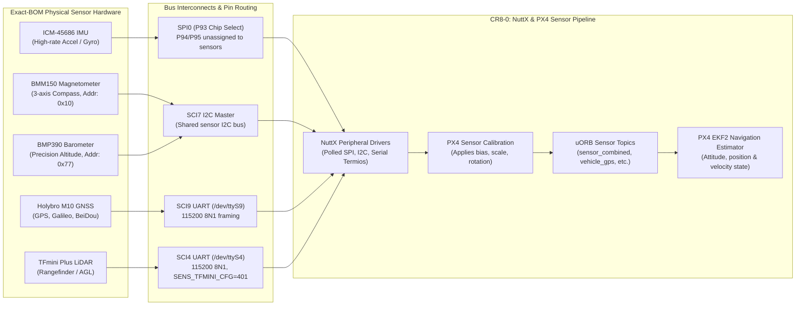
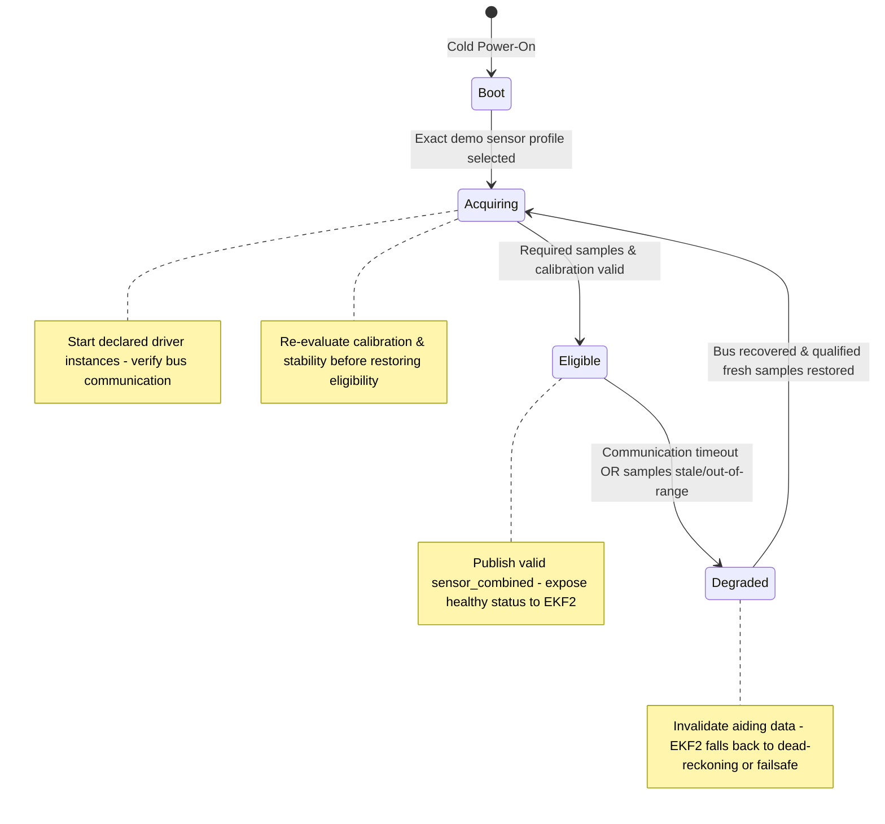

# Sensors and navigation

## Purpose and authority

This module owns **CR8-0 sensor/navigation integration** for the exact-BOM two-CR8 demo. The user approved this boundary and the [umbrella registry](./rzv2h-demo-requirements.md) on 2026-10-21. Existing parent requirements remain unchanged: SYS-IF-001/002; SW-DEV-001/005; SW-TIM-001. The registry owns allocation; the requirement rows below are synchronized module views, not an independent allocation authority.

Revision 1.0 records the approved target design. “Verified” in requirement evidence means the target contract is documented in the approved design, not that firmware implements it. Every implementation/physical test gap below remains open. Current staging behavior is a migration reference. A55/cameras/CM33 are outside demo runtime. Props-off qualification retains full product-service requirements.

## Module ownership

| Path | Classification | Owner | Notes |
|---|---|---|---|
| [rc.board_sensors](../../../boards/renesas/rdk-rzv2h/init/dualcr8/rc.board_sensors) | product-owned | CR8-0 sensor/navigation integration | Canonical one-P93 exact-BOM startup; fitted-device qualification remains open |
| [spi.cpp](../../../boards/renesas/rdk-rzv2h/src/spi.cpp) | product-owned | CR8-0 sensor/navigation integration | Selected SPI descriptor integration |
| [TFMINI.cpp](../../../src/drivers/distance_sensor/tfmini/TFMINI.cpp) | product-owned | CR8-0 sensor/navigation integration | Serial acquisition and final termios ordering |
| [sensors](../../../src/modules/sensors/) | product-owned | CR8-0 sensor/navigation integration | Sensor validity/calibration consumption |
| [ekf2](../../../src/modules/ekf2/) | product-owned | CR8-0 sensor/navigation integration | Estimator integration, not a new estimator algorithm |

Behavioral slices in a shared bridge file do not grant simultaneous write ownership. IPC owns codec/epoch handling, flight control owns producer/readiness consumption, battery owns sample semantics, and actuator safety owns lease/worker inhibition. Integrate those edits sequentially; mirrors have no independent schema authority.

## Interfaces and behavior

The following is the approved target contract with explicit hardware gaps. Exact layouts and block/data-flow/state/sequence diagrams remain in the [engineering design](./rzv2h-dualcr8-demo-design.md); the [architecture](./rzv2h-dualcr8-demo-architecture.md) explains system boundaries without duplicating normative authority.

**Figure 1: Exact-BOM sensor bus architecture and acquisition topology**



| Interface | Direction | Contract / limit |
|---|---|---|
| ICM-45686 | SPI0/P93 → CR8-0 | One polled sensor; fitted rotation required |
| BMM150 / BMP390 | SCI7 → CR8-0 | 0x10 / 0x77; BMP390 uses bmp388 |
| M10 / TFmini Plus | SCI9 / SCI4 → CR8-0 | ttyS9 / ttyS4, 115200 8N1; SENS_TFMINI_CFG=401 |
| Processed sensors | CR8-0 → EKF2 | Timestamp, validity, calibrated units; one IMU gives no redundancy |

### State and fault transitions

These are target integration states, not claims that enums or handlers already exist.

**Figure 2: Sensor pipeline health and eligibility state machine**



| From | Event / guard | To | Action / recovery constraint |
|---|---|---|---|
| Boot | Exact profile selected | Acquiring | Start only declared instances |
| Acquiring | Required samples and calibration eligible | Eligible | Expose ordinary PX4 health |
| Eligible | Required publication stale/invalid | Degraded | Remove affected estimator eligibility |
| Degraded | Qualified fresh samples restored | Acquiring | Recheck calibration and estimator health before eligibility |

**Figure 3: Multi-sensor EKF2 navigation estimation data flow**

```mermaid
flowchart TD
    subgraph Inertial["High-Rate Inertial Prediction Loop (250-400 Hz)"]
        IMU_In["ICM-45686 (ΔAngle, ΔVelocity)"]
        Strapdown["Inertial Strapdown Integration<br/>(Predicts attitude, velocity, position)"]
        IMU_In --> Strapdown
    end

    subgraph Aiding["Multi-Rate Sensor Aiding Updates (10-50 Hz)"]
        Baro_In["BMP390 Baro Altitude (50 Hz)"]
        Mag_In["BMM150 3-Axis Heading (50 Hz)"]
        GPS_In["M10 GNSS Pos & Vel (10 Hz)"]
        Dist_In["TFmini Plus Rangefinder AGL (50 Hz)"]
    end

    subgraph EKF2_Core["PX4 EKF2 Extended Kalman Filter"]
        FuseHAGL["Terrain Height Fusion"]
        FuseMag["Magnetic Heading Fusion"]
        FuseGPS["Horizontal Position & Velocity Fusion"]
        FuseBaro["Barometric Pressure Altitude Fusion"]

        Strapdown --> EKF2_Core
        Baro_In --> FuseBaro
        Mag_In --> FuseMag
        GPS_In --> FuseGPS
        Dist_In --> FuseHAGL
    end

    subgraph VehicleState["Estimated Aircraft State"]
        Att["Vehicle Attitude (Quaternion / Euler)"]
        Pos["Local & Global Position (NED / WGS84)"]
        Vel["Linear Velocity (Vx, Vy, Vz)"]

        EKF2_Core --> Att
        EKF2_Core --> Pos
        EKF2_Core --> Vel
    end
```

### Configuration and persistence

| Parameter / contract | Selected value / gap | Owner / persistence boundary |
|---|---|---|
| SYS_HAS_BARO/GPS/MAG | 1 in target profile | CR8-0; expected-health declarations |
| SYS_HAS_NUM_DIST | 1 in target profile | CR8-0; expected single rangefinder |
| SENS_TFMINI_CFG | 401 (EXT2) | CR8-0; persistent configuration |
| Sensor rotations | Fitted values unknown | Calibration-storage owns persistence; sensors consume validated values |

## Requirements registry

| ID | Requirement | Evidence | Confidence |
|---|---|---|---|
| SDS-SENS-001 | The demo profile shall instantiate exactly the declared sensor BOM. | [Approved target design](./rzv2h-dualcr8-demo-design.md#2-source-authority-bom-and-shared-resource-ownership) | verified |
| SDS-SENS-002 | The new SPI selector shall leave P94/P95 unassigned to sensor roles. | [Approved target design](./rzv2h-dualcr8-demo-design.md#2-source-authority-bom-and-shared-resource-ownership) | verified |
| SDS-SENS-003 | The sensor pipeline shall retain acquisition freshness through estimator ingestion. | [Approved target design](./rzv2h-dualcr8-demo-design.md#2-source-authority-bom-and-shared-resource-ownership) | verified |
| SDS-SENS-004 | The sensor pipeline shall apply the validated fitted orientation. | [Approved target design](./rzv2h-dualcr8-demo-design.md#2-source-authority-bom-and-shared-resource-ownership) | verified |
| SDS-SENS-005 | The profile shall declare every expected sensor in ordinary PX4 health checks. | [Approved target design](./rzv2h-dualcr8-demo-design.md#2-source-authority-bom-and-shared-resource-ownership) | verified |
| SDS-SENS-006 | The TFmini driver shall apply final serial framing before acquisition. | [Approved target design](./rzv2h-dualcr8-demo-design.md#2-source-authority-bom-and-shared-resource-ownership) | verified |
| SDS-SENS-007 | The estimator integration shall reject navigation data failing its selected validity policy. | [Approved target design](./rzv2h-dualcr8-demo-design.md#2-source-authority-bom-and-shared-resource-ownership) | verified |
| SDS-SENS-008 | Sensor bus recovery shall preserve unrelated output deadlines. | [Approved target design](./rzv2h-dualcr8-demo-design.md#2-source-authority-bom-and-shared-resource-ownership) | verified |

## Verification matrix

The methods below define required future proof. Existing source/reference coverage in the evidence ledger is partial and does not close a new-pair test.

| ID | Method | Level | Pass criterion | Existing test/gap | Code-review criterion |
|---|---|---|---|---|---|
| SDS-SENS-001 | analysis + test | integration/system | One ICM-45686, BMM150, BMP390, M10 and TFmini Plus instance; no hidden second IMU. | gap: full integration and physical acceptance evidence pending | Profile enumeration and artifact inspection |
| SDS-SENS-002 | analysis + test | integration/system | Selected table and init/reset paths contain no P94/P95 sensor touches; legacy roles remain unchanged. | gap: full integration and physical acceptance evidence pending | Selector exclusivity and conditional pin ownership |
| SDS-SENS-003 | analysis + test | integration/system | Stopped acquisition cannot be refreshed by republishing cached samples under the selected stale thresholds. | gap: full integration and physical acceptance evidence pending | Timestamp origin and stale rejection |
| SDS-SENS-004 | analysis + test | integration/system | Known axis stimuli produce the signed expected body-axis response after reboot. | gap: full integration and physical acceptance evidence pending | Rotation and calibration application once |
| SDS-SENS-005 | analysis + test | integration/system | Missing declared barometer/GPS/magnetometer/rangefinder fails its normal readiness check. | gap: full integration and physical acceptance evidence pending | SYS_HAS declarations and no bypass |
| SDS-SENS-006 | analysis + test | integration/system | Captured configured attributes are 115200 8N1 before first accepted frame. | gap: full integration and physical acceptance evidence pending | tcsetattr ordering and malformed framing |
| SDS-SENS-007 | analysis + test | integration/system | Invalid GNSS fix or out-of-policy range cannot be treated as a valid aiding measurement. | gap: full integration and physical acceptance evidence pending | Fix/range quality and estimator eligibility |
| SDS-SENS-008 | analysis + test | integration/system | Injected stuck sensor bus causes no measured output deadline violation. | gap: full integration and physical acceptance evidence pending | Bounded transaction/recovery ownership |

## Traceability

| ID | Design or behavior trace | Test trace | Review trace |
|---|---|---|---|
| SDS-SENS-001 | [Interfaces and behavior](#interfaces-and-behavior) | [Verification matrix](#verification-matrix) | [Review criteria](#review-criteria) |
| SDS-SENS-002 | [Interfaces and behavior](#interfaces-and-behavior) | [Verification matrix](#verification-matrix) | [Review criteria](#review-criteria) |
| SDS-SENS-003 | [Interfaces and behavior](#interfaces-and-behavior) | [Verification matrix](#verification-matrix) | [Review criteria](#review-criteria) |
| SDS-SENS-004 | [Interfaces and behavior](#interfaces-and-behavior) | [Verification matrix](#verification-matrix) | [Review criteria](#review-criteria) |
| SDS-SENS-005 | [Interfaces and behavior](#interfaces-and-behavior) | [Verification matrix](#verification-matrix) | [Review criteria](#review-criteria) |
| SDS-SENS-006 | [Interfaces and behavior](#interfaces-and-behavior) | [Verification matrix](#verification-matrix) | [Review criteria](#review-criteria) |
| SDS-SENS-007 | [Interfaces and behavior](#interfaces-and-behavior) | [Verification matrix](#verification-matrix) | [Review criteria](#review-criteria) |
| SDS-SENS-008 | [Interfaces and behavior](#interfaces-and-behavior) | [Verification matrix](#verification-matrix) | [Review criteria](#review-criteria) |

## Review criteria

Review each verification-row boundary against the actual selected profile and source change. Reject double ownership, stale data promoted to fresh authority, implicit hardware selection, cross-clock subtraction and promotion of a build/ACK into physical proof. Resolve each test gap with a named artifact before claiming its requirement passed. A hardware-dependent record stays blocked until its ICD is frozen; independent source work remains possible.

## Evidence ledger

| Claim / requirement | Evidence location | Confidence | Status / gap |
|---|---|---|---|
| Approved module requirements | [Engineering design](./rzv2h-dualcr8-demo-design.md) | verified | Target design authority only |
| Current migration and implementation boundaries | [rc.board_sensors](../../../boards/renesas/rdk-rzv2h/init/drone/rc.board_sensors) | verified | Source location exists; no integrated new-pair result |
| Related source/test evidence | [Subsystem evidence](../../../plans/reports/research-261021-0230-product-subsystems.md) | verified | Historical source review; rerun affected tests during implementation |
| Full module acceptance | [Verification matrix](#verification-matrix) | unknown | Required test/physical results pending |

The [software validation receipt](../evidence/dualcr8-software-validation-261021.md) records current exact-BOM profile/artifact and TFmini serial checks. The [drone profile fixture](../../../test/rzv2h-drone-profile-contract-test.py) separately preserves legacy selection. Fitted sensors, navigation and integrated physical freshness remain unqualified.

## Open inputs and acceptance gaps

Fitted orientations, harness/supply/pull-ups, exact Plus framing, GNSS quality, numeric sensor freshness policy and integrated estimator evidence remain unqualified.

The [shared hardware-input ledger](./rzv2h-demo-requirements.md#hardware-input-gates) names closure evidence. Unknown hardware remains an input gate rather than a substituted part number or a waived requirement.
