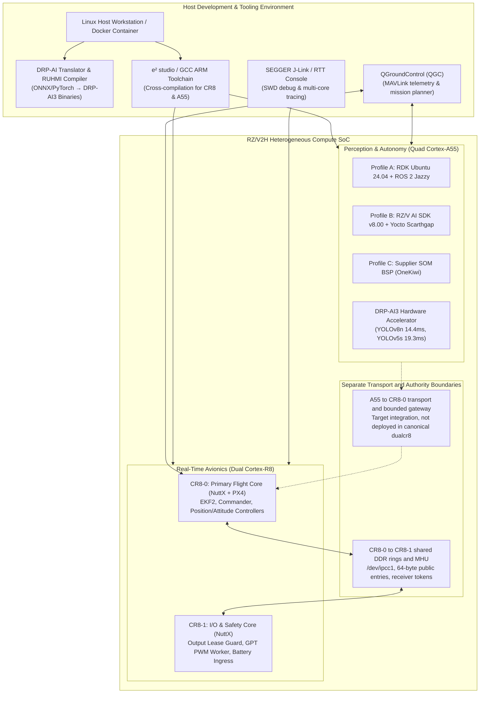
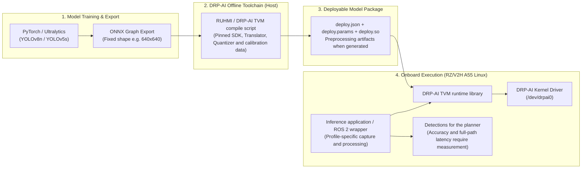
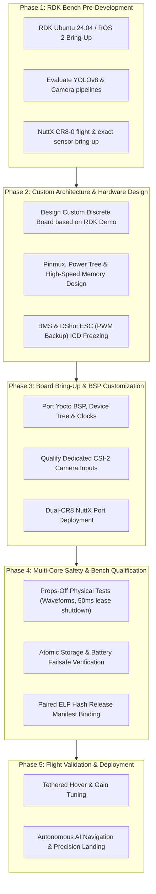

# RZ/V2H Development Ecosystem and RDK Pre-Development Guide

This guide maps the general RZ/V2H product architecture to software and examples
that customers can reuse. The RZ/V2H RDK is one pre-development platform. It is not
the required production board, pinout, operating-system image, or flight
controller.

Version facts below were checked on 2026-10-11. Links named `latest` can move;
record release tags, commits, downloaded package identifiers, and checksums in a
product compatibility manifest.

## Contents

- [1. Choose a starting profile](#1-choose-a-starting-profile)
- [2. Verified software snapshot](#2-verified-software-snapshot)
- [3. Official repository map](#3-official-repository-map)
- [4. AI and YOLO guidance](#4-ai-and-yolo-guidance)
- [5. From RDK to a customer board](#5-from-rdk-to-a-customer-board)
- [6. Sources](#6-sources)

## 1. Choose a starting profile

### 1.1 Why this ecosystem is a useful starting point

Customers can evaluate Linux vision and CR8 flight software before committing
to a custom PCB. Renesas provides board software, model-conversion tools and ROS
2 examples; the PX4/NuttX tree provides a separate real-time porting reference.
These are reusable engineering assets with different maturity levels.

| Customer objective | Reusable starting asset | First evidence to collect |
|---|---|---|
| Demonstrate onboard perception | RDK camera/ROS 2 demos and DRP-AI model packages | Recorded input, detections, model identity, frame age and measured latency |
| Develop a product Linux image | AI SDK source/Yocto recipes or the chosen module vendor BSP | Rebuilt kernel/DTB/rootfs and a reproducible package manifest |
| Bring up flight sensors and control | This PX4/NuttX port; public RDK FreeRTOS sample for comparison | Build artifacts, sensor timestamps, inactive output and reset measurements |
| Reduce custom high-speed board work | A supplier-supported SOM plus customer carrier | Released SOM pinout, carrier design files and board-specific BSP |
| Add differentiated autonomy | VIO, planner, landing and payload applications | Mission-specific accuracy and failure tests on the selected hardware |

Start with a bounded demonstration, then use the
[board design-start package](./rzv2h-system-specification.md#55-board-design-start-package)
and [software bring-up path](./rzv2h-software-specification.md#34-developer-start-path)
to turn that evidence into a customer platform. No stock profile yet combines
all three target domains into a flight-qualified release.

### 1.2 Choose one coherent profile per workstream

**Figure 1: RZ/V2H development ecosystem software landscape and profiles**



| Profile | Best use | Integration boundary |
|---|---|---|
| RDK Ubuntu/ROS 2 | Fast camera, AI, networking and ROS 2 evaluation | Ubuntu/Jazzy application baseline; RDK wiring and boot assets are board-specific |
| RZ/V2H AI SDK/Yocto | Custom Linux BSP and product-image development | EVK source starting point; port boot, DDR, device tree and peripherals |
| Supplier SOM BSP | Carrier-board product development | Use that module revision's supported BSP; obtain its release manifest |
| Public RDK PX4/FreeRTOS sample | Study CR8/A55 PX4, sensors and RPMsg integration | Separate FreeRTOS/POSIX baseline, not a drop-in NuttX image |
| This PX4/NuttX port | Target CR8-0 flight and CR8-1 I/O development | See the [NuttX](../port-status-nuttx.md) and [PX4 HAL](../port-status-px4-hal.md) status matrices; customer flight integration remains |
| RZ FSP/Multi-OS | CR8 peripherals, lifecycle and IPC references | Match board, core and package release; CM33 examples are out of scope |

The target domain allocation and CM33-free boot boundary belong to the [system
specification](./rzv2h-system-specification.md#3-rzv2h-allocation) and [software
specification](./rzv2h-software-specification.md#3-deployment-by-compute-domain).
Choose an A55 cold-boot path without a CM33 dependency; run the public FreeRTOS
sample separately when it is useful for peripheral or transport study.

### 1.3 Dual-CR8 real-sensor evaluation

The [demo architecture](./rzv2h-dualcr8-demo-architecture.md) and [engineering design](./rzv2h-dualcr8-demo-design.md) retain full battery, persistent-calibration and electrical-inhibit acceptance. Canonical `dualcr8` and CR8-1 `pwm` have a [host-tested/build-clean software candidate](../evidence/dualcr8-software-validation-261021.md), with unconfigured hardware identities and no admitted pair. Historical `dualcr8+default` admission is retired. A55/camera/CM33 are absent from this runtime; the broader Linux/AI profiles remain separate. The upstream version snapshot stays dated 2026-10-11; the local software receipt does not refresh it. The [module registry](./rzv2h-demo-requirements.md) owns props-off-first acceptance and hardware-input gates.

## 2. Verified software snapshot

### 2.1 RDK Ubuntu profile

The [RDK manual overview](https://renesas-rdk.github.io/rzv2h_rdk_documentation/latest/chapter-1/rdk_overview.html)
identifies Ubuntu 24.04 and ROS 2 Jazzy. The
[kernel customization guide](https://renesas-rdk.github.io/rzv2h_rdk_documentation/latest/chapter-2/common_system/quick_start_guide.html)
identifies Linux 6.10, shows installed modules under
`6.10.14-arm64-renesas`, and requires the `ubuntu/rz-v2h-rdk` branches of
`linux-rz` and `rz-utils`.

This kernel is based on the Yocto Project `linux-yocto` kernel, but the RDK
runtime described by this profile is Ubuntu 24.04. Do not call it the same image
as the Yocto-based RZ/V2H AI SDK. The RDK guide also states that its release
does not include bootloader build tooling, another reason not to treat it as a
complete production BSP.

| Component | Verified RDK reference |
|---|---|
| User manual | v1.2.0 |
| Target OS | Ubuntu 24.04, server or desktop |
| ROS 2 | Jazzy, tested by the RDK project |
| Linux | 6.10 family; documented module path `6.10.14-arm64-renesas` |
| Kernel/utilities branch | `ubuntu/rz-v2h-rdk` |
| Host | Ubuntu 24.04 with Docker |
| Accelerated OpenCV package | OpenCV 4.6.0 Ubuntu 24.04 ARM64 package repository |

### 2.2 RZ/V2H AI SDK/Yocto profile

The current [RZ/V2H AI SDK product page](https://www.renesas.com/en/software-tool/rzv2h-ai-software-development-kit)
lists AI SDK v8.00, released 2026-09-11. Its
[versioned configuration](https://renesas-rz.github.io/rzv_ai_sdk/8.10/v2h-configuration.html)
identifies the following paired components:

| Component | AI SDK v8.00 reference |
|---|---|
| Linux BSP | RZ/V2H Linux BSP v2.0.0 |
| Yocto | 5.0.11, Scarthgap |
| Kernel | 6.1.141-cip43 |
| RUHMI compiler | Release-2026-06-30, including v2.8.0-hotfix |
| DRP-AI Translator | i8 v1.12 |
| DRP-AI Driver | v1.50 |
| OpenCV / accelerator | OpenCV 4.9.0 / accelerator v1.50 |
| Video Codec Library | v4.3.4.0 |
| Python | 3.12 |

The [SDK specification](https://renesas-rz.github.io/rzv_ai_sdk/8.10/ai-sdk.html#rzv2h-ai-sdk-specification)
also identifies an important workload constraint: OpenCV acceleration and video
**decoding** share the DRP and cannot run simultaneously in that profile.
Plan resource arbitration; neither four camera inputs nor DRP-AI TOPS guarantees
four concurrent full-rate processing pipelines.

The binary AI SDK targets the RZ/V2H EVK. Customers changing the memory map,
device tree, peripherals, or board should use the AI SDK source package and its
Yocto recipes, then qualify the resulting image on their hardware.

### 2.3 Other official profiles and hardware platforms

| Profile / Platform | Snapshot | Relationship to this design |
|---|---|---|
| OneKiwi RZ/V2H SOM | Published brief: 8 GB LPDDR4X, 64 GB eMMC, 65 × 40 mm, 5 V input, four Hirose board-to-board connectors | Candidate module/carrier route; supplier drawing, BOM revision, pinout and qualification govern design |
| OneKiwi 360° Surround View | Vendor describes four-camera ground-vehicle viewing/analytics | Reuse candidate for calibration/media work; bird's-eye view is not airborne 3D avoidance evidence |
| RZ/V AI Applications | v8.10; five applications identified for RZ/V2H AI SDK v8.00 | Sample source, binaries, and model objects; application-web version is not the SDK version |
| RZ/V2H ROS 2 Support Package | v2.0; ROS 2 Humble; Yocto-native or Docker; paired with AI SDK v6.00 | Separate EVK profile; do not mix implicitly with the RDK Jazzy baseline |
| RDK drone sample | PX4 v1.16.0; CR8 FreeRTOS+POSIX; ROS 2 Humble; Micro XRCE-DDS Agent v3.0.1 | Pre-development architecture and integration sample |
| RZ Multi-OS / RZ FSP | Multi-OS v4.2.0 and RZ FSP v4.2.0 | CR8 and peripheral reference; FSP release adds RZ/V2H CR8 Ethernet and FreeRTOS+TCP support |
| AI Navigator / e² studio | AI Navigator v2.2.0; e² studio 2026-04.3 listed for download | Optional GUI development and model workflow; freeze the installer with the selected FSP/SDK |
| AOSP | RZ/V2H Software Package for AOSP 15 v15.3.0 | Optional Android profile, not the default autonomous-drone Linux selection |

### 2.4 Supplier and version compatibility boundaries

The [OneKiwi product page](https://onekiwi.com.vn/products/som-renesas-ai-rz-v2h/)
links its [module brief](https://onekiwi.com.vn/wp-content/uploads/2024/09/OneKiwi-RZ-V2H-SOM-AI-Accelerator-Datasheet-Release.pdf),
carrier resources and BSP. Its linked
[Yocto repository](https://github.com/OneKiwiEmbedded/meta-renesas-rzv2h/tree/onekiwi-dunfell/rzv2h-sdk-v5.20)
uses a Dunfell/SDK-v5.20 branch. This is distinct from Renesas AI SDK v8.00
Scarthgap. The web page advertises Ubuntu 24.04 while the brief mentions 22.04;
obtain the supplier's current board-specific release matrix before choosing.
The [surround-view reference](https://onekiwi.com.vn/360-surround-view/) is a
ground-vehicle application, not an already-qualified drone navigation stack.

Treat compatibility as a set: board revision, bootloader, kernel/device tree,
rootfs, accelerator runtime, model, ROS 2 and CR8 images. For example, the
Humble support package's SDK v6.00 dependency is not evidence of compatibility
with SDK v8.00; the RDK OpenCV 4.6 package is not the AI SDK OpenCV 4.9 build.

## 3. Official repository map

The [Renesas RDK organization](https://github.com/renesas-rdk) and its
[repository list](https://github.com/orgs/renesas-rdk/repositories) are the
discovery entry points. The following decision-relevant map distinguishes
Renesas examples, supplier assets, and upstream integration candidates.
Repository availability does not imply board support or a support SLA.

### 3.1 Board, BSP, and reproducible workspaces

| Repository | Customer use |
|---|---|
| [`rzv2h_rdk_documentation`](https://github.com/renesas-rdk/rzv2h_rdk_documentation) | RDK manual, hardware manual, setup, and tagged releases |
| [`Renesas-SST/linux-rz`](https://github.com/Renesas-SST/linux-rz/tree/ubuntu/rz-v2h-rdk) | RDK Linux kernel source |
| [`Renesas-SST/rz-utils`](https://github.com/Renesas-SST/rz-utils/tree/ubuntu/rz-v2h-rdk) | Kernel, DTB, module, and deployment utilities |
| [`ubuntu_xbuild_toolchains`](https://github.com/renesas-rdk/ubuntu_xbuild_toolchains) | Docker cross-build environment |
| [`ros2_demo_workspace`](https://github.com/renesas-rdk/ros2_demo_workspace) | Pinned `vcs` manifests; preferred entry point for reproducible demos |
| [`rzv2h_opencv_accelerated_debs`](https://github.com/renesas-rdk/rzv2h_opencv_accelerated_debs) | Accelerated OpenCV packages for the RDK Ubuntu profile |

### 3.2 AI and ROS 2 packages

| Repository | Customer use |
|---|---|
| [`rzv_model`](https://github.com/renesas-rdk/rzv_model) | Base DRP-AI model abstraction |
| [`rzv_model_utils_ros2`](https://github.com/renesas-rdk/rzv_model_utils_ros2) | RZ/V ROS 2 model integration helpers |
| [`renesas_model_utils_ros2`](https://github.com/renesas-rdk/renesas_model_utils_ros2) | Platform-neutral ROS 2 helpers |
| [`rzv_object_detection`](https://github.com/renesas-rdk/rzv_object_detection) | ROS 2 nodes using YOLOX, Gold-YOLO, and YOLOv8 examples |
| [`rzv_pose_estimation`](https://github.com/renesas-rdk/rzv_pose_estimation) | Hand-landmark and pose example |
| [`rzv_yolov8`](https://github.com/renesas-rdk/rzv_yolov8) | YOLOv8 detection/OBB package and post-processing |
| [`rzv_yolox`](https://github.com/renesas-rdk/rzv_yolox) | YOLOX package |
| [`rzv_gold_yolo`](https://github.com/renesas-rdk/rzv_gold_yolo) | Gold-YOLO package |
| [`rzv_mediapipe`](https://github.com/renesas-rdk/rzv_mediapipe), [`rzv_hrnetv2`](https://github.com/renesas-rdk/rzv_hrnetv2), [`rzv_rtmpose`](https://github.com/renesas-rdk/rzv_rtmpose) | Additional pose/model examples |

### 3.3 Drone, PX4, and autonomy middleware

| Repository | Reuse and status |
|---|---|
| [RDK drone sample](https://github.com/renesas-rdk/rzv2h_drone_px4) | Renesas FreeRTOS/POSIX PX4 integration reference with RPMsg and sensor wiring |
| [RDK PX4 fork](https://github.com/renesas-rdk/PX4-Autopilot/tree/feature/rzv2h-freertos) | Sample-specific PX4 branch; retain its submodule/dependency pins |
| [RDK XRCE-DDS Agent](https://github.com/renesas-rdk/Micro-XRCE-DDS-Agent) | Sample-specific custom RPMsg transport; do not substitute an arbitrary upstream agent version |
| [CR8-0/Linux RPMsg example](https://github.com/renesas-rdk/rzv2h_rdk_cr8_core0_rpmsg_linux_rtos_demo) | Renesas interprocessor reference |
| [CR8-0 micro-ROS example](https://github.com/renesas-rdk/rzv2h_rdk_cr8_core0_rpmsg_microros_demo) | Renesas micro-ROS reference; separate from the PX4 uXRCE client |
| [PX4 messages](https://github.com/PX4/px4_msgs) | Match message definitions to the selected PX4 build |
| [PX4 ROS 2 Interface Library](https://github.com/Auterion/px4-ros2-interface-lib) | Upstream `px4_ros2_cpp`; optional higher-level API, with version-dependent/experimental features |
| [OpenVINS](https://github.com/rpng/open_vins) | Upstream VIO candidate; customer calibration, ARM64 build and real-time profiling required |
| [AprilTag](https://github.com/AprilRobotics/apriltag) | Upstream CPU fiducial detection/pose candidate; not automatically a DRP-AI neural model |
| [Nav2](https://github.com/ros-navigation/navigation2) | Reusable robotics concepts/components; no verified RDK `nav2_aerial` package or ready airborne 3D planner was established here |

Select and validate an aerial planner with flight-dynamics constraints. Do not
treat a ground-robot navigation demonstration as airborne obstacle avoidance.
The software specification maps the actual PX4 topic and landing interfaces.

### 3.4 Generic RZ/V2H software sources

| Repository | Customer use |
|---|---|
| [`rzv_ai_sdk`](https://github.com/renesas-rz/rzv_ai_sdk) | AI SDK documentation and version history |
| [`rzv_drp-ai_tvm`](https://github.com/renesas-rz/rzv_drp-ai_tvm) | RUHMI compiler, conversion guides, and verified model list |
| [`rzv2h_drp-ai_driver`](https://github.com/renesas-rz/rzv2h_drp-ai_driver) | Linux DRP-AI driver |
| [`rzv2h_opencv_accelerator`](https://github.com/renesas-rz/rzv2h_opencv_accelerator) | DRP-backed OpenCV acceleration |
| [`rzv2h_ros2`](https://github.com/renesas-rz/rzv2h_ros2) | RZ/V2H ROS 2 package source |
| [`rzv_aosp_ai_apps`](https://github.com/renesas-rz/rzv_aosp_ai_apps) | Optional AOSP AI applications |
| [`rz-fsp`](https://github.com/renesas/rz-fsp) | Current unified RZ FSP |

## 4. AI and YOLO guidance

**Figure 2: RUHMI/DRP-AI TVM compiler artifacts and application/runtime deployment boundary**



The [Renesas RZ/V2H compiler tutorial](https://github.com/renesas-rz/rzv_drp-ai_tvm/blob/main/tutorials/tutorial_RZV2H.md#c-interpreter-mode) identifies this TVM artifact set; the [application guide](https://github.com/renesas-rz/rzv_drp-ai_tvm/blob/main/apps/build_appV2H.md) describes the C++ application and runtime-library boundary. Pin the compiler release/commit and retain its complete generated directory with the application/runtime build receipt. This diagram does not prescribe another toolchain's file format or establish a deployed ROS 2/DRP-AI path in this firmware workspace.

“YOLO version” is not sufficient configuration. The RDK ecosystem exposes
YOLOv8, YOLOX, and Gold-YOLO packages, while the current
[RZ/V2H model list](https://github.com/renesas-rz/rzv_drp-ai_tvm/blob/main/docs/model_list/Model_List_V2H.md)
records EVK conversion/operation results for a broader set including YOLOv5,
YOLOv6, YOLOv7, YOLOv8, YOLOv9, YOLOv10, YOLO11, YOLO26, and YOLOX.

That list identifies its own test tuple as RUHMI R2026-06, Translator i8 v1.12,
AI SDK v6.00, and the RZ/V2H EVK. It is conversion and benchmark evidence for
that tuple, not proof that every model is integrated or qualified on the RDK
Ubuntu image or a customer drone.

For every released model, pin:

- model family, size, weights, input shape, and training dataset;
- training/export repository commit, framework version, and ONNX opset;
- pre-processing, post-processing, thresholds, and class map;
- RUHMI release, Translator version, AI SDK/BSP, and DRP-AI driver;
- calibration/quantization dataset identity;
- target-board accuracy, latency, memory, thermal, and concurrent-camera load.

Review licensing before product use. For example, the RDK `rzv_yolov8`
repository declares AGPL-3.0; model weights, datasets, and upstream exporters
can have separate terms.

### 4.1 A useful benchmark, with its boundary

Renesas' [model evaluation table](https://github.com/renesas-rz/rzv_drp-ai_tvm/blob/main/docs/model_list/Model_List_V2H.md)
lists these inference measurements for 640 × 640 detection models:

| Model | Published inference time |
|---|---:|
| YOLOv5s | 19.3 ms |
| YOLOv8n | 14.4 ms |
| YOLO11n | 15.7 ms |

The table's EVK/SDK v6.00/RUHMI R2026-06/Translator i8 v1.12 tuple is the
benchmark provenance. These are useful model-selection evidence, not measured
camera-to-control latency or concurrent drone FPS. Preserve the model-list
commit when repeating the evaluation.

For an RDK first demonstration, start with a model in the selected locked demo.
The RDK YOLOv8 README implements detection and oriented boxes; it describes
segmentation and pose as future additions. The broader compiler model list
does not mean the RDK wrapper implements every task.

## 5. From RDK to a customer board

**Figure 3: Customer journey from RDK evaluation bench to flight-qualified aircraft**



### 5.1 Reproduce one Linux/AI demonstration

Use the RDK [first-boot guide](https://renesas-rdk.github.io/rzv2h_rdk_documentation/latest/chapter-1/quick_setup_guide.html)
and [application development guide](https://renesas-rdk.github.io/rzv2h_rdk_documentation/latest/chapter-4/development_guide/development_guide.html)
for image, camera, ROS 2 and host/container preparation. Follow their target
versus host distinction; review scripts requiring root before running them.

The following retrieves the inspected workspace snapshot. It requires Git,
`vcstool` and the guide's prepared development environment; it does not flash
hardware or establish a working perception system by itself.

```bash
git clone https://github.com/renesas-rdk/ros2_demo_workspace.git
cd ros2_demo_workspace
git checkout --detach e54204b38feeb22cf113b627b68d70297a85f2a5
vcs validate < vcs_manifests/rz-v2h/static_object_detection.target.lock.repos
vcs import . < vcs_manifests/rz-v2h/static_object_detection.target.lock.repos
colcon list --base-paths src
```

The [inspected manifest](https://github.com/renesas-rdk/ros2_demo_workspace/blob/e54204b38feeb22cf113b627b68d70297a85f2a5/vcs_manifests/rz-v2h/static_object_detection.target.lock.repos)
already prefixes repository paths with `src/`, so the import destination above
is `.`. This avoids accidental `src/src/` nesting. Then follow the imported
demo README and the RDK guide to install dependencies, build, obtain compatible
model objects and launch. Freeze the container digest too; `multiarch` is a
moving image tag. The static detection manifest is not a flight/VIO stack.

Capture OS/kernel versions, workspace SHA, model hash, camera format,
detections on recorded input, frame drops, latency, memory and temperature.
Keep this evidence bundle as the baseline for later custom-board comparison.

### 5.2 Parallel engineering workstreams

| Workstream / owner | Start with | Deliverable before integration |
|---|---|---|
| Hardware | [System design-start package](./rzv2h-system-specification.md#55-board-design-start-package) and supplier/Renesas design files | Selected BOM, power tree, resource ledger, schematic, pinmux and ICD |
| Linux/BSP | Selected RDK, EVK Yocto or SOM release | Rebuilt image, boot/recovery path, DTB, memory reservations and driver inventory |
| Flight/RTOS | [NuttX/PX4 developer path](./rzv2h-software-specification.md#34-developer-start-path) | CR8 artifacts, physical-sensor bench evidence and persistent parameters |
| I/O integration | CR8-1 target contracts and BMS/ESC ICD | Lease handling, measured output-safe behavior, RC/battery snapshots |
| Vision/autonomy | Locked detector demo, camera calibration and candidate VIO | Dataset replay, time/frame conversion, confidence and stale-data behavior |
| Systems/validation | Joint interface and timing budget | Repeatable HIL, saturation/reset tests and release evidence index |

Here “parallel” describes customer team work, not a claim that those components
are already integrated. Do not start flight testing from a successful AI demo.

### 5.3 Transfer to customer hardware

1. Derive the selected custom discrete board from the RDK reference architecture and reviewed source; qualify the customer pinmux, clocks, power/reset, memory and physical interfaces. The local software receipt does not establish hardware inheritance.
2. Choose direct CSI-2, SerDes, USB or Ethernet cameras using bandwidth,
   synchronization, harness and driver evidence.
3. Port boot/DDR initialization, device tree, memory reservations, pinmux,
   clocks, transceivers, sensor rails and storage ownership.
4. Qualify the chosen Linux profile and both NuttX images together, with CM33
   unused. Treat the FreeRTOS sample as reference evidence only.
5. Add customer BMS, RC, ESC (DShot primary, PWM 400Hz backup), GNSS and payload services through their ICDs.
6. Re-run the same perception and flight bench tests, then simultaneous-load,
   reset, power and thermal campaigns before aircraft qualification.

The stock RDK has no usable analog battery input. Its
[public drone sample](https://github.com/renesas-rdk/rzv2h_drone_px4#hardware)
uses an INA228/PM03D I2C power monitor. That monitor measures pack quantities;
it is not a complete cell-protection BMS. Customer hardware can select
CAN/DroneCAN, SMBus, a documented digital monitor, or a protected ADC front end
as detailed in the system specification.

### 5.4 Release and support checklist

- Freeze every source revision, toolchain/container, image, model and calibration.
- Record licenses for firmware, libraries, model weights, training data and
  compiler/runtime redistribution; repository licenses do not cover all assets.
- Identify the owner for silicon/BSP support, module/carrier support, PX4/NuttX
  integration and aircraft validation. Confirm support terms with each supplier.
- Archive known issues, security-update responsibility, update/recovery tests
  and hardware revision compatibility. Public source does not promise lifetime
  maintenance or aircraft approval.

## 6. Sources

- [RZ/V2H RDK User Manual](https://renesas-rdk.github.io/rzv2h_rdk_documentation/latest/)
- [RZ/V2H RDK Linux customization](https://renesas-rdk.github.io/rzv2h_rdk_documentation/latest/chapter-2/common_system/quick_start_guide.html)
- [Renesas RDK GitHub organization](https://github.com/renesas-rdk)
- [RZ/V2H AI SDK](https://www.renesas.com/en/software-tool/rzv2h-ai-software-development-kit)
- [RZ/V AI applications and SDK](https://renesas-rz.github.io/rzv_ai_sdk/latest/)
- [RZ/V AI SDK version matrix](https://renesas-rz.github.io/rzv_ai_sdk/8.10/version.html)
- [RZ/V2H AI SDK configuration](https://renesas-rz.github.io/rzv_ai_sdk/8.10/v2h-configuration.html)
- [RZ/V2H ROS 2 Package](https://www.renesas.com/en/software-tool/rzv2h-ros2-package)
- [RZ Multi-OS Package](https://www.renesas.com/en/software-tool/rz-multi-os-package)
- [RZ FSP v4.2.0](https://github.com/renesas/rz-fsp/releases/tag/v4.2.0)
- [AI Navigator](https://www.renesas.com/en/software-tool/ai-navigator-ide-ai-applications)
- [RZ/V2H AOSP 15 v15.3.0](https://renesas-rz.github.io/rz_aosp/v15.3.0/)
- [RZ/V2H hardware design handbook](https://www.renesas.com/en/document/gde/rzv2h-group-handbook)
- [OneKiwi RZ/V2H module and design resources](https://onekiwi.com.vn/products/som-renesas-ai-rz-v2h/)
