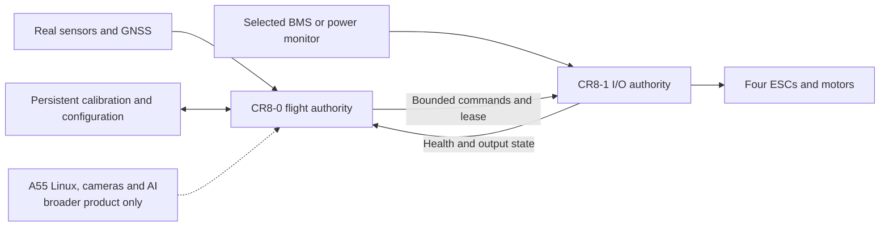
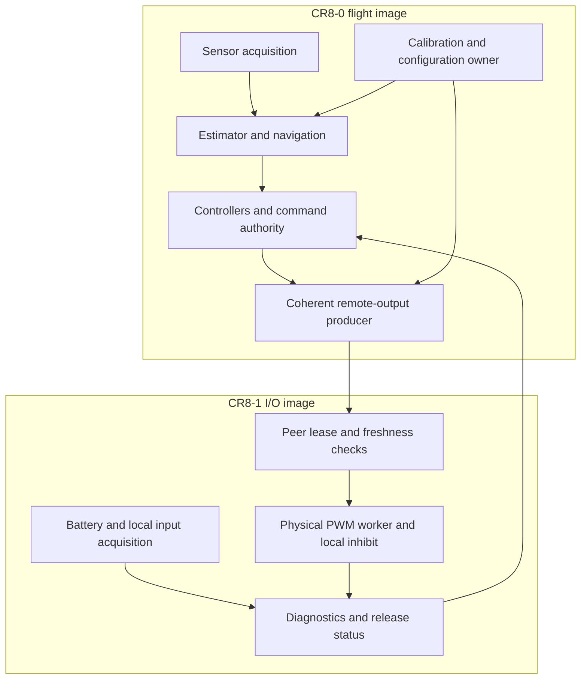
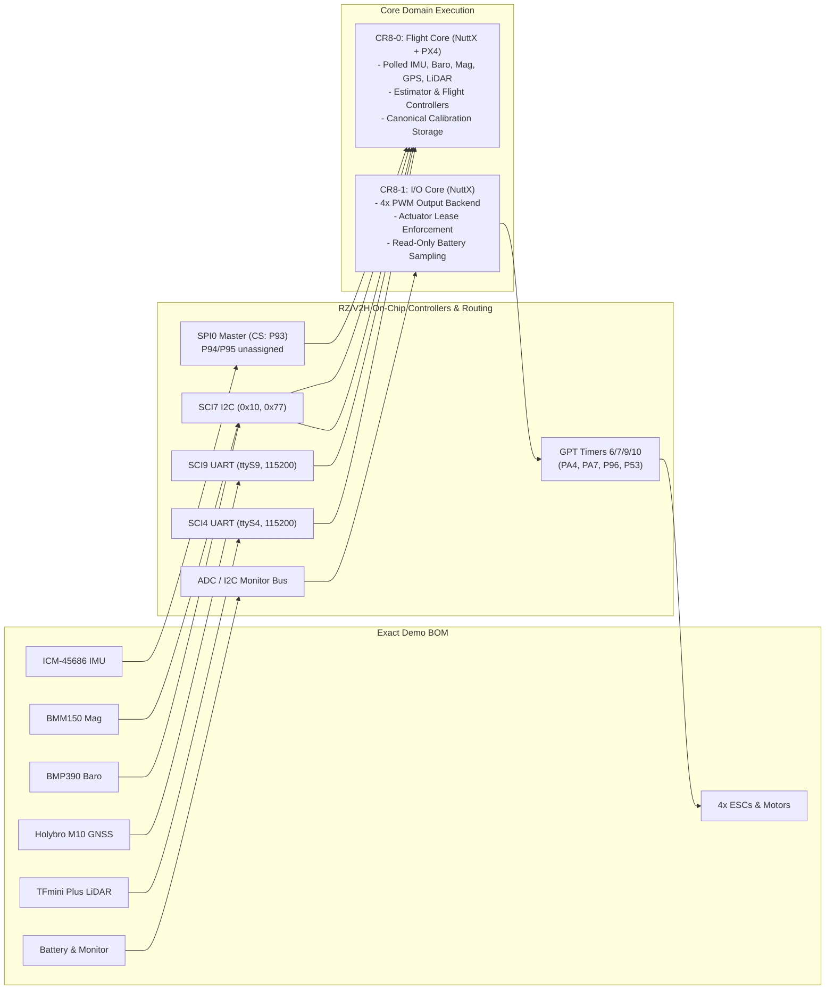
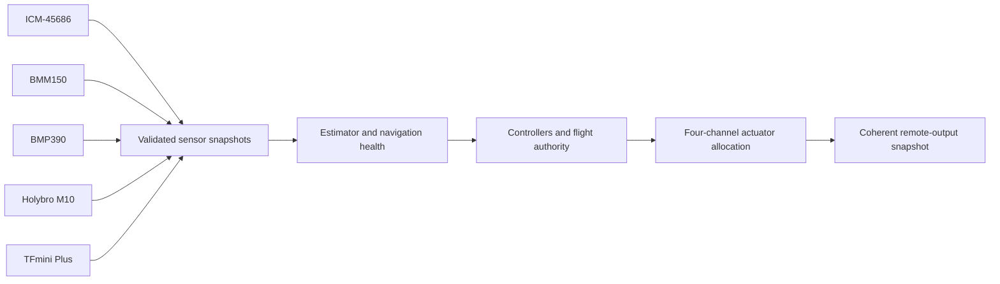
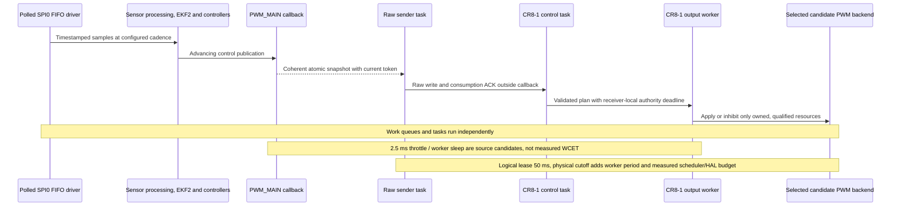
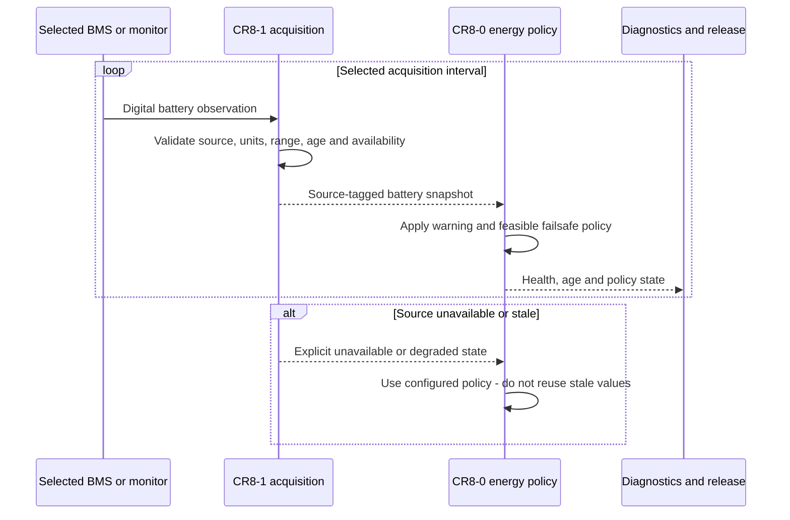
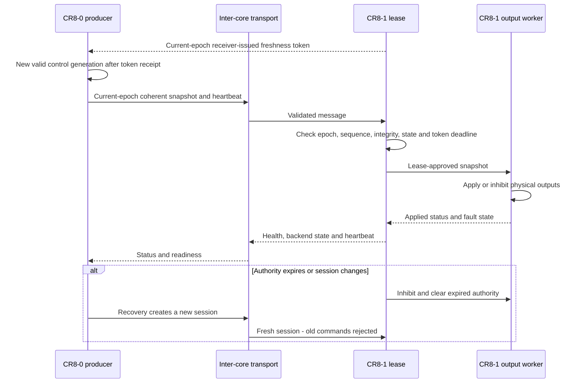
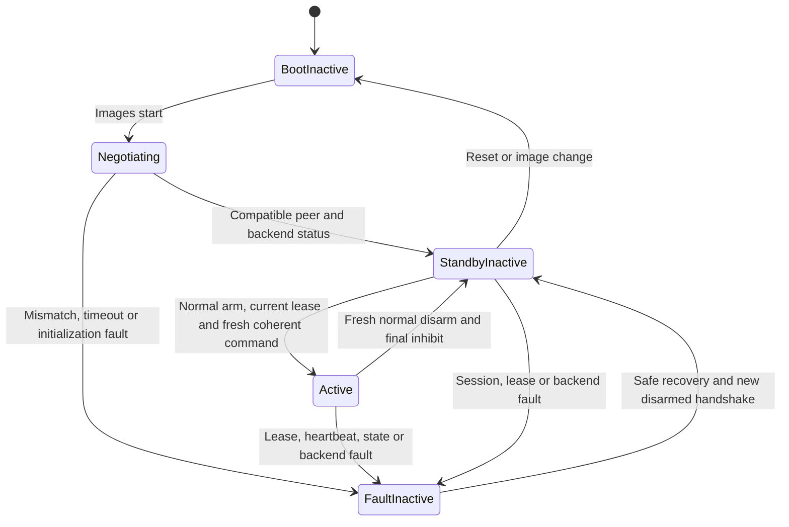
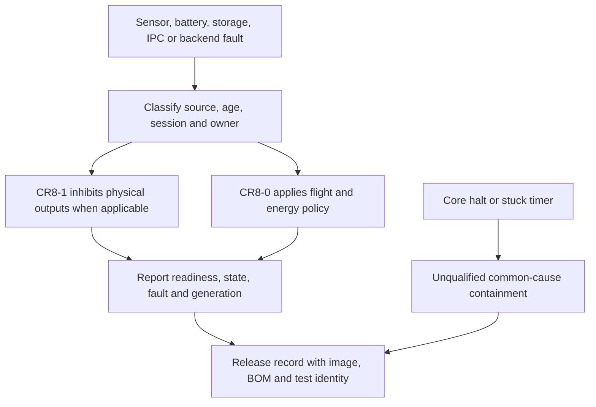

# RZ/V2H dual-CR8 demo system architecture

This page describes how the proposed real-sensor and actuator demonstration is assembled. It is a non-normative companion to the [system specification](./rzv2h-system-specification.md) and [software specification](./rzv2h-software-specification.md). The [detailed demo design](./rzv2h-dualcr8-demo-design.md) carries the deeper transport, state, and evidence detail. The product set remains indexed by the [marketing guide](./README.md).

The former staging pair is historical. Canonical `dualcr8` and CR8-1 `default` (formerly `pwm`) have a [host-tested, build-clean software candidate](../evidence/dualcr8-software-validation-261021.md), with shared contracts in [`src/apps/`](../../../src/apps/). Hardware identities remain unconfigured, physical output resources remain unclaimed, and no actuator pair is admitted. Battery acquisition, persistent storage, command/local-kill integration, the production DShot backend and physical qualification remain open. The intent gateway is a host-tested validator component; its A55 transport and runtime publication remain pending.

## 1. Boundary and allocation

The exact demo BOM is one ICM-45686, one BMM150, one BMP390, one Holybro M10, one TFmini Plus, four SunnySky X2216 motors, and four ESCs whose exact model and DShot speed remain unselected. DShot primary/PWM400 backup is the frozen protocol decision; both require selected-device qualification. CR8-0 owns the sensors, estimator, controllers, flight modes, command authority, and canonical calibration/configuration state. The proposed CR8-1 image owns the physical output backend, battery acquisition, and local output inhibit after compatible peer negotiation.

A55 Linux, cameras, DRP-AI3, and autonomy services remain in the broader product architecture but are absent from this demo runtime. CM33 is excluded from the target product as well as this demo; it is not an alternate output owner.

<!-- sys-view: context -->
**Figure 1 — Target demo context; proposed allocation, not qualified hardware.**

| Boundary | Owner | Demo treatment |
|---|---|---|
| Flight authority | CR8-0 | Active: estimation, navigation mode, arming, failsafe and desired setpoints |
| Physical output | CR8-1 target | Proposed: four PWM channels after peer/resource negotiation |
| Battery acquisition | CR8-1 target | Required for full acceptance; exact source and protocol remain open |
| Calibration and parameters | CR8-0 | Required durable state; storage medium and partition remain open |
| A55, cameras and AI | Broader product architecture | Absent from demo runtime |
| CM33 | Excluded | No boot/runtime/output role in the target product |

The product allocation and common-cause boundary remain owned by [system specification §2](./rzv2h-system-specification.md#2-system-context-and-boundaries) and [§3](./rzv2h-system-specification.md#3-rzv2h-allocation).

## 2. Deployment and responsibilities

<!-- sys-view: deployment -->
**Figure 2 — Target deployment; CR8-0 flight authority and CR8-1 I/O authority.**

| Component | Mutable state owner | Interface to the rest of the system | Failure behavior |
|---|---|---|---|
| Sensors/navigation | CR8-0 sensor and estimator services | Timestamped samples, validity and estimator health | Reject stale or inconsistent data; use configured estimator response |
| Flight control/command authority | CR8-0 commander and controllers | Coherent control generation and effective safety state | Retain flight policy; no Linux or I/O peer can originate arming |
| Battery/power | CR8-1 acquisition; CR8-0 policy | Source-tagged voltage/current/energy snapshot | Mark unavailable or degraded; apply configured warning/failsafe policy |
| Calibration/storage | CR8-0 | Validated records at startup and runtime | Keep last valid record or refuse readiness; do not silently accept corruption |
| IPC | Each endpoint owns its local queues; CR8-0 owns recovery epoch | Versioned commands, status, heartbeat and diagnostics | Reject invalid/stale data; recover into output-inactive state |
| Actuator safety | CR8-1 worker for pins; CR8-0 for flight decision | Lease-approved coherent snapshot | Disable outputs on expiry, fault, reset or local inhibit |
| Diagnostics/release | Each domain reports; CR8-0 aggregates flight readiness | Health, sessions, applied status and evidence identity | Preserve fault visibility across retries and image mismatch |

The component decomposition follows [software specification §2](./rzv2h-software-specification.md#2-software-decomposition) and deployment ownership follows [§3](./rzv2h-software-specification.md#3-deployment-by-compute-domain). The shared dual-core implementation is factored into [`src/apps/`](../../../src/apps/):
- **Producer:** [`output-producer.hpp`](../../../src/apps/output-producer.hpp) and [`output-snapshot.hpp`](../../../src/apps/output-snapshot.hpp) (`AtomicRecord`)
- **Lease authority:** [`actuator-lease.hpp`](../../../src/apps/actuator-lease.hpp) and [`actuator-lease.cpp`](../../../src/apps/actuator-lease.cpp) (`ActuatorLease`)
- **Output worker:** [`output-worker.hpp`](../../../src/apps/output-worker.hpp) and [`output-configuration.hpp`](../../../src/apps/output-configuration.hpp) (`OutputWorker`)
- **Status reporting:** [`output-status.hpp`](../../../src/apps/output-status.hpp) (`OutputStatusStore`, `supervised_status`)
- **Battery translation:** [`battery.hpp`](../../../src/apps/battery.hpp) and [`battery.cpp`](../../../src/apps/battery.cpp) (`BatteryReceiver`)
- **Wire framing & transport:** [`protocol.hpp`](../../../src/apps/protocol.hpp), [`protocol.cpp`](../../../src/apps/protocol.cpp), and [`raw-link.hpp`](../../../src/apps/raw-link.hpp)
- **Bench diagnostics:** [`bench-fault.hpp`](../../../src/apps/bench-fault.hpp) (`BenchFaultSchedule`) and [`hardware-contract.hpp`](../../../src/apps/hardware-contract.hpp)

## 3. Exact demo BOM and open hardware contracts

| Device | Proposed route and owner | Current contract status |
|---|---|---|
| ICM-45686 ×1 | CR8-0 SPI0, selected CS on P93 | Target device; orientation, supply, data-ready behavior and capture evidence open |
| BMM150 ×1 | CR8-0 SCI7 I2C, address 0x10 | Target device; pull-ups, calibration and bus recovery open |
| BMP390 ×1 | CR8-0 SCI7 I2C, address 0x77 | Target device through the existing BMP390-capable barometer path; pressure proof open |
| Holybro M10 ×1 | CR8-0 serial channel 9 | Target GNSS; framing, antenna/power, orientation and timing evidence open |
| TFmini Plus ×1 | CR8-0 serial channel 4 | Target rangefinder; framing, orientation, range validity and supply evidence open |
| SunnySky X2216 ×4 | Driven by four external ESCs | Motor count/model selected; ESC model, DShot speed, direction and timeout open |
| ESCs ×4 | Target: CR8-1 DShot primary / PWM400 backup | Current source: unqualified PWM candidate only; DShot backend/wire adaptation and both physical qualifications remain open |
| BMS or power monitor | CR8-1 acquisition to CR8-0 policy | Hardware, protocol, address, calibration and source identity unselected |
| Persistent medium | CR8-0 canonical calibration/configuration owner | Medium, controller and partition unselected |

The battery path and persistent medium are delivery gaps, not optional exclusions. A bench with battery monitoring disabled or calibration stored only in volatile memory is an incomplete bench milestone. Full acceptance requires real battery health data and persistence/recovery evidence. No invented battery hardware, protocol, storage partition, energy threshold, or service rate fills these gaps.

The product retains the broader external-device inventory in [system specification §4](./rzv2h-system-specification.md#4-external-device-architecture). This demo selects only the devices above.

**Figure 3-A — Exact demo hardware bus routing, pin allocation, and core domains.**

## 4. Sensors and navigation

<!-- sys-view: data-flow -->
**Figure 3 — Target sensor-to-control flow; source/host evidence precedes physical qualification.**

| Stage | Owner and data | Freshness/failure behavior |
|---|---|---|
| Acquisition | CR8-0; one source per selected device | Device-specific validity and receive age travel with each sample |
| Estimation | CR8-0; state, covariance and health | Stale, inconsistent or disconnected sources are rejected |
| Navigation | CR8-0; mode and feasible response | GNSS/range loss does not imply that an alternate estimator is healthy |
| External intent | A55 in the broader product only | No A55 input is active in this demo; future intent remains bounded and advisory |

The complete sensor interface and navigation boundary remain in [system specification §4.2](./rzv2h-system-specification.md#42-external-device-inventory), [§6.2](./rzv2h-system-specification.md#62-navigation-ownership), and [software specification §5.1](./rzv2h-software-specification.md#51-flight-sensors).

## 5. Flight control and command authority

CR8-0 is the only flight decision maker. It turns validated sensor state, operator input, and configured mode policy into one coherent four-channel snapshot. The snapshot carries the effective safety state, generation and source freshness needed for CR8-1 to reject stale combinations.

The target producer follows the standard PX4 remote-output pattern: mixing, function mapping, reversal, limits, configured disarmed values and failsafe values are chosen once on CR8-0; CR8-1 checks the received contract and generates the physical waveform. The historical staging pair had CR8-0 physical output ownership; canonical dualcr8 disables local outputs and has a compiled CR8-1 PWM supervisor candidate whose hardware contract is unconfigured. Software specification §5.6 now records the approved CR8-0 mixer allocation; CR8-1 validates bounds and applies its final inhibit without mapping twice. The [shared registry](./rzv2h-demo-requirements.md) links the seven approved module specifications.

DShot is selected as the primary ESC protocol, with fixed-rate PWM (400Hz) retained as a backup mode requiring qualification. The selected ESC ICD defines the exact DShot speed (e.g. DShot300/DShot600), timer DMA configuration, direction, and local command-timeout safe state before powered tests.

The remote producer must not block the flight mixer on inter-core transport. Its bounded snapshot is consumed by a sender/support context; stop-and-wait transport and recovery remain outside the flight-control callback. The design details are linked in [the proposed companion](./rzv2h-dualcr8-demo-design.md) and the ownership boundary is described in [software specification §5.6](./rzv2h-software-specification.md#56-esc-and-actuator-software).

**Figure 5-A — Independently scheduled candidate stages; no end-to-end deadline is established.**

## 6. Battery and power

<!-- sys-view: sequence-battery -->
**Figure 4 — Target battery-health flow; hardware and protocol are open.**

| Responsibility | Owner | Closure evidence |
|---|---|---|
| Pack/cell measurement | External BMS or selected monitor | Selected hardware ICD; a monitor exposes only supported measured fields |
| Cell/pack protection | External BMS | Protection remains a BMS function; a digital monitor alone does not provide it |
| Digital acquisition | CR8-1 | Protocol conformance, validity, age and disconnect test |
| Warning and flight response | CR8-0 | Normal PX4 health/failsafe tests using real observations |
| Independent measurement, if safety assessment needs it | Customer board and CR8-1 | Separate schematic, calibration and comparison evidence |

A disabled battery source can demonstrate plumbing on an isolated bench but cannot satisfy product battery health. The product retains CAN/DroneCAN, SMBus, protected ADC, and digital-monitor options; this demo selects none until the hardware and protocol decision is recorded. See [system specification §4.3](./rzv2h-system-specification.md#43-battery-management-interface) and [software specification §5.2](./rzv2h-software-specification.md#52-bms-and-power-software).

## 7. Calibration and persistent configuration

| State | System meaning | Output/flight consequence |
|---|---|---|
| Unverified | No trusted record or the selected store cannot be read | Readiness remains incomplete; no claim of calibrated flight |
| Validated | Record passes integrity, schema and bounds checks | Available to estimator and control initialization |
| In use | One validated generation is active | Generation is visible to diagnostics and release evidence |
| Replacement pending | New record is staged but not authoritative | Previous valid record remains protected until commit succeeds |

CR8-0 is the canonical writer for PX4 calibration and flight configuration. The target store needs atomic replacement, integrity checking, schema compatibility, power-loss recovery, and an evidence identity. The current volatile temporary filesystem is useful for incomplete bench work only. Route/type identity can stay unchanged when a sensor is replaced by the same model on the same connection; physical identity or a maintenance-controlled replacement/recalibration record is needed to invalidate the old calibration. Do not force parameter values to zero to imitate inactive outputs; stored configured disarmed pulses and electrical pin state are separate concerns.

The storage design remains open under [software specification §10](./rzv2h-software-specification.md#10-configuration-persistence-update-and-logging), with product retention and board choices in [system specification §5.2](./rzv2h-system-specification.md#52-external-memory-and-storage).

## 8. IPC and freshness

<!-- sys-view: sequence-ipc -->
**Figure 5 — Target command/status sequence; current raw transport is the staging reference.**

| Contract | Target behavior |
|---|---|
| Ownership | CR8-0 writes command snapshots; CR8-1 writes lease/backend status |
| Freshness | Deadline is the earlier of local receipt plus lease and local token issue plus lease; only a genuinely new control generation can bind a new token. Transmitted timestamps do not imply a shared clock |
| Invalid record | Ignore without renewal; a previous valid command lasts only until its existing authority expires |
| Lease | Existing 50 ms output freshness window and 500 ms peer heartbeat remain the staging safety baseline |
| Recovery | Safely initialized/recovery-eligible is distinct from arm-ready; a fresh stop/no-pulse disarmed handshake can establish readiness without allowing pulses |
| Status | Backend status expires independently of heartbeat on a receive-local deadline; cached readiness cannot stay green after status loss |
| Session rotation | The I/O peer requests rotation while inhibited; only the flight-core initiator creates a new epoch, whose observation acknowledges the request |
| Backpressure | Blocking transport send/recovery stays in support work; the mixer and physical worker do not wait on raw acknowledgment |
| Shared memory | Producer/consumer cache visibility and queue ownership follow the platform IPC contract |

The raw transport can wait longer than the output freshness window, so transport availability and output authority are separate states. A healthy heartbeat does not prove a fresh command or applied waveform. See [software specification §4](./rzv2h-software-specification.md#4-inter-domain-communication) and [§6](./rzv2h-software-specification.md#6-runtime-and-concurrency).

## 9. Actuator safety and output semantics

<!-- sys-view: state-actuator -->
**Figure 6 — Target actuator lifecycle; current staging has a different physical owner.**

| State | Electrical output | Meaning of configured disarmed value |
|---|---|---|
| Boot, reset, negotiation | Inactive/no pulse | Stored value is not emitted |
| Product standby | Inactive/no pulse | Stored value is not emitted |
| Disarmed-ready in product standby | Inactive/no pulse | Nonzero configured values remain preserved and masked |
| Future scoped service test | Policy not selected or encoded; no pulse permission established | Emission of configured values would need a separate state/device contract |
| Active | Valid lease-approved pulse | Values come from the current coherent flight snapshot |
| Stop, lockdown, expiry, fault | Inactive/no pulse | Inactivity overrides any stored nonzero value |

Reset retention is a separate gate: prove hardware reset makes the output inactive or provide qualified pre-application/external containment. An unclaimed application cannot blindly disable a potentially different owner's output; a role handshake cannot stop a timer already left running by reset.

This distinction is deliberate. Product standby, reset, and negotiation are electrically inactive even when a configured disarmed pulse is nonzero. The implementation must not rewrite parameters to zero to achieve that state. A future service or diagnostic pulse permission is not established by this demo; until such permission exists, no service pulse behavior may be claimed.

A zero channel value means no pulse for that channel. A nonzero configured disarmed value is only a requested pulse in a state that explicitly permits it. Every transition needs props-off capture of both configured-disarmed and electrically-inactive behavior, including stale armed data during disarm. Service-pulse testing remains a gap until its separate policy and implementation exist.

The local worker owns four physical channels and disables them on lease expiry, reset, stop, fault, or backend failure. The selected ESC must also have a defined local timeout. A halted CR8-1 core or a stuck timer can leave a peripheral running; this design does not claim containment for that common-cause condition. An ESC receiving continuing valid pulses may never reach its signal-loss timeout. Assess and implement any required independent hardware containment before product release; software cleanup or controlled reset alone cannot close this gap. The two R8s share silicon, power, clocks and other common resources; core partitioning is not physical redundancy. See [system specification §7](./rzv2h-system-specification.md#7-safety-reliability-and-security) and [software specification §7](./rzv2h-software-specification.md#7-lifecycle-and-state).

## 10. Diagnostics and release

<!-- sys-view: safety-fault -->
**Figure 7 — Target fault and release evidence path; no false containment claim.**

| Diagnostic area | Evidence expected for full acceptance |
|---|---|
| Sensors/navigation | Device identity, validity/age, estimator health, disconnect and recovery |
| Flight control | Coherent generations, authority boundary, arming/failsafe decisions |
| Battery/power | Real source, units, age, warnings, disconnect and policy response |
| Calibration/storage | Durable record, integrity, power-loss recovery and reload identity |
| IPC | Session/epoch, integrity, stale/replay rejection, bounded recovery and cache behavior |
| Actuator safety | Inactive boot/reset/standby/negotiation, configured disarmed distinction, lease expiry and scoped waveform proof |
| Diagnostics/release | Exact BOM, paired artifacts, image identity, logs, test environment and unresolved gaps |

Full acceptance is blocked by missing real battery health, missing persistence, or unverified electrical output semantics. A disabled battery source, volatile temporary storage, or a source-only clean build can support an incomplete bench record but cannot be presented as product acceptance.

The release record should connect the demo evidence to [system specification §9](./rzv2h-system-specification.md#9-evidence-boundary), [§10](./rzv2h-system-specification.md#10-verification-strategy), [software specification §13](./rzv2h-software-specification.md#13-evidence-boundary), and [§14](./rzv2h-software-specification.md#14-verification-and-open-decisions).

## 11. View coverage and ownership reconciliation

| View | Status | Review question answered |
|---|---|---|
| Context | Present, target | Which product components are active in the demo? |
| Deployment | Present, target | Which core owns each responsibility and mutable state? |
| Data flow | Present, target | How do real sensors become a coherent flight/output snapshot? |
| Battery sequence | Present, target with hardware gap | How is battery health acquired, validated and consumed? |
| Calibration state | Present, target with storage gap | How does a record become trusted and survive replacement/recovery? |
| IPC sequence | Present, current transport plus target producer/consumer boundary | How are freshness, blocking, session recovery and status separated? |
| Actuator state | Present, target | How are configured disarmed values distinguished from electrical inactivity? |
| Safety/fault | Present, target with common-cause gap | How are faults reported and where does containment remain unproven? |
| Layers/variants | Gap; owned by linked specifications | This page does not duplicate the product layer and profile matrices |
| Memory/boot | Gap; owned by linked specifications and detailed design | This page names ownership but does not restate transport layouts |

The detailed companion owns the implementation-oriented transition contract: [rzv2h-dualcr8-demo-design.md](./rzv2h-dualcr8-demo-design.md). This page owns the system-level explanation and product qualification boundary. Neither page promotes a target design to implementation evidence.

## 12. Open decisions

1. Qualify the CR8-1 sole-owner migration with the approved CR8-0 mixing allocation in software §5.6.
2. Select ESC models, DShot speed and protocol-specific limits, timeout,
   direction, wiring order, and motor rotation.
3. Select the BMS or power monitor, protocol, electrical interface, calibration
   source, source identity, and health policy.
4. Select the persistent medium, partition, integrity format and power-loss
   recovery route.
5. Complete the selected props-off campaign. Controlled hover and outdoor GNSS mission require a later campaign; no force-arm or health bypass is implied.
6. Define any authorized service/diagnostic pulse mode. Until then, configured
   disarmed values remain stored values and product standby/reset/negotiation
   remain electrically inactive.
7. Provide fitted-board orientations, wiring, supplies, pull-ups, capture
   correlation and any independent hardware inhibit evidence.

These decisions are aligned with [system specification §11.2](./rzv2h-system-specification.md#112-open-decisions-and-closure-criteria) and [software specification §14.3](./rzv2h-software-specification.md#143-open-decisions).
