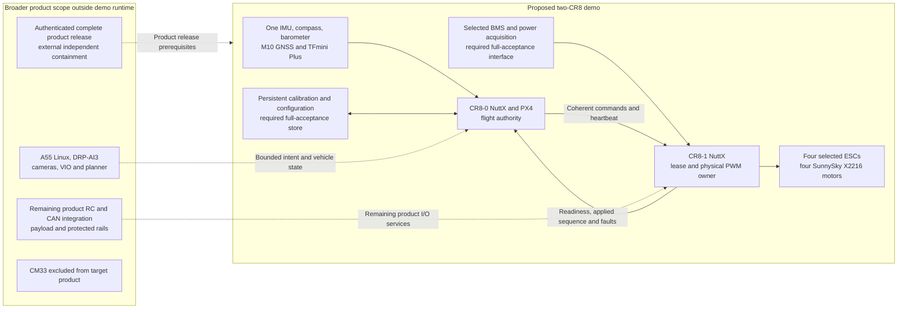
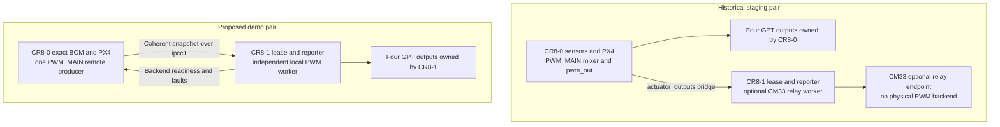
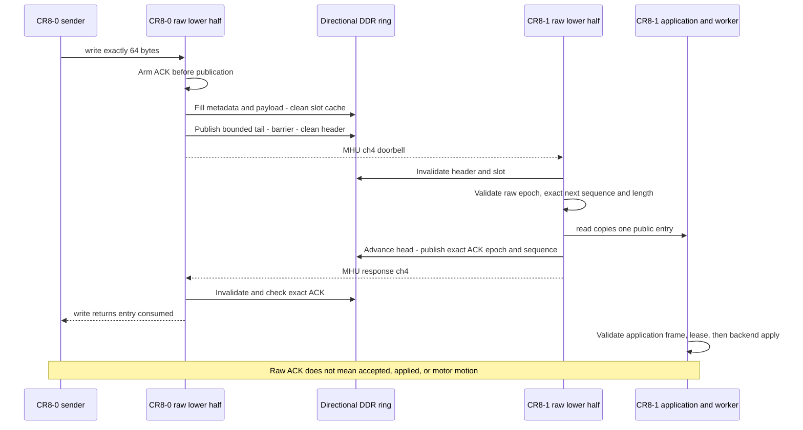
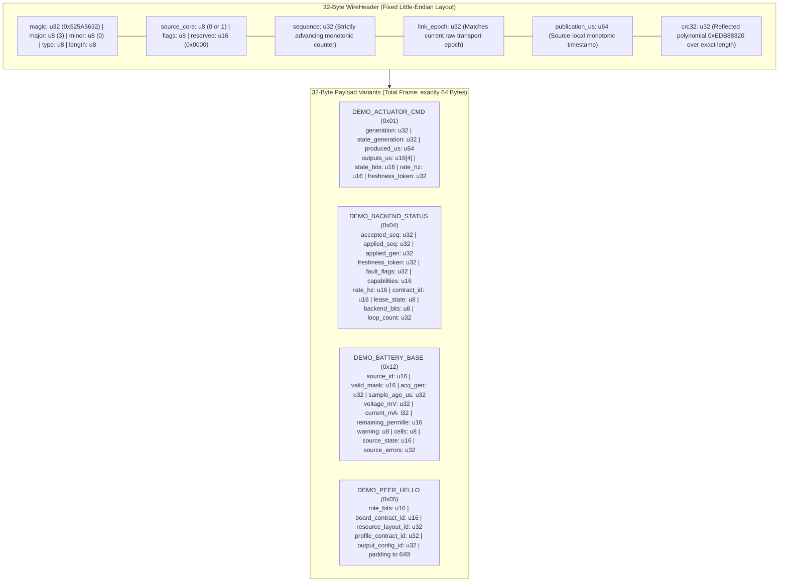
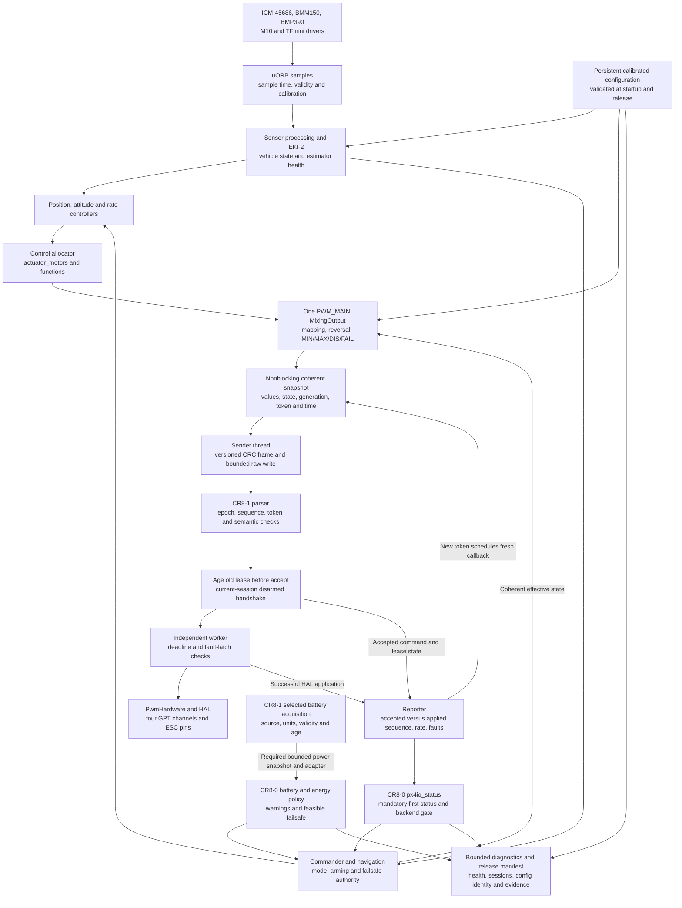
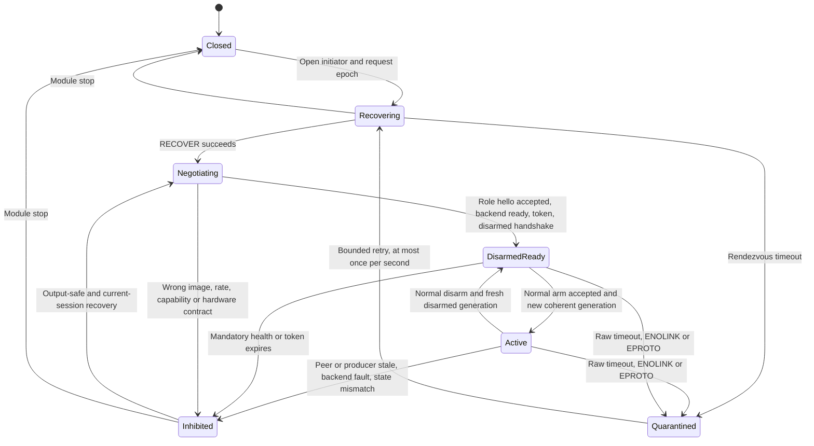
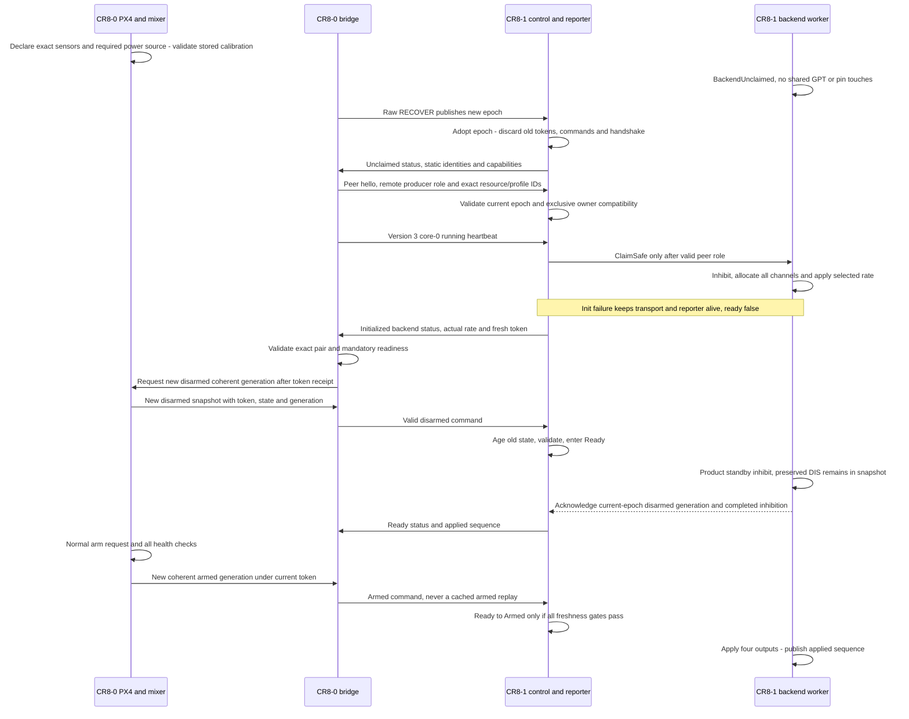
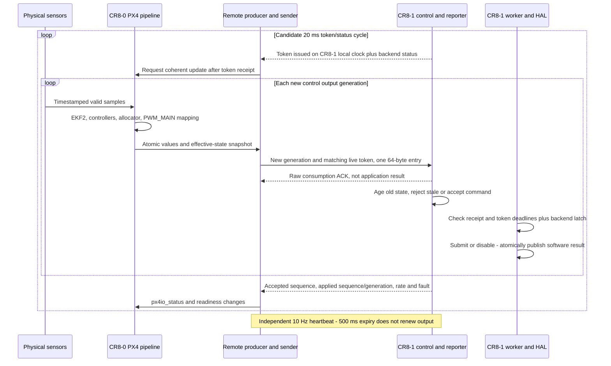
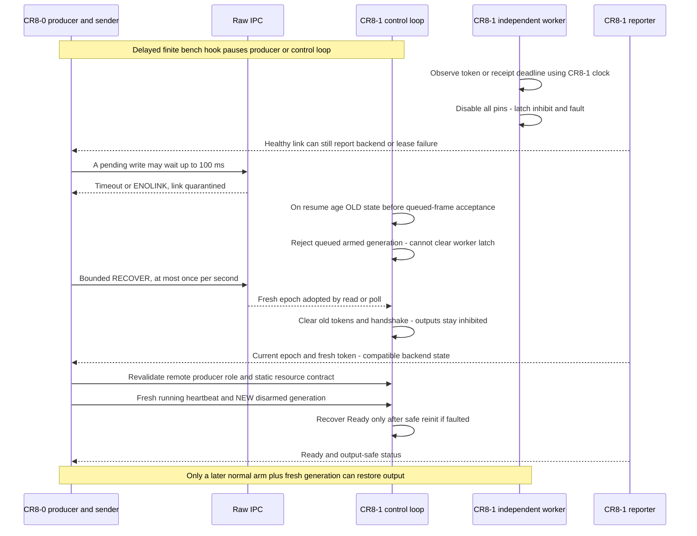

# Dual-CR8 demo design companion

This engineering design accompanies the [demo architecture](./rzv2h-dualcr8-demo-architecture.md) and [implementation plan](../../../plans/261021-0230-rzv2h-dualcr8-sensor-demo/plan.md), using the five [marketing/design documents](./README.md) as target requirements and checked-in sources as implementation evidence. Mixer/module/campaign allocations are approved target decisions. Canonical `dualcr8` contains the one-IMU sensor profile and `rzv2h_outputs` v3 producer; CR8-1 `pwm` contains `rzv2h_io`. Local CR8-0 outputs and the legacy bridge remain disabled. The [candidate validation procedure](../validation/dualcr8-sensor-actuator-demo.md) records the delivered codec, coherent producer, lease, independent worker/reporter, default-off fault hooks and artifact checks. Hardware identities remain unconfigured and policy qualifies no actuator peer. Real power acquisition, durable storage, command/local-kill hardware and physical qualification remain incomplete. The historical staging pair is migration evidence only. This companion does not grant hardware authorization.

Implementation checkpoint, 2026-10-21: the diagrams and selected-hardware contracts below remain target requirements. Actual source owners are `remote-outputs.cpp`, `io-supervisor.cpp` and `src/apps/`; the legacy bridge/relay is unchanged. Hardware faults require safe module reinitialization and a fresh disarmed handshake; in-place hardware-fault reset is not implemented. The normal artifact checker rejects enabled bench hooks. No measured deadline, persistence or physical output result is implied.

## 1. Outcome, product context, and allocation deltas

The proposed demonstration connects exactly one ICM-45686, one BMM150, one BMP390, one Holybro M10, one TFmini Plus, and four SunnySky X2216 motors through four as-yet-unidentified ESCs. Required battery/power-monitoring and persistent-storage hardware remain to be selected; their absence from that sensor/propulsion BOM is an open delivery gap, not an exclusion. CR8-0 runs physical sensors and PX4 estimation/control/allocation. Consistent with product `SYS-ARC-004`, the proposed CR8-1 backend alone generates the four physical PWM channels under a bounded CR8-0 command lease.

**Full acceptance covers all seven subsystem areas:** sensors/navigation, flight control, battery/power, calibration/storage, IPC, actuator safety, and diagnostics/release. A props-off bench milestone may establish partial source/host/target evidence before every subsystem is ready; it cannot complete the requested outcome with battery checks disabled, volatile-only calibration, or unverified disarmed-output semantics. Hover/GPS mission progression remains a separate physical-test choice; battery monitoring, durable calibrated configuration and safe output behavior are mandatory regardless of whether flight is exercised in this delivery. The broader product's A55/autonomy/camera requirements remain visible and are not claimed by this two-CR8 runtime.

<!-- sys-view: demo-engineering-1 -->
**Figure 1 — Demo boundary inside the broader product architecture.** Dashed links below describe future product integration, not active demo paths.

| Contract | Historical staging/source | Proposed demo | Broader product requirement retained |
|---|---|---|---|
| Image pair | CR8-0 `dualcr8` inherited `drone`; CR8-1 `default` relayed optionally to CM33 | Canonical `dualcr8` sensor profile, with future CR8-1 `pwm` pair; no `/dev/ipcc3` runtime | Product has A55 + both R8s, CM33-free boot/runtime |
| Sensors | Drone selects three ICM descriptors and INA228 alongside BMM150/BMP390 | One P93 ICM; no P94/P95 sensor role; one rangefinder; select the required power device through its own ICD, without assuming or excluding INA228 | Secondary IMU and independent recovery remain SYS-IF-002 work |
| Physical outputs | CR8-0 `pwm_out`; CR8-1 lease is not the physical PWM owner | CR8-0 remote mixer producer; CR8-1 sole GPT/pin owner only after valid role/resource handshake | SYS-ARC-003/004 flight and physical-output authority |
| Mapping/range | CR8-0 mixer selects configured values | CR8-0 `MixingOutput("PWM_MAIN", 4, ...)` maps function/range/reversal/DIS/FAIL once; CR8-1 checks bounds and generates pulses | Approved software specification §5.6 assigns mixing to CR8-0 and validation/final inhibition to CR8-1; software candidate delivered; physical qualification remains pending |
| RC | Native SCI6 RC remains a CR8-0 route | Retain local RC if fitted during staged integration, with explicit owner/detection evidence | Product CR8-1 RC allocation remains an open ownership gap; local RC alone does not close it |
| Battery/power | No qualified CR8-1 battery service in the selected pair; native INA228 source exists | Required selected source, acquisition, calibration, validity/age, IPC adapter and ordinary PX4 warning/failsafe tests; absence blocks full acceptance | SYS-IF-003/004/008 and SW-DEV-002 remain required; digital monitoring is not cell protection |
| Parameters/calibration | `/fs/params` is volatile TMPFS | Required atomic, integrity-checked storage and reboot/power-loss recovery for calibration and selected configuration | SW-CFG-002 applies to full acceptance; manual reload or a TMPFS warning is not completion |
| Safe output | Current lease forwards configured disarmed values, including nonzero pulses | Preserve DIS values in mixer/transport; final CR8-1 inhibit masks them during product boot/negotiation/standby/stop/Fault; nonzero DIS emission requires a scoped service/diagnostic policy | SYS-SAF-001 remains strict: product standby has no active pulse train; stored nonzero DIS is never rewritten to zero merely to pass it |

<!-- sys-view: demo-engineering-2 -->
**Figure 2 — Actual versus proposed responsibilities and physical ownership.**

## 2. Source authority, BOM, and shared-resource ownership

Source abbreviations below are exact repository paths, not new abstraction layers: **APPS** = [`src/apps/`](../../../src/apps/) (shared dual-CR8 library `rzv2h_demo`, wire codecs, actuator lease, output producer/worker, battery and intent gateway); **FC** = `boards/renesas/rdk-rzv2h/px4io_cr8_0/`; **IO** = `boards/renesas/rdk-rzv2h-io-cr8_1/px4io_cr8_1/`; **RAW** = `platforms/nuttx/NuttX/nuttx/arch/arm/src/rzv/`; **HAL** = `platforms/nuttx/src/px4/renesas/rzv/`. [Pin ownership](../pinmap.md), [memory map](../multicore-memory-map.md), and `RAW/rzv_ipc_channels.h` remain canonical. Firmware artifacts must resolve these contracts; a source table does not establish board routing or electrical qualification.

| Fitted device/count | Proposed owner and route | Source/design contract and remaining physical input |
|---|---|---|
| ICM-45686 ×1 | CR8-0 SPI0, P90/P91/P92, P93 CS; polled | New mutually exclusive one-CS selector spans PX4 `src/spi.cpp` and NuttX board Kconfig/`board.h`/`rzv2h_spi.c`; one `icm45686 -s -b 0 -c 3 -R <fitted>` start; orientation and CS waveform remain unproven |
| BMM150 ×1 | CR8-0 SCI7 I2C, P76/P77, `0x10` | `src/drivers/magnetometer/bosch/bmm150/`; external pull-ups, supply and calibration need fitted-board proof |
| BMP390 ×1 | CR8-0 same SCI7, `0x77`, `bmp388` driver | `src/drivers/barometer/bmp388/bmp388.cpp` accepts BMP390; shared-bus fault/recovery and pressure data need proof |
| Holybro M10 ×1 | CR8-0 SCI9, P82/P83, `/dev/ttyS9`, 115200 8N1 | Board serial mapping; CANFD1 selection conflicts with these pins; no unverified PPS assignment |
| TFmini Plus ×1 | CR8-0 SCI4, P70/P71, `/dev/ttyS4`, 115200 8N1 | `SENS_TFMINI_CFG=401` selects EXT2; final termios ordering is repaired in `TFMINI.cpp`; orientation, Plus framing/range and supply remain physical inputs |
| SunnySky X2216 ×4 + ESC ×4 | CR8-1 PWM proposal: PA4/GPT6A, PA7/GPT7B, P96/GPT9A, P53/GPT10B | Motor model does not identify ESC protocol/rate, calibration, timeout or direction; no powered acceptance until exact ESC ICD exists |
| RC/telemetry, if fitted | Existing CR8-0 SCI6/P75 and SCI5/P72/P73 | RC inversion and radio baud need proof; this is a declared temporary ownership delta from product CR8-1 RC |
| BMS/power monitor | Required source/device and transport not yet selected; product acquisition owner CR8-1, PX4 policy owner CR8-0 | Selection, ICD, driver/adapter and calibration are delivery work. `BAT1_SOURCE=-1` can mark an incomplete isolated bench milestone only; full acceptance requires real monitoring and normal checks. Stock RDK has no usable analog battery input |
| Persistent calibration/configuration store | Required medium, partition and driver route not yet selected; CR8-0 owns PX4 records | Qualify atomic replacement, integrity, schema compatibility and recovery through reboot/power interruption; current TMPFS remains a gap, not the final route |

The new profile declares `SYS_HAS_BARO=1`, `SYS_HAS_GPS=1`, `SYS_HAS_MAG=1`, `SYS_HAS_NUM_DIST=1` at first boot. Missing publications fail ordinary health checks. Physical-evidence gates never disable expected-hardware declarations. P94 must be absent from this new profile's CS/DRDY/button ownership, while legacy GY912/simple P94 DRDY and drone P94 CS1 stay intact.

| Resource | Owner and authority | Review/artifact condition before physical use |
|---|---|---|
| SPI0/SCI4/SCI7/SCI9 pins, clocks and reset | CR8-0 board + corresponding `RAW/rzv_spi.c`, `rzv_sci_i2c.c`, `rzv_serial.c` | Selected config, clock/reset path, fixed IRQ definitions and bounded bus recovery; no guessed IRQ/ELC/DMAC source |
| GPT6/7/9/10, pinmux and peripheral reset | CR8-1 only in new pair after compatible remote-owner handshake; existing CR8-0 `src/board_config.h`, `src/timer_config.cpp` supply mapping evidence | New CR8-1 timer table/config; prove CR8-0 init/reset and linked output paths cannot touch those pins/GPTs; unclaimed CR8-1 performs no reset/mux/cleanup writes |
| PWM clock/rate | CR8-1 HAL `io_pins/io_timer.c`, NuttX clock/CPG API | P4CLK is queried; 400 Hz is a source default, not the selected ESC contract; HAL range is 50–500 Hz; report actual configured rate and compare against CR8-0 parameters |
| HRT/worker scheduling | Each core's local HRT; CR8-0 owns flight time | Keep HRT GTM resources distinct from output GPTs; resolve actual CR8-1 clock/IRQ route before backend activation |
| ICU/GIC and CPG shared banks | Existing architecture APIs; each core only its owned routes/resources | INTR8SEL partition CR8-0 0–84, CR8-1 85–126; shared GIC distributor is not independently reset by a backend |
| PWM DMA | No demo DShot DMA owner | Fixed PWM proposal uses existing HAL; no borrowed DMA channel or new DShot behavior |
| Raw DDR + MHU | Initiator CR8-0 recovery epoch; per-direction producer/consumer ownership | `RAW/rzv_ipc_channels.h`, `rzv_ipc_raw.c`, `rzv_mhu_core.c`; cache/barrier path below remains mandatory |
| Battery bus, power calibration and source health | Product CR8-1 acquisition; CR8-0 energy/warning policy | Select actual controller/pins/transceiver/address and source ID through the power ICD; a proposed temporary CR8-0 monitor route must be recorded as an allocation gap rather than silently satisfying CR8-1 ownership |
| Persistent medium/controller/partition | One selected storage owner; CR8-0 is sole writer of canonical PX4 parameter/calibration state | Define boot/runtime access, flash/FS geometry, serialization, integrity and recovery; do not enable an unqualified xSPI/SD route just because its driver exists |
| Private images/RTT | Per-core linker map and exact ELF | CR8-0 cache DDR `0x40800000`, CR8-1 `0x41800000`; local TCM address equality is intentional; derive RTT from exact ELF |
| Board electrical/clock/reset release | Selected RDK schematic/XML/generated sources plus core-matched reference-map entries | EVK peripheral references prove IP behavior, not RDK pins; missing physical artifacts hold physical qualification only |

### 2.1 Seven required subsystem/interface areas

The user approved these seven module owners and the [shared requirements registry](./rzv2h-demo-requirements.md). Existing SYS/SW IDs remain unchanged; the registry allocates new module requirements and links each specification. These are target contracts, not implementation evidence. Full acceptance requires a closed interface contract and evidence for every applicable row, not only the IPC implementation.

| Area / target owner | Required interfaces and state | Current gap and acceptance proof |
|---|---|---|
| Sensors/navigation / CR8-0 | Exact fitted sensor identities, sample/receive time, units, rotations, calibration identity, bus recovery and invalid/stale state → uORB/sensor processing/EKF2; GNSS/range validity and estimator eligibility remain explicit | Existing individual drivers and profile tests do not prove integrated EKF/navigation. Close startup, timestamp/rotation/calibration, disconnect/stuck-bus/recovery and estimator-health evidence. Trace SYS-IF-001/002, SW-DEV-001/005 and SW-TIM-001 |
| Flight control / CR8-0 | Valid estimator state + manual/mission setpoints + commander arm/mode/failsafe → controllers → allocator → one `PWM_MAIN` transaction; CR8-1 status constrains readiness | Prove correct airframe/functions, controller scheduling, coherent state/value transitions, RC/link-loss distinctions, ordinary arming and feasible failsafes. Existing lease tests do not establish control-loop stability or navigation readiness. Trace SYS-ARC-003, SYS-IF-008, SW-ARC-005 |
| Battery/power / CR8-1 acquisition, CR8-0 policy | Selected BMS/monitor ICD → bounded read-only acquisition and calibrated source snapshot → versioned IPC adapter → `battery_status`, warnings/energy/failsafe; distinguish pack protection, measured monitor values and unavailable cell fields | Select real device/route and implement missing acquisition/adapter; test scaling/current sign, source/age/validity, unplug/stale/bus-off/pack-swap, low/critical thresholds and compute-rail disturbance. INA228 source or a declared `BatteryStatus_t` is not integrated proof. Trace SYS-IF-003/004/008, SYS-SAF-004, SW-DEV-002 |
| Calibration/storage / CR8-0 canonical records, one selected medium owner | Calibration/device binding, parameters, airframe/output/failsafe configuration and schema identity → atomic integrity-checked persistent record → validated startup restore; release manifest binds the active set | Select medium/partition/controller ownership and qualify recovery. Test save/reboot/cold boot, corrupt/truncated records, interrupted replacement, schema/identity mismatch and known-safe recovery; unqualified or lost calibration blocks readiness rather than silently accepting defaults. Trace SW-CFG-001/002 and system §5.2 |
| IPC / CR8-0 initiator and CR8-1 peer | Raw ABI/cache/IRQ/epoch plus bounded application schema, actuator freshness tokens and required power snapshots; one writer, per-stream expiry/backpressure and rejection counters | Detailed §§3–7 below cover the proposed actuator path; implement and qualify the proposed bounded battery layouts in §4.2, exact offsets/size/CRC and receiver adapters before full acceptance. Host/compile/load/cache/reset and stale-queue proof remain distinct. Trace SW-IPC-001–004, SYS-SAF-002/003 |
| Actuator safety / CR8-0 authority, CR8-1 physical owner | Coherent mapped commands plus product/service policy → final inhibit gate → selected GPT/rate/pins; Ready/Armed/Fault and backend state remain separate; stored DIS values are preserved | Externally prove no pulse at boot/reset/negotiation/product standby/stop/Fault, configured DIS emission only under explicit service policy, per-channel zero, ESC timeout, motor order/direction, lease timing and wrong-pair behavior. Resolve whole-CR8-1-halt containment for product release. Trace SYS-ARC-004, SYS-IF-007, SYS-SAF-001–003/005, SW-FLT-002/003 |
| Diagnostics/release / per-domain reporters, one release manifest owner | Reset/session IDs, sensor/calibration/power health, arming/inhibit reasons, accepted/submitted sequence, queue/errors/deadlines and build/config hashes → bounded logs/status/evidence bundle | Prove reporter survival through init/apply failure, log age/unknown semantics and bounded logging under load; reject incompatible images/config/calibration and interrupted updates; retain actual hashes and fault captures. Debug output is not an analyzer or a signature test. Trace SW-OBS-001, SW-CFG-001, SW-UPD-001, SYS-SEC-001 and SW-SEC-001 |

Battery protocol reuse follows software specification §5.2: `src/drivers/power_monitor/ina228` supplies monitor/calibration logic, `src/drivers/batt_smbus` has device-specific SBS behavior and manufacturer writes requiring exclusion from a read-only adapter, and `src/drivers/uavcan/sensors/battery.cpp` supplies message-to-PX4 semantics. None supplies the entire missing CR8-1 service automatically. Freeze the selected protocol, source identity, units/sign/validity, sample/receive timestamps, acquisition/stale budgets and fault behavior before adding its bounded IPC frames. Unknown battery data must not become valid zero voltage/current or a fictitious BMS protection state.

Storage ownership similarly requires one real route, not an assumption that xSPI or SD works because code exists. Use software specification §§10.1–10.4 to bind calibration, schema, hardware revision, output configuration and both CR8 images. A controlled reload is useful during incomplete bring-up; it is not persistent calibration, power-loss recovery, or a substitute acceptance route. Do not mark the overall requested demo complete until the selected persistent route and its fault tests pass.

| Milestone | What may be recorded | Completion limit |
|---|---|---|
| Source/host/build | Reviewed proposed contracts, bounded fixtures and exact paired artifacts | No physical sensor, power, persistence or output qualification is inferred |
| Partial props-off bring-up | Authorized isolated device/output evidence; an explicitly incomplete setup may temporarily use `BAT1_SOURCE=-1` or TMPFS | Cannot be called full acceptance, calibrated persistence, battery coverage or flight readiness |
| Full requested acceptance | All seven area interfaces and applicable source/host/build/physical gates closed, real battery monitoring, durable calibration/configuration and strict output-state proof | Flight campaign selection changes the exercised envelope, not these required subsystem deliverables |

## 3. Existing raw transport and application ABI

The operational raw rings are **not** the legacy `SharedMemCR8_t`/`SharedMemM33_t` templates and stale `0x70000000` comments in `protocol.h`. `RAW/rzv_ipc_channels.h` owns `/dev/ipcc1`: CR8-view `0x43800000`, 64 KiB split into directional halves; 16 entries per ring; public entry 64 bytes. The reserved overall raw window is 256 KiB. CR8-0 transmits on MHU NS ch4 and receives ch9; its response/message IRQ macros resolve to 327/316. CR8-1 transmits ch9 and receives ch4, response/message IRQs 328/315. Do not confuse these identities with selectable ELC events.

Transport ABI v2 has a 64-byte ring header: magic `0x525a4950`, version 2, state, epoch, bounded head/tail, mask, `ack_epoch`, `ack_sequence`, `last_sequence`, then reserved bytes. Each physical slot is 128 bytes: 64-byte metadata line (`epoch`, 32-bit nonzero sequence, length, padding), then the 64-byte public payload line. The initiator owns nonzero recovery generations; `RECOVER` reconciles both directional headers. Raw sequences are distinct from application sequences.

<!-- sys-view: demo-engineering-3 -->
**Figure 3 — Current raw publication, cache visibility, and ACK contract.** Reverse traffic uses the same mirrored path.

`RAW/rzv_ipc_raw.c:rzv_ipc_raw_read/write` are the source authority for operation order; IRQ notification is not application validation. A write waits up to 100 ms for peer consumption, even with the descriptor opened `O_NONBLOCK`; the application cannot treat it as a nonblocking callback. Timeout/protocol failure quarantines the link, subsequent I/O reports `ENOLINK`, and only the initiator publishes a new epoch with `RECOVER`. The responder adopts it through `read()`/`poll()`. Recovery stays in a sender/support thread, with bounded rendezvous and at most one retry per second. No output worker waits for raw ACK.

The existing **application** ABI is separately version `0x02`, magic `0x525A5632`, packed little-endian header 16 bytes: magic 0–3, version 4, type 5, `uint16_t sequence` 6–7, source `uint32_t timestamp_us` 8–11, CRC32 12–15. CRC starts `0xffffffff`, uses reflected polynomial `0xedb88320`, final complement, with CRC field zeroed; it covers the type's encoded frame length, not 64-byte entry padding. Source timestamp wraps and is not used as a cross-core lease clock. Senders zero-pad to 64; current CR8-1 transport accepts either exact frame size or full entry in its validator.

| Existing application type/value | Packed size from `FC/protocol.h` | Current use / demo disposition |
|---|---:|---|
| HEARTBEAT `0x00` | 28 | Both R8s at 10 Hz; source identity checked; demo gets separate v3 layout |
| ACTUATOR_CMD `0x01` | 36 | Eight outputs plus mixer/armed/safety/DShot bytes; no stop flag or producer generation; replace only for new pair |
| PWM_FEEDBACK `0x02` | 52 | Optional CM33 feedback; excluded from demo runtime |
| FAULT_STATUS `0x03` | 28 | Lease/fault/armed reporting; no backend rate/readiness; retain for legacy |
| INPUT_RC `0x10`; ESC_STATUS `0x11` | 56; 58 | Declared/parsed types do not prove CR8-1 acquisition or real ESC telemetry |
| BATTERY_STATUS `0x12`; SAFETY_STATUS `0x13` | 36; 24 | Declared schema is not an integrated BMS/local safety service |
| VEHICLE_CMD `0x20`; VEHICLE_STATUS `0x21`; FAILSAFE_CMD `0x30` | 48; 28; 24 | Selected bridge broadcasts exist; demo does not use these as alternate arm/output authorities |

Current `OutputLease::accept()` ages the old state before writing receipt time; preserve that invariant. Current application sequence handling is incomplete as a reject contract: some receive streams count gaps, while the raw transport enforces exact next transport sequence. A declaration of `sequence` in the header does not prove duplicate/regression rejection for actuator commands. The new profile must explicitly test it.

## 4. Proposed demo wire contract and freshness proof

Introduce a **separate demo application major 3, minor 0**, sharing raw ABI v2, implemented in [`src/apps/protocol.hpp`](../../../src/apps/protocol.hpp) and [`src/apps/protocol.cpp`](../../../src/apps/protocol.cpp) as part of the shared `rzv2h_demo` library (`src/apps/CMakeLists.txt`). Keep legacy application v2 definitions/serialization for legacy consumers and historical evidence; the canonical dualcr8 profile does not start that bridge. All three checked-in protocol mirrors carry matching explicit v2/v3 definitions. A profile selects exactly one application major; a wrong major is rejected before type dispatch. A blanket 16-byte header expansion would push existing RC/ESC frames above 64 bytes, so dormant v2 types must not be silently reinterpreted as v3.

The following layouts are **implemented in [`src/apps/protocol.hpp`](../../../src/apps/protocol.hpp)** and tested across the dual-core pipeline. Encode/decode little-endian fields with bounded helpers or `memcpy`, avoiding unaligned packed loads. No pointer, compiler `bool`, native enum, or `float` is on the new command/status wire.

| Proposed common `WireHeader` field | Offset | Bytes | Rule |
|---|---:|---:|---|
| `magic` | 0 | 4 | Existing `0x525A5632`; version separates meanings |
| `major`, `minor`, `type`, `length` | 4,5,6,7 | 1 each | Exact supported major/minor and type-specific length |
| `source_core`, `flags`, `reserved` | 8,9,10 | 1,1,2 | Core 0/1 only; flags/reserved zero in version 3.0 |
| `sequence` | 12 | 4 | Per-direction/per-type; strictly advancing, gaps observable |
| `link_epoch` | 16 | 4 | Nonzero; equals current raw `GET_STATS` epoch |
| `publication_us` | 20 | 8 | Source-local monotonic encode time; diagnostics, not cross-core subtraction |
| `crc32` | 28 | 4 | Existing algorithm over exact `length`, CRC field zeroed |

| Proposed type and payload | Offsets after 32-byte header | Encoded total |
|---|---|---:|
| `DEMO_ACTUATOR_CMD` `0x01` | `generation:u32` @32; `state_generation:u32` @36; `produced_us:u64` @40; `outputs_us:u16[4]` @48; `state_bits:u16` @56; `rate_hz:u16` @58; `freshness_token:u32` @60 | 64 |
| `DEMO_BACKEND_STATUS` new `0x04` | `accepted_cmd_sequence:u32` @32; `applied_cmd_sequence:u32` @36; `applied_generation:u32` @40; `freshness_token:u32` @44; `fault_flags:u32` @48; `capabilities:u16` @52; `rate_hz:u16` @54; `hardware_contract_id:u16` @56; `lease_state:u8` @58; `backend_bits:u8` @59; `loop_count:u32` @60 | 64 |
| `DEMO_HEARTBEAT` `0x00` | `state:u8`, `cpu_load:u8`, `memory_load:u8`, `reserved:u8` @32–35; `uptime_ms:u32` @36; `loop_count:u32` @40 | 44, padded to 64 |
| `DEMO_BATTERY_BASE` `0x12` | `source_id:u16` @32; `valid_mask:u16` @34; `acquisition_generation:u32` @36; `sample_age_us:u32` @40; `voltage_mV:u32` @44; `current_mA:i32` @48; `remaining_permille:u16` @52; `warning:u8` @54; `cell_count:u8` @55; `source_state:u16` @56; `reserved:u16` @58; `source_errors:u32` @60 | 64 |
| `DEMO_BATTERY_DETAIL` new `0x14` | `source_id:u16` @32; `valid_mask:u16` @34; `acquisition_generation:u32` @36; `sample_age_us:u32` @40; `temperature_centiC:i16` @44; `min_cell_mV:u16` @46; `max_cell_mV:u16` @48; `reserved:u16` @50; `remaining_mAh:u32` @52; `full_capacity_mAh:u32` @56; `bms_fault_bits:u32` @60 | 64 |
| `DEMO_PEER_HELLO` new `0x05` | `role_bits:u16` @32; `board_contract_id:u16` @34; `resource_layout_id:u32` @36; `profile_contract_id:u32` @40; `output_config_id:u32` @44 | 48, padded to 64 |

Heartbeat load percentages are 0–100 when measured and `255` when unavailable; other values are rejected. Uptime/loop counters are actual local observations, with a saturated 32-bit uptime reported as such. No measurement is inferred from an alive heartbeat. The software candidate uses the initializing state and unavailable load fields while its hardware contract remains unconfigured.

The software candidate assigns capability bits 0–4 to implemented PWM backend support, coherent values, stop-inhibit semantics, causal-token lease, and HAL-submission feedback. Other bits are reserved. Capability support is distinct from current resource ownership and qualification: `Claimed`/`Initialized`, the selected nonzero hardware/profile contract and fresh worker evidence still gate readiness. No capability bit proves a connector waveform.

`state_bits` defines effective armed, safety off, force failsafe/termination, lockdown, manual lockdown, and stop motors as explicit bits; all other bits must be zero. Illegal combinations fail semantic validation; lockdown/stop takes output-inhibit precedence. There are exactly four channels, each either `0` or a legal pulse in 90–2500 µs; selected MIN/MAX/DIS/FAIL constraints are applied by CR8-0. No second function mapping/reversal/range transform occurs on CR8-1. Wire rate must equal the backend's fixed selected rate, and all configured/commanded pulses must be representable below its timer period. Validate this before readiness, including DIS/FAIL values. Capabilities identify local four-PWM ownership, coherent snapshot, stop semantics, freshness-token support, and feedback meaning; `hardware_contract_id` binds the four-pin map and selected fixed-rate/safety profile to a manifest registry. Do not pick an arbitrary accepted ID before creating that registry.

`DEMO_PEER_HELLO` is a CR8-0 declaration of the selected remote producer role and absence of local physical ownership, matched against CR8-1's compiled pair/resource contract before any shared output hardware access. These IDs are static board/profile/resource/configuration identities from the compatibility manifest, never invented per-unit UUIDs or fleet provisioning. CRC and role bits do not authenticate a malicious privileged peer; both R8 peers are trusted in this demo.

`backend_bits` assigns bit 0 resource claimed, bit 1 initialized safely, bit 2 arm ready, bit 3 output inhibited, bit 4 fault latched, bit 5 recovery eligible and bit 6 session rotation requested; bit 7 is reserved zero. Recovery eligibility is not arm readiness. `accepted_cmd_sequence` means semantic/lease acceptance. `applied_cmd_sequence` advances only after the worker's successful HAL submission/commit path; GPT buffered compare may latch on a later timer cycle. It is neither raw ACK nor independent waveform/ESC/thrust proof. `applied_generation` connects software submission to the coherent mixer snapshot. A PWM backend has no RPM/current/thrust observation; leave unsupported telemetry unavailable rather than fabricating ESC feedback. Zero sequence/generation means no accepted/submitted sample since session reset.

[`src/apps/protocol.hpp`](../../../src/apps/protocol.hpp) owns the `WireHeader`, `WireCommand`, `WireStatus`, `WireHeartbeat`, `WireHello` and battery layout assertions; [`protocol.cpp`](../../../src/apps/protocol.cpp) owns byte-wise encoding and validation. The [software receipt](../evidence/dualcr8-software-validation-261021.md) records current codec and legacy-regression checks. Runtime raw writes remain exactly 64 bytes; short fixture inputs never authorize short device writes.

**Figure 4-A — Proposed 64-byte IPC wire frame structure and field layout.**

### 4.1 Producer age and stale queue rejection without a common clock

Local receive-time leasing alone proves time since receipt, **not time since production**. A sender `age_us` field computed before `write()` also omits a subsequent stop-and-wait queue delay of up to 100 ms. Cross-core subtraction of `produced_us` or `publication_us` is invalid without a qualified clock correlation. This demo proposes a bounded causal freshness-token exchange instead of adding a generic synchronization framework.

CR8-1 issues a nonzero token in backend status, with a **CR8-1-local issue time**, at a candidate 20 ms cadence derived from the existing disarmed-refresh period. Keep at most three token records for the current epoch; prune expired tokens before lookup. Token creation is rate-limited to no more than one per 20 ms. Fault/readiness event reports reuse the current token and its original issue time; they cannot mint extra tokens or evict a still-live token. If issuance cadence changes, rederive capacity from maximum issuance burst and lifetime. Intentional session invalidation clears authority and history together. A token expires at issue + 50 ms, using the existing lease window. CR8-0 accepts a current-epoch status token and requests a **new coherent mixer snapshot generated after that token was received**. It must never stamp a new token onto an old generation or merely refresh the timestamp. The committed snapshot binds token, values, all state and produced time. Causal ordering then bounds source-to-receipt age by receiver-local token age; no shared clock is assumed.

Before command acceptance, CR8-1 checks current epoch, token history/age, strictly advancing command sequence and snapshot generation, and coherent state-generation transitions. Its worker deadline is `min(valid_receipt_us + 50000, token_issue_us + 50000)`, additionally constrained by heartbeat expiry. Thus a command arriving near token expiry cannot acquire a new full 50 ms of output life. Token-only traffic, heartbeat-only traffic, or a cached armed generation cannot extend output. Armed frames never repeat: merely scheduling a callback on a new token cannot turn cached controller values into fresh control. An eligible armed generation requires a new valid allocator/control publication (`has_updates` plus source-publication advancement/freshness checked on CR8-0's clock); token-only callback runs produce no renewable armed command. Disarmed refresh requires a new coherent safe/disarmed callback generation; an idle mixer is explicitly scheduled for that refresh. If a fresh generation cannot be obtained, hold no pulse and let the lease expire.

Token IDs and application generations/sequences use bounded unsigned progression; duplicate/regression rejects do not renew. Before identifier reuse/wrap becomes ambiguous, inhibit and rotate the raw epoch through the initiator-only exchange below; reset all application trackers/token history only after the new epoch is observed. Raw transport sequence wrap retains its existing nonzero next-sequence contract. Epoch/session changes clear tokens on both sides. The 20 ms token cadence, combined traffic load and scheduling headroom are candidates requiring source/host/load/target evidence, not accepted latency claims.

| Stream / one writer | Direction and proposed cadence | Expiry, rejection and backpressure |
|---|---|---|
| Coherent actuator snapshot / CR8-0 producer | 0→1 on each new armed generation; candidate 400 Hz producer budget, measured later | No armed replay; bounded latest-snapshot storage, one in-flight raw write; never overwrite unread raw slots; drop superseded unsent snapshots with counters |
| Disarmed coherent refresh / same producer | 0→1 at most 20 ms gap while readiness maintained | New safe snapshot after token; no stale values/new state splice; full queue or blocked sender can expire lease |
| Heartbeat / each domain reporter | Both directions 10 Hz, core/state validated | 500 ms receive-local expiry; running heartbeat does not prove producer/backend health |
| Peer role/resource hello / CR8-0 bridge | 0→1 during epoch negotiation; bounded retries before readiness | Exact static compatibility match required before claim; no output lease renewal; reject all undeclared roles and never fall back to legacy local ownership |
| Backend status + freshness token / CR8-1 reporter | 1→0 candidate 20 ms plus fault/readiness events | Bound pending reports to latest snapshot; token lifetime 50 ms, history ≤3; blocking report write cannot block worker/control loop |
| Battery/power observations / selected acquisition service | Required CR8-1→CR8-0 bounded snapshots, cadence fixed by the selected device ICD | Must add versioned validity/source/units/sample-and-receive-age records and adapter before full acceptance; existing v2 battery declaration is not sufficient. Never renew actuator lease through battery traffic |
| RC/CAN/ESC measurements beyond selected power route | No implemented new acquisition stream claimed | Preserve v2 declarations for legacy; required product interfaces retain their own integration and test gaps |

### 4.2 Battery acquisition progress and bounded age

The two power frames keep the 32-byte v3 header and 64-byte public entry, implemented in [`src/apps/battery.hpp`](../../../src/apps/battery.hpp) and [`src/apps/battery.cpp`](../../../src/apps/battery.cpp) with codec support in [`src/apps/protocol.hpp`](../../../src/apps/protocol.hpp). Base units are mV, discharge-positive mA, permille, count and device-qualified warning/state enums; detail units are centi-degrees Celsius, mV and mAh. Exact valid-mask/state/fault mappings, source IDs, ranges and stale budgets are managed through `BatteryPolicy` and `BatteryReceiver`. Reserved fields are zero; unsupported fields have validity cleared, never invented BMS/cell data. Detail is optional only when its measurements are unsupported; available safety-relevant selected-device data remains required. Match base/detail by source, epoch and acquisition generation; do not combine different samples as one coherent observation.

Only a successful **new physical acquisition** advances `acquisition_generation`. Reporter activity, IPC sequence, heartbeat and encoding timestamps cannot advance it. Cached sample resends retain the generation and increasing source-local `sample_age_us`; invalid/disconnected updates can immediately clear validity without fabricating a new valid sample. CR8-0 tracks last actual acquisition progress with its local clock, separately from record receipt, and never restamps an old generation into fresh battery health. Account conservatively for encoded sample age, a qualified bounded queue/transit budget and local elapsed time; unrelated core timestamps cannot be subtracted. The transport-age budget is an explicit qualification gap until measured/analysed. Test acquisition stopped while reporting/heartbeat remain live, frozen generation with advancing packet sequence, delayed queued data, source reset/pack swap, detail/base mismatch and valid zero current versus unavailable current.

### 4.3 Status expiry, bootstrap and epoch rotation

CR8-0 independently expires validated backend status on its receive-local clock, using the proposed 50 ms freshness window. A continuing 500 ms heartbeat cannot preserve cached ready/rate/fault. Only a semantically valid current-epoch advancing status sequence renews that status deadline; duplicates or other stream traffic do not. Status expiry blocks selected-profile arming and invalidates cached readiness. Command authority remains independently bounded on CR8-1.

`initialized_safe/recovery_eligible` and `arm_ready` are separate. In cold bootstrap or safe reinitialization, CR8-1 can publish a token with arm-ready false/fault latched. CR8-0 may then send **only** a current-epoch token-bound fresh disarmed stop/no-pulse snapshot without waiting for commander arm readiness. CR8-1 accepts this recovery acknowledgement only when hardware is safely initialized; it clears the eligible fault latch and later reports arm-ready. Armed/service commands stay blocked. Test cold bootstrap and persistent backend-fault → safe reinit → stop handshake → ready without circular gating.

Only CR8-0 can call raw `RECOVER`. Before CR8-1 token/status counters approach ambiguous wrap, it latches `session_rotation_requested`, inhibits claimed outputs, stops minting tokens and freezes advancing counters before reuse; the reporter repeats the bounded request without renewing authority. CR8-0 consumes the request (or detects its own counter high-water condition), invalidates its producer snapshot and follows the disarmed/safe recovery path through initiator `RECOVER`. CR8-1 observing the new nonzero raw epoch is the rotation acknowledgement; a fresh role hello, tokens and disarmed handshake establish the new application session. Until that epoch arrives, CR8-1 stays inhibited and the request stays latched. Force near-wrap states in host tests, including dropped request, delayed ACK and absent initiator; no responder-issued epoch, silent counter wrap or armed replay is accepted. The high-water/flight-response policy needs the released safety contract before operational use.

## 5. PX4-to-output dataflow and concurrency

<!-- sys-view: demo-engineering-4 -->
**Figure 4 — Full physical-sensor-to-PWM path and distinct feedback meanings.**

`OutputProducer` helper and board `RemoteOutputs` module (implemented in [`src/apps/output-producer.hpp`](../../../src/apps/output-producer.hpp) and [`boards/renesas/rdk-rzv2h/px4io_cr8_0/remote-outputs.cpp`](../../../boards/renesas/rdk-rzv2h/px4io_cr8_0/remote-outputs.cpp)) follow the real `OutputModuleInterface`/`MixingOutput` ownership pattern, not an `actuator_outputs` subscriber pretending to replace the physical driver. Source authorities are `src/drivers/pwm_out/PWMOut.hpp`, `src/drivers/px4io/px4io.cpp`, and `src/lib/mixer_module/mixer_module.cpp:limitAndUpdateOutputs`. `updateOutputs()` copies four outputs, stop, effective arming/safety/termination/lockdown state, generation/state generation, token and source time in one bounded commit. Read `MixingOutput::armed()` inside this callback's mixer transaction (`src/lib/mixer_module/mixer_module.hpp`); update/cache safety state in the same producer Run generation. The sender never performs a later independent uORB state overlay. No IPC, ioctl, allocation, filesystem, or blocking logging is reachable from that callback.

The output pipeline uses the atomic seqlock implementation `AtomicRecord` in [`src/apps/output-snapshot.hpp`](../../../src/apps/output-snapshot.hpp) with a finite reader retry budget (3 attempts) and explicit memory ordering. Sender consistency failure means no new output command. An arming/safety/termination/configuration transition without a matching new mixer generation inhibits transmission of the previous output values; request a new callback. Do not overlay a newer arm/disarm bit onto older pulse values. Snapshot publication and callback-state access use single-core atomics (`px4::atomic<uint32_t>`); cross-core C++ atomics are not substituted for raw cache maintenance.

CR8-1 control (`io-supervisor.cpp`) coordinates with [`src/apps/actuator-lease.hpp`](../../../src/apps/actuator-lease.hpp) and [`src/apps/output-worker.hpp`](../../../src/apps/output-worker.hpp): it validates/drains a bounded number of records, observes raw epoch after each read, **ages the existing lease before accepting a new heartbeat or command**, and publishes a coherent lease-approved worker snapshot including receipt/token deadlines. The worker checks it every candidate 2.5 ms and owns physical apply/disable. If the worker observes expiry while the control loop is paused, it atomically latches the inhibit/session fault; the resumed control loop merges that latch before accepting queued frames. A queued armed frame can never clear it. The reporter uses [`src/apps/output-status.hpp`](../../../src/apps/output-status.hpp) (`OutputStatusStore` / `supervised_status`) to merge atomic/coherent snapshots, running even after backend initialization failure.

Before initialization, the backend remains **BackendUnclaimed** and advertises identity/capability plus `ready=false` through the live reporter. It must not configure, reset, mux, allocate or disable shared GPT/pins until a valid current-epoch v3 hello declares the expected CR8-0 remote producer role and exact board/resource/profile/output compatibility. This prevents an accidentally mixed CR8-1 `pwm` image from clobbering legacy CR8-0 PWM during boot, before offline pair policy can reject it. The worker alone transitions to ClaimingSafe, safely acquires/initializes resources, then reports Ready. No unknown-peer fallback claims hardware. Board startup and static/platform initialization do not initialize or reset output GPT/pins; only the post-hello worker claims them. Cleanup/reset handlers may disable only resources this application has actually claimed.

Backend init/apply failure sets worker-owned atomic `ready=false` and latched fault, calls idempotent `disable_all()` for resources this image actually claimed, and remains visible across control/report cycles. The control loop cannot overwrite or clear the backend fault with lease-only health. Recovery first establishes safe successful reinitialization with pins disabled while retaining the latch. A fresh current-session disarmed **stop/no-pulse** handshake may then acknowledge recovery without requiring `ready=true` first; only after both conditions does the worker clear the latch and report ready. That exception grants no armed output and prevents a circular ready/handshake dependency. The handshake alone never repairs hardware. Stop/cleanup disables/releases only owned resources and leaves no detached worker/reporter. A peer/session loss after claim inhibits those owned outputs; it does not transfer pin ownership to another core or erase the required new role handshake.

### 5.1 Reset containment before negotiation

Unclaimed non-interference does not itself prove reset-time inactivity. If a warm CR8-1 reset leaves GPT/pad state active, waiting for a role hello would leave pulses running; unconditional startup cleanup could instead clobber a mismatched legacy CR8-0 owner. Before any powered activation, prove the selected reset classes make outputs inactive in hardware, or provide pair-qualified pre-application/external containment that keeps them inactive through reset and negotiation. No such hardware guarantee or gate is currently established. Test warm reset from active output separately from wrong-pair startup and orderly cleanup; a cleanup transcript cannot substitute for reset-retention proof. This remains a product release/physical input gate, not a reason to violate the unclaimed ownership guard.

## 6. Link, lease and output state models

<!-- sys-view: demo-engineering-5 -->
**Figure 5 — Proposed CR8-0 link/application readiness.** Physical readiness remains a separate condition from raw-link success.

<!-- sys-view: demo-engineering-6 -->
**Figure 6 — CR8-1 lease states and orthogonal backend readiness.** `Ready` is a disarmed handshake state, not permission to arm without PX4's checks. The backend independently progresses `BackendUnclaimed → ClaimingSafe → BackendReady`, or `ClaimingSafe/BackendReady → BackendFault`; only the worker writes these states. Peer hello precedes ClaimingSafe, and safe reinitialization plus handshake is required after BackendFault.

```mermaid
stateDiagram-v2
    [*] --> Safe
    Safe --> Ready: Compatible backend plus fresh heartbeat and valid disarmed handshake
    Ready --> Armed: New armed generation with live token and lease
    Armed --> Ready: Fresh normal disarmed generation
    Ready --> Safe: Lease, token or heartbeat expires; session changes
    Armed --> Fault: Lease, token or heartbeat expires; session changes
    Ready --> Fault: Backend init or apply fault
    Armed --> Fault: Backend fault
    Safe --> Fault: Backend initialization fails
    Fault --> Ready: Safe reinit if needed, current-session fresh disarmed handshake
    Safe --> Safe: Armed frame rejected
    Fault --> Fault: Armed frame rejected
    Ready --> Ready: stop_motors inhibits pins while valid disarmed lease remains
    Armed --> Armed: stop_motors inhibits pins while valid armed lease remains
    Ready --> Safe: Module stop disables and releases resources
    Armed --> Safe: Module stop disables and releases resources
    Fault --> Safe: Module stop, outputs disabled
    note right of Safe
        Backend initialized, ready, rate and fault
        are orthogonal worker-owned state.
        Every apply checks both state machines.
    end note
```

| Condition | Lease/state action | Physical action |
|---|---|---|
| Boot/reset/negotiation; no first status | Safe, backend unclaimed, no handshake | No shared pin/GPT touches before compatible role hello; board reset-safe behavior still requires scope proof |
| Valid current-session disarmed frame | Safe/Fault→Ready with compatible safely initialized backend and fresh heartbeat/token; backend-fault recovery also requires the stop/no-pulse acknowledgement above | Product standby final gate inhibits pulses despite preserved DIS values; only an explicitly scoped service/diagnostic policy may emit configured DIS; recovery handshake emits no pulse |
| Valid current-session armed frame | Ready/Armed→Armed; increasing generation | Apply exactly selected four values if every gate passes |
| Normal disarm | Armed→Ready with fresh coherent disarmed generation | Preserve configured DIS values in the snapshot; product standby inhibits the physical pulse train |
| `stop_motors`, lockdown/manual lockdown | No automatic Fault or arm permission; snapshot carries effective state | All motor pins no pulse even if pulse array is nonzero |
| Force failsafe/termination | PX4 selects FAIL values in same coherent transaction; no second mixer | Stop/lockdown wins; motor-only demo termination uses no pulse; any future servo termination needs its own contract |
| One malformed/CRC/duplicate/regressing/stale-token frame | Reject/count; no receipt/deadline renewal | Prior valid command may persist only to its existing deadline |
| Expired old Ready state before queued armed arrival | Ready→Safe, armed frame rejected | No pulse until new disarmed handshake |
| Expired old Armed state before queued armed arrival | Armed→Fault, armed frame rejected | No pulse; latched reason visible |
| New raw epoch or unavailable epoch | Clear tokens, sequences, stored outputs and heartbeat | No old command replay; Fault if previously armed |
| Backend failure with healthy heartbeat | Latch fault/ready false independently | Disable all; report persists; commander blocks arming |

Configured disarmed values and electrically inactive outputs are separate acceptance contracts. Preserve configured DIS values exactly through `MixingOutput`, coherent snapshots and transport; do not rewrite all DIS parameters to zero. **SYS-SAF-001 remains strict:** product boot, negotiation and standby have no active pulse train, enforced by CR8-1's final physical inhibit even if a current Ready command carries nonzero DIS and `stop_motors=false`. Nonzero DIS pulse emission requires a separately scoped service/diagnostic state and selected-device policy; Ready alone grants no such exception. That service policy is pending and not enabled or encoded as permission by the current proposed v3 frames. Its future contract must retain normal safety gates and leave product standby inactive; tests cannot assume `armed=0` or a nonzero DIS value grants service access.

With `stop_motors=true`, lockdown, Fault, expired authority or controlled stop, all motor outputs are electrically inactive; per-channel zero disables only that channel. The pad's safe electrical level or high-impedance choice belongs to the fitted hardware ICD; high impedance is not universally safe. External capture must prove the selected service policy's configured DIS behavior once defined, inactive product behavior, all transitions, and no stale armed pulses during disarm. The owning SYS/SW state/interface descriptions retain this distinction without weakening SYS-SAF-001 or deleting configured DIS semantics. Safety-input pins are not invented: P52 is not established as a safety input in the selected reference. Ordinary PX4 arm/health policy remains in force.

Selected-profile Commander implements mandatory first-status, receive-local status expiry and backend readiness/fault gating in [`px4ioCheck.cpp`](../../../src/modules/commander/HealthAndArmingChecks/checks/px4ioCheck.cpp). [`remote-outputs.cpp`](../../../boards/renesas/rdk-rzv2h/px4io_cr8_0/remote-outputs.cpp) publishes the v3 status mapping. Legacy boards retain their separate timeout/first-status behavior; current hardware remains unconfigured and inhibits arming.

## 7. Bootstrap, steady operation, and recovery sequences

<!-- sys-view: demo-engineering-7 -->
**Figure 7 — Bootstrap, compatibility, disarmed handshake, and normal arm.**

[Current profile policy](../../../Tools/rzv2h-px4-profiles.json) admits no actuator pair. `dualcr8+pwm` is a software candidate with unconfigured identities; historical `dualcr8+default` admission is retired. [Candidate artifact checks](../../../test/rzv2h-dualcr8-artifact-contract-test.py) inspect individual images and assert the absence of an admitted pair. Future admission requires selected identities and physical qualification. Runtime role/resource checks and the unclaimed-before-hello guard remain necessary to prevent wrong-pair boot interference.

<!-- sys-view: demo-engineering-8 -->
**Figure 8 — Steady sensor/control flow with independent liveness and feedback.**

<!-- sys-view: demo-engineering-9 -->
**Figure 9 — Producer/control-loop stall, quarantine, new epoch, and recovery.**

`T_off` is bounded from the last valid command's applicable deadline reference by the 50 ms logical freshness window plus one worker period (candidate 2.5 ms) plus a **declared, measured** scheduler/HAL budget. Use `deadline=min(receipt+50 ms, token_issue+50 ms)`; report both reference times in target instrumentation. Do not claim exactly 50.000 ms or equate an application status timestamp with an analyzer-visible pin transition. Establish a board-verified correlation/testpoint method without assigning an unverified GPIO. Stop-and-wait latency can reduce availability; it must never extend authority.

Fault injection for props-off bench verification is implemented in [`src/apps/bench-fault.hpp`](../../../src/apps/bench-fault.hpp) (`BenchFaultSchedule`), guarded by [`CONFIG_RZV2H_DUALCR8_FAULT_INJECTION`](../../../src/apps/Kconfig). It enables bounded one-shot injection (`ProducerPause`, `HeartbeatDrop`, `CorruptFrame`, `ControlPause`, `BackendFail`, `StatusDrop`) with atomic publication and single-shot consumption, strictly disabled in normal production artifacts.

A complete CR8-1 halt stops the worker, HRT callback and cleanup; GPT hardware may continue pulses. This design does not guarantee shutdown for that fault. Controlled reset/module stop proves cleanup paths only. ESC local timeout and any independent hardware inhibit remain SYS-IF-007/product safety work; an ESC seeing continuing valid PWM may not time out. No external watchdog project or automatic parachute is silently added.

| Sequence view | Trigger and ordered action | Failure / recovery contract |
|---|---|---|
| Figure 7 bootstrap | New raw epoch → compatible role hello → safe ownership claim → backend status/token → fresh disarmed handshake → ordinary arm | Wrong role/manifest leaves hardware unclaimed; init fault keeps reporting alive; no startup pulse permission |
| Figure 8 steady flow | New token → genuinely new control publication/coherent snapshot → semantic acceptance → bounded worker submission | No controller advancement or expired token cannot renew output; raw ACK proves consumption only |
| Figure 9 recovery | Worker expiry/inhibit → old state aged before queued receipt → new epoch/role → safe reinit/disarmed handshake | Armed replay cannot clear fault; no direct Fault-to-active transition; physical containment separately qualified |

## 8. Implementation/test inventory and evidence contract

The current v3 owners are [`FC/remote-outputs.cpp`](../../../boards/renesas/rdk-rzv2h/px4io_cr8_0/remote-outputs.cpp), [`IO/io-supervisor.cpp`](../../../boards/renesas/rdk-rzv2h-io-cr8_1/px4io_cr8_1/io-supervisor.cpp) and [`src/apps/`](../../../src/apps/). The three board `protocol.h` mirrors include the shared C++ contract while preserving legacy v2 consumers. `FC/uorb_bridge`, `IO/px4io_cr8`, legacy transports/output-lease and CM33 remain regression/reference owners, not the canonical v3 runtime. The [software receipt](../evidence/dualcr8-software-validation-261021.md) owns the delivered source/host/build checkpoint; the [phase files](../../../plans/261021-0230-rzv2h-dualcr8-sensor-demo/plan.md#phases) retain remaining execution work.

Legacy ABI regression fixtures remain: `test/rzv2h-dual-cr8-output-lease-runtime-test.py`, `test/rzv2h-expanded-remediation-runtime-test.py`, `test/rzv2h-audit-remediation-runtime-test.py`. Machine-owned profile/pair/archive owners are `Tools/rzv2h-px4-profiles.json`, `Tools/rzv2h-regression-catalog.json`, `Tools/rzv2h-px4-artifact-check.py`, and their existing tests. A new checker cannot override contradictory legacy policy.

| Requirements / proof ID | Existing source/test baseline | Software coverage and remaining acceptance proof |
|---|---|---|
| SYS-ARC-003/004, SW-ARC-005 / D-OWNER | Board init/timer table, `dualcr8.px4board`; `test/rzv2h_gpt_pwm_contract_test.py`, `test/rzv2h_core_irq_contract_test.py` | [Candidate artifact checks](../../../test/rzv2h-dualcr8-artifact-contract-test.py) and runtime fixtures inspect ownership guards; source evidence is in the software receipt. Physical sole-owner/reset proof remains pending |
| SYS-IF-001/002; SW-DEV-001/005 / D-SENSOR | `test/rzv2h-bmp388-reset-contract-test.py`, `test/rzv2h-sci-i2c-runtime-test.py`, `test/rzv2h_bmm150_sample_contract_test.py`, `test/rzv2h_board_gpio_contract_test.py` | [Exact-BOM profile fixture](../../../test/rzv2h-dualcr8-profile-contract-test.py) and candidate artifacts cover selection/startup; fitted identities, timestamps and disconnect evidence remain pending; no secondary-IMU closure |
| SW-IPC-001/003; SYS-SAF-003 / D-WIRE | Three ABI fixtures above; `test/rzv2h_ipc_raw_contract_test.py`, `test/test_rzv2h_ipc_recovery_contract.py` | Extend fixtures: actual compile/offset/CRC/parity, all v2/v3 dispatchers, malformed flags, wrong length/version, duplicate/regression/gaps, wrap and full queues; source/host only until named exact-image load/cache tests |
| SW-IPC-002/004; SW-FLT-002/003; SYS-SAF-002 / D-LEASE | Existing output-lease fixture; `IO/output-lease.cpp` age-before-receipt | Extend: Ready/Armed gap >50 ms, token issue/expiry/history, cached generation, new token on old snapshot, token-triggered callback without new control publication, epoch reset, heartbeat-only and source-stop cases; host then detached-probe target waveform |
| SYS-SAF-001/002 / D-COHERENCE | `mixer_module.cpp:limitAndUpdateOutputs`; current bridge split-state behavior | [Protocol/producer fixtures](../../../test/rzv2h-demo-protocol-test.py) and [runtime boundary fixture](../../../test/rzv2h-demo-runtime-boundary-test.py) cover coherent consumed progress and inhibit behavior; scoped physical/service proof remains pending |
| SW-FLT-002/003, SW-OBS-001 / D-BACKEND | `test/rzv2h-io-core-health-runtime-test.py`, existing reporter/worker source | Extend persistent init/apply fault over many reports, healthy heartbeat plus failed backend, missing first status, successful safe reinit and mandatory disarmed handshake; host then named fault transcript |
| SW-CFG-001 / D-PAIR | `test/rzv2h-px4-artifact-test.py`, `test/rzv2h-jlink-debug-tools-test.py` | [Candidate artifact checks](../../../test/rzv2h-dualcr8-artifact-contract-test.py) and current policy require no admitted pair; future selected identities, rate/capability binding and exact-image physical qualification remain pending |
| SYS-PER-001; SW-IPC-004 / D-TIMING | Existing raw timeout and 2.5 ms worker source | Bounded drain/memory/stack/WCET review, token/status load and jitter measurement; externally measure `T_off`, not logger elapsed time; no invented benchmark target result |
| SYS-IF-007; SYS-SAF-005 / D-LIMIT | Specification and HAL disable source | Real ESC timeout/reset/stuck-output and whole-core-halt containment remain physical/product gates; do not mark unsupported containment passed |
| SYS-IF-003/004/008; SW-DEV-002 / D-POWER | `src/drivers/power_monitor/ina228`, `src/drivers/batt_smbus`, `src/drivers/uavcan/sensors/battery.cpp`; no integrated CR8-1 qualification claimed | [Battery fixture](../../../test/rzv2h-battery-contract-test.py) covers codec/receiver/measured-SOC components; selected physical acquisition, ICD, PX4 policy and powered source qualification remain required |
| SW-CFG-001/002 / D-STORAGE | `test/rzv2h-parameter-save-contract-test.py`, `test/rzv2h-xspi-paramfs-contract-test.py`; current TMPFS is volatile | **New required** selected-medium persistence integration tests and named power-interruption campaign: save/reboot/cold boot, corruption, interrupted atomic replacement, calibration identity/schema mismatch, same-model/same-route replacement and safe recovery; manual reload cannot close this gate |
| SYS-ARC-003; SW-DEV-001/005 / D-CONTROL | `src/modules/ekf2`, controllers/allocator, expected-sensor checks; individual sensor/profile tests | **New required** integrated estimator/controller/allocator scenarios and target timing evidence with calibration restored: bad/stale sensor, GPS/range loss, mode/arm/disarm/failsafe and correct airframe/function mapping; bench wiring alone is not control/navigation proof |
| SW-OBS-001; SW-CFG-001; SW-UPD-001; SW-SEC-001 / D-RELEASE | Existing profile/artifact and debug-tool tests; no complete authenticated release claimed | **New required** correlated seven-area health logs, actual image/config/calibration hashes, incompatible-set rejection, recovery/interrupted-update and authentication-negative results as applicable to the product release; test-hook builds must be excluded from normal release |

Legacy `drone` and `simple` fixtures remain regression gates. Current build entry points are `./build.sh renesas_rdk-rzv2h_dualcr8` and `./build.sh renesas_rdk-rzv2h-io-cr8_1_pwm`, run sequentially through the owning build script. Existing source/host/build receipts establish software evidence only; connector captures, fitted-sensor transcripts and product/flight acceptance remain separate.

Fault injection is implemented under default-off `CONFIG_RZV2H_DUALCR8_FAULT_INJECTION`; normal artifacts must prove it off. [`bench-fault.hpp`](../../../src/apps/bench-fault.hpp) and the [candidate validation guide](../validation/dualcr8-sensor-actuator-demo.md) own bounded hook semantics, CLI use, evidence and cleanup. Source/host hook coverage does not prove any target result. GDB halt cannot substitute for a worker-alive stall test. Hardware loads/resets/writes, powered ESCs and fault commands require explicit user authorization.

## 9. Integration into the five-document product set

This companion is the detailed target design record, linked from all five documents. The table below assigns later implementation/evidence updates to their smallest owning sections; it does not claim those implementation gates passed. Do not edit a broad product requirement merely to make the demo appear compliant.

| Existing document and owning sections | Intended future integration | Broad scope retained / required proof |
|---|---|---|
| [Marketing README](./README.md), document map, engineering entry points, evidence boundary | Link the delivered demo validation guide from software-development navigation; identify proposed/current evidence tier | Remains product-set navigation; no duplicated wire tables; D-PAIR and named status-record link |
| [Solution brief](./rzv2h-autonomous-drone-solution.md), §§2, 3.5, 4.2, 7 | Describe only achieved evidence for the complete “Control” demonstration, including battery, retained calibration and output behavior, using Figures 1/4 and seven-area proof links | Partial bench milestone is explicitly incomplete; “See”/“Integrate,” complete autonomy, aircraft containment and production claims still require their own evidence |
| [Ecosystem](./rzv2h-development-ecosystem.md), §§1.2, 5.2–5.4 | Add a pinned two-CR8 demo tuple and reproducibility/evidence route once artifacts exist | Keep Ubuntu/Jazzy, AI SDK/Yocto, SOM BSP and FreeRTOS profiles distinct; no Linux/AI benchmark or camera throughput inferred from CR8 success |
| [System specification](./rzv2h-system-specification.md), §§3.3, 4.2–4.3, 4.6, 4.8, 5.2, 6–10 | Link exact RDK sensor/power/storage ICDs, seven-area allocation, sole PWM owner proof and Figures 1/6/7/9; retain strict product standby inhibit alongside scoped service DIS behavior | Battery monitoring and persistent calibration are required acceptance work. Customer-board/secondary-IMU/camera/rail/common-cause requirements remain broad; no partial result deletes them |
| [Software specification](./rzv2h-software-specification.md), §§3.4, 4, 5.1–5.2, 5.6, 7, 9, 10, 12, 14 | Link seven-area source/host/target gaps, bounded actuator/power IPC contracts, persistent-record lifecycle, Figures 3–9, compatibility manifest and proof matrix | Record approved CR8-0 mapping and the temporary RC allocation gap; full acceptance closes every applicable proof row in §8, including D-OWNER/D-PAIR/D-TIMING/D-LIMIT as well as the seven subsystem service/data proofs, while A55 gateway and joint Linux workload remain product integration gates |

The product's Linux security boundary is outside this demo runtime; trusted R8 peers plus CRC are not authentication or proof of privileged-domain containment. Authenticated boot/update, unique identity and production debug controls remain SYS-SEC/SW-SEC work. The two R8s still share one SoC/power/clock failure domain. PX4 route/type identity is not necessarily a physical unit serial: same-model replacement on the same bus/CS can reuse it. Require a qualified device serial or maintenance-controlled replacement epoch and recalibration; current route matching alone cannot detect that replacement. Keep current status/evidence in `docs/renesas/port-status-{nuttx,px4-hal}.md` and named `docs/renesas/evidence/` records only after actual qualification.

## 10. Material unresolved inputs

1. Product physical ownership is CR8-1 under SYS-ARC-004; qualify the new pair/resource/reset migration. Use the approved CR8-0 mixer allocation in software §5.6; legacy CR8-0 PWM ownership remains a separate staging baseline.
2. Select exact ESC revisions, DShot speed, PWM400 backup limits, local timeout, harness/output order and motor direction. DShot primary/PWM400 backup remains frozen; production DShot backend/wire adaptation and selected-device qualification remain open.
3. Selected campaign: props-off qualification first. Controlled hover plus outdoor GPS mission remain a later separately scoped campaign. Full acceptance retains battery monitoring, persistent calibration and all seven subsystem contracts; this choice does not remove them or authorize force-arm/health bypass.
4. Interface/physical inputs: selected BMS/power monitor and persistent medium/partition, fitted IMU/rangefinder orientations, RDK/extension revision and wiring/supply/pull-up confirmation, ESC ICD including safe pad level and scoped service DIS policy, capture correlation/testpoint, measured worker jitter/HAL budget and inactive/reset waveforms. These hold their owning interface/physical qualification; the module ownership/registry decision is closed and does not select these hardware interfaces.
