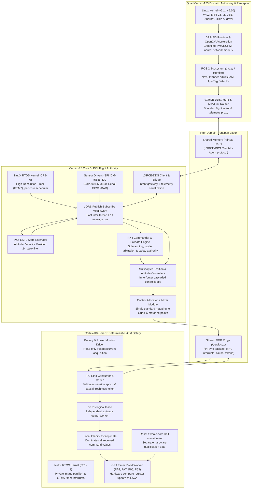
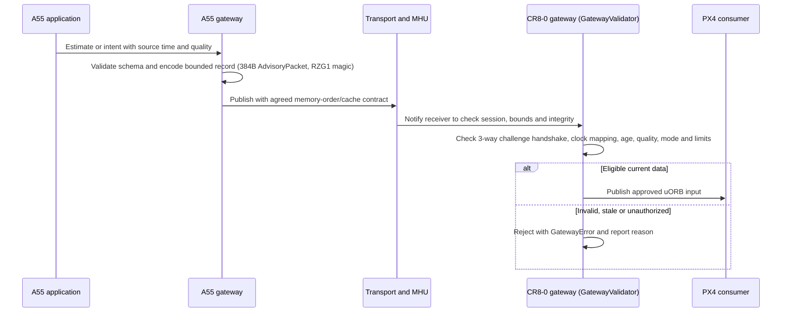
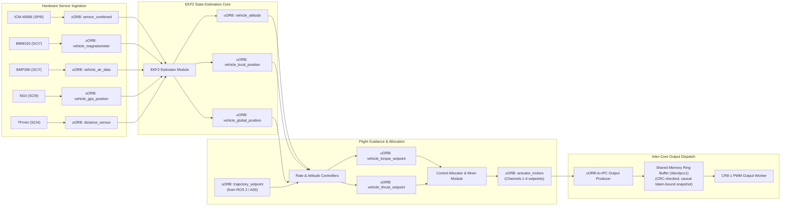
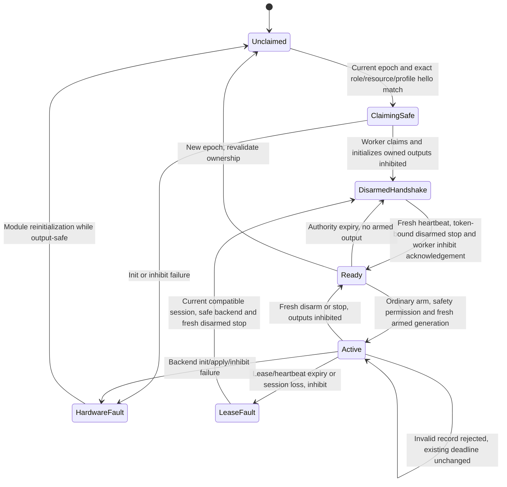
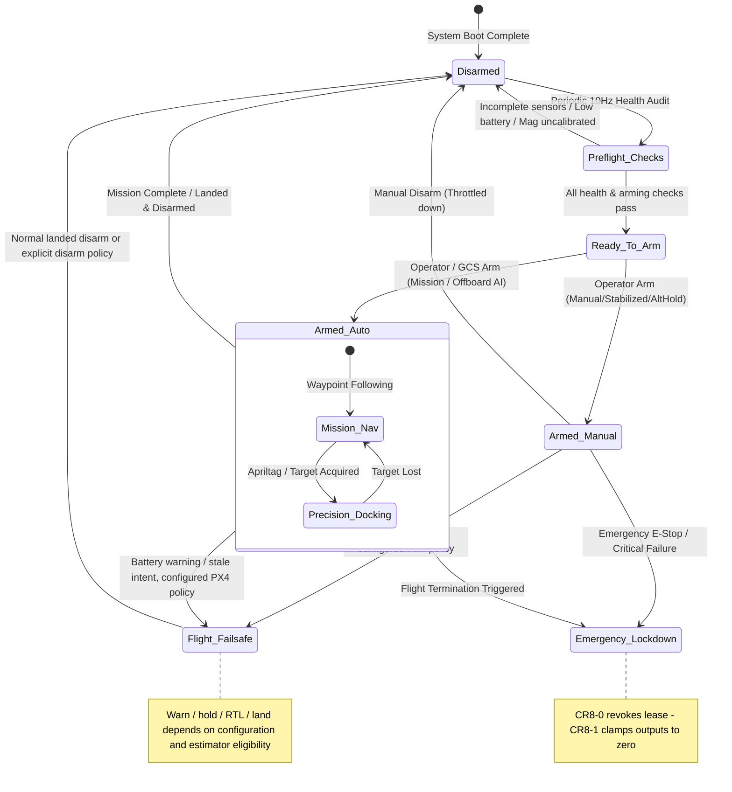

# RZ/V2H Single-SoC Autonomous Drone Software Specification
> **Purpose.** The [system specification](./rzv2h-system-specification.md) defines what the aircraft and external
> interfaces must do. This document defines how target software is partitioned across A55/Linux, DRP-AI3, CR8-0, and
> CR8-1. It does not promote target behavior to current port status.
## Document control
| Revision | Date | Change |
|---|---|---|
| 1.0 | 2026-10-11 | Initial full software specification for the CM33-free target architecture. |
| 1.1 | 2026-10-11 | Generalized deployment requirements to customer RZ/V2H platforms and separated the RDK software profile. |
| 1.2 | 2026-10-11 | Added developer entry points, verified topic mapping, BMS-driver reuse limits, bring-up gates and release artifacts; qualified performance targets. |
| 1.3 | 2026-10-21 | Linked the full dual-CR8 subsystem design; clarified battery, calibration/power-loss acceptance and disarmed-value versus electrical-inhibit contracts without reallocating IDs. |

| 1.4 | 2026-10-21 | Approved CR8-0 standard mixer allocation with CR8-1 validation/physical inhibit; linked seven demo module contracts and shared registry. |

| 1.5 | 2026-10-21 | Consolidated the exact-BOM sensor configuration under dualcr8; retired the separate target and historical default-peer admission. |
| 1.6 | 2026-10-21 | Distinguished the host-tested gateway validator from pending runtime integration and clarified software-lease versus physical shutdown evidence. |

**Start at [§3.4](#34-developer-start-path)** for builds and first bench gates. The normative target remains NuttX on
both R8 cores; the public RDK FreeRTOS sample is separate reference material.
## Contents
- [1. Scope and design rules](#1-scope-and-design-rules)
- [2. Software decomposition](#2-software-decomposition)
- [3. Deployment by compute domain](#3-deployment-by-compute-domain)
- [4. Inter-domain communication](#4-inter-domain-communication)
- [5. External-device software interfaces](#5-external-device-software-interfaces)
- [6. Runtime and concurrency](#6-runtime-and-concurrency)
- [7. Lifecycle and state](#7-lifecycle-and-state)
- [8. Data and control flows](#8-data-and-control-flows)
- [9. Fault handling](#9-fault-handling)
- [10. Configuration, persistence, update, and logging](#10-configuration-persistence-update-and-logging)
- [11. Software security](#11-software-security)
- [12. Software requirements](#12-software-requirements)
- [13. Evidence boundary](#13-evidence-boundary)
- [14. Verification and open decisions](#14-verification-and-open-decisions)
## 1. Scope and design rules
### 1.1 Included software
This specification covers Linux/ROS 2/media/DRP-AI3, CR8-0 PX4/NuttX, CR8-1 NuttX I/O, their drivers, IPC, lifecycle and
release controls. CM33 is excluded, including boot dependencies. Customer schematic, pinmux, device tree, memory map and
ownership define the board-specific software. The [ecosystem guide](./rzv2h-development-ecosystem.md) separates RDK
reference profiles from production baselines.
### 1.2 Governing design rules
1. **One owner per mutable state.** Other domains receive snapshots or send commands; they do not share writable
   structures.
2. **Commands down, status up.** A55 sends bounded intent to CR8-0; CR8-0 sends actuator commands to CR8-1. Reverse
   paths publish health and observations.
3. **Linux is advisory to flight.** Linux may propose trajectories, odometry, obstacles, or payload actions; CR8-0
   validates and owns acceptance.
4. **No raw pointers on wire.** Inter-domain payloads are fixed schemas with explicit endianness, size, version, and
   bounds.
5. **Time is part of every contract.** Sensor, command, health, and output data include source time or acquire a
   trusted receive time plus validity/age.
6. **Safe after reset.** Reset or peer absence is a normal state that inhibits output rather than reusing old data.
7. **Bounded real-time work.** CR8 interrupt and high-priority paths perform bounded work and never wait indefinitely
   for Linux, storage, BMS, or payloads.
8. **Evidence labels remain visible.** Target architecture, implemented source, build-clean behavior, and on-target
   observations are never merged.
### 1.3 Dual-CR8 evaluation design
The [demo architecture](./rzv2h-dualcr8-demo-architecture.md) covers all subsystem owners; the [engineering
design](./rzv2h-dualcr8-demo-design.md) owns proposed message layouts, state/sequence views and acceptance gaps. Both
describe target work. Full acceptance includes battery ingestion/policy, persistent calibration, command/kill paths and
diagnostics. Disabled battery checks, TMPFS or manual calibration reload cannot satisfy product release. The approved
allocation in §5.6 performs mixing once on CR8-0; CR8-1 validates the output contract and owns final physical
inhibition. The [demo requirements registry](./rzv2h-demo-requirements.md) allocates the seven module contracts.
Props-off qualification is the selected initial campaign. Historical staging remains a dated reference; canonical
dualcr8 uses the consolidated sensor profile and inhibited remote-output producer.
## 2. Software decomposition
**Figure 2-1: Layered software stack architecture across compute domains**


The 50 ms lease is a logical software freshness bound. Connector shutdown must be measured against 50 ms plus one worker
period (2.5 ms candidate) plus the declared scheduler/HAL budget; see the [engineering timing
contract](./rzv2h-dualcr8-demo-design.md#7-bootstrap-steady-operation-and-recovery-sequences). A stopped CR8-1 cannot
execute the worker, so reset/core-halt containment remains a separate unqualified hardware gate. The diagram does not
establish a hardware watchdog or an exact 50 ms physical cutoff.

Applications depend on their domain's middleware and device drivers. A55 sends bounded intent to CR8-0; CR8-0 sends
leased outputs to CR8-1. Health and observations travel back to the owning flight authority. All shared peripherals and
memory regions require explicit ownership.
### 2.1 Component ownership
| Component | Owner | Inputs | Outputs | Failure containment |
|---|---|---|---|---|
| Camera capture/media | A55 | CSI/USB/GbE frames, camera controls | Timestamped frames, stream, capture status | Drop/backpressure locally; never block CR8 |
| Perception/DRP-AI3 | A55 | Frames, calibration, model | Detections with timestamp/confidence | Mark unavailable/stale; no direct actuator command |
| VIO/SLAM | A55 | Synchronized images and inertial/time input | Pose/velocity/covariance and health | CR8-0 validates continuity/quality before fusion |
| Mission planner | A55 | Mission, map, vehicle status, obstacles | Bounded route/trajectory intent | CR8-0 mode and limit checks |
| Payload manager | A55 | Operator/mission/AI requests | Camera/gimbal commands and status | Payload failure isolated from flight |
| Commander and failsafe | CR8-0 | Health, RC, link, battery, estimator, mission | Mode, arming, failsafe actions | Sole flight authority |
| Estimator | CR8-0 | Flight sensors and accepted external estimates | Vehicle state and health | Rejects stale/inconsistent sources |
| Flight controllers | CR8-0 | State and setpoints | Normalized actuator demand | No dependence on Linux availability |
| Actuator allocator | CR8-0 | Controller demand and airframe config | Per-function actuator setpoints | Range/function validation before IPC |
| I/O supervisor | CR8-1 | CR8-0 lease/setpoints, local safety input | Output enable and I/O status | Fail-silent on peer/lease/data fault |
| BMS/power service | CR8-1 | Selected digital BMS; optional customer-board secondary monitor | Timestamped battery snapshot | Source timeout and, when present, independent-source comparison |
| RC service | CR8-1 | CRSF/SBUS/redundant receiver | Channels, link metrics, failsafe bits | Timeout is explicit loss, not frozen input |
| ESC/output service | CR8-1 | Valid lease and actuator setpoints | DShot/PWM/CAN frames, ESC status | Safe output on timeout/reset |
## 3. Deployment by compute domain
### 3.1 A55 Linux domain
The Linux image shall be reproducible from a pinned BSP and package manifest.

The product shall select one qualified Linux baseline. The RDK Ubuntu profile and the RZ/V2H AI SDK Yocto profile are
useful but distinct starting points; their kernels, ROS 2 distributions, libraries, and drivers shall not be mixed
without an explicit compatibility build and test. See the [development ecosystem
guide](./rzv2h-development-ecosystem.md).

| Layer | Target service | Notes |
|---|---|---|
| Boot/lifecycle | Verified boot chain, service manager, health aggregator | Must release/monitor CR8 images without granting flight authority to Linux |
| Device/media | MIPI CSI-2, ISP where present, video codec, USB, Ethernet, PCIe | Optional IP depends on exact part number |
| AI | DRP-AI3 runtime, model loader, pre/post-processing | Models are versioned assets with compatibility metadata |
| Middleware | ROS 2 and DDS, MAVLink router, time service | Current PX4 guidance uses uXRCE-DDS client/agent architecture |
| Autonomy | VIO/SLAM, perception, obstacle map, mission planner | Publishes bounded, quality-tagged results |
| Payload | Camera manager, gimbal manager, video/evidence service | Media plane is separate from control plane |
| Network | Telemetry, fleet link, VPN/TLS as required, firewall | Untrusted ingress cannot reach raw CR8 IPC |
| Maintenance | Update, diagnostics, log export, calibration tools | Propulsion inhibited in maintenance state |

Linux scheduling may optimize camera and autonomy latency, but PREEMPT_RT or CPU isolation does not make Linux part of
the hard real-time actuator chain.

Each model manifest shall define input/output formats, pre/post-processing, calibration, compiler/runtime,
memory/bandwidth, measured latency, dataset limits and health/fallback behavior. Reject mismatched or untimestamped
results; see the release manifest in §10.4.
### 3.2 CR8-0 flight domain
CR8-0 owns sensors/time/watchdog, PX4 estimation/commander/control/allocation, flight parameters/logging and the
A55/CR8-1 gateways. It decides whether manual/assisted flight or a configured failsafe remains feasible when Linux
disappears; that decision depends on the mode and valid estimator sources.
### 3.3 CR8-1 I/O domain
CR8-1 owns the bounded peer/lease service, RC/BMS/CAN acquisition, safety inputs, PWM/DShot/CAN outputs, feedback and
watchdog/health. Optional secondary monitoring exists only on equipped customer hardware. It does not run the estimator,
choose navigation mode or originate arming.
### 3.4 Developer start path
Start from the [ecosystem profile matrix](./rzv2h-development-ecosystem.md#2-verified-software-snapshot). Use RDK
Ubuntu/Jazzy for an application proof, or the selected EVK/SOM Yocto source for board BSP work. The Linux decision does
not change the NuttX flight target. First reproduce each baseline independently.
#### 3.4.1 Build and identify the local CR8 reference
On a development host in this repository, follow the [root setup guide](../../../README.md) and [port
playbook](../porting-playbook.md). These commands are build-only; hardware image loading, reset and output tests require
a separate safe setup.

```bash
git rev-parse HEAD
git submodule status platforms/nuttx/NuttX/nuttx platforms/nuttx/NuttX/apps
source ./build_setup.sh
./build.sh --list
./build.sh renesas_rdk-rzv2h_demo
```
The demo image is the bench profile; see the [demo bench guide](../validation/demo-bench-validation.md).
For the reference drone build `./build.sh renesas_rdk-rzv2h_default` (PWM or DShot from `PWM_MAIN_TIM0..3`). The expected ELF pattern is `build/<target>/<target>.elf`; archive the actual
artifact hash, toolchain, configuration and log. Use `--no-clean` only for a compatible incremental build.

Standalone NuttX driver work uses `platforms/nuttx/NuttX/build.sh --list`, then a listed configuration with that script.
Do not hand-run NuttX configure and make. RTT/debug and the loaded ELF must match; follow the repository guide.
#### 3.4.2 Where engineers implement the customer port
| Responsibility | Existing owner / starting source | Customer deliverable |
|---|---|---|
| PX4 board | [RDK board](../../../boards/renesas/rdk-rzv2h) | Customer board target, sensor buses, timer outputs, startup and airframe config |
| NuttX board | [RDK NuttX board](../../../platforms/nuttx/NuttX/nuttx/boards/arm/rzv/rdk-rzv2h) | Pins, boot, linker map, owned peripherals and defconfigs |
| SoC/PX4 HAL | [RZ/V NuttX drivers](../../../platforms/nuttx/NuttX/nuttx/arch/arm/src/rzv) and [PX4 HAL](../../../platforms/nuttx/src/px4/renesas/rzv) | Driver/HRT/reset/DMA changes with tests, separate from board pin policy |
| CR8-1 I/O | [CR8-1 board scaffold](../../../boards/renesas/rdk-rzv2h-io-cr8_1) and [IPC architecture](../ipc-architecture.md) | Complete peer, lease, RC/BMS acquisition, output backend and reset recovery |
| Linux BSP | Selected external SDK/module BSP; not built by this PX4 command | Boot artifacts, DDR setup, DTS, reserved memory, modules and rootfs |
| ROS 2/autonomy | Locked ecosystem workspace plus customer packages | Version-matched messages, frame/time conversions, gateway, calibrated models and tests |

The default RDK PX4 image does not enable A55 OpenAMP/raw IPC. Refer to its
[defconfig](../../../boards/renesas/rdk-rzv2h/nuttx-config/nsh/defconfig); source directories alone do not establish an
active transport.
#### 3.4.3 Bring-up gates and evidence to save
| Gate | Work | Exit artifact |
|---|---|---|
| SW0: reproducible baselines | Build CR8 image and reproduce one Linux camera/AI demo separately | SHAs, configs, image hashes, logs and known-issue list |
| SW1: real devices | Read IMU/GNSS/BMS on selected hardware; prove persistence and safe output | Timestamp/calibration records, reboot persistence and waveform captures |
| SW2: CR8 peer | Implement lease and I/O snapshots; inject stale/corrupt/reset cases | Protocol tests and independent safe-output measurements |
| SW3: A55 flight gateway | Start with vehicle status, then validated odometry/intent; no direct actuator access | Topic allow-list, time/frame tests, overload/reconnect evidence |
| SW4: joint workload | Run cameras, models, storage and networks while exercising control | Worst-case timing, buffer use, thermal and fault-response results |
| SW5: product release | Signed compatible images, parameters, models, update/recovery | Manifest/SBOM, recovery tests and approved aircraft test entry criteria |

These are work packages, not completed features or delivery-time promises.
## 4. Inter-domain communication
### 4.1 Logical links
| Link | Transport target | Producer → consumer | Critical data | Current status |
|---|---|---|---|---|
| A55↔CR8-0 | Qualified RPMsg/OpenAMP or bounded shared-memory transport; selected uXRCE-DDS topics above it | Autonomy ↔ PX4 gateway | Odometry, trajectories, vehicle status and time/health | Target integration; disabled in default RDK PX4 image |
| CR8-0↔CR8-1 | MHU notification and shared DDR rings | PX4 ↔ I/O peer | Actuator lease/status and battery codecs; RC acquisition remains pending | [Software candidate checked](../evidence/dualcr8-software-validation-261021.md); no admitted pair or physical qualification |
| Linux internal | ROS 2/DDS and direct media APIs | Applications ↔ services | Mission, perception, VIO and payload | Selected profile plus customer integration |
| PX4 internal | uORB | PX4 modules | Sensors, estimates, commands and actuators | Existing architecture |

Shared memory is an on-chip transport opportunity, not proof of zero-copy DDS or sub-100 µs end-to-end behavior. Pin
client/agent versions, transport framing/MTU, memory attributes and reset handling; custom RPMsg support in the FreeRTOS
sample must be ported and tested for NuttX.
#### Actual PX4 topic boundary
The [local DDS allow-list](../../../src/modules/uxrce_dds_client/dds_topics.yaml) is the source for available endpoints.
Presence here does not enable the client or the board transport.

| Function | Existing interface | Product integration rule |
|---|---|---|
| External vision | `/fmu/in/vehicle_visual_odometry` (`VehicleOdometry`) | Transform frames/covariance, align timestamps and configure EKF2 fusion |
| Trajectory intent | `/fmu/in/trajectory_setpoint` plus `/fmu/in/offboard_control_mode` | Enforce freshness, permitted mode and bounds before acceptance |
| Obstacle observations | `/fmu/in/obstacle_distance` | Match the message semantics; not an arbitrary 3D occupancy-map interface |
| Flight/battery telemetry | `/fmu/out/vehicle_status`, `/fmu/out/vehicle_odometry`, `/fmu/out/battery_status` | Read-only Linux consumers with age/health handling |
| Landing target | MAVLink `LANDING_TARGET` to the [receiver](../../../src/modules/mavlink/mavlink_receiver.cpp) | Position-valid local-NED data becomes `landing_target_pose`; no default DDS subscription for that topic |
| Low-level outputs | Current general-purpose YAML also includes actuator/thrust/torque inputs | Exclude from the product A55 ingress or enforce a non-bypassable gateway; stock YAML does not satisfy this design's authority boundary |

For precision landing, use the supported MAVLink path over a selected validated link, or explicitly add a versioned
DDS/gateway adapter and corresponding tests. Do not publish a camera-relative vector directly as local-NED position.

[PX4 Offboard](https://docs.px4.io/v1.16/en/flight_modes/offboard) uses `OffboardControlMode` liveness separately from
ROS 2 setpoints and has configured loss timeout/action. A running heartbeat does not prove a planner is producing fresh
intent. The target gateway shall detect stale setpoints itself; a 100 ms response is not guaranteed by PX4 defaults.
### 4.2 Common envelope
Every inter-domain record shall contain or be protected by an envelope with:

| Field | Purpose |
|---|---|
| Magic/protocol identifier | Reject wrong memory or wrong protocol |
| Major/minor version | Compatibility decision |
| Message type and encoded length | Bounds and dispatch |
| Source identity and boot epoch | Detect peer restart and stale shared memory |
| Per-stream sequence | Detect duplicate, loss, and regression |
| Source monotonic timestamp | Freshness and ordering |
| Payload integrity check | Detect memory/transfer corruption |
| Flags/validity | Distinguish valid, degraded, unavailable, and reset states |

The existing CR8 raw protocol uses fixed ring entries, magic/version, sequence, timestamp, and CRC32. Any target
extension shall preserve compatibility rules and remain within the verified ring bounds.
### 4.3 Ownership and direction
| Data | Writer | Reader | Update model | Invalid behavior |
|---|---|---|---|---|
| Autonomy intent (`trajectory_setpoint`) | A55 aerial planner | CR8-0 gateway | Stream with explicit expiry/mode; candidate 50 Hz | Reject stale intent; choose a feasible configured fallback |
| External odometry (`vehicle_visual_odometry`) | A55 VIO | CR8-0 EKF2 input | Pose/velocity/covariance/quality; candidate 30–60 Hz | Stop invalid fusion and assess remaining estimator sources |
| Precision landing target | A55 detector/pose adapter | CR8-0 landing logic | Validated MAVLink or new gateway path; candidate 30 Hz | Apply configured target-loss behavior; do not assume safe continued descent |
| Obstacle constraints | A55 perception | CR8-0 navigation | Snapshot/constraint set with horizon | Ignore stale; use configured navigation response |
| Vehicle status | CR8-0 | A55 services | Read-only snapshot/event | Linux displays unknown/disconnected |
| Actuator setpoints | CR8-0 | CR8-1 | Ordered stream under a current-session lease | Configured safe-output behavior on stale/invalid data |
| Arming/output lease | CR8-0 | CR8-1 | Explicit renewable capability; candidate ≤ 50 ms expiry | Disabled after expiry/reset; timeout justified by aircraft hazards |
| RC input | CR8-1 | CR8-0 | Timestamped snapshot stream | RC loss |
| Battery status | CR8-1 | CR8-0 | Timestamped snapshot stream | Degraded/unavailable energy source |
| ESC/I/O status | CR8-1 | CR8-0 | Snapshot/events | Mark device/link unhealthy |
### 4.4 Backpressure and overload
- Control/status rings shall have fixed capacity and bounded per-cycle drain.
- A producer shall never overwrite unread safety-critical commands silently.
- High-rate state streams may use latest-value semantics only when sequence gaps and age remain observable.
- Full queues shall increment counters and apply the message-specific drop or fail policy.
- Media frames shall be dropped or quality-reduced within Linux before they consume flight-domain resources.
- IPC interrupts are notification only; message validity comes from the ring protocol and cache/memory-order contract.
### 4.5 Time synchronization
CR8-0 owns the flight monotonic timebase. Cross-domain time service shall estimate offset, drift, and uncertainty
without stepping flight time. Camera capture, GNSS PPS, VIO output, gimbal events, and log records shall be traceable to
this timebase within an aircraft-defined error budget.
### 4.6 Memory and transport contract
Freeze the memory-region addresses, sizes, alignment and cache attributes in one manifest used by Linux reserved-memory
nodes and both CR8 linker/MPU configurations. Distinguish the application envelope from XRCE framing and the existing
raw-IPC format; do not copy a proposed magic number into an unrelated transport.

For each producer/consumer queue define publication ordering, cache clean/ invalidate responsibility, barriers,
notification acknowledgement, index ownership, wrap rules and epoch reset. A55 and CR8 memory/cache operations must be
reviewed together. A shared address does not imply coherency, and cross-core atomics must be supported for the selected
memory region.

<!-- sys-view: sequence-ipc -->
**Figure 4-1: Target bounded message path; private packet validation is implemented, runtime integration remains
pending**


The host-tested private packet validator is implemented in [`src/apps/gateway.hpp`](../../../src/apps/gateway.hpp) and
[`src/apps/gateway.cpp`](../../../src/apps/gateway.cpp) (`GatewayValidator`, header 96 bytes, packet capacity 384 bytes,
`GatewayMagic = 0x31475A52`, advisory kinds `Mode`, `Trajectory`, `Odometry`, `Obstacle`). The horizontal
range-to-obstacle formatter in [`src/apps/perception.cpp`](../../../src/apps/perception.cpp) validates mounting,
heading, FOV and range policy before creating an advisory packet. These components do not provide a running A55 gateway:
transport/startup ownership, canonical uORB publication and eligibility-aware Commander fallback remain pending. Figure
4-1 describes that target integration, not an executed end-to-end path.

Transport latency measurement starts at publication of a ready record and ends at validated reception. Camera-to-control
latency additionally includes exposure, capture queues, inference/VIO, scheduling and PX4 processing.

**Figure 4-2: End-to-end uORB publish-subscribe data flow across PX4 modules and inter-core boundaries**


## 5. External-device software interfaces
### 5.1 Flight sensors
Each sensor driver shall expose identity, calibration, sample timestamp, receive timestamp, error count, temperature
where available, and health. Drivers shall bound bus transactions, reset only their owned device/bus, and publish
discontinuity after reset. Redundant sensors shall not share an undocumented calibration or error state.
### 5.2 BMS and power software
The CR8-1 power service normalizes the selected digital BMS source—DroneCAN or a documented vendor CAN protocol, or
SMBus Smart Battery Data—into a source-aware battery snapshot. On a suitably equipped customer board, a separate adapter
may also normalize protected ADC sensing or an external digital power monitor. A board profile shall instantiate only
sources that are routed, protected, configured, calibrated, and validated on that hardware.

| Normalized field | Rule |
|---|---|
| Battery/source ID | Stable per installed pack/source; never inferred solely from bus order |
| Voltage/current | SI units with validity and measurement source |
| Remaining charge/capacity | Preserve whether reported by BMS or estimated by PX4 |
| Cell voltages | Optional array with count and unavailable state |
| Temperature | Preserve sensor/min/max meaning and validity |
| Warning/protection flags | Preserve raw vendor/SBS meaning plus mapped common status |
| Contactor/charge state | Read-only unless the approved safety design explicitly permits control |
| Source and receive time | Required for age and link diagnosis |
| Link/error counters | Timeouts, CRC/PEC errors, NACKs, resets, sequence loss, bus-off |

For SMBus, the service shall implement the chosen device's SBS subset and packet-error checking when supported. It shall
not issue undocumented writes. For CAN, it shall handle bus-off/recovery without blocking actuator CAN service; separate
CAN channels are preferred when bus criticality or load warrants it.

CR8-0 owns low-battery thresholds, warnings and flight actions. CR8-1 reports facts and link health; Linux cannot
suppress the PX4 response.
#### Reuse existing drivers deliberately
| Source reference | What can be reused | Required target work |
|---|---|---|
| [INA228 driver](../../../src/drivers/power_monitor/ina228) | Device-register and shunt-calibration logic | Qualified bus/board configuration and CR8-1 acquisition adapter or explicitly temporary CR8-0 bench ownership |
| [SMBus battery driver](../../../src/drivers/batt_smbus) | SBS reads and BQ40Z50/BQ40Z80-specific handling | Audit supported commands, timing, PEC and device compatibility; not a universal smart-battery driver |
| [DroneCAN battery bridge](../../../src/drivers/uavcan/sensors/battery.cpp) | BatteryInfo/auxiliary decoding into PX4 semantics | CAN stack/driver ownership on CR8-1 and a new bounded IPC ingestion path on CR8-0 |

The existing `batt_smbus.cpp` also contains manufacturer writes and undervoltage-protection changes. It is **not** a
drop-in read-only BMS adapter. The target service shall exclude such operations unless the selected battery's approved
safety design explicitly permits them. Reusing source does not authorize changing pack protection.

Implement and test: identify source → bounded acquisition → validate PEC/CRC, units and sign → retain sample age →
publish normalized snapshot → CR8-0 battery-status adapter → PX4 warning/failsafe policy. Test NACK/stuck bus, bus-off,
pack swap, stale data, negative current, capacity mode, unsupported fields and disagreement with any secondary monitor.
The measured-SOC snapshot-to-PX4 adapter exists; selected physical acquisition and voltage-based estimation remain pending.
### 5.3 Camera, vision AI, and precision landing software
The camera service separates configuration, capture, processing and media:

1. Bind only customer-routed cameras/bridges to verified Linux drivers; record pixel format, resolution, rate,
   control bus, trigger and reset behavior.
2. Record exposure/sample time separately from receive time. Measure the camera/IMU offset and drift; a GPIO strobe
   does not itself synchronize the sensors' internal sampling.
3. Use the selected release's supported DRP/OpenCV functions and parameter ranges. The [accelerator
   documentation](https://github.com/renesas-rz/rzv2h_opencv_accelerator) describes `remap` and stereo support with
   constraints and CPU fallback. Its DRP path conflicts with simultaneous video decoding; schedule ownership.
4. Run compiled neural models with their matching runtime and post-processing. Run VIO on A55 unless a specific
   accelerated implementation is supplied and validated. Record accuracy, frame age and resource use under joint
   load.
5. For landing, use CPU AprilTag detection or a separately validated neural detector, calibrate pose, transform into
   the accepted PX4 frame and route through §4.1. Target loss and docking accuracy are aircraft test requirements.
6. Bound encode/record/stream buffers and bandwidth; codec channel capability does not imply unlimited simultaneous
   streams.
7. Translate MAVLink Camera Protocol v2 commands only to capabilities actually supported by the camera. Keep media
   transport separate from flight commands.
### 5.4 Gimbal software
The gimbal manager arbitrates sources in this order only after product approval: emergency/safety policy, operator
manual override, mission command, then AI tracking. The configured priority and timeout shall be visible in telemetry.

Commands carry target frame, attitude/rate/ROI type, timestamp, expiry, and source. Status carries orientation, angular
velocity where available, active manager/source, limit/fault flags, and age. Vehicle attitude comes from CR8-0; gimbal
feedback is not a flight-attitude source unless separately specified.
### 5.5 RC, telemetry, and modem software
- CR8-1 decodes RC frames and publishes channels, failsafe bits, link quality, frame loss, and age.
- MAVLink routing applies explicit port profiles and forwarding rules.
- A55 network services firewall payload/fleet traffic from CR8 transport.
- Loss of cellular/Wi-Fi service is a network event, not synonymous with RC loss or GCS telemetry loss.
- Remote ID service health is separately observable.
### 5.6 ESC and actuator software
CR8-0 owns the standard `PWM_MAIN` mixer and applies function mapping, range, reversal and configured disarmed/failsafe
values once. CR8-1 consumes validated leased channel commands without repeating those transformations. It validates
pulse bounds, timer-group constraints and the selected protocol/rate contract, and owns the physical backend and final
electrical inhibit. **DShot** is selected as the primary ESC protocol, with standard 400Hz PWM retained as a qualified
backup mode; CR8-1 manages the corresponding GPT timer DMA or compare registers accordingly. Configured disarmed values
remain distinct from the final electrical inhibit in system §6.3. Boot/negotiation/standby inhibition takes precedence
over a nonzero configured value; transport consumption, HAL submission and measured connector output are separate
observations.

ESC feedback shall retain ESC identity and may include RPM, voltage, current, temperature, consumption, and fault state.
Missing telemetry shall not be fabricated. DShot checksum or CAN frame integrity does not prove the commanded motor
produced thrust.
## 6. Runtime and concurrency
### 6.1 Priority classes
| Class | Examples | Blocking rule | Overrun action |
|---|---|---|---|
| Critical I/O | CR8-1 output update, lease/watchdog, RC capture | No unbounded wait, allocation, filesystem, or Linux dependency | Inhibit/hold safe output and report deadline miss |
| Flight real-time | CR8-0 IMU, estimator/controller scheduling, HRT | Bounded driver/IPC access only | PX4 health/failsafe plus counters |
| Flight support | Other sensors, battery ingestion, telemetry preparation | May block only on bounded local primitives | Mark source stale/degraded |
| Linux latency-sensitive | Camera capture, VIO, perception, mission bridge | Bounded queues and memory pools | Drop/reduce workload and mark output stale |
| Linux best effort | Video recording, upload, analytics, UI | Must yield to latency-sensitive services | Throttle/restart locally |

Final periods, priorities, stack sizes, queue depths, WCET, and stale thresholds belong in the aircraft timing budget.
Source defaults are not accepted as the released values without measurement.
### 6.2 Interrupt and DMA rules
- Interrupt handlers acknowledge the source, capture minimal timestamp/status, and defer bounded processing.
- DMA buffers have explicit ownership, alignment, cache maintenance, and completion/error paths.
- A peripheral reset cannot invalidate another domain's buffer or pin state.
- Shared IRQ or DMA exhaustion is included in load and fault tests.
- Camera/media DMA is prevented from monopolizing memory bandwidth needed by flight and IPC traffic.
### 6.3 Watchdogs and liveness
Each domain publishes liveness plus functional health. A task merely running is not proof that sensors, IPC, output, or
control work is current. Watchdog recovery shall preserve crash evidence where practical and return actuator outputs to
inhibited state before peer re-negotiation.
## 7. Lifecycle and state
### 7.1 CR8-1 output state machine
<!-- sys-view: state-output -->
**Figure 7-1: Target CR8-1 actuator-output state machine**


Lease state and worker state are distinct; [the detailed design](./rzv2h-dualcr8-demo-design.md#6-link-lease-and-output-state-models)
owns their full transition contract. A rejected frame never renews authority. Hardware faults stay latched until safe
module reinitialization and a fresh disarmed handshake; no direct fault-to-active transition is permitted.

**Figure 7-2: PX4 Master Commander arming and flight mode state machine**


### 7.2 Linux service lifecycle
Linux services use ordered readiness dependencies: time/storage/device drivers, camera/media, accelerator/model,
middleware, then autonomy/payload applications. Failure of an upper service shall not restart the CR8 domains. CR8
health and output state remain visible even when autonomy is unavailable.
### 7.3 Shutdown and update
Operational shutdown shall disarm, confirm outputs inactive, stop mission and payload commands, flush bounded critical
state, and then stop services/rails. Update mode requires propulsion inhibition and enough power to complete or
rollback. Mixed incompatible A55/CR8 image sets shall be rejected before arming.
## 8. Data and control flows
| Flow | Required sequence |
|---|---|
| Autonomy | Timestamped capture → perception/VIO/planning → A55 gateway → CR8-0 validation → PX4 control/allocation → CR8-1 lease/output checks |
| Gimbal/camera | Operator/mission/AI request → approved payload arbitration → device acknowledgement; CR8-0 supplies attitude/time and flight-state inhibits |
| Battery | CR8-1 acquisition → separate source health/snapshots → CR8-0 energy/warning policy → Linux/GCS telemetry; optional secondary sources remain distinguishable |

The gateway sequence in §4.6 and output state machine in §7.1 define the control boundaries. Linux may adapt missions to
battery state but cannot suppress PX4 failsafes or bypass output checks.
## 9. Fault handling
| Fault | Detector/owner | Immediate software action | Recovery |
|---|---|---|---|
| A55 service/planner stall | Linux supervisor and CR8-0 gateway | Reject stale autonomy intent; PX4 selects a response compatible with remaining estimates and configured mode | Restart service with new session and valid current intent |
| A55 domain loss / reboot | CR8-0 heartbeat/transport | Drop autonomy lease; retain flight authority via CR8-0 manual/assisted/failsafe mode | Full peer re-handshake; never reuse old commands |
| CR8-0 loss/reset | CR8-1 lease/epoch | Apply configured safe output and enter SafeFault within the released lease timeout | Outputs remain safe until new peer, disarmed handshake and lease |
| CR8-1 loss/reset | CR8-0 heartbeat | PX4 declares I/O/output failure and executes feasible response | Rejoin only while output-safe and according to flight safety case |
| IPC CRC/version/length fault | Receiving gateway | Reject record, count/report error | Continue only with subsequent valid current-session data |
| IPC queue full | Producer/transport | Apply per-stream drop/fail rule; record overload | Recover when capacity returns; no silent overwrite |
| IMU/sensor fault | Driver/estimator | Reject/vote/degrade source | Device reset or switch only with health proof |
| BMS link loss | CR8-1 power service | Mark smart data stale; use a secondary monitor only when the customer board provides and validates one, otherwise report unavailable | Reaccept after protocol and plausibility checks |
| BMS/secondary-monitor disagreement | CR8-1 and PX4 | On equipped customer boards, mark degraded and use conservative policy | Requires stable agreement or maintenance diagnosis |
| GNSS signal lost | PX4 estimator | Reassess position validity; continue VIO only if already healthy/configured, otherwise apply feasible failsafe | Controlled re-fusion after health checks |
| Camera/VIO tracking lost | A55 and CR8-0 quality checks | Stop invalid fusion; GNSS/flow/range aids may be used only if valid | Require continuity, calibration and quality before reacceptance |
| Optical flow/lighting loss | Estimator | Reassess navigation capability; flow and VIO may share an environmental failure | No guaranteed position hold or RTL without suitable estimates |
| Precision landing target lost | PX4 landing logic | Apply selected precision-landing mode/timeouts and search/abort policy | Reaccept only a fresh target in the correct frame |
| Gimbal/payload fault | A55 payload manager | Stop/park/hold per device; report | Local restart; no flight-domain restart |
| RC loss | CR8-1/PX4 | Explicit RC-loss event and configured PX4 response | PX4-controlled recovery after valid link returns |
| Storage full/corrupt | Storage owner | Preserve critical operation; bound logging; report | Rotate/recover/read-only or maintenance |
| Thermal/power warning | Linux/CR8 sensor owner | Shed payload/AI load first; maintain flight margins | Hysteretic recovery or controlled landing policy |
| Total SoC/power failure | Independent external system, if fitted | SoC software cannot act; external gating, ESC timeout and qualified recovery system handle the fault | Aircraft-specific containment and recovery |

The candidate 50 ms output-lease budget is a development requirement to measure, not current evidence. SafeFault
prevents stale actuation but does not guarantee a safe aircraft landing. A stuck timer/DMA output needs hardware-level
containment, not just a task watchdog. No automatic parachute deployment is implied by this software table.
## 10. Configuration, persistence, update, and logging
### 10.1 Configuration ownership
| Configuration | Canonical owner | Distribution rule |
|---|---|---|
| Flight parameters, calibration, failsafe | PX4/CR8-0 persistent store | Linux may request through authorized parameter service; CR8-0 validates |
| I/O pin/bus/output safety mapping | CR8-1 signed image/config | Must match hardware revision and CR8-0 compatibility manifest |
| Camera/gimbal/media | Linux payload configuration | Cannot alter flight authority or output mapping |
| AI model/calibration | Versioned Linux asset bundle | Compatibility and integrity checked before activation |
| Network/security policy | Linux security configuration and device credentials | Secrets never stored in public logs or general PX4 parameters |
| Aircraft interface control data | Released system manifest | Consumed by build/validation tooling, not duplicated inconsistently |
### 10.2 Persistent storage
PX4 parameters require atomic replacement, integrity checking, schema/version migration, power-loss recovery, and known
defaults. Linux uses read-only base images plus controlled writable data partitions where practical. Flight, payload,
and update data have separate quotas so video cannot exhaust critical parameter or diagnostic storage. Calibration
records include sensor identity, fitted orientation, offsets/scales and compatibility with the selected board/schema.
Validate after cold boot and replacement; incompatible or corrupt records cannot silently count as calibrated. PX4
route/type device identity is not necessarily a unique physical serial; same-model same-route replacement needs a
qualified serial or maintenance-controlled replacement epoch and recalibration. Interrupted saves recover the previous
committed set or declared safe defaults with failed calibration readiness. NVM transactions run outside
control/lease-critical work. Select and qualify an actual storage device, partition/ownership, durability and power-cut
recovery before release; volatile TMPFS and controlled reload are bring-up aids only (`SW-CFG-002`).
### 10.3 Update compatibility
A release manifest shall identify hardware revision, A55 image, CR8-0 image, CR8-1 image, IPC schema, PX4
parameters/schema, device tree, AI model bundle, and payload configuration. The system shall reject an incompatible set
or stay in maintenance/output-inhibited mode. Rollback shall never restore incompatible calibration or a partially
written image.
### 10.4 Minimum release manifest
Maintain a machine-readable product manifest, generated from build outputs where possible. Required entries are:

| Group | Fields to freeze |
|---|---|
| Hardware | Board/SOM revision, exact SoC, BOM/ICD revision and boot mode |
| Linux | BSP/Yocto layers and commits, kernel config, DTB, bootloader, rootfs/package manifest, toolchain/container digest |
| CR8 | PX4, NuttX and apps commits, both board configs, compiler, linker maps and image hashes |
| Inter-domain | Region layout, protocol/schema versions, topic allow-list, XRCE client/agent versions and transport |
| Devices | Sensor/BMS/ESC/gimbal firmware, calibration identity and interface configuration |
| AI | Model/exporter/weights hashes, input/pre/post-processing, quantization dataset, compiler/runtime/driver tuple |
| Release | Parameter set, SBOM/license notices, signing identity, rollback compatibility and test-evidence IDs |

Store real build-generated hashes; never substitute example hashes in a release. The current repository does not yet
generate a complete three-image manifest.
### 10.5 Logging and observability
Logs shall correlate by common time and boot/session identifiers. Required observability includes:

- reset cause, image versions, boot result, and watchdog source;
- IPC version/session, queue high-water marks, CRC/sequence/timeout counters;
- sensor identities, resets, error rates, and data age;
- RC, BMS, power, ESC, camera, gimbal, and network health transitions;
- arming/output-lease transitions and reasons;
- autonomy input acceptance/rejection and reason;
- storage pressure, thermal state, and workload shedding.
## 11. Software security
### 11.1 Trust zones
- External RF, Ethernet, USB, cameras, and payloads are untrusted inputs.
- Linux is a rich attack surface and is not trusted to write actuator state.
- CR8 gateways accept only allow-listed message types, bounded lengths, valid versions, current sessions, and
  semantically valid values.
- Integrity fields protect against accidental corruption; authenticated boot, update, and link controls address
  malicious modification.
### 11.2 Required controls
- Verified boot and signed release manifest for every executable/model asset.
- Least-privilege Linux services, read-only base filesystem, service sandboxing, firewall, and no default remote shell
  on operational links.
- MAVLink 2 signing and key lifecycle for untrusted command channels.
- TLS/VPN or equivalent where IP confidentiality/peer authentication is needed.
- Rate limits and allow lists at Linux-to-CR8 gateways.
- Unique device identity and credential provisioning from an approved source; the current fixed PX4 board identity is
  unsuitable for a fleet.
- Controlled production debug and secret-free crash/log export.
### 11.3 Software assurance work products
Create requirements-to-test traceability, reviewed safety-related code, bounded timing/stack/queue analysis, reset/fault
tests, configuration control, and dataset/operating-envelope evidence for perception. These are engineering work
products to support the customer safety plan; no DO-178C DAL, SORA level, or safety certification is established for
this port.

The Linux trust boundary requires enforceable peripheral/memory access rules and gateway authorization tests. An MPU/GIC
configuration or CRC alone does not prove containment of a privileged or compromised Linux domain.
## 12. Software requirements
### 12.1 Partitioning and authority
| ID | Requirement | Verification |
|---|---|---|
| SW-ARC-001 | Software shall deploy only to A55/DRP-AI3, CR8-0, and CR8-1 as allocated in §3. | Image and deployment inspection |
| SW-ARC-002 | A55 software shall not directly command actuator peripherals or modify CR8-owned actuator state. | Access-control and fault-injection test |
| SW-ARC-003 | CR8-0 shall accept or reject all autonomy intent before it affects flight control. | Interface and scenario test |
| SW-ARC-004 | CR8-1 shall implement output inhibition and lease expiry independently of Linux availability. | Peer-loss and timeout test |
| SW-ARC-005 | Each mutable cross-domain datum shall have one writer. | Schema/ownership audit |
### 12.2 Communication and time
| ID | Requirement | Verification |
|---|---|---|
| SW-IPC-001 | Every inter-domain record shall be versioned, length-bounded, sequenced, timestamped, session-scoped, and integrity-checked. | Protocol unit/fuzz test |
| SW-IPC-002 | A peer boot-epoch change shall invalidate all prior commands, leases, and snapshots. | Reset injection |
| SW-IPC-003 | Queue-full, timeout, duplicate, loss, regression, and corrupt-record behavior shall be specified per stream and observable. | Load/fault test |
| SW-IPC-004 | No critical CR8 work shall wait indefinitely for another domain. | Static review and timing test |
| SW-TIM-001 | Flight time shall be monotonic and shall not be stepped by Linux time synchronization. | Time fault test |
| SW-TIM-002 | External estimates and camera-derived data shall include time/quality information sufficient for CR8-0 freshness checks. | Pipeline test |
### 12.3 Devices and fault behavior
| ID | Requirement | Verification |
|---|---|---|
| SW-DEV-001 | Device drivers shall distinguish unavailable/invalid data from valid zero. | Unit and disconnect test |
| SW-DEV-002 | BMS software shall retain source, units, validity, age, and unavailable fields and shall not issue undocumented control writes. | Protocol conformance test |
| SW-DEV-003 | Camera and gimbal services shall expose only capabilities supported by the selected device. | Capability/interoperability test |
| SW-DEV-004 | ESC feedback shall remain associated with the physical ESC identity. | Integration test |
| SW-DEV-005 | Bus recovery shall not reset unrelated devices or exceed the owning task's bounded work. | Shared-bus fault test |
| SW-FLT-001 | Linux restart shall not require or cause actuator activation. | Reset test |
| SW-FLT-002 | CR8-0 reset/loss shall cause CR8-1 to enter the defined safe-output path. | Hardware scope test |
| SW-FLT-003 | CR8-1 shall require a disarmed, current-session handshake before recovering from SafeFault. | State-machine test |
### 12.4 Configuration, update, and security
| ID | Requirement | Verification |
|---|---|---|
| SW-CFG-001 | Released images and configurations shall be tied by one compatibility manifest. | Update/rollback test |
| SW-CFG-002 | PX4 parameters, including calibration described in §10.2, shall persist atomically with integrity and power-loss recovery before flight release. | Cold-boot, interrupted-save, corrupt-record, sensor-replacement and schema-compatibility tests |
| SW-UPD-001 | Update shall be possible only with propulsion inhibited and shall recover from interruption. | Update power-cut test |
| SW-SEC-001 | Executable images, configuration manifests, and AI models shall be authenticated before activation. | Negative signature test |
| SW-SEC-002 | Linux-to-CR8 gateways shall enforce type allow lists, bounds, session, freshness, and semantic validation. | Fuzz/security test |
| SW-OBS-001 | Logs shall correlate resets, sessions, IPC faults, sensor/device health, arming, lease, and autonomy acceptance across domains. | Log review test |
### 12.5 Advanced autonomy, vision, and precision landing
| ID | Requirement | Verification |
|---|---|---|
| SW-AUT-001 | Camera/IMU timestamps shall meet the released correlation budget with explicit uncertainty and reset handling. | Scope and timestamp fault tests |
| SW-AUT-002 | Autonomy intent shall have independent freshness checks, supported Offboard liveness and a measured expiry-to-response bound. | HIL stall/heartbeat-separated fault tests |
| SW-AUT-003 | VIO shall publish frame, pose/velocity, covariance and quality through a version-matched PX4 interface. | Frame/covariance/time-jump injection |
| SW-AUT-004 | Landing estimates shall use an implemented PX4 input path and defined target-loss policy; detector acceleration is optional. | Target/frame-loss bench and aircraft tests |

Initial feasibility budgets are 50 Hz trajectory updates, ≥ 30 Hz VIO/landing updates, < 100 µs transport, ≤ 100 ms
stale-intent response and < 10 µs camera/IMU correlation. These remain proposals requiring systems approval and
measurement; they are not PX4 defaults or SDK guarantees. Define how a stale setpoint is detected even while Offboard
heartbeats continue.
## 13. Evidence boundary
This specification owns target software contracts, requirements and verification gates. Current repository
implementation status and named hardware evidence are maintained in the [NuttX port status](../port-status-nuttx.md) and
[PX4 HAL status](../port-status-px4-hal.md); the [system specification](./rzv2h-system-specification.md) owns the
corresponding hardware requirements. RDK and repository results remain pre-development evidence and do not promote
target contracts to shipped behavior.
## 14. Verification and open decisions
### 14.1 Software verification gates
1. Schema generation/static assertions and protocol unit/fuzz tests.
2. Host tests for lifecycle, lease, stale data, reset epochs, queue overload, battery normalization, and
   gimbal/camera arbitration.
3. Reproducible builds and artifact/manifest inspection for all three images.
4. Processor-in-loop IPC throughput, cache coherence, reset, and timeout tests.
5. HIL with real/simulated sensors, BMS, RC, camera, gimbal, and ESC nodes.
6. Powered bench scope tests of inactive/default/output-timeout behavior.
7. Linux saturation/crash/security tests while monitoring CR8 deadlines.
8. Controlled flight envelope expansion with fault injection permitted by the safety plan.
### 14.2 Primary references
- [System specification](./rzv2h-system-specification.md)
- [Renesas RZ/V2H Group Datasheet](https://www.renesas.com/en/document/dst/rzv2h-group-datasheet)
- [PX4 ROS 2 User Guide](https://docs.px4.io/main/en/ros2/user_guide)
- [PX4 uXRCE-DDS](https://docs.px4.io/main/en/middleware/uxrce_dds)
- [PX4 MAVLink Camera v2](https://docs.px4.io/main/en/camera/mavlink_v2_camera)
- [PX4 Gimbal Configuration](https://docs.px4.io/main/en/advanced/gimbal_control)
- [PX4 DroneCAN](https://docs.px4.io/main/en/dronecan/)
- [Smart Battery Data Specification](https://www.sbs-forum.org/specs/sbdat110.pdf)
- [Repository IPC architecture](../ipc-architecture.md)
- [Repository multicore memory map](../multicore-memory-map.md)
- [RZ/V2H development ecosystem and RDK pre-development guide](./rzv2h-development-ecosystem.md)
- [PX4 v1.16 Offboard contract](https://docs.px4.io/v1.16/en/flight_modes/offboard)
- [PX4 v1.16 precision landing](https://docs.px4.io/v1.16/en/advanced_features/precland)
### 14.3 Open decisions
- Linux BSP/distribution, kernel branch, service manager, and update framework.
- Exact A55↔CR8-0 transport and measured deadline/bandwidth budget.
- CR8-1 device/bus assignment and whether actuator CAN is separated from battery/sensor CAN.
- Final IPC schema evolution policy and compatibility window.
- BMS protocol/device and, if required, customer-board secondary-monitor interface and calibration source.
- Camera topology, synchronization error budget, VIO/perception model set, and workload-shedding thresholds.
- Gimbal manager location and approved command-source priority.
- Product security, safety, and regulatory assurance targets.
