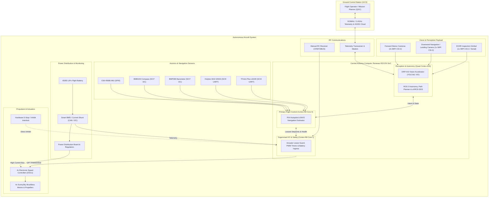
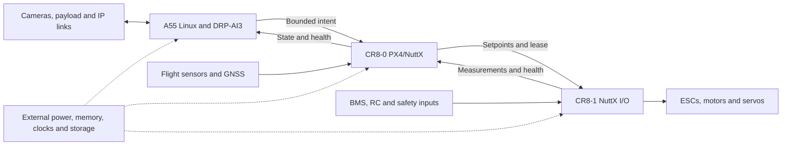
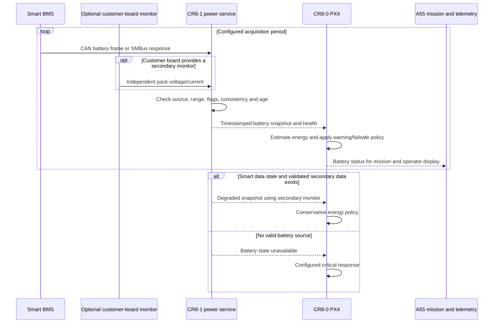
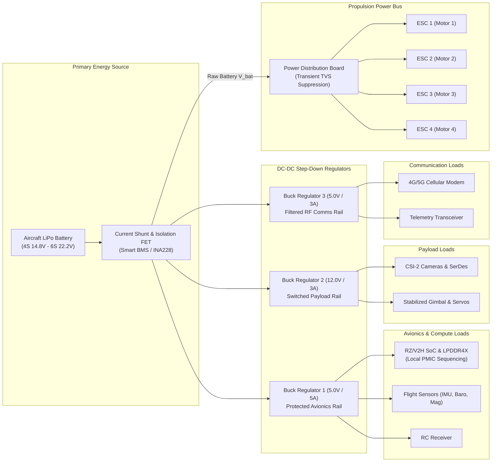

# RZ/V2H Single-SoC Autonomous Drone System Specification
> **Authority and status.** This document defines a board-independent RZ/V2H target aircraft architecture and its
> external interfaces. The RZ/V2H RDK is only a pre-development example and does not define the production pinout or
> board. Current repository evidence is owned by the [NuttX](../port-status-nuttx.md) and [PX4
> HAL](../port-status-px4-hal.md) status matrices.
## Document control
| Revision | Date | Change |
|---|---|---|
| 1.0 | 2026-10-11 | Replaced the prototype architecture with a complete single-central-SoC target, removed all CM33 responsibilities, and specified external devices and communication paths. |
| 1.1 | 2026-10-11 | Made the specification RZ/V2H-platform-wide and isolated RDK details as pre-development evidence. |
| 1.2 | 2026-10-11 | Added board-design inputs, ICD/resource ledger, concrete battery transactions and source-qualified camera/SOM guidance; separated candidate budgets from evidence. |
| 1.3 | 2026-10-21 | Added full dual-CR8 evaluation applicability, required battery/persistence gates and explicit electrical-inactivity semantics; retained requirement IDs. |

| 1.4 | 2026-10-21 | Linked the approved seven-module registry and props-off campaign without selecting unverified hardware or changing existing requirement IDs. |

| 1.5 | 2026-10-21 | Consolidated the exact-BOM sensor configuration under dualcr8; retired the separate target and historical default-peer admission. |

**Start board work at [§5.5](#55-board-design-start-package).** This is an architecture and design-input specification,
not a fabrication-ready schematic. A released customer BOM, pinout, layout and verified BSP are required before
manufacturing.
## Contents
- [1. Purpose and scope](#1-purpose-and-scope)
- [2. System context and boundaries](#2-system-context-and-boundaries)
- [3. RZ/V2H allocation](#3-rzv2h-allocation)
- [4. External-device architecture](#4-external-device-architecture)
- [5. Power and electrical design](#5-power-and-electrical-design)
- [6. Operational behavior](#6-operational-behavior)
- [7. Safety, reliability, and security](#7-safety-reliability-and-security)
- [8. System requirements](#8-system-requirements)
- [9. Evidence boundary](#9-evidence-boundary)
- [10. Verification strategy](#10-verification-strategy)
- [11. References and open decisions](#11-references-and-open-decisions)
## 1. Purpose and scope
### 1.1 Product intent
One RZ/V2H is the aircraft's central mission/flight compute SoC, consolidating Linux/networking, DRP-AI3 perception, PX4
flight control and deterministic I/O. Memory, storage, power, transceivers, sensors, cameras, radios, BMS, ESCs, motors
and payload controllers remain external.
### 1.2 Platform applicability
These requirements apply to an RZ/V2H-based customer flight computer. The customer schematic, pinmux, device tree, board
support, power design, and interface control document define the actual implementation. RZ/V2H evaluation boards and
their software may shorten pre-development, but no evaluation-board connector or pin assignment is a product
requirement.

The RZ/V2H RDK is one such reference. Its Ubuntu, ROS 2, AI, PX4/FreeRTOS, and this repository's PX4/NuttX examples are
mapped in the [development ecosystem guide](./rzv2h-development-ecosystem.md). RDK-specific limitations remain evidence
about that sample only.
### 1.3 Included aircraft capabilities
The target includes multicopter control, GNSS/local navigation, perception/VIO/ planning, smart-battery monitoring with
optional secondary measurement, gimbal/camera payloads, RC/telemetry/networking, logging/service and supervised actuator
output. Other PX4 airframes require their own allocation and tests.
### 1.4 Exclusions
- The Cortex-M33 core has no boot, runtime, I/O, safety, or actuator role in this design.
- Final component part numbers, connector pinout, airframe, battery chemistry, RF band, and regulatory approval are
  not selected here.
- This document does not claim certification, production readiness, measured range/endurance, or a safety integrity
  level.
### 1.5 Requirement language
“Shall” is a target-system requirement. “Should” is a recommended design choice. “May” is optional. A target requirement
is not implementation evidence.
### 1.6 Dual-CR8 evaluation applicability
The [demo architecture](./rzv2h-dualcr8-demo-architecture.md) and [engineering design](./rzv2h-dualcr8-demo-design.md)
cover the requested single ICM-45686, BMM150, BMP390, M10, TFmini Plus and four-motor configuration. Battery monitoring,
retained calibration and electrical output inhibition remain required for full acceptance; their missing hardware or
implementation is a gap. Props-off bring-up with battery disabled or volatile parameters is an incomplete milestone. The
demo excludes A55/cameras/CM33 at runtime; the broader product requirements remain applicable to their product variants.
A single IMU supplies no redundant inertial path. The [demo requirements registry](./rzv2h-demo-requirements.md) owns
the approved seven-module allocation. Initial qualification is props-off; hover/GPS flight remains a later campaign.
Unselected ESC, battery, storage and command/kill interfaces remain explicit input gates.

**Figure 1-1: Complete autonomous drone avionics system architecture and hardware boundaries**

## 2. System context and boundaries
<!-- sys-view: context -->
**Figure 2-1: Target domain and external-device connections**

| Boundary | Inside | Outside but required |
|---|---|---|
| Central compute | RZ/V2H, its memories, boot storage, clocks, and local power rails | Sensors, payloads, radios, BMS, ESCs, motors, airframe |
| Flight authority | CR8-0/PX4 | Linux autonomy proposes intent; operator and safety inputs constrain it |
| Physical output authority | CR8-1 while a valid CR8-0 lease exists | ESC firmware must also enforce its own command timeout |
| Battery protection | Flight policy consumes battery state | BMS owns cell protection, balancing, and pack protection |
| Payload control | A55 payload services and CR8-0 arbitration | Gimbal/camera controller owns its internal stabilization and motor loops |
## 3. RZ/V2H allocation
The selected RZ/V2H part shall provide the required optional multimedia and security blocks. The exact ordering code
must be frozen in the hardware BOM; family-level feature lists are not sufficient proof.

| Domain | Target software | Responsibilities | Isolation rule |
|---|---|---|---|
| Cortex-A55 cluster | Linux distribution, ROS 2, media and device services | Camera ingest, ISP/media path, DRP-AI3 inference, VIO/SLAM, obstacle map, mission planning, gimbal/camera manager, IP networking, fleet/payload applications | Cannot bypass PX4 arming, drive motors, or write CR8-owned actuator state |
| DRP-AI3/DRP | Linux-controlled accelerator workloads | Neural inference and selected image pre/post-processing | Output is advisory until checked by Linux and bounded by CR8-0 |
| CR8-0 | NuttX and PX4 | Primary sensors, timebase, estimation, commander, navigation mode, control loops, actuator allocation, flight health, failsafes, logging subset | Sole owner of flight mode, arming decision, and desired actuator setpoints |
| CR8-1 | NuttX I/O image | RC input, CAN avionics, BMS/power acquisition, safety switch, LEDs/buzzer, output lease, PWM/DShot/CAN actuator output, I/O health | Accepts actuator commands only from CR8-0; defaults to output disabled |
### 3.1 SoC resources used by the target
Renesas documents dual Cortex-R8, quad Cortex-A55, DRP-AI, 6 MB ECC SRAM, LPDDR4/4X, MIPI CSI-2, USB, PCIe, GbEthernet,
CAN-FD, SPI, I2C, I3C, SCI, timers, ADC, SD/eMMC, and xSPI resources. System allocation is conditional on pin
multiplexing, package, selected part, board routing, and measured bandwidth.
### 3.2 Common-cause boundary
The compute domains share silicon, package, power, clocks, interconnect, memory controllers, and thermal conditions.
Core allocation reduces scheduling and software interference but is not physical redundancy. The safety assessment shall
treat total SoC failure as a common-cause event.
### 3.3 Peripheral and shared-resource ownership ledger
Before selecting connector pins, create one ledger shared by hardware, Linux and NuttX teams. The following is a
proposed logical allocation, not RDK wiring or a claim that all alternate functions can be routed together.

| Resource group | Target owner | Reserve/check before schematic release |
|---|---|---|
| Primary and secondary inertial buses | CR8-0 | Prefer independently recoverable SPI instances, separate CS/DRDY, sensor rail/reset control |
| Barometer/compass management | CR8-0 | Device addresses, bus capacitance, pull-ups, clock stretching and recovery |
| GNSS and timing | CR8-0 | UART RX/TX, PPS capture, optional correction input and independent antenna power |
| RC and local safety inputs | CR8-1 | UART inversion/half-duplex needs, input capture and reset-safe GPIO levels |
| ESC/servo channels | CR8-1 | GPT channels, DMA requests, output gates and timer-rate groups; no HRT/debug conflict |
| Smart BMS and avionics CAN | CR8-1 | Controller/transceiver, selected Classic CAN or FD protocol, termination and fault isolation |
| Local power-monitor bus | CR8-1 | Dedicated I2C/SMBus or SPI pins; device-specific driver and optional ALERT |
| CSI/USB/media, model buffers, payload/network | A55 | Camera control bus, trigger owner, PHY/bridge, bandwidth and DMA isolation |
| PMIC, clocks and shared reset | Boot/lifecycle owner | A55 cold-boot sequence; controlled requests from other domains, never two independent owners |
| DDR/SRAM, MHU and storage | Explicit partitions | Linux reserved memory, both CR8 linker maps, cache policy, DMA reachability and one writer per region |

Each ledger row shall record the exact SoC instance, ball/pin, voltage bank, alternate function, reset state, IRQ/ELC
route, DMA channel, clock/reset owner, schematic net, Linux node or NuttX configuration, and corresponding test. Do not
let Linux probe a CR8-owned peripheral or reset a shared clock domain.
## 4. External-device architecture
### 4.1 Interface-selection principles
| Interface | Preferred use | Design notes |
|---|---|---|
| SPI | High-rate board-local IMUs and deterministic sensors | One chip-select per device; data-ready GPIO preferred; bound DMA and recovery |
| I2C/I3C | Low-rate board-local sensors and management devices | Short harness; isolate or recover a stuck bus; do not mix incompatible voltage domains |
| SMBus | Standards-based smart battery data | Electrically related to I2C but uses the SBS command/timing contract; not arbitrary I2C registers |
| UART/SCI | GNSS, RC receiver, rangefinder, telemetry, gimbal, debug | Define voltage, inversion, flow control, baud, framing, and timeout per device |
| CAN/CAN-FD | ESCs, smart BMS, GNSS, range sensors, robust remote avionics | Terminated differential bus; use DroneCAN in its supported Classic CAN mode or a frozen vendor protocol that explicitly defines Classic CAN versus CAN FD |
| MIPI CSI-2 | Board-local raw camera pixels | Separate I2C/I3C control and reset/trigger GPIO normally required |
| USB 3.2 | Smart camera, modem, removable high-bandwidth payload | Account for enumeration, inrush, cable retention, and host reset |
| GbEthernet | IP camera, payload, service, high-rate telemetry | Define addressing, QoS, time sync, authentication, and bandwidth ceilings |
| PCIe Gen3 | Integrated modem/accelerator/storage module | Highest board complexity; use only when USB/Ethernet is insufficient |
| ADC/GPIO | Board-local power sensing, safety input, discrete status | The customer hardware shall route, protect, calibrate, debounce, and define safe state |
### 4.2 External-device inventory
| Device class | Minimum role | Primary link | Alternate link | SoC owner | Loss behavior |
|---|---|---|---|---|---|
| Primary IMU | Angular rate and acceleration | SPI + data-ready GPIO | — | CR8-0 | Reject stale data; estimator/failsafe policy |
| Secondary IMU | Redundant inertial measurement | Separate SPI + GPIO | CAN remote IMU | CR8-0 | Continue only if estimator health permits |
| Barometer | Air pressure/altitude aid | I2C or SPI | CAN | CR8-0 | Degrade altitude source; report fault |
| Magnetometer | Heading aid | I2C/SPI | CAN remote compass | CR8-0 | Reject disturbed/unhealthy source |
| GNSS/RTK | Global position, velocity, time | UART + PPS GPIO | CAN or USB | CR8-0 | Health-gated local navigation or configured failsafe |
| Rangefinder/LiDAR | Height/obstacle range | UART or CAN | I2C for board-local unit | CR8-0 or A55 by use | Mark invalid; never reuse stale range |
| Optical-flow sensor | Local velocity aid | SPI/UART/CAN | A55 camera pipeline | CR8-0 | Estimator switches/degrades by health |
| Navigation camera(s) | VIO and obstacle imagery | MIPI CSI-2 + I2C control + trigger | USB/GbE | A55 | VIO/avoidance marked unhealthy; CR8-0 selects response |
| Payload EO/IR camera | Inspection/video/evidence | MIPI CSI-2, USB, or GbE | Vendor-specific | A55 | Payload function degrades; flight remains stable |
| Gimbal controller | Payload stabilization and pointing | MAVLink Gimbal v2 over UART or UDP | CAN/vendor protocol after ICD | A55 service with CR8-0 arbitration | Hold/park per device; no flight-control dependency |
| Smart BMS | Pack/cell state and alarms | DroneCAN or documented vendor CAN protocol | SMBus SBS | CR8-1 | Mark data unavailable or use a validated customer-board secondary monitor; configured energy failsafe |
| Optional secondary power monitor | Independent pack voltage/current on a customer board | Protected ADC front end or digital monitor over I2C/SPI | Separate documented digital link | CR8-1 | Mark estimate degraded; conservative policy |
| RC receiver | Manual control and link health | CRSF or SBUS UART | Redundant receiver/CAN | CR8-1 | PX4 RC-loss action |
| Telemetry radio | GCS command/status | MAVLink 2 over UART/USB/Ethernet | Second independent link | A55 or CR8-1 by trust boundary | Continue autonomous policy; report link loss |
| Cellular/Wi-Fi modem | IP backhaul/video/fleet link | USB/PCIe/Ethernet | — | A55 | No effect on basic flight stability |
| Remote ID module | Regulatory broadcast | UART/USB/CAN per module | Linux network service where permitted | A55 or CR8-1 | Report failure; behavior depends on jurisdiction |
| ESCs | Motor commutation | DShot/PWM or DroneCAN/vendor CAN | Selected per airframe | CR8-1 | Local command timeout drives defined safe state |
| Servos/auxiliary actuators | Control surfaces, gear, gripper, parachute | PWM or CAN | UART/vendor link | CR8-1 | Per-function safe position/action |
| Safety switch/kill input | Local inhibit or emergency input | Protected GPIO | CAN safety panel | CR8-1 | Asserted/unknown state inhibits outputs by policy |
| eMMC/SD/xSPI | OS, models, parameters, logs, recovery | Native storage interface | USB service media | A55/CR8 ownership partitioned | Read-only/degraded operation or no-arm based on asset |
### 4.3 Battery-management interface
The production aircraft shall select one primary smart-battery route and freeze it in the aircraft ICD. A secondary
pack-level measurement route is optional and shall be added when required by the aircraft safety assessment. CAN, SMBus,
protected ADC sensing, and external digital monitoring are implementation options whose connectors, transceivers,
wiring, protection, calibration, and software support shall be defined by the customer board. SoC peripheral capability
alone is not evidence of a ready aircraft interface.
#### 4.3.1 Preferred CAN smart BMS
For a remote/noisy pack harness, prefer differential CAN with supported DroneCAN Classic CAN messages or a documented
vendor protocol explicitly selecting Classic CAN or CAN FD. Freeze addressing, bitrate, termination, bus load,
heartbeat, timeout and recovery. Report available voltage/current, capacity, cell/temperature extrema, warnings,
contactor state, identity and age. Frame CRC does not replace plausibility and freshness checks.
#### 4.3.2 SMBus smart battery
For a short board-local SBS connection, CR8-1 hosts bounded, low-priority transactions. Check signed units, status,
block lengths and optional PEC; recover/isolate stuck buses and represent unsupported values as unavailable. Do not
write charger/protection controls without a separately approved contract. A candidate 5–10 Hz status cadence must be
checked against device timing and aircraft energy/fault-response requirements.
#### 4.3.3 How RZ/V2H actually receives battery data
The BMS or monitor performs the analog measurement. RZ/V2H receives digital messages through the selected controller and
driver. No SoC ADC is needed for these routes.

| External board type | Wiring to customer compute board | Transaction/data contract | Software result |
|---|---|---|---|
| DroneCAN smart BMS | CAN_H/CAN_L through a compatible transceiver, reference/isolated ground as designed | Subscribe to `uavcan.equipment.power.BatteryInfo`; optional auxiliary cell/status messages only when supported | Source-tagged pack state through CR8-1 IPC to CR8-0 battery ingestion |
| Vendor CAN BMS | Same physical bus class, explicitly selected CAN/FD mode | Vendor frame IDs, byte order, scaling, heartbeat and fault bits; not automatically DroneCAN | Dedicated parser and normalized battery snapshot |
| SBS smart battery | SDA/SCL, compatible pull-up voltage, reference ground, optional alert/presence | SMBus Read Word/Block operations supported by that pack | Units/sign/PEC validation, age and per-field validity |
| I2C power module | SDA/SCL, reference ground and specified supply/ALERT | Device registers and shunt calibration, e.g. [INA228](https://www.ti.com/product/INA228) | Pack voltage/current/energy; no invented cell or protection information |
| SPI monitor or BMS board | SCLK/MOSI/MISO/CS, ground, supply and optional IRQ | Device-specific framing, e.g. [INA229](https://www.ti.com/product/INA229); a BMS board needs its own published SPI protocol | Separate SPI adapter; I2C driver is not interchangeable |

For an SBS-compliant device, a concrete starting read set is voltage command `0x09` (mV), signed current `0x0A` (mA),
temperature `0x08` (0.1 K), relative state of charge `0x0D` (%), and battery status `0x16`. The common 7-bit address is
`0x0B`, but verify the selected device. A Read Word uses a command write, repeated START and word read; validate byte
order and PEC when applicable. Convert to volts, amperes and Celsius, and reconcile SBS charge-positive current with
PX4's discharge-positive convention. Capacity units depend on the battery mode. Cell registers and protection-control
commands are vendor-specific. See the [SBS specification](https://www.sbs-forum.org/specs/sbdat110.pdf) and the [local
SMBus reference](../../../src/drivers/batt_smbus/batt_smbus.h).

The stock RDK has no usable analog battery input. Its public PX4 sample uses a digital INA228/PM03D power monitor. This
demonstrates the digital approach, not an already-integrated smart BMS in this NuttX port.
#### Optional secondary measurement
Where the safety assessment requires independent pack measurement, provide a separately assessed monitor or protected
divider/current front end into routed customer-board ADC pins. Define calibration, range, saturation, fault detection,
source identity and recovery. An independent measurement is not necessarily an independent power source, and cannot
prevent a BMS disconnecting propulsion.
#### 4.3.4 Battery data flow
<!-- sys-view: sequence-battery -->
**Figure 4-1: Target battery-status flow and failure handling**

### 4.4 Camera architecture
The [RZ/V2H datasheet](https://www.renesas.com/en/document/dst/rzv2h-group-datasheet) lists four CSI-2 receivers, each
supporting up to four lanes. The following allocation is a customer-design example; the RDK exposes only its routed
connectors and is not a four-camera aircraft reference.

| Logical input | Candidate sensor role | Processing and synchronization |
|---|---|---|
| CAM-A / CAM-B | Matched global-shutter forward stereo pair | Calibrated rectification/depth; shared exposure trigger if supported |
| CAM-C | Downward VIO/landing camera | Calibrated camera-to-IMU transform and exposure timestamps; CPU or validated accelerated processing |
| CAM-D | EO/IR payload or alternate surround view | Media/inference pipeline; time-correlated capture events |

Stereo plus downward plus payload is not full-sphere obstacle coverage. A surround configuration needs a separate
FOV/occlusion study and may consume ports otherwise used for stereo. Raw thermal sensors may require a bridge; “thermal
camera” does not imply CSI compatibility.

Use supported DRP/OpenCV functions with their format/size constraints; unsupported processing remains a CPU or
custom-acceleration task. AprilTag detection is initially a CPU candidate, not an assumed DRP-AI model. Camera Protocol
v2 is the command/status path; pixels use CSI, USB or IP.
#### 4.4.1 Camera interface options and verified entry points
| Option | Reusable reference | Customer checks |
|---|---|---|
| Direct CSI-2 + control bus | [e-CAM22_CURZH / IMX462](https://www.e-consystems.com/renesas/sony-starvis-imx462-ultra-low-light-camera-for-renesas-rz-v2h.asp), listed in AI SDK | Exact board adapter, sensor driver, Bayer/YUV format, rails, clocks and exposure timing; not automatically a global-shutter VIO choice |
| USB UVC | V4L2 USB camera path in the [AI SDK](https://renesas-rz.github.io/rzv_ai_sdk/8.10/ai-sdk.html) | Supported formats, timestamp quality, bandwidth, inrush and disconnect recovery |
| FPD-Link III | [DS90UB960-Q1](https://www.ti.com/product/DS90UB960-Q1), quad deserializer; paired camera/serializer design | Driver, remote I2C, CSI virtual-channel mapping, synchronization and aggregate lane budget |
| FPD-Link IV | [DS90UB9702-Q1](https://www.ti.com/product/DS90UB9702-Q1), **quad** deserializer with compatible serializers such as DS90UB971-Q1 | Set CSI output within the RZ/V2H receiver limit; a faster bridge output is not automatically usable |
| GMSL2/3 or MIPI A-PHY | Alternative supplier camera/SerDes integration | Obtain matched serializer/deserializer, Linux support and test evidence; not established by the RDK examples |
| Ethernet camera | V4L2/vendor/GStreamer adapter as applicable | PHY, power, buffering, transport latency, time synchronization and security |

FFC/FPC length is governed by the selected PHY, board stackup, connectors and signal-integrity result, not a universal
200 mm rule. Coax/STP SerDes requires matched impedance, qualified connectors, link budget and EMC testing; PoC is
optional and requires its own supply/filter/protection design. Neither option has zero power cost or guaranteed immunity
to motor noise.
#### 4.4.2 Bandwidth, buffering and time budget
For each stream record width × height × frame rate × transmitted bits/pixel, then add CSI packet/blanking overhead and
link margin. As a calculation example, 1920 × 1080 × 60 × RAW12 is **1.493 Gbit/s payload per camera**; four such
streams total 5.972 Gbit/s before overhead. Memory traffic also includes DMA, copies, rectification, inference and
recording, often with unpacked pixels.

An unpacked 16-bit 1920 × 1080 frame is 4,147,200 bytes; four triple-buffered streams alone use 49,766,400 bytes. Add
model/runtime pools and operating-system headroom, then measure simultaneous workloads. These are sizing calculations,
not demonstrated stream support.

Reserve a supported trigger/capture path without stealing the flight HRT. A trigger edge does not equal an exposure
timestamp or an IMU sample instant: include sensor latency, rolling/global shutter behavior, timestamp origin, clock
offset/drift and calibration in the error budget. Acceptance targets are listed separately in §8.5.
### 4.5 Gimbal architecture
The preferred gimbal is a self-stabilizing unit with its own controller and MAVLink Gimbal Protocol v2 support.

- A55 hosts the payload/gimbal manager when the gimbal does not provide one.
- CR8-0 supplies trusted vehicle attitude/time and arbitrates mission, operator, and AI tracking intent.
- A55 perception may request a target vector or region of interest; it may not command aircraft attitude through the
  gimbal path.
- Gimbal power shall use a separately protected payload rail sized for startup and stall current.
- On command timeout, the gimbal shall hold, neutralize, or park according to the selected payload safety case.
- Loss or reboot of the gimbal shall not disturb attitude control or motor power.
### 4.6 Actuator architecture
CR8-0 calculates normalized actuator setpoints. CR8-1 validates freshness, arming lease, output mapping, and range
before generating the physical protocol.

| Output | Use | Feedback | Selection rule |
|---|---|---|---|
| DShot | Short direct ESC harness, low latency | Optional UART/BDShot telemetry when supported and validated | Primary ESC protocol for production aircraft; 400Hz PWM retained as backup |
| PWM | Backup ESCs, servos, auxiliary functions | Usually none | Qualified backup ESC protocol (400Hz) and auxiliary actuators |
| CAN ESC | Longer/noisy harness, status-rich ESC | RPM, voltage, current, temperature, faults | Freeze DroneCAN/vendor contract, CAN mode, and bus budget |

No motor output may become active solely because CR8-1 booted. Activation requires hardware initialization, safe input
state, a valid peer epoch, a fresh CR8-0 heartbeat, a fresh actuator frame, and an active arming/output lease.
### 4.7 Command, telemetry, and payload links
- RC is an independent low-latency input to CR8-1 and CR8-0/PX4.
- MAVLink 2 is the standard command/telemetry envelope for GCS, camera, and gimbal services. Message signing shall be
  enabled on untrusted command links.
- ROS 2/DDS is internal application middleware, not the external flight-safety authority.
- Video shall use a media transport separate from command/control bandwidth.
- Link loss shall be handled by PX4 mode/failsafe policy, not by Linux killing motors directly.
### 4.8 Device interface-control record
Create one controlled record per connector/device. The following is a starting template, not a fabricated pinout:

| Field | Required content |
|---|---|
| Identity | Function, supplier part/revision, serial identity, datasheet/firmware and driver revision |
| Physical | Connector and mating part, numbered pins, net names, shield/ground, retention and harness limits |
| Electrical | Supply range, continuous/peak/inrush current, logic levels, pull-ups, isolation, termination, ESD and reverse-power protection |
| Protocol | Controller instance, address/CS/node ID, bitrate/mode, framing/units, CRC/PEC and supported messages |
| Timing | Sample/source/receive timestamps, update rate, jitter/latency budget and stale threshold |
| Ownership | Boot/runtime owner, IRQ/DMA/clock/reset owner, Linux/NuttX configuration and consumer |
| Safety | Power-up/reset/hot-plug state, loss/degraded policy, recovery and maintenance-only writes |
| Evidence | Bench test procedure, expected waveform/data, calibration record and result tied to board/image revisions |

For example, an I2C power-monitor ICD shall name the actual chip and shunt, its address, pull-up rail, board-local
harness, conversion/averaging setting, current sign and calibration. “Battery on I2C” is not sufficient for either
schematic or driver release.
## 5. Power and electrical design
### 5.1 Power tree
**Figure 5-1: Aircraft multi-rail power distribution and electrical isolation architecture**

The aircraft shall contain, at minimum:

1. propulsion path from battery/PDB to ESCs;
2. protected always-on or flight-compute rail for RZ/V2H and critical sensors;
3. separately switched payload rail for gimbal/cameras;
4. separately protected RF/modem rail where load transients warrant it;
5. monitored reset, power-good, and watchdog behavior.

The board design shall analyze peak and transient load, regulator efficiency, inrush, reverse current, brownout, rail
sequencing, ground return, EMI/EMC, thermal dissipation, and connector current rating. Motor/gimbal noise shall not
corrupt IMU, GNSS, camera timing, or smart-battery communication.
### 5.2 External memory and storage
- LPDDR4/4X capacity and any enabled inline-ECC regions shall be sized for Linux, camera/model buffers, CR8
  reservations and worst-case DMA traffic; use the selected silicon stepping and DDR configuration guidance.
- eMMC should hold the Linux system and recovery slots.
- xSPI may hold first-stage boot assets or immutable recovery data.
- SD may hold flight logs and removable mission/payload data.
- PX4 parameters require a persistent, power-loss-tolerant owner before flight.
### 5.3 Harness and transceivers
The SoC pins are not aircraft connectors. The design shall add the required CAN transceivers, ESD protection, level
shifting, inversion, termination, common-mode filtering, galvanic isolation where justified, and keyed/locking
connectors. Every external connector shall define power, signal voltage, grounding, shield, hot-plug policy, and fault
containment.
### 5.4 Power, thermal and mechanical budgets
Record rail voltage tolerance, continuous/peak current, inrush, efficiency, transient response, reset threshold and
thermal loss for each branch.

| Branch | Include in budget | Verification |
|---|---|---|
| Propulsion/PDB | ESC startup, motor transients, conductor/connector losses | Voltage droop, protection coordination and current limits |
| Flight compute | SoC, LPDDR, storage, PMIC losses, sensor and transceiver loads | Cold/warm boot, simultaneous workload and rail/reset captures |
| Payload/camera | Camera/SerDes/PoC, gimbal startup/stall and lighting | Fault isolation and flight-rail disturbance |
| RF/modem | Transmit bursts, USB/PCIe enumeration and regulator peaks | Link stress while logging control deadlines |
| Independent recovery, if selected | Separate energy, trigger, monitoring and retention | Total-SoC-power-loss response within its approved envelope |

Use the [RZ/V2H hardware handbook](https://www.renesas.com/en/document/gde/rzv2h-group-handbook) to obtain current
power-use-case, thermal, DDR, PCB checklist and design models. Some resources require My Renesas or NDA access. Do not
derive whole-SoC power from accelerator TOPS/W. No 4–8 W, fixed weight saving or ambient-temperature qualification is
established by this specification.

Passive conduction is a preferred design study, subject to measured dissipation, junction limits, ambient, enclosure,
mounting orientation and airflow. Include the thermal plate, fasteners, cables and carrier in the mass budget. Vibration
isolation for the IMU and a conductive cooling path need a joint mechanical design. SOM dimensions and connector
keep-outs determine the minimum carrier, not a generic 50 mm square envelope.
### 5.5 Board-design start package
#### 5.5.1 Choose the implementation path
**Selected production path:** The production aircraft layout selects a **fully custom discrete RZ/V2H board** directly
derived from the multicore drone demo on the RDK-RZ/V2H board in this workspace. This guarantees complete mechanical,
thermal, mass, and BOM authority while directly inheriting the validated pinmux, clock trees, power sequencing, and
sensor/actuator HAL established on the RDK.

A SOM/carrier route remains an evaluation alternative. For a OneKiwi option, obtain its [published module and carrier
resources](https://onekiwi.com.vn/products/som-renesas-ai-rz-v2h/) and the exact revision's released connector pinout.
The supplier brief describes four Hirose connectors; alternate DF40, Samtec/Panasonic, SO-DIMM, SMARC/MXM or solder-down
designs require a separately agreed module design. Form-factor similarity does not establish electrical compatibility or
vibration rating.
#### 5.5.2 Inputs to collect before drawing the schematic
| Input / accountable owner | Required artifact |
|---|---|
| Systems | Airframe/motor count, pack min/max voltage, payload, use cases, environment and allocated power/mass budgets |
| Hardware | Exact RZ/V2H ordering code/stepping or SOM SKU; option/errata review; vendor schematic/layout and lifecycle information |
| Power/boot | Selected A55 cold-boot mode, PMIC ordering code/EEPROM profile, reset and recovery sequence |
| Memory/BSP | Approved DDR parts/topology/configuration, boot media, Linux/CR8/IPC/AI memory map and persistent-store owner |
| Avionics | Selected IMU/barometer/compass/GNSS/BMS/ESC/camera/gimbal datasheets and interface-control records |
| Software | Driver availability per core, required BSP/RTOS changes, topic/protocol mapping and release baseline |
| Mechanical/test | SOM/carrier CAD, connector access, retention, cooling/IMU isolation, test points and programming/provisioning fixture |

The [Renesas power-supply design
guide](https://www.renesas.com/en/document/apn/rzv2h-group-and-rzv2n-group-power-supply-design-guide) has a dedicated
**RZ/V2H A55 cold-boot** reference. Use that path for this CM33-free target. PMIC suffixes/EEPROM profiles are not
interchangeable; copy neither CM33 startup dependencies nor an EVK power sequence without review.
#### 5.5.3 Schematic and layout release checklist
1. Complete the §3.3 resource ledger and §4.8 ICDs; reconcile them with Linux device tree and both NuttX board
   configurations.
2. Review power sequencing, reset, boot straps, oscillators, decoupling, input protection and actuator inhibit
   independently of running software.
3. Validate DDR topology/configuration and reserve Linux/CR8/DMA memory before selecting capacity. Allocate one owner
   for each storage controller/partition.
4. Route each high-speed interface to its own vendor impedance, length/skew, return-path and model requirements. Do
   not use one 100-ohm rule for CSI, USB, PCIe and Ethernet indiscriminately.
5. Review SPI CS/DRDY, I2C pull-ups/clock stretching, UART inversion, CAN transceivers/termination, camera
   resets/triggers and debug-pin conflicts.
6. Include rail/test access, debug recovery, hardware revision identification, calibration/provisioning access and
   factory safe-output tests.
7. Release BOM/alternates, schematic, PCB stackup/layout, fabrication/assembly files, pinmux/ownership ledger, ICDs,
   SI/PI/thermal review and bring-up plan together. No unresolved voltage, pinmux, sequencing or output-safe conflict
   may pass the fabrication gate.
#### 5.5.4 First-board bring-up order
With propulsion inhibited and propellers removed: verify unpowered shorts; apply current-limited power; capture
rails/reset; prove recovery/boot and DDR; enumerate storage and communications; read one real sensor/BMS source at a
time; verify timestamps/calibration; scope inactive/output-timeout behavior; then add cameras/AI and simultaneous-load
tests. Save board revision, images, instrument setup and transcripts at each gate. Software stages are in the [developer
start path](./rzv2h-software-specification.md#34-developer-start-path).
## 6. Operational behavior
### 6.1 Boot and readiness
1. Hardware keeps actuator command paths inhibited during power/reset.
2. The selected A55 boot path verifies and releases both CR8 images.
3. CR8-1 initializes output-safe; CR8-0 initializes time, sensors and parameters.
4. Peers negotiate current epochs, time and health before declaring readiness.
5. A separate approved arm action plus fresh setpoints/lease enables outputs.

Initialization, communication, estimator readiness, preflight readiness, arming and active output are distinct states.
Linux readiness alone cannot arm.
### 6.2 Navigation ownership
A55 may provide VIO odometry, obstacle constraints, landing-target estimates, and route intent. CR8-0 validates
coordinate frames, timestamps, covariance, quality, freshness, continuity, and mode eligibility before fusion or
control. Loss of A55 shall not corrupt CR8 sensor fusion; PX4 transitions according to available estimates and
configured failsafes.
### 6.3 Operating states
**Figure 6-1: Master aircraft operational states and flight mode execution hierarchy**

```mermaid
stateDiagram-v2
    [*] --> Off : Battery Disconnected

    Off --> Booting : Power applied (Regulators & PMIC stable)
    note right of Booting : Hardware keeps PWM outputs inhibited; Linux & CR8 bootloaders execute

    Booting --> Standby_Disarmed : Peripherals initialized & health checks pass
    note right of Standby_Disarmed : Preflight checks OK; outputs electrically inactive; awaiting operator arm command

    Standby_Disarmed --> Armed_Manual : Operator Arm (Manual/Stabilized mode)
    Standby_Disarmed --> Armed_Autonomous : Mission Arm (GPS Waypoint / AI Nav)

    state Armed_Autonomous {
        [*] --> Full_AI_Nav : DRP-AI + Vision + GPS Healthy
        Full_AI_Nav --> Degraded_GPS_Only : Camera occlusion or vision loss
        Degraded_GPS_Only --> Full_AI_Nav : Vision restored
    }

    Armed_Autonomous --> Degraded_Hold : GPS denial or partial sensor failure
    note right of Degraded_Hold : Maintain altitude with Baro/IMU; warn operator

    Armed_Manual --> Standby_Disarmed : Throttle down & Disarm
    Armed_Autonomous --> Standby_Disarmed : Mission Touchdown & Disarm

    Armed_Manual --> Failsafe_RTL : RC Loss / Geofence Breach
    Armed_Autonomous --> Failsafe_RTL : Critical Battery / Comms Timeout
    Degraded_Hold --> Failsafe_EmergencyLand : Battery Critical

    Failsafe_RTL --> Failsafe_EmergencyLand : Home unreachable / Battery Low
    Failsafe_EmergencyLand --> Standby_Disarmed : Touchdown verified

    Armed_Manual --> Emergency_Cutoff : Hardware Kill / E-Stop Asserted
    Armed_Autonomous --> Emergency_Cutoff : Lease Expiry (>50ms) / Structural Fault
    note right of Emergency_Cutoff : CR8-1 immediately terminates PWM pulses to ESCs
```

| State | Outputs | Linux autonomy | Exit condition |
|---|---|---|---|
| Off | De-energized | Off | Valid power-on |
| Booting | Inhibited | Starting | Required health/readiness reached or boot fault |
| Standby | Inhibited | Available but advisory | Preflight checks pass and arm accepted |
| Armed | Enabled under fresh lease | May provide bounded intent | Disarm, lease loss, or failsafe |
| Degraded | Depends on PX4 policy | Failed service isolated | Recovery or configured RTL/land/disarm |
| Maintenance | Propulsion inhibited | Service access allowed | Verified reboot to operational image |

**Electrical inactivity and disarmed values are distinct.** For `SYS-SAF-001`, inactive means no active actuator command
pulse train at the connector, with the pad level, bias, reset behavior and external gate defined by the selected
hardware ICD. High impedance alone is not proof of a safe electrical state. A configured nonzero disarmed PWM value
remains a configuration value; it does not authorize pulses during boot, negotiation or standby. An independent output
inhibit masks such values in those states. Any service pulse test needs a separately scoped device/state policy and
propeller-free authorization; it cannot be reported as inactive standby. Absence of pulses does not prove the ESC is
unpowered or the motor has stopped.

Navigation fallback is conditional on actual estimator health. GNSS loss does not guarantee valid VIO; vision and
optical flow can fail together. Position hold/RTL require usable position/home information, and a multicopter does not
inherit a generic autorotation/glide recovery. Freeze PX4 failsafe parameters and the feasible responses per airframe
rather than hard-coding a universal GNSS → VIO → flow → land sequence.
## 7. Safety, reliability, and security
### 7.1 Safety invariants
Reset, stale/invalid IPC, missing heartbeat or invalid configuration shall not activate output. A55 shall not write
actuator peripherals/state. CR8-1 lease expiry and ESC local command timeout shall follow the assessed safe-output
policy. Every datum has time/validity; unknown is distinct from zero. Payload/media/storage faults and watchdog recovery
shall neither block critical flight work nor bypass arming checks. Verify these invariants under shared-load and reset
conditions, not just in isolated tasks.
### 7.2 Redundancy and common cause
Sensor redundancy should use independent devices, chip selects/buses where practical, power filtering, and placement.
Two processes on one core are not hardware redundancy. Both R8 cores remain vulnerable to SoC-wide failure; the aircraft
safety assessment shall decide whether external independent monitoring or termination hardware is required.
### 7.3 Security
- Lock the exact SoC part number before relying on optional secure boot, cryptography, device identity, OTP, or
  debug-disable features.
- Verify all boot artifacts before release to operational cores.
- Use signed update manifests with anti-rollback policy and an A/B or recovery path for Linux and both CR8 images.
- Separate maintenance, payload, fleet, and flight-control network privileges.
- Enable MAVLink 2 signing for untrusted command links; use encrypted network transport when confidentiality is
  required.
- Disable or physically control production debug access.
- Treat AI models, camera feeds, logs, and location history as protected assets.
### 7.4 Product assurance and market access
The customer shall establish an operation-specific assurance plan with the relevant authority. [FAA Part 107 waiver
guidance](https://www.faa.gov/uas/commercial_operators/part_107_waivers) and [EASA specific-category
guidance](https://www.easa.europa.eu/en/domains/drones-air-mobility/operating-drone/specific-category-civil-drones) are
entry points. This architecture confers no SAIL, DAL, airworthiness approval or generic compliance with a parachute
standard.

Requirements traceability, timing evidence, software review, fault testing, perception dataset coverage and
configuration control are useful inputs to an assurance case. Their required rigor and applicable standards must be
agreed for the aircraft/operation, not inferred from the use of PX4 or two R8 cores.
### 7.5 Preliminary hazard and containment analysis
This table starts the hazard analysis; it is **not a completed probabilistic fault tree**. No failure rates or
residual-risk classifications are established.

| Fault branch | Proposed containment | Residual hazard and proof required |
|---|---|---|
| Total SoC/PMIC/clock loss | External output gating, ESC timeout and independently powered recovery if selected | CR8-1 also stops during total SoC loss; demonstrate response without either R8 or Linux |
| Linux/VIO/planner loss or bad data | CR8-0 bounds/age checks and eligible PX4 fallback | Shared-memory/DDR contention, incorrect but plausible estimates, and loss of position remain hazards |
| CR8-0 control failure | CR8-1 lease timeout plus external supervision as required | Stopped thrust can cause impact; quantify detection/output delay and aircraft consequences |
| CR8-1/output failure | Watchdog/reset route, external gating and ESC local timeout | A stuck peripheral may keep generating pulses; stopping software alone is insufficient proof |
| Battery/BMS/propulsion failure | Energy warning, protected rails and selected propulsion/recovery strategy | A monitor cannot undo pack disconnection or guarantee motor-out control |
| Camera/gimbal/RF fault | Bounded services and separately protected loads | Prove no brownout, blocked real-time task or corrupted flight state |

An independent parachute/flight-termination device is an optional external system selected by the safety assessment.
Obtain the exact aircraft-compatible unit's approved envelope, independent power/trigger design, deployment limits,
status/test interface and evidence. Motor inhibit and parachute deployment are different actions: do not connect every
lease expiry directly to deployment. Recovery cannot depend solely on a GPIO emitted by an unpowered SoC.
## 8. System requirements
### 8.1 Architecture and authority
| ID | Requirement | Verification |
|---|---|---|
| SYS-ARC-001 | The aircraft shall use one RZ/V2H as its only central mission and flight compute SoC. | Design/BOM inspection |
| SYS-ARC-002 | A55/DRP-AI3, CR8-0, and CR8-1 shall have the responsibilities in §3; no operational function shall depend on CM33. | Architecture and image inspection |
| SYS-ARC-003 | CR8-0 shall be the sole authority for arming, flight mode, flight-level failsafe, and desired actuator setpoints. | Interface test and fault injection |
| SYS-ARC-004 | CR8-1 shall be the sole owner of configured physical actuator buses in the target multicore design. | Peripheral access and integration test |
| SYS-ARC-005 | A55 loss or restart shall not directly activate or corrupt actuator output. | Reset/fault injection |
### 8.2 External interfaces
| ID | Requirement | Verification |
|---|---|---|
| SYS-IF-001 | Every external device shall have an ICD entry defining connector, voltage, protocol, owner, rate, timeout, safe state, and verification method. | ICD review |
| SYS-IF-002 | Primary and secondary IMUs shall use independently recoverable paths where the hardware permits. | Schematic and bus-fault test |
| SYS-IF-003 | The battery system shall provide a smart-data path. If the safety assessment requires an independent pack voltage/current path, the customer board and software shall implement and validate it. | Design review, schematic inspection, and injection test |
| SYS-IF-004 | Smart-battery data shall preserve validity, source timestamp, age, units, and unavailable fields. | Driver/interface test |
| SYS-IF-005 | Camera media and control paths shall be distinct and shall have explicit time synchronization. | Pipeline and timestamp test |
| SYS-IF-006 | Gimbal or camera failure shall not block flight-control scheduling. | Load/fault injection |
| SYS-IF-007 | ESCs shall enter their defined safe state after command timeout. | Powered bench test without propellers |
| SYS-IF-008 | RC loss, command-link loss, and smart-battery loss shall be separately detectable. | Fault injection |
### 8.3 Safety and lifecycle
| ID | Requirement | Verification |
|---|---|---|
| SYS-SAF-001 | Actuator outputs shall remain electrically inactive as defined in §6.3 through power-up, reset, image load, IPC negotiation, and standby. | Connector waveform and reset/bias/gate test, including nonzero configured disarmed values |
| SYS-SAF-002 | Output activation shall require a current peer epoch, valid arming state, fresh heartbeat, fresh setpoint, and active lease. | State and timeout test |
| SYS-SAF-003 | CRC/integrity failure, sequence regression, stale timestamp, or peer reset shall invalidate the affected command or snapshot. | Protocol fault injection |
| SYS-SAF-004 | Payload and RF rail transients shall not violate flight-compute voltage or reset margins. | Power-transient test |
| SYS-SAF-005 | The product safety case shall analyze the RZ/V2H as a common-cause failure domain. | Safety review |
| SYS-SEC-001 | Operational images and updates shall be authenticated before execution. | Secure-boot/update test |
| SYS-SEC-002 | Untrusted MAVLink command links shall use signing and authorization policy. | Security test |
### 8.4 Performance and capacity
| ID | Requirement | Verification |
|---|---|---|
| SYS-PER-001 | The final aircraft ICD shall allocate worst-case bandwidth and latency budgets for every shared bus and inter-core link. | Timing/bus-load analysis |
| SYS-PER-002 | Linux camera, AI, video, storage, and network saturation shall not violate measured CR8 control and I/O deadlines. | Stress and timing test |
| SYS-PER-003 | Thermal design shall cover simultaneous worst-case A55, DRP-AI3, media, memory, and I/O workload at the specified ambient condition. | Thermal analysis and chamber test |
| SYS-PER-004 | Power sizing shall cover startup/inrush and steady-state peaks of compute, sensors, RF, camera, and gimbal loads. | Power budget and transient test |
### 8.5 Advanced autonomy, vision, and precision landing
| ID | Requirement | Verification |
|---|---|---|
| SYS-AUT-001 | The camera/IMU subsystem shall measure exposure-to-sample timing error and meet the released synchronization budget. | Scope/timestamp calibration under load |
| SYS-AUT-002 | The autonomy pipeline shall meet a released end-to-end reaction-time budget including capture, processing, transport, acceptance and control. | Instrumented HIL latency distribution and maximum |
| SYS-AUT-003 | Precision landing shall meet the customer docking accuracy/availability requirement with defined target-loss behavior. | Ground-truth landing campaign across declared conditions |
| SYS-AUT-004 | The thermal solution shall meet the selected part's junction limits and CR8 deadlines at worst-case qualified workload/ambient. | Thermal chamber and deadline measurements |

**Candidate budgets carried forward for feasibility testing, not accepted product performance:** stereo skew < 1 µs;
camera/IMU correlation < 10 µs; on-chip transport < 100 µs; autonomy reaction ≤ 50 ms; landing target updates ≥ 30 Hz;
touchdown error < 10 cm; actuator lease ≤ 50 ms; passive cooling if feasible. Systems engineering shall approve or
revise each with workload, percentile/ maximum, fault response and measurement definition before freezing the ICD. An
80-TOPS capability is not a thermal test workload.
## 9. Evidence boundary
This specification owns the target hardware requirements and their verification strategy. Current repository
implementation status and named hardware evidence are maintained in the [NuttX port status](../port-status-nuttx.md) and
[PX4 HAL status](../port-status-px4-hal.md); the [software specification](./rzv2h-software-specification.md) owns the
corresponding software gap and verification contracts. RDK and repository results remain pre-development evidence and do
not narrow these platform-level requirements.
## 10. Verification strategy
Progress through design/source review, build/artifact inspection, host protocol tests, processor-in-loop/HIL, powered
propeller-free bench tests, controlled flight expansion, environmental qualification and operation-specific approval. Do
not promote evidence between these levels without the named test result.

| Integration campaign | Minimum injected/observed cases |
|---|---|
| Boot/output | Cold, warm, watchdog and peer resets; output-inactive waveforms |
| Sensors/time | Disconnect, stuck bus, corruption, saturation, timestamp jump and recovery |
| Battery/energy | BMS loss, low energy, pack swap; secondary-source disagreement/loss if fitted |
| Joint workload | Linux/AI/media/network/storage saturation and crash/restart while measuring CR8 deadlines |
| IPC | CRC/length/version, sequence/epoch, full queues, cache visibility and sustained-load latency |
| Actuators | ESC command timeout, telemetry loss, function mapping, stuck-output containment and safe waveforms |
| Cameras/navigation | Sync error, frame drops, VIO divergence, stale obstacles and conditional navigation transitions |
| Payload | Gimbal stall/reboot, source arbitration and payload-rail transients |
| Release | Parameter persistence, interrupted update, incompatible-image rejection and recovery |
## 11. References and open decisions
### 11.1 Normative and primary references
- [Renesas RZ/V2H Group Datasheet Rev.1.40](https://www.renesas.com/en/document/dst/rzv2h-group-datasheet)
- [PX4 ROS 2 User Guide](https://docs.px4.io/main/en/ros2/user_guide)
- [PX4 Power Systems](https://docs.px4.io/main/en/power_systems/)
- [Smart Battery Data Specification 1.1](https://www.sbs-forum.org/specs/sbdat110.pdf)
- [PX4 DroneCAN](https://docs.px4.io/main/en/dronecan/)
- [PX4 DShot](https://docs.px4.io/main/en/peripherals/dshot)
- [PX4 MAVLink Camera v2](https://docs.px4.io/main/en/camera/mavlink_v2_camera)
- [PX4 Gimbal Configuration](https://docs.px4.io/main/en/advanced/gimbal_control)
- [MAVLink Microservices](https://mavlink.io/en/services/)
- [Repository IPC architecture](../ipc-architecture.md)
- [Repository hardware guide](../hardware.md)
- [Software specification](./rzv2h-software-specification.md)
- [RZ/V2H development ecosystem and RDK pre-development guide](./rzv2h-development-ecosystem.md)
- [Renesas RZ/V2H hardware handbook](https://www.renesas.com/en/document/gde/rzv2h-group-handbook)
- [Renesas power-supply design
  guide](https://www.renesas.com/en/document/apn/rzv2h-group-and-rzv2n-group-power-supply-design-guide)
- [OneKiwi module/carrier resources](https://onekiwi.com.vn/products/som-renesas-ai-rz-v2h/)
### 11.2 Open decisions and closure criteria
| Decision | Closure evidence |
|---|---|
| Exact RZ/V2H ordering code | BOM plus datasheet option review |
| Airframe/motor count and DShot versus CAN ESC | Propulsion trade study, harness and latency/safety analysis |
| BMS CAN/DroneCAN/vendor versus SMBus | Selected BMS datasheet, ICD, EMI/harness review |
| Optional customer-board voltage/current monitor | Safety rationale, schematic, interface, accuracy/error budget, calibration method |
| Camera count/type/rate and synchronization | Perception/VIO requirements and bandwidth/timing measurements |
| Gimbal transport and manager owner | Selected gimbal ICD and arbitration test |
| Linux distribution and update mechanism | Reproducible build, threat model, boot/update validation |
| IPC transport and deadlines | Implemented peers plus measured worst-case latency/load/reset evidence |
| Product safety/regulatory target | Approved product requirements and safety plan |
