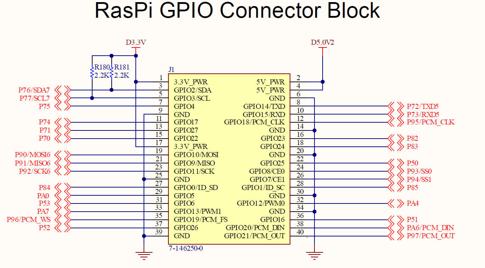

# RZ/V2H Pin Ownership Matrix

**Date:** 2026-10-11
**Status:** Profile-specific software mapping; extension target validation pending
**Reference software source:** [selected RDK configuration](../../refs/rzv2h_drone_px4-dev/configuration.xml), [reference hardware guide](../../refs/rzv2h_drone_px4-dev/docs/HARDWARE.md)

Use the selected profile's source, not a single universal sensor assignment.
Software changes, host checks and builds can proceed from the reference XML and
board sources. Generated FSP output, fitted-board identification and electrical
measurements remain target-validation tasks; see [reference sources](./reference-source-map.md).

## Sensor Wiring Profiles

| Connection | Existing native bench/default | Opt-in `drone` extension |
|---|---|---|
| SPI0 P90/P91/P92 | MOSI/MISO/SCK, single MPU9250 or ICM20948 | Shared MOSI/MISO/SCK, three ICM-45686 |
| P93 | Single sensor CS; GPIO or hardware SSLA0 by configuration | IMU #1 CS (reference SSLA0) |
| P94 | DRDY/TINT for MPU9250/GY912/simple, or exclusive button demo | IMU #2 CS (reference SSLA1); no DRDY |
| P95 | No sensor ownership in existing bench profile | IMU #3 CS (reference SSLA2); no DRDY |
| SCI7 P76/P77 | BMP280 at 0x76 or standalone BMM150 at configured address | BMM150 0x10, BMP390L via `bmp388` 0x77, INA228 0x45 |

The `drone` profile selects default-off
`CONFIG_RZV2H_DRONE_SENSOR_EXTENSION`. Its native GPIO CS dispatch uses the
three actual PX4 descriptor IDs; unknown IDs deassert all CS lines, and startup
does not configure P94 as DRDY. Host routing/startup tests and the firmware
build pass; physical qualification remains open. Legacy profiles retain their
existing pin policies. Reference
`-c 1/2/3` values are logical SSL indices, not native GPIO pin selectors;
use native SPI descriptors/CLI semantics. Native polling does not require the
reference's `-P` option. Keep P94 DRDY/button images exclusive with extension
CS1 wiring.

### Physical Header Drawing



This retained RDK connector drawing maps SoC pads to header positions, not
sensors or firmware profiles. It labels P93 at pin 24, P94 at pin 26 and P95
at pin 12; P76/P77 at pins 3/5. Its Raspberry Pi alternate-function labels
(for example PCM_CLK on P95) do not override selected RZ/V2H pinmux. Verify
extension-board nets and populated revision separately before target use.

## Serial Policy

The RDK-RZV2H board does not use SCI3 as an active console. Current and target
serial roles are split by mode:

- Standalone CR8-0 NuttX: SCI4 shell + RTT diagnostics.
- Standalone CR8-1 target: SCI5 shell + RTT diagnostics, not yet hardware validated.
- Standalone CM33 target: SCI9 shell + RTT diagnostics, not yet hardware validated.
- Integrated PX4 CR8-0: RTT0 console/debug, SCI4 LiDAR, SCI5 MAVLink/QGroundControl, SCI6 RC, SCI9 GPS.

---

## Pin Numbering Convention

**Format:** `P<port><bit>` where:
- `<port>` = 0–11; hexadecimal-style aliases use `PA` and `PB` for ports 10
  and 11
- `<bit>` = 0–7 (bit position within port)

**Example:** P70 = Port 7, bit 0

**Current lower-half total:** 86 bonded pins across P0-PB, plus multiplexed
special-function selections.

---

## Active Pin Assignments (RDK-RZV2H)

Subset of pins actively used by PX4 + NuttX drivers:

| Pin | Port.Bit | Alt-Func | Peripheral | Mode | Pull | Drive | Owner File | FSP Ref |
|-----|----------|----------|-----------|------|------|-------|------------|---------|
| **P50** | 5.0 | Profile-dependent | No native sensor DRDY owner | — | — | — | board.h | Reference SPI table retires INT1; comments reserve pad for debug UART |
| **P52** | 5.2 | Profile-dependent | Safety candidate not established | — | — | — | board safety (planned) | Selected reference XML uses RSCI1 TX; do not infer safety input from old labels |
| **P53** | 5.3 | AF=11 | GPT10B (PWM4) | Output | None | B01 | rzv_gpt.c | PWM |
| **P70** | 7.0 | AF=1 | RSCI4 TXD | Output | None | B01 | rzv_serial.c | TFmini TX |
| **P71** | 7.1 | AF=1 | RSCI4 RXD | Input | None | B01 | rzv_serial.c | TFmini RX |
| **P72** | 7.2 | AF=1 | RSCI5 TXD | Output | None | B01 | rzv_serial.c | Telemetry TX |
| **P73** | 7.3 | AF=1 | RSCI5 RXD | Input | None | B01 | rzv_serial.c | Telemetry RX |
| **P75** | 7.5 | AF=1 | RSCI6 RXD | Input | Noise-filter | B01 | rzv_serial.c | RC RX |
| **P76** | 7.6 | AF=1 | RSCI7 SDA (I2C) | Bidirectional | External pull-up; noise filter on | B01 | rzv_sci_i2c.c | Header Pin 3; sensors selected by profile above |
| **P77** | 7.7 | AF=1 | RSCI7 SCL (I2C) | Bidirectional | External pull-up; noise filter on | B01 | rzv_sci_i2c.c | Header Pin 5; sensors selected by profile above |
| **P82** | 8.2 | AF=6 | RSCI9 TXD | Output | None | B01 | rzv_serial.c | GPS TX; CAN2 CTX1 (AF=5) when `CONFIG_RZV_CANFD1` (exclusive with SCI9) |
| **P83** | 8.3 | AF=6 | RSCI9 RXD | Input | None | B01 | rzv_serial.c | GPS RX; CAN2 CRX1 (AF=5) when `CONFIG_RZV_CANFD1` (exclusive with SCI9) |
| **P90** | 9.0 | AF=1 | RSPI0 MOSI | Output | None | B11 | rzv_spi.c | Shared sensor bus |
| **P91** | 9.1 | AF=1 | RSPI0 MISO | Input | None | B11 | rzv_spi.c | Shared sensor bus |
| **P92** | 9.2 | AF=1 | RSPI0 SCK | Output | None | B11 | rzv_spi.c | Shared sensor bus |
| **P93** | 9.3 | GPIO or SSLA0 mode 1 | SPI0 CS | Output, initially high | None | B11 | rzv2h_spi.c / PX4 SPI table | `CONFIG_RZV2H_SPI0_HARDWARE_SSL` selects hardware SSL in compatible samples |
| **P94** | 9.4 | Profile-dependent | DRDY/button or extension CS1 | Input or output by profile | Profile-dependent | B11 | board GPIO/SPI table | Mutually exclusive roles; selected reference XML uses SSLA1 |
| **P95** | 9.5 | Profile-dependent | Extension CS2 | Output in extension profile | None | B11 | opt-in board SPI table | Selected reference XML uses SSLA2; inactive IMDT P36 does not apply |
| **P96** | 9.6 | AF=9 | GPT9A (PWM3) | Output | None | B01 | rzv_gpt.c | PWM |
| **P97** | 9.7 | GPIO | GPS buzzer | Output low | None | B01 | board GPIO (planned) | GPS buzzer |
| **PA4 / P10_04** | A.4 | AF=11 | GPT6A (PWM1) | Output | None | B01 | rzv_gpt.c | PWM |
| **PA6 / P10_06** | A.6 | GPIO | Safety LED | Output low | None | B01 | board GPIO (planned) | GPS safety LED |
| **PA7 / P10_07** | A.7 | AF=11 | GPT7B (PWM2) | Output | None | B01 | rzv_gpt.c | PWM |

---

## Pin Ownership by Peripheral

### UART / Serial Communication

| SCI Channel | Pin TX | Pin RX | Pin Flow | Device | Function |
|-------------|--------|--------|----------|--------|----------|
| RSCI4 | P70 | P71 | None | TFminiPlus | LiDAR rangefinder (/dev/ttyS4) |
| RSCI5 | P72 | P73 | None | Sik Telemetry | MAVLink / QGroundControl (/dev/ttyS5) |
| RSCI6 | — | P75 | None | fs-a8s | RC input (`/dev/ttyS6`, 100000 8E2; inversion path requires target proof) |
| RSCI9 | P82 | P83 | None | u-blox M10 | GPS (`/dev/ttyS9`, 115200 8N1) |

**Limitations:** No hardware flow control (RTS/CTS) currently implemented.
Reference startup selects telemetry 115200; native default and reference hardware
guide use 57600. Configure the fitted radio explicitly without changing working
profiles. GPS remains 115200 8N1; SBUS requires the external inverter.

### SPI Bus (RSPI0)

| Pin | Function | Device | Signal |
|-----|----------|--------|--------|
| P90 | MOSI | Selected IMU profile | Data out |
| P91 | MISO | Selected IMU profile | Data in |
| P92 | SCK | Selected IMU profile | Clock |
| P93 | GPIO CS (SSLA0-capable) | Single native sensor / extension IMU #1 | Active-low chip select |
| P94 | GPIO / TINT or CS1 | Native DRDY/button / extension IMU #2 | Exclusive profile roles |
| P95 | CS2 (planned native profile) | Extension IMU #3 | Reference SSLA2 |

**Speed:** Driver default 1 MHz; target ceiling unverified.
**Transfer backend:** PIO and opt-in SPI0 DMA exist in the native lower half.
Read the selected defconfig and [SPI source](../../platforms/nuttx/NuttX/nuttx/arch/arm/src/rzv/rzv_spi.c)
for current channel allocation; neither host checks nor a build prove external
DMA transfers or CS waveforms. New multi-CS routing starts with PIO.

### I2C Bus (RSCI7 SCI-mode I2C)

| Pin | Function | Device | Signal |
|-----|----------|--------|--------|
| P76 | SDA | Sensors selected by profile | Data (40-pin header Pin 3) |
| P77 | SCL | Sensors selected by profile | Clock (40-pin header Pin 5) |

**Address:** Legacy BMP280 0x76; BMM150 sample defaults to 0x10 with address
configuration. Planned extension addresses are in the profile table above;
reference runtime `rcS` selects BMP390L 0x77 despite a legacy 0x76 board macro.
**Speed:** 100 kHz (BMP280 HIL); 400 kHz default for the BMM150 sample. Neither validated on target.
**Module power:** Pin 1 3V3, Pin 6 GND. See [bmm150-i2c-validation.md](./bmm150-i2c-validation.md).
**DMA:** Disabled (PIO mode).

### PWM / GPT Outputs (ESC Control)

| GPIO / AF | GPT Timer | Output | Function | Pin |
|-----------|-----------|--------|----------|-----|
| PA4 | GPT6A | PWM1 | Motor 1 (front-right) | PA4 |
| PA7 | GPT7B | PWM2 | Motor 2 (rear-left) | PA7 |
| P96 | GPT9A | PWM3 | Motor 3 (front-left) | P96 |
| P53 | GPT10B | PWM4 | Motor 4 (rear-right) | P53 |

**Frequency:** Configurable (typically 400 Hz for ESC).
**Duty Cycle:** 1000–2000 µs (1–2 ms pulse width).
**Source:** [rzv_gpt.c](../../platforms/nuttx/NuttX/nuttx/arch/arm/src/rzv/rzv_gpt.c), [timer_config.cpp](../../boards/renesas/rdk-rzv2h/src/timer_config.cpp)

### GPIO / Interrupts

| Pin | Function | Source | Active Config |
|-----|----------|--------|----------------|
| P94 | GPIO / TINT or CS1 | Profile-dependent | Native IMU INT/button versus planned extension CS1 |
| P52 | No ratified GPIO input | Safety switch candidate | Reference active XML is RSCI1 TX; generated symbol and routing need verification |
| P97 | GPIO output low | GPS buzzer candidate | FSP reference config; PX4 consumption pending |
| PA6 / P10_06 | GPIO output low | Safety LED candidate | FSP reference config; PX4 consumption pending |

**Pull-ups/Pull-downs:** P76/P77 require external I2C pull-ups; confirm the populated board value before timing validation.

---

## Additional Ownership

Do not infer availability from absence in the sensor table. Check bonded-pad
definitions, selected native board configuration, reference XML and any CA55
device tree before adding an owner. Reference SPI comments retire the former
P50/PA0/P74 DRDY pads and identify debug-UART/SDHI uses; they are not spare
interrupt inputs. P80/P81 are CANFD CH0 in standalone CAN configs; P82/P83 are
exclusive SCI9 GPS or CANFD CH1 selections.

---

## Cross-Check Recipe

**Verify source-backed ownership contracts:**

```bash
python3 test/rzv2h_board_gpio_contract_test.py

rg -n 'pincfg|active="true"|selected="true"' \
  refs/rzv2h_drone_px4-dev/configuration.xml

rg -n "P50|P52|P53|P70|P71|P72|P73|P75|P76|P77|P82|P83|P90|P91|P92|P93|P94|P96|P97|PA4|PA6|PA7" \
  boards/renesas/rdk-rzv2h \
  platforms/nuttx/NuttX/nuttx/boards/arm/rzv/rdk-rzv2h
```

Defconfigs select peripheral instances, not a complete pin list, so a
defconfig-only pin diff is not authoritative. The contract test checks the
board-owned GPIO invariants; source scans support human reconciliation. Read
only the XML's selected `RDK` set rather than merging inactive profiles.
None proves drive strength, signal integrity, connector routing, or board
population.

**Validate against board_config.h:**

```bash
grep -E "PX4_UART_|GPIO|SPI|I2C" \
  boards/renesas/rdk-rzv2h/src/board_config.h \
  | grep -oE "P[0-9A-F][0-9]"
```

---

## Related Files

- **Hardware Guide:** [hardware.md](./hardware.md)
- **Board Config (PX4):** [../../boards/renesas/rdk-rzv2h/src/board_config.h](../../boards/renesas/rdk-rzv2h/src/board_config.h)
- **NuttX Pin Map Header:** [../../platforms/nuttx/NuttX/nuttx/arch/arm/src/rzv/hardware/rzv_pinmap.h](../../platforms/nuttx/NuttX/nuttx/arch/arm/src/rzv/hardware/rzv_pinmap.h)
- **GPIO Driver:** [../../platforms/nuttx/NuttX/nuttx/arch/arm/src/rzv/rzv_gpio.c](../../platforms/nuttx/NuttX/nuttx/arch/arm/src/rzv/rzv_gpio.c)
- **Reference SPI descriptors:** [reference spi.cpp](../../refs/rzv2h_drone_px4-dev/px4/boards/renesas/rzv/src/hal/spi.cpp)
- **Reference startup:** [reference rcS](../../refs/rzv2h_drone_px4-dev/px4/boards/renesas/rzv/init/rcS)

---

## Maintenance Notes

- **Per-PR Rule:** Update this table when adding new peripheral drivers or changing pin assignments.
- **Verification:** Run the cross-check recipe whenever pin or peripheral
  ownership changes.
- **If >800 LOC:** Split into `pinmap-uart.md`, `pinmap-spi-i2c.md`, `pinmap-pwm.md` in `peripherals/` directory.
- **Conflicts:** Reserved pins are marked with owner file; confirm in Kconfig before reassignment.

---

## Remaining Target Validation

1. No internal pull-up/pull-down contract is established in `rzv_gpio.c`; SCI7 I2C requires board-level external pull-ups.
2. SPI0 DMA is opt-in; fitted-sensor transfers and electrical timing require exact-image evidence.
3. UART flow control (RTS/CTS) not wired.
4. Secondary SPI/I2C buses not active; only RSPI0, RSCI7 in use.
5. Multiplexed pins (e.g., P50 as GPIO vs. TINT) require Kconfig guards; conflicts possible in dynamic reconfiguration.
6. Safety/button, P97 buzzer and PA6 LED ownership need generated-symbol and
   electrical confirmation. Active XML does not establish P52 as a safety input.

---

## Next Steps

- Proceed with configurable extension software integration and sample regression
  checks; obtain schematic/electrical evidence for target qualification.
- Add peripheral-specific CAN-FD and SDHI pin tables only when those optional
  paths enter hardware bring-up.
