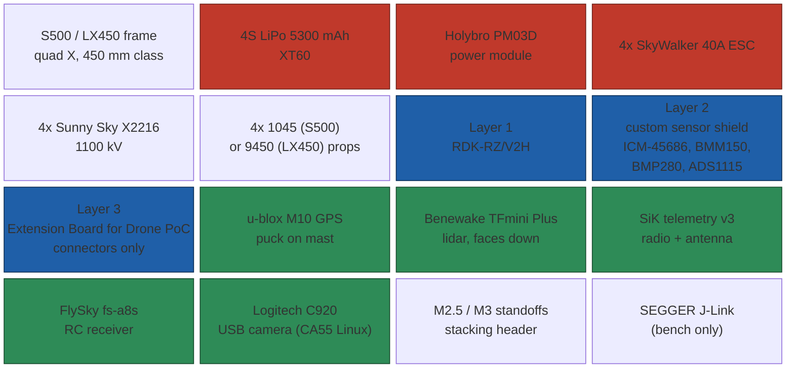
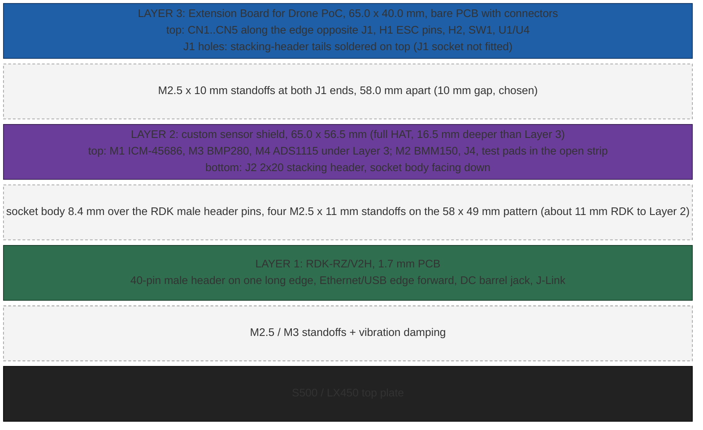
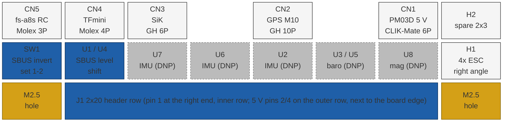
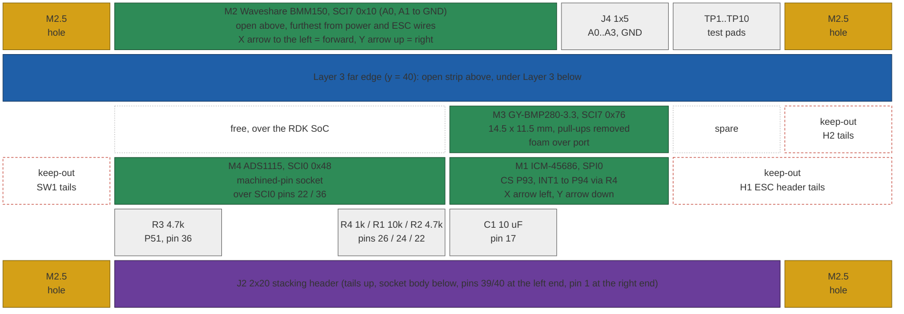
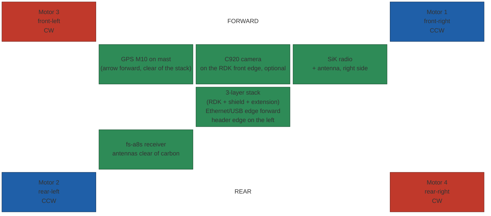
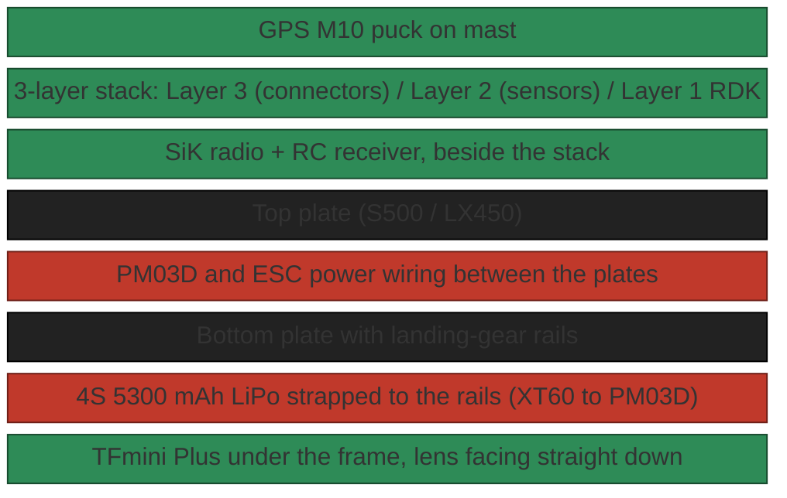
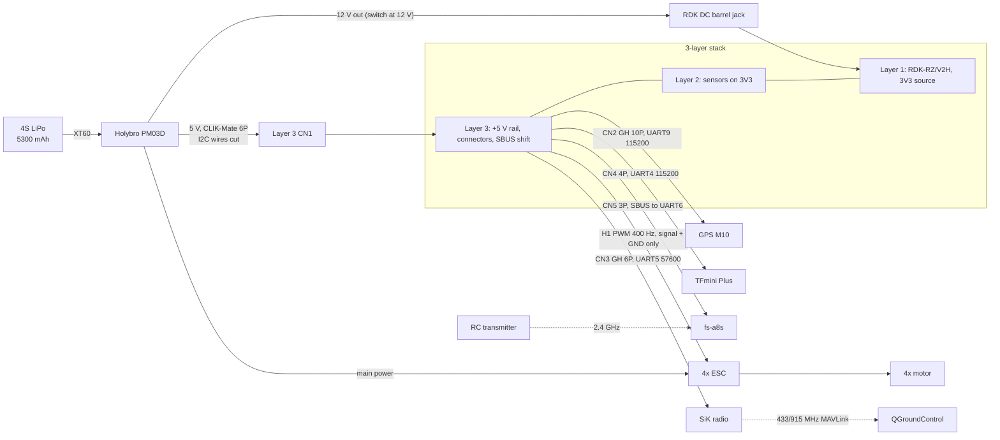
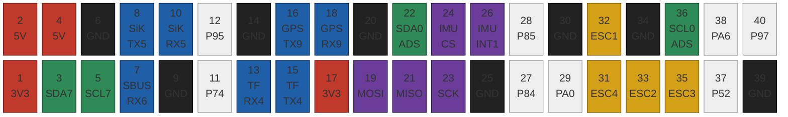

# RDK-RZ/V2H Drone Demo: Block Diagrams for 3D Renders

**Date:** 2026-11-23
**Build it describes:** [3-layer drone demo board](./rzv2h-rdk-drone-demo-board.md) on an S500/LX450 quad
**Sources:**
- `refs/rzv2h_drone_px4-dev/docs/` HARDWARE.md and the photos in `assets/`.
- Component placement from the PoC PCB `Extension board for drone_20260713.PcbDoc`.

Each section below describes one image:
- a Mermaid block diagram for layout and topology;
- a **render brief** with the 3D facts (sizes, heights, camera, materials) that Mermaid cannot express.

**To render:**
- Paste one section (diagram + brief) into a 3D or image-generation tool.
- Or render the diagrams to SVG and use them as layout references:
  `mmdc -i docs/renesas/rzv2h-rdk-drone-demo-3d-render-diagrams.md -o /tmp/drone-diagrams.md`.

**Conventions:**
- Every top view is seen from above, with vehicle **forward = up**.
- Sizes marked *measured* come from the PoC PCB file.
- Sizes marked *assumed* are typical values to confirm on the real parts.
- Colours marked *render choice* are only there to tell parts apart.

## 1. Kit overview (all parts, exploded flat lay)

Same idea as `assets/drone_components.png`, updated for this stack.

**Render brief:**
- Isometric flat lay on a green cutting mat, as in the reference photos.
- Soft studio light, every part labelled.
- The three boards sit side by side and also appear assembled as one stack in the corner.

## 2. Layer stack, exploded side view

**Render brief:**
- Exploded vertical stack, 3/4 view from the front-left, gaps exaggerated about 3x.
- **Board outlines:**
  - Layer 3 is 65.0 x 40.0 mm (*measured*), with two Ø2.75 mm holes on the header row centreline, 3.5 mm from each short edge.
  - Layer 2 is 65.0 x 56.5 mm (full Raspberry Pi HAT, *design choice*). It shares the Layer 3 header-edge holes and adds two more 49 mm further on (*estimated* from the RDK manual photo), so it stands on four standoffs.
  - Layer 2 sticks out 16.5 mm past the Layer 3 far edge. The M2 compass, J4 and the test pads sit on that open strip.
- **Header:** the 2x20 2.54 mm header lies along one long edge, centred, 3.8 mm in from that edge.
- **Heights:**
  - RDK PCB 1.7 mm (*from the RDK schematic, p. 1*). Layer 2 and Layer 3 PCBs 1.6 mm (*assumed*).
  - J2 socket body 8.4 mm (*measured*, M20-7812045 class). RDK top to Layer 2 bottom about 11 mm (*estimated*; spec §4.4.4).
  - Layer 2 to Layer 3 gap 10 mm (*chosen*, spec §4.4.4), which needs a stacking header with ≥14.7 mm of tail.
- **Header pins:** draw one continuous row of 40 gold pins running from the RDK header, through the Layer 2 socket, up through Layer 3.
- **PCB colours:** blue for Layer 3 (as photographed); purple for Layer 2 and green for the RDK (*render choice*).
- **Alternative B:** Layer 3 with its J1 socket fitted on its bottom, plugged onto the Layer 2 tails.
- **Reference photo:** `assets/real_drone_top1.png` shows the PoC fitted with J1 under the board, plugged straight onto the RDK with brass standoffs at both header ends.

## 3. Layer 3 top view (PoC PCB placement)

Placement is rotated 180° from the PCB file so it matches the photo
`assets/real_drone_top1.png`: connectors along the upper edge, J1 along
the lower edge. On the vehicle, the J1 edge lies along the left side (spec §4.4.1). Parts in grey are footprints left empty in this stack.

**Render brief:**
- Straight-down top view of a blue 65.0 x 40.0 mm PCB with white silkscreen "Extension Board for Drone PoC".
- **Upper edge, left to right:** white CN5 (3P), CN4 (4P), CN3 (6P), CN2 (10P), CN1 (6P, the largest).
- **H1:** four 3-pin right-angle headers pointing off the right edge.
- **H2:** the 2x3 header in the upper-right corner.
- **SW1:** slide switch at the left edge.
- **Sensor pads:** the U2/U6/U7 IMU, U3/U5 baro and U8 mag pads are empty.
- **J1 area:** 40 gold pin tails in a row near the lower edge.
- **Mounting:** brass M2.5 standoffs in the two holes at the J1 ends.

## 4. Layer 2 top view (custom sensor shield, proposed placement)

No PCB exists yet, so this is the proposed placement. Fixed facts: board outline,
J2 row and header-edge holes (copied from Layer 3), the Layer 3 keep-outs and all
the nets. The zone coordinates are in spec §4.4.2. Each column is about 8 mm wide,
the far edge (y = 56.5) is at the top and the header edge at the bottom. The
top row is the open strip past the Layer 3 edge (y = 40).

**Render brief:**
- Top view of a 65.0 x 56.5 mm PCB (purple, *render choice*), with the header row along the bottom edge and pin 1 at the right end. Four M2.5 holes, one in each corner.
- **Layer 3 shadow:** draw the Layer 3 outline (65 x 40 mm, from the bottom edge) as a translucent blue overlay, so the open strip at the top stands out.
- **Open strip (top 16.5 mm):** the 29 x 20 mm Waveshare BMM150 module at the left, fixed by its header row and two nylon screws at its forward corners; a straight 1x5 J4 header and a block of test pads at the right.
- **Under Layer 3:** M4, a larger ADS1115 breakout in a round-pin socket at the left; M1 ICM-45686 in the middle, just above the SPI pins; M3, a small purple GY-BMP280-3.3 (14.5 x 11.5 mm) above M1, its pin row on the J2 side.
- **Axis arrows:** M1 and M2 X arrows both point left (toward pins 39/40, vehicle forward). The M1 Y arrow points down (toward J2); the M2 Y arrow points up (away from J2).
- **Keep-outs:** leave bare board under the Layer 3 H1, H2 and SW1 tails (right side and left edge), drawn as dashed red outlines if shown.
- **Heights:** modules about 5 mm, M4 about 8.5 mm, all below the 10 mm Layer 2 to Layer 3 gap. M2 sits in the open strip, so its height is free.
- **Wiring:** short wires from the header row to each module; the I2C7 pair runs from pins 3/5 past M3 up to the M2 header row.

## 5. Airframe top view (placement on the quad)

PX4 quad X motor numbering and spin directions, as in HARDWARE.md.

**Render brief:**
- 3/4 aerial view of a black S500 quad X frame, about 450 mm motor to motor, with red arm wiring.
- **Props:** show the direction arrows: motors 1 and 2 CCW, motors 3 and 4 CW.
- **Centre:** the stack sits on the top plate. The RDK Ethernet/USB edge faces forward, so the long 40-pin header edge runs front to back along the vehicle's left side, and the Layer 3 connectors face the right side (spec §4.4.1).
- **GPS:** puck on a carbon mast, with an arrow pointing forward.
- **SiK radio:** box with a black antenna on one side.
- **Receiver:** the small fs-a8s, with its antenna leads routed outward.
- **ESC leads:** the four ESC signal leads run from the arms to the H1 pins on the stack.
- **Reference photos:** `assets/real_drone_top.png` and `assets/real_drone_top1.png`.

## 6. Airframe side view (vertical layout)

**Render brief:**
- Side elevation from the right, at eye level with the frame.
- **Battery:** it hangs below on velcro straps, as in `assets/real_drone_side2.png` (the older ribbon-cabled build).
- **Upper stack:** the three-board stack and GPS mast replace that build's ribbon and perfboard.
- **TFmini:** must have a clear view down, not blocked by the battery or landing gear.

## 7. Power and signal harness

**Render brief:**
- A cable-harness illustration in which wire colours follow the power class:
  - red/black for battery and 12 V;
  - red/black thin for 5 V;
  - yellow/green/white for signals.
- Draw the ESC servo leads with the red BEC wire left unconnected.

## 8. 40-pin header map (for a close-up render)

Odd pins are the inner row; even pins are the board-edge row. Header geometry follows [rzv2h-rdk-40_pin_header_pin.png](./rzv2h-rdk-40_pin_header_pin.png).

**Render brief:**
- Macro close-up of the 2x20 2.54 mm header, colour-coded as above:
  - power red, GND black, SPI purple, I2C green, UART blue, PWM gold, unused grey.
- **Labels:** UART names are from the RDK side (TX5 = RDK transmit).
- **Orientation:** pin 1 square pad; viewed from above, the inner row runs 1 to 39 from left to right.
- Mirror the image when you need to match the photo orientation of §3.
